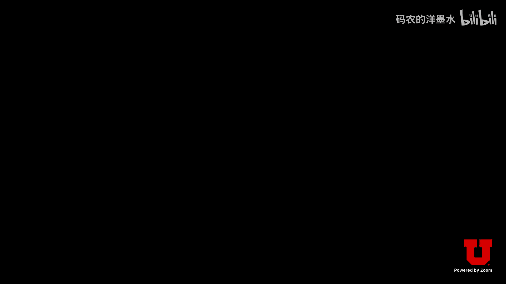
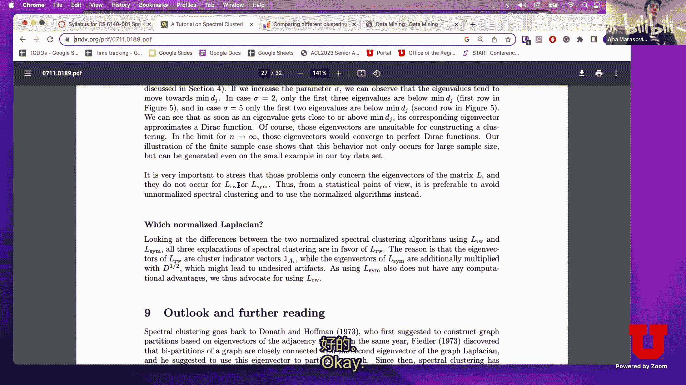

# 犹他大学-CS6140-数据挖掘-中英字幕-1080P-p10-Lecture-10---谱聚类--BV1j1mLB9EAB_p10-

嗯。没。在我是。So。Okay， good afternoon everyone， let's get started， please get seat。

We don't have any special announcements today， so I just want to take a few maybe a minute to go over the upcoming deadlines the first one is this Wednesday。

 which is our data collection approach。Component of the project where you need to tell us a little bit more information。

 more concrete information about the data you are collecting or you have already collected。

 some of you who are already taking an existing data set like if you're working on a KeL task we had asked you to also give us more information about approaches。

 you're going to take given that usually these are group of three。

 you already have the data you're kind of ready to give us more concrete information about how that data could be used。

嗯。All right， after that next Wednesday is a due date for the fourth homework clustering and then we are kind of approaching our midterm exam and I will assume provide more information about what to expect there and so on。

Any questions about the upcoming deadlines？Y， please go ahead we have only this midterm and final exam。

 yeah that's correct。Yep， the Wednesday before true。有。Okay。

 and it's going to be on person and on paper， we have mentioned that before。

 but maybe I will say it again and then we'll come back to the details of the exam next time。

All right next time on on Monday soon Okay if there are no more questions then we can proceed with more clustering so this is the third lecture in our series of lectures and clustering and this is going to be the final one and I know I have introduced two categories of clustering one is a gl narrativeative the other one is assignment based clustering but this one won really fall in either of these two categories if you need to give it the name you can call it topdown clustering because we are starting with one big cluster and then we are dissecting in two smaller clusters kind of opposite from the hierarchical clustering where we started with very small clusters and then we combine them so you can think about this one as a topdown。

All right， and this type of clusterster has emerged from graph theory and we are going to kind of think about our data as being represented by a graph。

And then the main idea of clustering of data which is represented as a graph is to find a partition of this graph where in each group you have edges many edges and between groups in this partition you have a little edges so just to kind of illustrate how this could look like it could be so like this aBCDE。

FGH。And let's say here we have lots of connections between these nodes and also connection between these nodes。

 but then we have only these two connections between these other nodes and one partition of these graph into two set of vertices will be to cut it over here and then we would have two subgroups of vertices and each one of them would be densely connected while cross groups we would have a little connections。

So that's kind of the main idea of how to think about clustering with data that we represent with graphs。

Now you all probably have heard about graphs in some setup already。

 but we are going to go over all of the definitions we need for going over clustering specifically this type of clustering called spectrum clustering so we are going to bring a lot of definitions then we are going to introduce some special mattresses that will help us with going about these algorithm and then only by the end we are going to actually construct the entire algorithm so this is one of those lectures where we bring a lot of tools in the game and then in the end we combine them all into what we need for the actual algorithm。

All right， so let's start with some definitions。So we are going to talk about graphs。And。

Some important definitions related to graphs。So first of all， graph， excuse me。

 I'll try to not blow into this method。So。For most。

 graph is an abstract data structure that is usually defined by its set of vertices and edges。

So we here is going to be set of vertices。Yes。And he is going to be set of edges。嗯。All right。

And we can maybe define them a little bit more， you say there are V1， two， VN of them。And。E12 E。

Edges and each one of these edges can also be represented as a set of two vertices it is kind of putting together two vertices it is connecting some VL and VK here。

And I have used setnotation here because for us it' is going to be more important to talk about so called and directeded graph。

And this is basically graphs where if two vertices are connected。

 there is no direction of this connection， so separate from undirected graphs or directed graphs。

And I don't think it's easier to illustrate them， so here you might have something like a node being Paris。

And you might have a note that's France。And you might have relation directed relation is city which says Paris is a city in France。

 but other way around doesn't work because France is not a Paris city in Paris so this would be an example of kind of directed edge and this is not what we are going to work with we are going to work with this undirected graph。

O。So let's introduce one example。Let's say we have Bha's。ABCD。EFGH。And edges。Maybebe。Hey see。A啲。Bm。

C啲。C。EF。F。有。He， Jim。FG。And FH。All right， so。The most common way to represent the graph is to actually illustrate it to draw these vertices and to put edges that connect them so let me see where should I put that I'm going to delete this example of Paris and France just because I want to use this space。

And right it here。Okay。All right， so this way to go about illustrating this graph is to draw a picture so we could have a is connected to B and a is connected to C。

 a is also connected to D。Then we have that B is connected to D， that C is connected to D。

 and that C is connected to E， E is connected to F， is connected to G。

F is also connected to G and then we have F being connected to H。All right。

 that's how we can illustrate that graph and kind of here we have an example where we do have that two separate subsets of vertices and that are kind of connected with only one edge。

However， this is not something we can really work with when we implement things。

 so what we are going to use instead is so called adja metrics。

This is going to be n times n size metrics where n is the number of vertices you can think about it。

As each row corresponding to one of these vertices， so ABC D FG。

 and also each column is corresponding to vertices， ABCD， oh no， doesn't fit。The E FGH。And then A B。

 C， D E F G H Okay， and we are going to put one and zeros into metrics where one will say that okay。

 these two vertices are connected by NH so we have AB being connected so we have one here but because we are working with undirected graph。

 then B will be connected to a so these matrix will besymmetric。

Then we have AC and then again C A will be connected A D， again D A will be connected B D， so here B。

 and then we have D， which means that DB is going to be connected C。

 so here which means that D is also going to be connected。C， E。And also EC。E F。And FE。E G and G， E。

FG。NGF。And FH。Which means that also H F is connected and everywhere else we are going to have zeros because there is no edge that connects these two vertices。

Yeah。So we have lots of zeros。是。This one is a little bit misalign。退出。

And the lots of zeros in the last row since age is not connected with almost any of the viruses。Okay。

 so this kind of matrix is called adjacentsymmetric metrics and this is how we are going to represent our graph when we have undirected graphs。

 this metric is going to be symmetric and symmetric metricses have nice properties。嗯。

I don't think they need to be by default I think you can have an undirected graph without having the loop with vertex with itself so yeah this is fine and we will not introduce those those like。

Elements on the Dianaagonal being one。All right。This is the simplest kind of representation of a graph we can also introduce a weight to edges so we can have our graph being weighted。

Which means that。That every every edge。Will carry some。Wait。

And we are going to denote that weight as w between L and k。

 and it's going to be non negative for our purposes。When。Weight equals to0， that means that。

These two notes， excuse me。Use the wrong subs。If WLK equals to zero。

 that means that div veres VL and VK are not connected， so there is no path between them。

In this case， no edge between them。Okay， and then we can introduce the concept of weighted。

Adjacency metrics。Where instead of using zeros and1。

 we are going to use the W metrics where we put instead of zeros and ones。

 this values WIJ at each point of this matrix。Yeah。

Another thing we need is so called degree of atics。

which we are going to write as DI to make our notation shorter。

 and that's going to be a sum of all the weights of edges that go outside of this vertex VI。

So we have vertex V and it is connected to some。Some other vertices we are going to sum the weights of those vertices and here it might be slightly confusing that this summation goes all the way to M。

 but this is just because the weight with those vertices that VI is not connected to is going to be zero so effectively you are not considering them it's just an easier notation。

So once we have degree， we need degree metrics。Which is going to be a diagonal matrix where。

On each point of the our diagonal， we are going to put the degree of the corresponding vertex。

 so it's going to be diagonal of D1。To the end。Which is nicely illustrated like this。

And this is going to be one of those important mattresses we need for doing spec clusterstering。嗯。

Yeah order that a matrix we're not using a center to that economic matrix。Sorry， second。

 can we store the debris matrix and the two make have the same structure？

To save space since we're not using that I need agency matrix。I guess so。

 but you can represent the diagonal just be that vector so I don't think you are by combining them you are saving much so yeah I think in actual implementation you would not do that。

But again， you can try， you always have nice ideas that you know， why not？

Probably when you start doing some operation with these mattress。

 it becomes more complicated to combine them。Yes。All right。

 what else we need we are going to need the concept of the kind of like weight between these subsets of vertices A and B。

 so that's going to be the sum of and now I'm going to introduce notation I element of a means V the vertex VI is element of a just going to use I and J instead of V and Vj to make it similarr okay so。

I'm going to write here hence。Bye。We要呀。Okay， so we have I element vertex I element A and J element B。

 and then we are going to sum the weights between them。We are also going to need the concept of size。

Of a， which is some subset of vertices vertices V and we are going to have two options。

 one is to just take the cardinality of a so how many vertices are included in a。Very simple。

And the other one is known as the volume of a。And that's going to be the sum of all the degrees of vertices that are in a。

These two things are going to become important when we start again going into the details of the spectral clustering。

Yeah， degrees are over here。So it's the sum of all the weights between vertex i and all the other vertexes it is connected to so here you see this picture。

If we imagine only two vertices， you would adjust sum the of these two edges。

If we didn't introduce the weights of the edges， we were just someone。Yes。Okay。

I'm thinking whether we need all of this。All right。

 so let's also define what is a partition because I did say that that's our ultimate goal。

 so let's make that a little bit formalal so a set of subset of vertices a one to aK such that none of them are empty sets。

嗯。Okay，ita form a partition。Of the graph。If two things are satisfied and that's。

One that all of them are disjoint。And that in their union。

 they are giving us the entire set of vertices we。Okay。

 we might need a concept of a subset of vertices being connected and connected components。

 but that will come back to that if we need it just one more thing I want to introduce the complement of a subset of vertices a is everything that's in our set of vertices that's not in a。

是。Okay so we have now introduced some of the definitions we are going to need for this algorithm。

 we are not going to go straight into the algorithm yet。

 I want to give you a kind of intuition for why spectral clustering is related to this problem of approximating the partition theition problem。

Im going to write this down， so Spect clustering is a kind of approximation of that。嗯。

Partition problem where partition problem is referring to partitioning of the graph。All right。

Let's say we have chosen the number k that's a number of subsets。

 so see here I have defined that a1 to aK which are each one of these AIs is a subset of vertices。

 so we are now setting some number of subsets k on our own like we did choose k when we were talking about k means。

And the simplest way to construct a partition of the graph is to solve so called min count problem。

Yeah。Which is finding the partition， so subsets a1 to aK。Sat that we minimize that cut。Even by a1 ak。

And cut is defined。As。Ignore this for a second as the sum of one。

2K so the number of subsets and we are going to take that weight between a and its complement。

So just going back once or two slides ago， we have a defined。The weight between two。

Subset of vertices A and B as the sum of weights between vertices that are in a and vertices that are in B if we go back maybe two。

This example here。If we say， let's say。This is maybe A。And this is B， then we have only one。

One connection between the vertices that are in A and B， that's the one which is right here。

 so the way between A and B would just be the way that's on this edge。是。O。

It's only worth with spars cut。Yes。I wouldn't call these graphs spae because they can have their own like dense regions。

 but it works for graphs that have something like communities， let's call it yeah。

If everything was connected， it doesn't work for。I'm not sure that direction would become a problem。

 I think it's going to be you can have a version of this with a direction。

 but maybe I can go to something I wanted to show from before。Later on， actually， excuse me。

 just a moment， I'm trying to escape this。Okay。All right so I wanted to show this a little bit later on。

 but basically here in EcalLn second learnarn you can find illustrations of how different clustering algorithms with cluster different toy data so now which are kind of hinting on here at least for me is this situation we have different points very very dense and now if we represent our kind of input metrics not as an in matrix but rather like this weighted metrics where weight is the distance between each point we would get something that's very like densely connected in a graph and you can see here we have second cluster we get like reallys which is not really what we wanted so here for example cluster。

Also comes from the fact that we need to define the number of。

Subsetss or number similar to number of K and Kmeese。

There is a question of how would you have introduced k equal being one here。

 but then what's the point like if you're doing clustering。

 you would never say K equals to one because that just means that you didn't cluster anything in your life。

mSo。Yeah， I think you are onto something when you say， okay， maybe the density affects things。

 but I'm not 100%， but I think direction doesn't really affect things。

 but here at least in the examples I had in mind for this。

 it's undirected graphs are what you need basically。But yeah。

 I'll have that question in mind and maybe see whether something would break later on。Yeah。

因为我觉个你发个就事。You didn't get what's written here so Bar I'm here will so this says we are going to find the partition partition is defined by the subsets of vertices a12 ak。

 such that we are minimizing cut given by that partition and cut itself is defined with this formula。

 which is some of all the weights between the vertices that are in a and everything that's outside of a。

Here we have also one over two just because we are working with undirected graphs so basically this summ will give us will count ages twice。

 so we're having one over two to count for that。对个O。你今天是这。你。Sorry。嗯。😊，Yes。

Now I'm wondering whether you are seeing a problem for this because there is a trivial solution to this problem that we want to avoid。

All those。I don't want to put transport， but maybe I can say that so the problem with excuse me。

 I'm in this mode。Okay， so the problem with minimizing this function as it is。

 is that there is a trivial solution so you can take。One point。

 so let's call it VI as as its own group and everything outside of that all the other vertices that are not VI will be。

呃。Excuse me if we had worked with k equals two you would have this situation where you take one vertex as it being its own subset of vertices everything else is another subset now if we are generalizing this to to more more values of k you could have similar situation where you are isolating one one vertex and then making everything else into a partition so this kind of degenerate case is minimal but it's not optimal because we don't want to end up with clusters where we have one vertex but everything else is its own cluster that's not what we want to achieve with clustering so what we obviously need to do is introduce some kind of criterion which counts in for reasonable size of this subset of vertices so I will put solution because it's not an easy solution。

Each。Sis there？So the size of every。Subset of vertices AI has to be。

Reasonable they were reasonably large， let's say。就。

Adding this kind of criterion that you enforce that the size of every subset of vertices is reasonably large。

 such that you don't add up to the situation where you have only one vertex is called conduct button。

So if you see it in the literature。It means that not super important。

 but just in case you see it elsewhere。And basically from this criterion there has been this is where the versions of socalled spectral clustering algorithm had emerged。

 so we haven't introduced spectral clustering yet， but I will introduce here two versions。

 one it's called ratio cut。It's from。1992 and then a more modern version normalized cut that you might have heard elsewhere。

It's from two dos。😔，And basically these two versions that we won see kind of introduced this criterion to have reasonably large subset of vertices。

 ratio cut will use a size of AI to be the cardinality of AI。

And normalized Scott will use the volume that we have introduced before。Okay。

 just going slightly back， these are where we define this increase number of vertices volume is the sum of all the degrees of vertices in eye。

Iい excuse me。Okay， and basically what what we are getting now we'm going to kind of introduce that criterion in this equation over here。

So when we introduce these criterions， the equation is slightly different it's going to be。Like this。

 so we are going to minimize。We are finding the partition， so we are finding the subsets a1。To aK。

Such that we minimize。Minimize。One over two again。And again。

 we have similar summation1 from K and above the fraction line we will have what we have before。

 which is the weight between a subset of vertices AA。AI and everything that's not in AI。

 but we are going to then divide this by size of AI。She。Okay。

 and the important thing to realize here is that。This whole thing。

 this whole summation will be small if each one of these one oversize of AI is sufficiently large as soon as there is one that is too small。

 this summation will become a little bit larger and what this effectively is doing is that it's producing more balanced partition。

 so it's given us this sets a one to AK that are of similar size not necessarily equal size but it's kind of inferred from this equation that we will get something that's not to off from one another。

Okay， does this make sense？Yeah。I similar helpful for the marriages。I then points ready。

Should we establish their connections or imagess？Yeah so so far we have just worked with adjac metrics but we didnt say what connects to vertices I will talk about that like for now to kind of connect it with everything else we have talked about in this course in this adjacentdjacsymmetric turn it into weighted adjacsymmetric where weight is defined by the distance of two data points so let's say you are having I't know restaurants and you want to see how can you group these restaurants to deliver them food you know to kind of save time by delivering food to two clusters of restaurants you can use the distance between them as a way to say that's the way between these two data points and each data point as a restaurant just for example but that's the simplest way to kind of start there are a few more tricks you could try there isn't like again general。

Let answer what works the best， but I will go through these other options。Okay， but for now。

 let's go back to finding the best cut of our graphs。

Here we have found a trivial solution for our problem easy easy and then with like with everything in math and computer science as soon as you add some constraint things become very very hard so this is actually MP hard problem just adding this one constraint that makes total mass。

So reminder why we are talking about this i'm trying to tell you why spectral clustering what is its connection to approximation of this partitioning problem well basically spectral clustering is solving a relaxed version of this problem so I'm want to write this down because it's important spectral clustering。

Yeah。好。Basically， relaxing。Raaceio cut。So this is where when we instead of size aI use the cardinality of AI。

 that's going to be connected to annorized spectral clustering。And then relaxing normal cut。

Which is the version of this problem above。This one here。😔，Where instead of size we use the volume。

 which is again the sum of degrees of the vertices that are inside a。

So relaxing normalized cut and providing the solution to it will be connected to normalized。

Specttorral clustering。谢。Okay。Oh yeah， go ahead。点咯嗯。

What do I mean by complexity I don't know by heart no， yeah。Yeah。

Okay so I said that we are going to need some definitions。

 I also said we are going to need some special mattresses to kind of go about this algorithm。

 we have introduced one which is our degree matrix a diagonal matrix or age element of diagonal we have the degree of that corresponding vertex。

 we will need something which is called graph lapplian as well。

And actually that there isn't going to be one it's going to be multiple of them and this is why we are going to have multiple version of spectral clustering。

 not just one as you have kind of guessed from me saying a normalized and normalized spectral clustering。

Okay， in literature， you also won't have。嗯。Unique conve， which metrics are we talking about exactly。

 so if you are reading about this and someone introduces graphlaplian kind of pay attention what version exactly are they going to use？

Okay， so let's introduce some of these lalas， so first we are going to have our graph。

 which is defined by weights and edges， which is going to be undirect graph。Yeah。

And let's say we have some。Weight metrics， W associated with it。

The first lapplaceium we' are going to introduce is called Unorized。Laplaceion matrix。嗯。

And it's very simple， it's going to be defined。As a difference between the degree metrics and the weight metrics。

And it's going to there for a bit of。Size and times n。

Sometimes in a textbook called or notes you might see instead of W adjacency matrix A。

 just think about the adjacency matrix says one weight weighted matrix where weight is always one or zero。

啊。Okay。清。This matrix has some nice properties。For most， it is symmetric。

And I have said that symmetric mattresses have nice properties。

 you might remember that from linearar algebra， namely all symmetric mattresses will have of size n times n will have n real valued eigenvalues and are going to be no negative。

 so let's write this down。对。AndOkay。It's not me， that's great。All right， N non negative。Real。

Eigenvalues。Can I see with the raised at hand how many of you remember what eigenvalues are？Okay。

Not too many so。Yeah， I want to go now and define in details all the intuitions behind eigenvalues and eigenvectors。

嗯。Having in mind that it's one of I would say one of the most important things to know from linearar algebra。

 so I definitely recommend you know opening the M4D textbook and kind of reading through everything that's written there for today。

 you can think about eigenvalue and eigenvectors without any geometric intuition as。

Solutions to the problem。嗯。Okay， I will used。All right， let's do this。

 so this is a digress we are going to have a matrix a。

And we are finding the eigenvalues and eigenvectors of this matrix。

So eigenvalues and eigenvectors are going to be solution to these this problem。

 so a x equals lamb dis， so these are going to be。Solution x that solve this problem are going to be called eigenvectors。

And Las are going to be eigenvalues。Another way of writing this that you might have seen before is to write it basically you put lambda x to the left side and then you kind of factorize x out so you have a minus lamb lambda times identity matrix times x equals0。

So identity metrics is。A diagonal metric that has ones on diagonal and zeros elsewhere。

And you have maybe also， you also maybe remember that solution to this problem is。

Is the solution to the problem of。Finding values of x and lambda subject the determinant of a minus lambda i equals to zero。

I game values that soul。This problem。So difficult。Now， maybe let's introduce some。Matrics。

 an easy one to see how this would work。Let's say one， two， two， four。Because。

Calculating determinant of two by two metrics is easy so。When we use。

We are going to use this equation to find eigenvalue s lambda。

 which means that we need to solve that determinant of one minus lamb lambda on diagonal or minus lamb lambda and everything outside of diagonal stay the same equals to zero。

Then if you remember that determinant of two by2 just multi this element one the product of these two。

嗯。So that's going to be equal to1 minus lambda4 minus lambda minus2 by  two is4。

So we have now deraized this， it's going to be four minus lambda minus4 lambda plus lambda squared minus4。

These two things cancel out then we have lambda squared minus5 lambda equals to zero。

And from this factorization， it's easy to see that two eigenvalues are solution to this problem。

1 is 0。And the other one is five。Yeah。Okay， so this is just a part of the problem now you have calculated your you have found your eigenvalue。

 you still need to find your eigenvectors and you are going to do that by going back to this equation find your one place and so it with respect。

X would have as many variables as you have the dimension of your space in this example we have two so you have a minus1 that I times x1 x2 and then you want find of x1 and x2 so we're not going to go into that this kind of factorizations are super important for example。

 from just solely this little equation know is this matrix inverible you know it's not because you have a singular order of value or eigenvalue that equals to zero。

Okay， so important concept to know this is just a little kind of。

Introduction about how you would go about finding those eigenvalues and eigenvectors。

 but they have whole other intuition behind them that it's valuable to know so I definitely recommend learning more about that。

 but that intuition is not super important for us right now okay going back to where we stopped before going into this thatmetric is symmetric it has and real valued eigenvalues that are oral non negativeg which means that our zero or positive and usually we are going to put them in a decreasing orders so when we are writing down the eigenvalues we put them from by one which can be zero and then we order the rest of them so usually they come in in this kind of ordered sequence。

All right， what else did I want to say？Okay maybe this is not super important but some of each so row of this matrix L is going to give us the trivial eigenvector with eigenvalue 0 so sometimes when you read literature around this graphfllastian step you will see that this mentioned that the first eigenvalue is zero and that the corresponding eigenvector is a vectorctor of all ones so when we talk about eigenvalues of this bra fllastian we are focusing on the second second eigenvalue so you can maybe remember that you know if you see like okay why are we talking about the second eigenvalue and eigenvector you can try to remember that the first one is zero and we already know what it is。

Okay， maybe I can still write this down one。I will add here too。A trivialal。Another thing。

That might be useful to know about eigenvalues is that。They can have。Multipplicity of higher of one。

 which means that for one deciding them， you can get two two vector on this equation and then next multiplicity would be two in this case。

Not important for today's lecture， I believe， but I think it might come in some of these textbooks about spectral clustering。

Okay， so this is one of these lapplaceiers that we needed to define。A normalizedized plasticy matrix。

 let's now introduce another one。Which is， as you might have guessed， normalized laplaium。Oops。

 graph Laplium。And there are all actually I want write down here mattresses because there are more than one we are going to focus on one of them but I will write both of them just so you know that again there are multiple options over here and then when you read literature in this space you really need to pay attention on what are you getting as the Laplian so the first one will be defined as taking the degree metrics and putting its values on the diagonal to the power of minus one over two which means that you take the square root of the degree and then take the inverse of it you're going to multiply that by abnormalized lapplian and then again multipied it with the degree metrics where we do this little little。

Transformation。And another way of writing this is one， not one， but I。Minus。D， again。

 to the power of one over two minus1 over two times your weight matrix times d。

Over again on the power of1 minus2。U just such that that's not confusing if this is your diagonal metrics。

 the degree metrics。Do you want the N on the diagonal？

Then D to the power of one over two is going to take your。Element on the diagonal。

 take a square root of it and put it as an inverse。

And you would do the same no matter what the power here would be。All right and this is one of them。

 so one of these normalized。Graph La pallaians and it's going to be。

 I think you are going to see it where more than the other one， the other one。

I call it like this is defined by。D to the power of minus1。

 which means you just take the inverse times L， which is equal to1 minus。T-1 W。

That's going to be the other one。嗯。I will not go in details of all of that but the second one is connected to another way of thinking about these partition so right now we are thinking about let's find a partition of our graph where we made this cut and then we end up with the subset of vertices that have lots of connections between each other vertices inside each subset but little connection across a different subset another way of thinking about partition is to say well let's focus on a random walk on this graph and then we want to find a partition where if you do a random walk we would do little walk across using the edges across that connect vertices that are in different reasonableable partitions if you take this view then this kind of graph fl palian might be more useful for the further derivations you do。

嗯。主要我。Defined by its definition so this is a lapplian graph lapplium is' defined by taking the sub drafting the degree matrix from the weight matrix it's all it is and then that's a normalized graph lapplian。

And then if you take normalized graph Laplian， you are taking your unnormalized graph Laplian and doing this transformation given by these degree macro。

 so there is nothing more to it than following their definition。

And definition is given by doing matrix multi of matrixric L andD。

Don't get it confused with lapplaceians you might have seen for on calculus， it's a different thing。

Okay， so。I also have said somewhere that here that the spectral cluster involvess a relaxed version of this problem。

And I want to touch a little bit on this。I won't give you all the ins and outs of it。

But I will point you to stuff you might read if you want to learn more。Okay。

 let's take the finding the。Let's let's try to find the。嗯。

Subset of vertices such that we minimize the ratio cut。

And let's imagine that we are just trying to have， we are now focusing on a version where we are finding one subset and then a complement of that subset is the other subset and that's the entire partition。

Okay so。Let's focus on this problem here， we will define some indicator functions。FI。

That are going to take certain values if vertex V is in a or not， so if the vertex VI is in a。

 they're going to take a square root between the ratio of the cardinality of the complement and the cardinality of a。

And we are going to take。Negative value of ratio between cardinality of a and the complement if the。

Vertex is not in。对。Then you can derive that if you define a vector F， which is just F12。FN。

 I believe。You'll take its transpose multiplied by the unormalized lapplian。

 and then again with this vector F。If you can use nice properties of this lapplian。

 which will not do now， you will get that this minimizing this problem is equal to that this problem is equal to。

Carinality of v times ratio cut。Again， ratio cut is P by。It's a formulation we have seen before。

Just another equation。Right， so there is that we now know that these two things are the same。嗯。

What else do we know We know that the。Norm of F。Equals to n。

And you can also show that the sum of one to n of F equals to zero。

Now the problem of minimizing the one。Oh。嗯。Turns it into。Minimizing。F transpose time L times F。

With conditions such that F is orthogonal to the。Vectors of all ones， which comes from here。

That F is defined。As it is above， let's put this to be two stars。And that it has this。North。

A close to square of an。Okay， so this is still MP hard， but you can relax it。

By not finding these discrete values of F， you rather try to find values of F in RN。

 surre realal valued Fs。And you still have this。Conditions that it's orcuttgono。And that it's norm。

Is squared really and now we come to to our eigenvalues and eigenvector so solution to these problems to the relaxed version。

Is the eigenvector corresponding to the second smallest value of the unnmalized lalastium。

 remember our first eigenvalue was zero with the corresponding eigen vector to be vector of all ones。

So we have the solution to this problem， it's given by the eigen problem involving the unormalized graph lapplium。

But still that。It's not kind of the end of the story。

 we you still need to transform that real valued numbers into something that tells us whether the vertex is a part of the subset a or not。

AndYou can do something very simple and say， well， VI is element of a。

 if F is larger or equal to zero and it's not in a if otherwise， so if VI is smaller than zero。

 you can define this kind of indicator function， let's call it GI。However。

 this doesn't work if you have more values of k that are larger than2。

 and if values of k are larger than two， then you would do k means first。是。On the vectors F。

On a set of vectors F， and then you would say， well， V I is element of a if F is。Element of。诶诶。

And it's not otherwise。Okay so there is a lot going on here。

 so I just want to go over the main intuitions， so we are having our ratio cut problem which is a problem we have defined a little while ago。

 so here we have a more gen version of ratio cut is when we take a size to be cardinality of the subset of vertices AI。

嗯。Okay that's the first thing we are going to focus on。

 and we are going to show that by solving the eigen problem involving the unnormalized lapplian matrix L ra matrix L。

 we are going to get the solution to the relaxed version of this problem to do that we are defining some function indicator functions F。

 which tell us what happens if vertex V is or is not in the subset of purchases A。

 we then show that this is equal to has a connection to ratio。

 and we say to the solution to the can formalize it by focusing on this formulation itself but this is still going to be empty card discrete values and we are to find vector mean LF。

That's our real value。And then we say， okay， these solution to these problems are given by the een vector corresponding to the second smallest value of the lapplaceian graph unorized graph lapplaceian。

 so this is kind of how。We connect the problem of finding the partition of the graph to these eigenvalues of these graph Lalaian mattressricist。

And now we are going to put things together into actual algorithm I did promise that I will talk a little bit about how we actually represent these metrics。

 so when we have actual real data points， what is the starting metrics we represent our data with and this is now and a similarity graph。

So you can start with adjacency or weight at adjac matrix， and that would be also similar to graph。

 except if you take adjacency metrics。Doesn't tell us a lot about the distance。

 so that wouldn't be a similarity graph， but it's little modification would be。 so let's say we have。

Points x12 xn。And we also have similarities between them。

Between each of the points or equally you know， distances between these points。

 whatever you like more。Then you can put these distances and similarities into graph。

So you can also do something like I'm going to connect all X I and Xj where their similarity is larger than zero。

 which means it's not zero。And you can weight edges with SIj so you can define a metrics S。

With values SIj to be its elements， the simplest thing you could do right， just put a distance。Okay。

However， you might see other people's problems that they are going to say， well。

 I'm going to connect。And I'm going to write here， connect。Every。X I Xj such that X I X J， oops。

Theity similarity s between X I and Xj is strictly positive。However。

 you can say I'm going to connect Xi and Xj only if the distance between them is smaller than some epsilom。

 so you're kind of thresholdholding， what are you connecting？You can also say， well。

 I'm going to connect them Xi and XA only if。嗯。Xj is the nearest neighbor， K nearest neighbor。Of。

Of Xi and the problem with doing that is that then we are introducing the directed graph。嗯。

Because what is key neighbor to Xi is not necessarily that the other way around is true so you can do two things you can ignore the direction。

 which basically says。Well， I'm going to connect XI and Xj X if Xj is the nearest neighbor the nearest neighbor of Xi or either way around。

 so if as long as one of them is neighbor to the other， they are connected。

And this would be known as K nearest。Neighbor。Graph。

Or otherwise you might be impose a little bit stricter condition and you can say， well， both of them。

Our neighbors can neighbor to each other。And this what could be called mutual can Ne growth。Okay。

 what I didn right here and I hope it's kind of clear is when we decide what is being connected we are going to still use the similarity between those two or distance between two connected births to put in the metrics but basically just in introducing more zeros in the similarity metrics or now can call it similarity graph and I think the easiest thing for you to kind of have in mind thinking about these things is it just have a similarity or distance between two points and putting that into your as your weighted metrics。

If you are wondering whether there are the results that show us how the choice of one of these similarity graphs is going to affect spectral clustering performance。

 there isn't as many times when we wonder like which choice I should choose。

 so there isn't one of these that would work at the best for all kinds of the problems and you just need to find your way for your own problem when you're deciding what are you going to use。

Okay， let's now in the last 12 minutes actually introduce the spectral clustering algorithm。Yeah。啊。

And the first version I'm going to introduce is going to be unorized。

Version of the spectral cluster ring。Algorithm and again。

 since there are many these graph plotusians we can take。

 we can have multiple versions of the algorithm itself。

So just remember that there isn't only one of them。Okay， let's start with our data points。

 like we did with K means and hiarchical clustering， we had x1 to xN， which are our points。

Let's focus on a similarity graph on excuse actually we don't need to pick like let's just construct the similarity between each point Xi and Xj。

So this is going to be known negative。And from there， we can construct our similarity metrics， right？

Oh。And the similarity function is going to be symmetric， so like Jaquarts similarity。

 if we say that this set is dissimilar to the other set the other way around holds。

And we are going to need to select K， which is the number of clusters。Okay， so now given。SmK。

 we are going to do the following。We are going to construct。

Similarity graph if we wish to change it from the just。Similarity metrics。

 so by this I just mean we're kind of deciding are you going to do these extra steps of thresholdholding。

course。So you're going to construct a similarity graph with our weighted matrix W， again。

 if you have just chosen the similar matrix， the weighted matrix for that case is going to just be similarity metrics。

You are then going to compute。Our unnormalized graphplium。Then you're going to。Compute。

Igan the composition of L， which is going to give you the first k。Eigenvectors。Yeah。

You are one to UK。They're all going to be elements， real value vectors in RM。So。

We got this by solving。The eigenpro， LU， lambda U， right？

You don't need to do this by hand or you know write your own function。

 you have everything you need in NI so you would use。I believe NP。This is not by。

Lin or linear algebra and then。Eigen of L something like this and you get from these eigenvalues and eigenvectors。

嗯。So if you did decide to use something like this for your projects， just so you know。

All right so we have computed the first eigenvectors i'm saying the first because as I said we are always ordering eigenvalues from smallest to the largest。

 so when we talk about eigenvectors we talk about eigenvectors as corresponding eigenvalues so the first one will be the eigenvector of the smallest eigenvalue and so on。

And when then we are going to construct metrics。You。Which equals to U1 to U。

 So basically you are concatenating your eigenvectors， chi eigenvectors together。

 so you get n times k metrics。是。And now comes a bit important but kind of out of blue moments。

 you're going to construct the special vectors。I， Ie。Which are going to be。

Defined by the I row of the metrics you would you just construct usingonic here means I and then give me all the values so this is just I row。

off。有。Okay， and we didn't go into this， but these vectors are another way to represent your point Xi。

With a different representation and we didn't work through this details。

 but basically this representation is inducing implicitly this clustering properties that that are。

Welcoming， you know， if we plot our X points， they might not be obvious how to cluster them immediately。

 but these points here it will make a scatter plot where this clustering will be more obvious。Okay。

So these are another in other words， just good representation for clustering so what you are going to do then is going to cluster。

These vectors。Into。What came means。And you are going to get clusters C1。To C。

And what you're going to do then in the end。Is。Output clusters。C1 tilda to C tilda K。Where every。

One of these clusters it's going to be defined by cluster CI basically you're going to say well。

 vertex VJ is an element of this cluster， if it' representation， IJ is element of C。Okay。

 so basically we have。Reprocessing stage here。We are having our important bit is our decomposition。

Of L。And then grouping in the end。嗯。Let me see so I already told you that you can get eigenvalues and eigenvectors from numi。

 you can also get the Laplian is from and it's a nice compact representation from sippi。

Let me write his own spars， sea graph。Leplsum。Let me see whether anything else is useful。

You have or will learn from your homework that you can get K means from Scal learnn clustersters。

And if you do not want to even use any of these functions。

 you you can totally even do that because you have pro Scal learn。Cluters， you can import。

Spectctorial clustering or one version of it。So if you need these things for your project。

 you can get them very easily。Okay， so。We have gone through the unnmalized version where we use the unnormalized graphph lapplian and this is just one of the spectral clustering versions。

 other versions are changing based on this here so now obviously differents we can just use the eigenvectors of the different eigen problem involving different graph lapplians and there is another version that uses something a little bit more。

The changes changes things a little bit more besides that I will go over these other versions quickly in the beginning of the next next lecture what I want to point you to which is also reference in the calendar is this tutorial on spectral clustering so here you can find more more information in general how this connects in a mat way to all this eigen problems and you can read these different perspectives instead of taking just this cut of and finding the partition you can read about that other perspective I mentioned briefly about randomvos or even perturbations of the eigen problems but the thing I really wanted to point you to is。

Some of these practical details， including。It's a loan document which graph flplaces should be used so there isn't like one that's magical and you might use different ones in different situations。

 so I recommend going over this and kind of getting a little bit more information about when different kinds of lapplaceians might be useful especially for your projects and especially since this one be covered in the homework so it's already relevant for your future jobs and also for if you are planning to use something like this in the project。

Okay， that's all， thanks。

你个可以。你可以个。系。