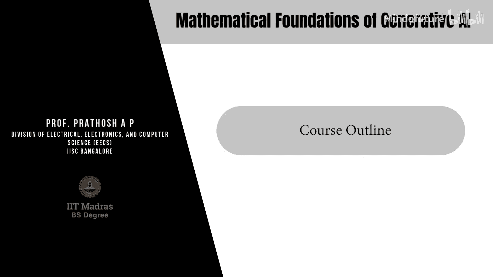
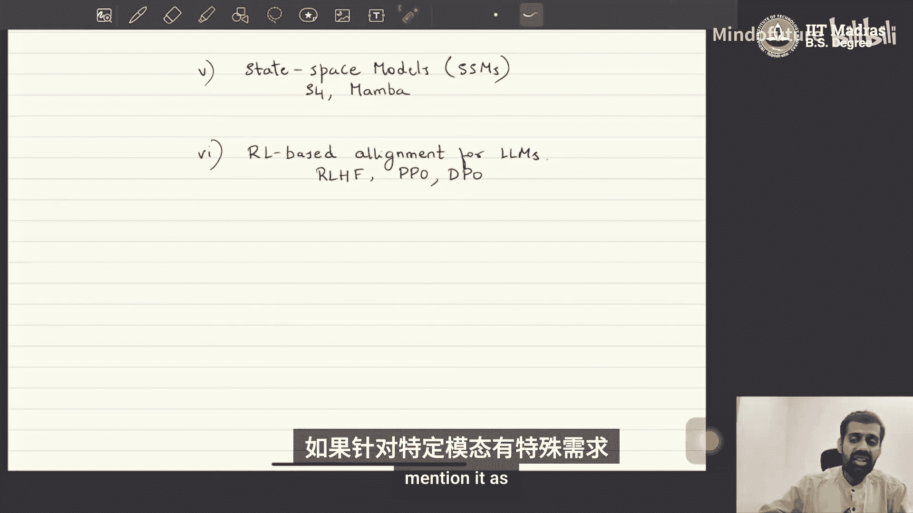
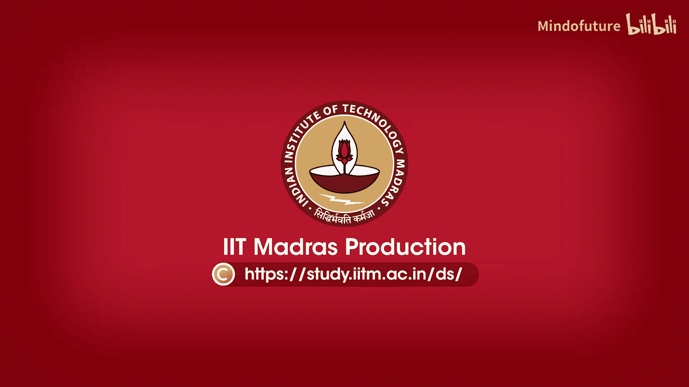

# 生成式Ai的数学基础 ｜ Mathematical Foundations Of Generative Ai p01 P01_W1L1-课程大纲 -BV1fperz7EjK_p1-

。

Hello you， everyone。嗯。Welcome to this course on deep and Radio Mor。

My name is Ratosh and I am a faculty member at the Division of EECS Indian Institute of Science。

 Bangalu。Yeah。So in this course， we are going to look at several。Deep generative models。

 also known as generative AI these days。The primary objective of the course would be to develop a mathematical foundation for is it generative modeling or generative AI。

The uniqueness of this course would be that。We will be looking at all the famous generative models。

怎么。Mathematicical standpoint。Why we are not going to discount the practical aspects of it。

The development of the treatment of the topics would be from a mathematical standpoint。说的。

One can go deep into the workings of these models。And appreciate and understand the。

Formulations of all these and easily go through the obligations。

 the original papers and improvisations thereof correspond to these models。

So that being the objective。Edvertists walk you through the broad list of。

Topics that would be covered in this course。So we will be looking at a large family of DGms。

 So DGm is an abbreviation that I am going to use。For deep generative models。

The deep the word deep here signifies that most of these。Martys。

Have a neural network component of it and these are typically the deep neural networks。

 so that is why I choose to call these deep geneative models。如。

These are the family of deep brain modelss that are to be covered in this course。

We will first start with the adversarial learning and generative adversarial networks also known as Gi in chart。

This， even though not the current state of the art or the several of the tasks this would set a very solid foot on the principles of working of workings of generative modeling。

 thats why we will start out with Gs as the past topic that we be covering in this course。

Then we will move on to the class of models called the variation of autoenderrs abbreviated as VAs。

都啊。Like GNs， these are classical models， however， workings of Vs and the underlying theoretical frameworks that are there for Vs sets the ground for studying a lot of the other state of the art models such as DDPMs。

 so once we look at adversarial learnings and GNs we will go through the variation auto encodeder family of module。

Then we will look at denoizing diffusion probabilistic models。

Also known as a diffusion modeling chart。Abbreviated as DD ps。

These are the state of the art models for several of the generative tasks such as image conditional image generation that you might have seen in all the commercially available tools such as dolly and GPT mean that is capable of generating images and so on。

😊，So the underlying models that are still working there are DDPMs or demonosing execution probabilistic models。

So a member of another member of gene model that is very closely related to division models are what has what are called as the score based models。

 we will also look at how score based models operate。

Then we will move on to another class of generative models called autoregressive models abbreviated as AR models。

Now， the most famous large language model， which。Are the fundamental constants of all these generative AI commercially available generative A platforms such as GT and Google's Gemini and models like cloud and Quen and all these all of these are mostly auto aggressivegressive models。

 which are also known as large long wave models you will be looking at auto aggressivegressive models as well。

Then we will move on to another class of models， generative models called as state space models。

 SSMs， the examples for these models are like S4 and Maba and so on and these are upcoming family of generative models that for an alternative to the autoregressive language models。

At the end of the course we will also look at some of the techniques that are used for alignment of large lung waist models。

 specifically specifically we will be looking at the reinforcement learning based alignment techniques such as PPO which is the called the proximal policy optimization of algorithm and we will also look at the direct preference optimization。

D policy of reference optimization abbreviated as DPO。

So this is the broad content of the the course that we are going to。

Go through in this particular module。Okay， now the treatment of the subject。

Would be mostly as I said mathematical and we will be using a probabilistic framework to deal with these gene models。

Now， why do we look at these models from a probabilistic framework is something that we we are we are going to。

Discus in a while now we will be mostly looking at these models from a probabilistic framework。Okay。

There will be accompanying tutorials for this course where for each of the classes of generative models that we are going to cover in the。

来这。Classes， there will be accompanying tutorials where onena Ts would walk you through the implementation of these module typically in a framework such as Itch so there will be the evaluation etc would be setup according to the the。

Design that we have made for this particular pose， which has quiz quizzes and assignments and exams and so on。

 which you would know in due course。Okay， so with that being an introduction Okay。

 so the other point is that I will mostly be delivering the content using。

This setting where I would be writing everything that is needed on my iPad screen that would be protected the one that you are seeing right now。

And wherever it is needed， we will see the corresponding papers or the other presentations and so on。

 but by and large this is going to be me working on this iPad Sur now this is because as I said since the treatment of the subject is mostly mathematical I think it is imperative to write down the equations in a rigorous manner so that we can go through each of the in a。

Slow manner， okay。The other thing is the entire course is going to be conducted in a data agnostic manner in a sense that。

I will not be restricting myself to， let's say。Images or text or speech or any other kind of modality。

 While I'll be taking specific examples， as in when they are needed。

 the course would be done in a data modality， agnostic manner。

 It means that the techniques that would be studying would be gentle enough。

That with minor modifications， one can adapt the same kind of models。

For different kinds of data modality okay so if there is something specific that is needed for a particular modality。

 I would mention it as and when it is needed。😊。

