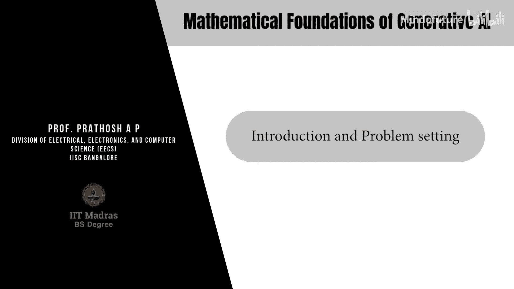
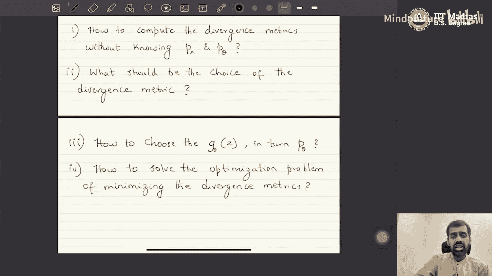

# 生成式Ai的数学基础 ｜ Mathematical Foundations Of Generative Ai p02 P02_W1L2-介绍与问题设定 -BV1fperz7EjK_p2-

🎼。

So with that as the introduction， let us now dwelll directly into the course content。So， let us。

In this module， let us define what the problem of generative modeling is from a mathematical perspective。

Okay， so generative modelling。Yeah。Yeah。Yeah。Yeah。Okay。

So generative models are pretty much everywhere that you would see these days right so the examples for the generative models。

Are the。Applications such as Cha GT right and the Googles Gemini。You have。Clor and so on。

 where these are conditionary text generators。그。These are conditional X generators。So。

 in the sense that if you are。To takestens。In the sense that given a particular text as an input or rather prompt as it is called。

 so these words。Gen a response with corresponding to that particular text that you have given as an input。

 so that would constitute a conditional text generation task this is one of the example that you see so this text can be in natural language。

Or this can be computer code。And so on。 So you might have seen a lot of applications of some of these techniques in generating。

Computer codes that work for different kinds of。Tasks so these are conditional text generators basically where conditioned on a particular text。

 given that you are you have a particular text given as a parameter as an input。

 these would generate a text as。The response okay or the output the other examples that you might have seen are image generators such as。

Yeah。you have stable diffusion。Yeah。Yeah。So， these things are conditional image generators。Yeah。Yeah。

그。Image generators。So now what do these do given a particular description of the image that you want to generate these。

Models would create an image corresponding to that particular description。

 So you might have seen a lot of examples where people have generated different kinds of images corresponding to the prompt that they you as an input。

 Okay this is another example of what the gene model is the other class of models that you might have seen are。

Speech generators。그。Speech dinner us。그。So， given a particular text right what do these do given a particular text。

 they would generate a wave file right or a speech deternce。That corresponds to this particular text。

So these are several examples of what generative models are capable of。

 which you might have seen in action in current asinary now mathematically speaking what is a problem that we have at hand。

🤧。Now， we will start with what is called as data。To the starting point。嗯。그。그。

As with any of the machine learning techniques， the starting point would be what is called as data okay where I define data as a set of。

Wines。hich are not particularly order。We have n data points， that are sampled。IAD。

 according to a distribution， Pis。Justの。Note， whenever I use。Scrip letters like this。

 I mean that I mean probability distribution functions and whenever I am using nonscripted letters such as this。

 I mean probability density functions now will Ill I'll make it clear as we move on now this is the starting point or any of the generative modeling tasks for that matter any of the machine learning tasks that。

You are given and。Data points are samples which are drawn I mean this symbol denotes that these are sampled okay。

IID where IID stands for independent and identically distributed from a distribution px that is unknown now typically all these data points X they lie in some deal real space where d is called the dimensionality of data。

그。Yeah。起き得た。Okay， typically this these is going to be very high for instance。

 examples you take samples suppose your excs are images。Images， so images are represented as。

The color image is represented as a tensor。그。You have。Oh。R number of rows。

 We have C number of columns， and typically， you have。3 channels each corresponding to the red。

 green and in the blue， which are the peris。 So typically the value of R and C would be of order of hundreds。

 if not thousands and adding into three would make your data lie in。

Tens of thousands of dimensionmens and had hundreds of thousands of dimensionmens， no， if not more。

So that would be the dimensionality of your data So let's say that your r is some 400 pixels and you C is 400 pixels and3 you know we are talking about 16 times 3。

 which is you would be here would be。4 p8。And four zeros。This would be。480。

000 dimensionality of the data right assuming that I represent each of the pixel as one dimension of data so these you may just correspond to 480。

000 dimension and dimensionality of data right so the point that I am trying to make here is that the dimensionality of the data we denote that by the letter at D and it is typically of order of tens of thousands if not more。

 it will be we are dealing with high dimensions of data here。Okay。Now， all these excise。

 the data are。Because there are samples drawn from an unknown distribution。

 we say that this all the excesss there are。Instrainations of some random variable。Yeah。Yeah。

A variable width。A distribution。With a distribution， px。Okay。

 we assume that our data points are actually being sampled from an underlying unknown distribution。

 and we also assume that all the data points that we are that we have have been sampled。Independly。

 from from one distribution that we have okay that is what is meant by the I sampling。

 which means that all of the data points that we have are。

Independently sampled and are identically distributed in coming according to one particular distribution。

 which we doote ask px， which is unknown。Now， what does that mean if you go back to the images example。

 suppose our data set has thousand images， suppose D has thousand images。It write them。

 Deote them as x1。 its to。Up to x n， and we have n is thousand here。 What we are seeing is the。

Firstt image denoted by x1 and the second image as denoted as x2 are。

Statistically independent and we are saying that both of them are actually sampled from the same underlying quality distribution which is unitnoted by px。

😊，they are saying X Ie is statistically independent to Xj and we have extra Xi and Xj gos are drawn or rather apo say X and Xj。

 every XI is drawn according to one distribution px。

 and of course the underlying distribution is unknown。So please note that I'm not saying that the。嗯。

The pixels are the dimensionality of the data independent of each other right I am not saying that the first pixel here and the lets say the thousandth pixel here they are independent of each other that is not what I am seeing。

What this idea assumption says is that。The first image that we have and the let us say1 hundred image that we have are patly independent。

😊，This is a fair lesson to make in practice because suppose you are dealing with images then there is no reason why you should not believe that that the past image and the returns image are statistically independent because they are collected independently if they are both captured independently at different points in time。

 however。Unless otherwise specified in general， we don't。 we do not make an assumption that the the。

Data。Is independent。In the dimensionary sense， in the sense that the different the different dimensions of the data are not independent we are not claiming that the dimension。

Data points are not statisticalt or are statistically independent within the dimensionality we are only saying that across the samples there is a statistical independence in the sense that one image is independent of the other okay I just wanted to make this point clear that whenever we say that the data has been drawn I we only mean that there is independent across the。

Different across different data points that we sample and they are all sampled according to a same underlying distribution。

Okay so why do you have to make this assumption that we are all sampled from the same underlyinging distribution it is because of mathematical ease in the sense that if you have multiple distribution that your data is coming from it is it is going to be difficult to estimate multiple unknown distributions at once so now if you assume that all your data is coming from one single distribution it is much easier to tackle the problem that way okay now in the case of G etc which are the large scale。

😊，Chad based in herms。This data is a set of all documents。

 okay a large number of documents are articles that are there in the internet。Okay。

 so what we are saying is that all the data that we are getting data point that we are getting are。😊。

Independently sampled。Where the independence is across different data points and all of them are coming from one distribution and in a case of models such as GPT。

😊，This distribution that we are talking about is the distribution that would capture the the entirety of everything that is there in internet so I think you know you understood the point that it does not matter that this pH is restrictive to a particular upgo or anything just for the mathematical convenience you make an assumption that all our data points are drawn from one distribution that you want to estimate。

Okay。😊，Sure， okay， so let us continue。 So now as I said all of these x their instants are a random variable okay and they are drawn according to a distribution。

And since we are talking about x that is there in some dere dimensional real space。

 X I are instances。off。A vector valued random variable。嗯。그。Yeah。

A vector valued random variable of size D。Right， because we are saying that all the。

Data is lying in a de dimensional real space Okay so what are we seeing is saying that there exists a probability distribution over the data points where all the data points。

Are instances of a deal。Random variable so please have this world view because this is very。

 very important because this is the kind of mathematical formalalism that we will be using in the rest of the course。

😊，Now I am assuming that the audience in this course are aware of what is rank by a vectorvalue random variable。

 just like you have distributions over scalar value random variables。

 you have distributions over vectorvalue random variables and the data that we have are modeled as instances of vector value random variable drawn。

From one particular distribution， which is unknown。对。Right， with this。

 let us now define the problem of generative money。Yeah。Yeah。Geneative modeling。

 how do we define the problem of generative modeling So now what are we given as these data points。

Yeah。Which are instantations of random variables， drawn IadD。

According to an unknown underlying distribution， given this。Or objective。

Our goal in geneative modeling is to。Estimate。Estimate px。

 so we want to estimate the underlying probability density function or probability distribution。And。

Learn to。Sample from it。Yeah。Yeah。Yeah。아。Yeah。Okay。

 this is how you define the problem of gene modeling machine learning that given。

N samples that are drawn ID from an unknown and so this will be typically an unknown distribution。

So given that you are drawn in samples IadD from an unknown distribution。

 the objective is to estimate the underlying unknown distribution and most importantly learn to sample from the underlying distribution this estimation some of the models do not estimate the underlying distribution explicitly they would estimate px in an implicit manner。

 but almost all the models generative models would learn how to sample from the underlying distribution。

So just to contrast these the discriminative family of models。Now， in in a discriminative model。

 you would estimate the underlying distributions， you know。

 you typically estimate the conditional distributions of form p of y given1 x in the case of discriminative models。

 however。We do not necessarily learn to sample from the data distribution in a discriminative model。

 while in a generative model， the primary objective is not only to estimate the underlying distribution but also learn to sample from the underlying distribution。

给。Okay， so now what is the general principle of solving this problem， Let us look at how this。

Problem。Of generator models， how do we go about solving this problem？Yeah。Is as follows。Yeah。

 this is not some sacrosine way of doing it， but looking at all the geneative models right one can abstract out a general principle of how these geneative models how the realm of data geneative models。

Work， okay， so first thing is that start off。Z。啊。Parametric。Family。Of modelss。😔。

Let me just not call them models yet。 So as you were paraed primarily。On Bx。

Okay now the goal is to estimate the underlying distribution from now on I will just switch on to the probability density functions assuming that the distributions that we are dealing with have well behaved density functions okay just to make the calculations and math a little more easier okay so assume a parametric family on P denoted typically denoted by P theta。

Denoted by。P theta okay now， typically， this P theta。Yeah。Is represented。Using deep neural networks。

Yeah。그。Yeah。You will see specific examples for all this as we navigate through the now this P theta which is an assumption that is made on px are typically represented。

What the me is a spell step here represented。😔，These are typically represented using deep neural networks this is owing to the fact that the modern deep neural networks are known to have very good expressive power in the sense that they can approximate a large family of functions in fact any function to arbitrary closeness this is what the universal approximation capability of deep neural networks are capability of deep deep neural networks is so now。

Given that they are so powerful in representing any function。

 so the model or the distribution or the densitys function is represented using a deep neural network and this is what is called as a model。

Yeah。Okay， now this is not a standard term whatsoever， but I'll be using this term across the course。

 So whenever I refer to something as a model， I'm actually talking about the。Parametricic。Function。

 okay， which we would assume on the density function that we would want to estimate。

Okay now that is what I will be referring to as model these things would be represented using deep neural networks at least in this course and in all the the model way of looking at the generative modeling。

 all of these are when pe u which is the representation of Ps。

Is done via deep neural networks given their expressive power whenever I say model Im talking about P theta here okay。

😊，Now， once you do that。Define。Define and compute。Yeah。Define and estimate or compute。그。

Are they garden。A divergence metric， or a distance metric。Yeah。Distance metric between。

The distribution P theta， which the model is giving you and px， which is the true distribution。Okay。

 now we define an estimated divergence metric between p3 and px。Now。

 you might have the question that I mean， aren't we begging the question because we all started by saying that we don't know the underlying distribution Px now。

 how do you estimate。Or rather compute a divergence or a distance method between P datata and px。

 that is a very very valid question which would be taking up in the in the rest of the course but。

at an abstract level， so assume that that you can define a distance or a divergence metric between a pair of probability distributions which would tell you how close or far a given pair of distributions are okay now once you can measure how far or close a p3 times P are the final step is to solve an optimization problem。

그。Sol when optimization problem。Optimization problem or。

Parameter space of periodta parameters of perita。Pタ。To minimize。The abo divergence metric。嗯。

Abo div metric。Yeah。Right so that's it。 So what you do is any generative model that we are going to look at in this course will roughly follow this recipe where。

Given that you are you have data that are drawn I from an unknown distribution。

Now the goal is to estimate the underlying distribution and learn to sample from it as I said this estimation is done explicitly in some of the models and it is done implicitly in others in some other we will see that。

Now the recipe to solve this problem contains roughly contains three steps where you first start by assuming a parameter family on px denoted by p Theta which is represented using deep neural networks and then you define and estimate a divergence metric or a distance metric between P Theta and pX which means that given a particular p Theta that your neural network is representing with certain parameters。

You measure how close that particular P theta is to the true distribution px now once you can measure that then finally you solve an optimization problem or the parameters of p theta to minimize the above evidence metric so in other words you keep tweaking the parameters of this deep neural network that represents your P theta。

Till a point where the divergence metric between P Theta and px reduces becomes close to 0 in the sense that you learn the parameters or you adjust the parameters of this neural network representing P theta such that your P theta appears as px as closely as closely as possible。

Okay so this is the general recipe of how any problem on generative modeling is solve。

 let us now look at an example of how this is realized。😊，Yeah。Yeah。

Please note that the goal of gene mourning is24。One。

 we want to estimate the underlyinging unknown distribution of data。

 and we also want to learn to sample from it Okay now how is sampling accomplished now the procedure that I just told you is estimating the data but how is sampling accomplished is something that we would see now。

 So lets say that there is a。There is a random variable。Z。It is。In some K dimension real space。And。

Has some arbitrary distribution。As some arbitrary。Yeah。But known distribution。그。Yeah。

Okay what are we saying here we are saying that we start from another random variable z which is in K dimensional real space which has some arbitrary distribution but it is known an example can be that your z can be in a Gaussian distribution with0 mean and unit variance。

2。Which is in k dimensions。 So it can be a k dimensional Gaussian random variable with0 main unit variance。

 Now we know that。Suppose。Gtた。Of the。So let us。嗯，有。Let us call this Git of Z is a function。From。

The space of Z。To the space of x in which we have defined a random variable， okay， then。Yeah。Excap。

 which is the。그。Traccing the rain space of G， okay， has。A different distribution。

Different distribution。Then that of x， then that of z。嗯。And that of Z。Arenned。

The distribution of X cap。Dist distribution of X cap depends on。Yeah。Depends on。D function G。

D function G theta。So， what are we saying here， suppose there is just an arbitrary random variable？

And there is just a deterministic function that is operating on top of it。 Oh， let's say that G are。

Sorry， so G is a deterministic function that is operating on an arbitrary random variable we know from probability theory that。

If you transform a random variable using a determinative function。

 the range of that deterministic function will also be a random variable right and the distribution of that random variable is not same as that of Z but depends on e theta this is a known thing。

Now， suppose let's if。Yeah。Yeah。Yeah。Suppose。G tta。Of the。Is a neural network？Yeah。

Lets say that G theta of is a neural network， okay， now let us。For that。Yeah。Yeah。

Okay so maybe before that。Don't see that。😔，Yeah。그。This neural network。

 we take z from normal 01 as the input samples from normal 01 as the input this is the Gte of z network and this is given as output x cap。

Okay， so suppose G theta of Z and neural network and lets also denote。The distribution of xca。

 which is equal to g theta of z as。I did。Do know。Yeah。Density of。Of its cap。Yeah。Using P Theta。

So I am reiterating， please note that Ill be using the word distribution function and the density function in a sort of interchangeable manner。

 even though mathematically strictly mathematically speaking they are not exactly the same but for the sake of ease of understanding I will be saying distribution sentence using the words distributions and density functions in interchangeable manner。

 please note that they are not exactly the same okay。Now， we denote the。

Density function of G2ta using the。P it off。X cap， the density function of x cap as a P The of x cap。

 then the output of this neural network， we can interpret that as samples coming from P the of x cap。

Right。Yeah。Okay now this neural network， what is it trying to do given samples drawn from a known distribution。

 it is transforming that into some of the distribution which is ennoted by PT topics now suppose。D。

off。비X and 비 theatreta。Yeah。그。Deote。ADrgence metric。Peverence measure。😔，Between。BX and V体的。Okay。

 now remember the recipe that I said， you start by assuming a parametric family on P theta。

 then you define and estimate a diveence metric between P P theta and P that we have denoted by D here okay what is the next step we just need to solve。

An optimization problem， okay？Solve the following optimization problem。그。Yeah。Yeah。Yeah。

What is the optimization problem that we are solving， We want to set theta Okay， in such a way that。

The defined divergence metric between。Px， which is the2 data distribution and p theta。

 which is the distribution that our model is giving is minimized note that this divergence metric will be a function of theta and therefore the optimization would be over theta okay。

 so now we want this theta star to be。That theta， which would minimize some divergence metric between px and P Theta。

Okay， so it is。Yeah。A notational custom that a divergence measuring between two probability distributions is denoted by d and within parenthsesis you have two distributions separated by two vertical bars okay this is just denoting a divergence measure between two distributions okay。

Now， if we do this upon the successful solving of this optimization problem。

 what happens is that your P theta becomes close to px。

 suppose we choose this theta in this particular way。Correct。

Okay we will also see later that one of the properties of this divergence metric is that it is always we choose the divergence metric such that it is always non negative okay so the minimum value of this is 0 okay and that happens。

Your friend only leave。The underlying distributions match with each other then we will see these properties when we define different family of divergence metrics。

 but yeah so the idea is that if you have a divergence metric okay that would be0 if and only if the underlying distributions match and you solve this optimization problem。

Wwhichch is to find the parameters of this neural network GtR in such a way that this prevalence matter is minimized。

 then we are pretty much done why because we have。Upon。Yeah。Solving the above optimization problem。

Yeah。Optimization problem。Yeah。The distribution。Px。Is implicitly estimated。Stimd。

By the G theta function， right？被个斯。The distribution that we are getting from the output of g theta is nothing but p because now p theta is has p theta has matched with P not only that it is being estimated the distribution be is simply estimated by G theta and。

And one can sample from Px。Using GT network。Well， how is that possible now。

Let's say that we have tried the G Theta network to solve the optimization problem okay。

 let us denote that as okay let me just take the same picture here and reuse it。Yeah。Yeah。嗯。

Lets say that we have solved the optimization problem and I am calling this as g theta star because we have solved the optimization problem and this is p theta star and this is。

Close to。Cl to px because that is the way we have solved this optimization problem right now what happens is you can take a sample of z okay and then pass it through the neural network here。

A sample。Yeah。But。The normal distribution， okay， which you know how to sample from。Yeah。Yeah。

Pass through GT2 network。G T K clerk would produce a sample from Pis。Would produce a sample， but I'。

For p theta of x cap， I mean to be precise， but now because p theta of x is close to px。

We do does start a big。Okay， we use。Close to px by construction， okay。

 close to px by the virtue of solving of this optimization problem， we end up。그。Sampling from Px。

Okay that is it So now recall what was our objective our objective was that once you are given some data samples the card drawn id from an unknown distribution we wanted to estimate generally in distribution and also learn to sample from it okay now what did we do。

We started from an arbitrary distribution from which we know how to sample。 and we use the fact that。

Any random variable passing through a deterministic function will produce another random variable whose distribution depends on the particular function that this random variable is passed through right now we use this probability and we use this idea that we represent this Gtta function using a deep neural network now given that the deep neural network can approximate any arbitrary functions which is the universal universal approximation capability of a neural network we use we exploited that and we said that okay you will fix the parameters of this neural network in such a way that some distributional dirgence metric between the true distribution P and the distribution that this neural network is imposing。

Is Min maist。Now， upon learning what will happen， this neural network would not only estimate the underlying distribution px。

 but also give you a way to sample from it because。

There is no way there is no limit on how many samples that we can produce on a Gaussian distribution right because thats a random number generation correct so we know how to generate random numbers once we generate random numbers which are samples from Gaussian 0 I you can pass those samples through this tri and neural network which would produce samples from p theta star of x gap which is close to px which is the underlyingline density function or T2 data okay by the way one other a side note the。

Notation that I use as the following。When I write a density function P。

 the sub here denotes the random variable under consideration。

And the value within the parenthesis is a particular value okay the symbol within the parenth is a particular value that that particular random variable will take。

😊，That is my notation here when I write P theta star。

 okay I mean that this particular distribution is parameterized by theta。

I I'll be using this notation P theta star all along the course that means that it is then it is a distribution that is parameterized by theta and it is upon the random variable x cap stickly speaking I have to write p x cap and denote some denote theta here but that would make it a little cumbersome and that's why I write theta as P theta star x cap or x cap where whenever I write something within the bracket I mean that it is it is being evaluated at a particular。

Value x cap okay and the sub typically represent the random variable or the parameters。Okay。

 getting back to what we are doing upon training okay。

 what we do is that we sample a random number from a distribution that we knowhawkan question and then it is passed through the deterministic function G。

Theta star here denoting that it is trained。 then that would。

A sample from Z passed through G datata would produce a sample from， your pardon。Yeah。

Would produce a sample。We could produce。A sample from E Theta star S cap， which is close to px。

The sample from z pass the d theta star would produce a sample from P theta star。

 which is close to p x okay and in turn， we end up sampling from p x， which is our objective。

 which is the objective that we would want to accomplish。

So this is the general principle of lot of algorithms that are that we would study in this course starting from generative ads serialial networks and variation auto encoders and diffusion models and auto expresssive models and so on。

 this is a general principle。😊，OK就呃。We will be looking at different instantiations of this general principle。

 the questions that are to be asked no。Given this， the questions that are to be asked are the following。

The questions。TheQu are to be asked are as follows。Okay， now how to compute。😔，How to compute。

The divergence metric。Yeah。They were dense matrix。Okay， without knowing。Without knowing。Bx。

I be too dark。Please note that in the example that I just discussed here。

We neither know P Theta nor we know Px。Correct we know we don't know either of the distributions that are used to solve this optimization problem I mean one can guess that this divergence metric will be obviously a function of P theta and px but we neither know P Theta nor we know px all we all we have are samples from P Theta and px so do we know do we have samples from px yes we do because that's the data that we have do we have samples from P Theta we do have samples from P theta because by construction we can just take samples from an arbitrary distribution and pass it through G theta and we did samples from P theta right so one important question that is that we ask this how to compute the divergence matrix without knowing p theta and px so this is one question that we are going to ask an answer in this course。

Second question that we should ask is。What should be。😔，What should be the choice of？😔。

choicehoice of the divergence metric。Yeah。Divergence matrix。The okay。Yeah。

 so the other the question that we asked this ask is。

 what should be the choice of divergence metric and differing choices for the divergence metric will end up。

With different generative models with different properties。 Okay。

 so what should be choice of parameter of a metric。

 The other question that would be that we would ask is that how to choose。Yeah。How to choose。😔，😔。

G tta function， okay。Or in turn， the。The distribution P theta right what should be the parametric form for the P theta that once should look at if for instance。

 you know p theta for again is very different from that of V that is very different from what is done in diffusion models and other aggressiveive models and so on。

 So these are typically the questions that could come up which would answer in this course that。

Now we know that the general principle is to start from an arbitrary random variable and pass it through a deep neural network so that the distribution of the output of the deep neural network matches with thatta for the underlying unknown distribution。

The question that you would ask is how to compute the diveence metric without knowing both px and P theta and what should be the divergence metric itself that is to be causalsal which would give different。

Properties that that would in infuse different properties on the generated models and how to choose this particular model distribution P theta and there is also one other question that that would we take taking up is how to solve。

Sol the optimization problem。Yeah。How to solve the optimization problem？

Of minimize indeed dive metric， right。Mainimizing the divergence metric。그。Okay。

 so now we will be looking at several ways of answering all these questions and each of one each of each of the choices that you make to answers these parts of these questions would give rise to different kinds of gene models okay。

Now that would bring us to the end of this particular session just quickly recap so now as I said in this course we will be looking at several families of digenerary models we start from adversarial networks then we will go to variation autoing orders then we will be looking at diffusion models and would come to auto aggressivegressive models then state space models and some reinforcement learningbased alignment algorithms for the AR language models。

We started from defining what generative models are and some have looked at some of the examples such as S DBT which are conditional text generators。

and there are a conditional image and the speed generators such as dolly stable diffusion and so on now then we formulated the problem of generatorative modeling that the problem is that we are given n data points that are sampled ID permanent unknown distribution and the data points are typically taken to be。

ranandom instances of random variables that are different in a D dimensional real space example can be an image or a text or a speak or any of the that art and we assume that the data points are statistically independent of each other okay and drawn from one single distribution。

Now， formally speaking， the problem of generative modeling is that given this particular data that has been sampled I department on distribution。

 we want to estimate angle and distribution and learn to sample from it。

The general principle of solving this problem is that we start from assuming that the P theta that we would want to estimate has a parameter form sorry px that we would want to estimate has a para form P theta and this is typically represented using a deep neural network given there expressive power and then we define and estimate a distributional divergence metric between the true distribution and the model distribution and solve an optization problem or the parameters of the model distribution such that this divergence metric is minimized now the idea is that if we bring our model distribution p theta closer to that of px then the problem is solve because we want to estimate p theta and we do it from model model building perspective now here is an example where you start from an arbitrary random variable that you know how co sample from typically it is a gaussian random variable and define a neural network Gta。

ZWhi is a function on this random variable from the input arbitrary random variable to the the。

Dimenssion in which the data lies， okay。Then， you。Solve an optimization problem over the parameters of the neural network such that the distributional dience between Px and P data。

 which is the distribution of the output of this particular neural network is minimizeized。Now。

 if you do this， then you have practically solved the problem because。

Upon solving you have implicitly not only implicitly estimated underlyingline distribution。

 but if you take a random number sampled from the input distribution and pass it through this gene network it would go it would give a sample that is from P theta which is now very close to Px and therefore we are sampling from the underlyingline distribution okay now。

The samples that we are getting from the output of the neural network are not a part of the dataset obviously because if we are not data in just reproducing what is there in the data and this is because we are sampling from the underlying distribution but not just reproducing what is already there so every time we sample from a distribution you get different points different data points in accordance with the the corresponding likelihood are the probability of each of the data points now with this framework the questions that we would be asking and answering in this courses first of all what should be recharge of divergence method that should be used and then because it looks like the diveence metric is a function of both the distribution px and P theta without knowing px and P theta how do we even compute the underlying distributional divergence then how do you choose the model itself the theta of。

OkayAnd then given that that there is a model there is a distributional dirgence metric that we can compute。

 how do we solve the underlying optimization problem of minimizing the divergence metrics these are the questions that we be asking in the rest of this particular course and every different choice that we make or rather every different algorithm that we take up to answer some of these questions end up in having different gene models that are used in different scenarios。

😊，So that brings us to the end of this particular module module， see you in the accession。

