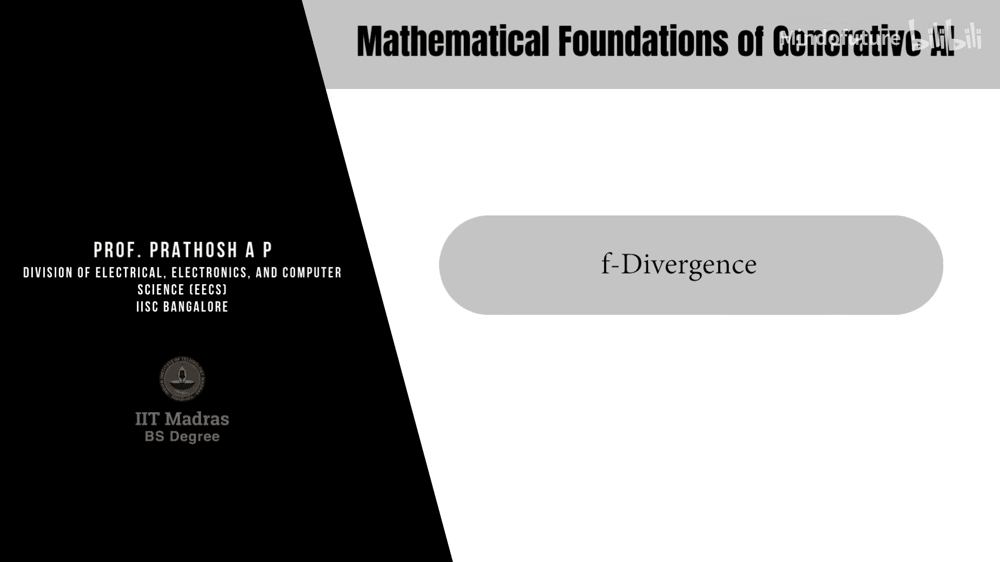
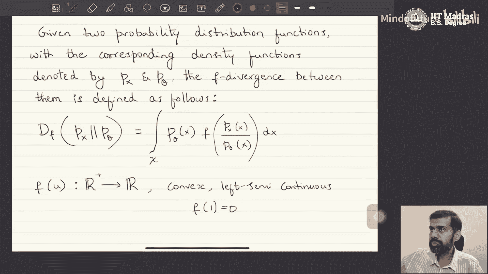
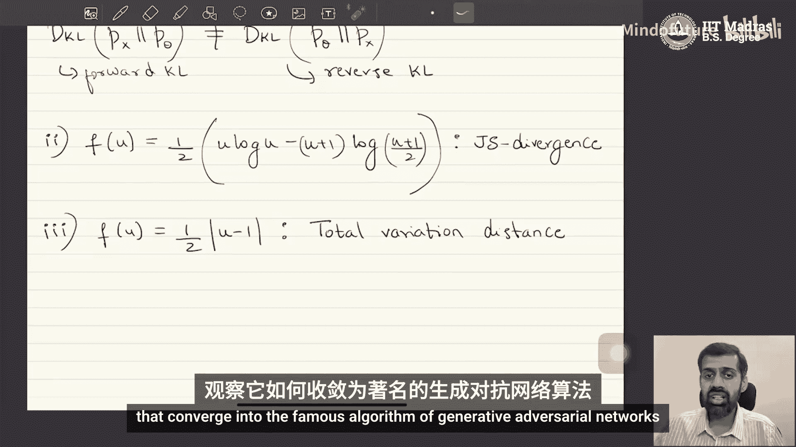

# 生成式Ai的数学基础 ｜ Mathematical Foundations Of Generative Ai p03 P03_W1L3-f-散度 -BV1fperz7EjK_p3-

🎼。

helello， everyone。Welcome to this session of the course on deep geneative models。In this session。

 we will be looking at。A class of generative models based on a principle called variational divergence minimmunization。

The famous generative adversarial networks are the Gs。

Are also a member of this family of geneative models。Now。

 before we go into the details of variational reence mini miniization。

 I would quickly recap the concepts that we saw in the previous session so that there is continuity。

In the previous session， we looked at a formal definition of what generative modeling is。😊。

Recall what we are given is a data set which is a set of yn samples drawn。ID。

 independently identically distributed。😊，From an underlying unknown distribution which we denote by script Px。

Now， given this， the goal is to estimate the underlying distribution px and learn to sample from it。

So as I said in the previous session。😊，eststimating px may be implicit or explicit depending upon what model are we looking at。

 but one of the primary requirements of a generative model is to learn to sample from the unknown underlying distribution in this case px。

Now， we also looked at what is a general principle of learning generative models。

I told you that it involves three broad steps as a recipe the first thing is to assume a barometric family on Vx denoted by Phiica typically in modern day generative models。

The speed theta is represented using deep neural records。And this is what is referred to as a model。

Then， once you。Represent the underlying distribution using some parametric model P theta。

 now one has to define and estimate a divergence metric between the true distribution Bx and the model distribution P theta。

The next step is to solve an optimization problem over the parameters of P theta。

 the modern distribution。With a goal of minimizing the aforementioned divergence metric that would capture the distance between P and peakx。

😊，Now， the idea is to set the parameters of this parameter distribution B data in such a way that it aes px as closely as possible。

We also looked at an example of a class of methods that are called push forward methods where。

The idea is to start with an arbitrary random variable from which we know how to sample from。

So typical choice would be a normal distribution with zero mean and unit variance。And then。

Represent your repeat theta as the distribution obtained from the output of a deterministic function G theta that would map the samples from the space of Z from which random variable is sampled to display space of data renoted by scripts。

Now， what happens is that by the the elementary probability theory。

 we know that a random variable when pushed forward put through a deterministic function will。

Lead to another random variable denoted by x cap in this case。

And will have a different distribution as compared to。

The distribution of the initial random variable that was used as an input。Now。

 the probability distribution of the output random variable determines。

On what sort of function is the theta？😮，So， the idea in these classes of gene models which uses a put forward mechanism is to represent the function D theta as a deep neural network。

😊，Good， and the。Distribution that this particular neural network is imposing is denotted by P theta then the idea is to start from an arbitrary distribution which often happens to be a normal distribution。

 pass it through a deterministic neural network and obtain the samples from some distribution denotted by P theta。

Please note that。The output of this neural network is only giving us samples from P Theta。

 but not the distribution P Theta itself then as we saw the objective is set as a minim and optimization problem over the parameter space of this particular function in this case a neural network such that a distributional divergence metric between the true distribution and the distribution that is imposed by the model is minimized。

Now， the hope is that if the distribution， if the divergence distributional divergence metric is well defined and the optimization problem is solved appropriately then。

When the optimization is solve and you reach the optimal set of parameters theta star。

 the distribution that is imposed by this neural network P theta would have gone close to the true distribution px because the divergence metric has this probability that it is always non negative and the0 if and only the constuent distributions match if that happens then if you sample a data point from a normal distribution and pass it through this network。

 the tri the network the theta star， then the samples that you will be getting at the output of this neural network would be samples from px。

 because now P theta star is close to px by construction。

This is the general principle and we startve the previous session by asking the following questions that how do we compute divergence metrics without knowing neither of Pta and PX right so now all we have are samples drawn from P we also know how to get samples from Pta because。

Obtaining sample from P Theta is easy by design because all you need to do is sample a z which is from an arbitrary distribution。

 pass it through the G function and whatever samples you are getting at the output of this neural network are nothing but the samples from P Theta。

😊，So， we have samples from Px， we have samples from P theta， however。

 we neither know px nor we know P theta。We don't know what the underlying density functions are。

 but we have samples from it。😊，And the other question that we ask is。

 what should be the choice of the diveence metric that we would be using？

The third relevant question is how to choose the particular G Theta it says that if you choose a P theta then you are choosing sorry if you are choosing the function G theta。

 then in turn you are choosing P Theta as well what choices can one make on D theta？

The other relevant question that we asked this how do we solve the optimizationim problem of minimizing the divergence matrix so these are the questions that one should ask if one is interested in constructing a model using the push forward method that we just look at so now variational divergence minimization which we will be going to look at now is no different from the push forward method that we just so let us continue now we will be looking at。

These class of methods， called。The variational。Divergence。Mainway session。は。

We will be looking at the method of variational divergence of miniization。Now to start with。

 let us define。The first thing that we should do is。李芳英。Divergence metric。Tiveverence metric。Yeah。

Between distributions。Recall that one of the。Key ingredients of building a generative model is to define a distributional divergence metric or divergence metric between distribution Now let us do that。

 let us define a class of distributional divergence metrics called the F divergence。Yeah。F neence。

その given。都。Pbability distribution functions。Probability distribution functions。Yeah。W。

The corresponding。Decor。Density functions。Density functions denoted。Theynoted by。😔，PX and E Uta。

The F divergence。If they wereence。Between them。Between them is denoted as follows。嗯。Yeah。Sorry。

 the F divergence is defined as follows。It is typically denoted by Df。And within the parentthesis。

 we write the density functions。Corresponding to the distributions。

Which we are measuring the divergences between。 So please note that I have assumed that the。

Underlying distribution functions。Have well defined probability density functions here。

 and I am also assuming that the underlying random variables。Our continuous random variables here。

There are equivalent definitions of F divergences for the cases where the density functions are not well defined and the random variables are discrete。

 but since most of the generative models that we be looking at the random variables are continuous and density functions are well defined and they exist。

 I am defining the F diveivergences for this special case where we have the density functions will defined and the underlying random variables are continuous。

So， the f divergence between px and P theta is defined as the integral。The integral of B t。

Ralular genetic times。A off。Px， imers。我。Be hitta， predicts。D x。

And the integral is over the space over which the random variables are differing。哦， here。F。Of you。I。

A convex an arbitrary convex function defined from positive real numbers to real numbers。

It's a convicx。Yeah。Left semi continuous function。Continuous function width。

The value of the function at1。Being equal to？0路。

No我。If you look at the definition。Conver x。Is this space。On which。

The distributions PX and P are supported。Typically this space happens to be RD。

 the data dimensional real space， because that is where our data is coming of。Now。

 you please note that F here is any function that is convex and lipummiconous such that f of 1 equal to 0。

 so 1 can choose n f。Wwhich has this particular properties and that particular any particular choice of f is going to give you one de metric that has special properties。

Now， U here is a term variable here， so f is a function from positive real numbers to real numbers。

 so please note that this is a well defined quantity because what we are taking here is a ratio of density functions evaluated at the same point。

Now， by definition density functions are non negativeative。

 therefore the ratio of two density functions evaluated at the same point is going to be a non negativegative quantity rather a positive quantity so now and the rain space of density functions are also scals right so in despite the fact that x here is a d dimensionional random vector。

When you evaluate the density function at that particular point the density function evaluates to a positive real number；

 therefore the ratio of two density functions is going to be another positive real number and therefore f of a positive real number is very defined。

and the f function by definition is a convex function。

 which is left somewhere meaneous with the value of the function at 1 being equal to 0。😊，Okay。

 now okay， so what are the properties of this F reence see the properties that we need are the following。

Properties of。F down turns。Are as follows。1。If thergence。For olive if for any of is non limited。

For any Joseph if。This is one property that we desire because。嗯。

We want the divergence metric between two distributions to be always a non negative quantity so this is by construction F divergence is non negative for any choice of f。

The other important property that is of importance to us is that the F divergence between。

Any pair of distributions。Will be 0 if and only if。The two distributions are exactly equal。Okay。

 so we will use both of these properties for our。A case while constructing generative models。Now。

 recall， our goal was to。Build a derivative model such that the distributional divergence between the two distribution and the model distribution is going to be 0 now if we take the divergence metric as the f divergence right then by these two properties right it is always non negativeative and it will go to 0 only when the underlying distributions match we can use this distributional divergence metric for the case of for the purpose of building the derivative models。

Okay， now let us look at some examples of this e divergence。Examples of F leverageence。Now， if， if。

If of U is。You log you， then the corresponding of divergence will be the famous Ubar cl divergence or。

Kill Leltons。It is very very easy to see that with this particular choice of f divergence。

 the underlying sorry F function， the underlying F dirgence becomes the K divergence just to the algebra very quickly so D F between px and P theta。

For this particular case will be recall the definition it will be integral over x。

 we have p theta of x。F of。F of。😔，P x by P theta。D x， so this is the definition of the play voltages。

 Now， substituting U log U for F function will give us the following。 so it would be。

So now u will be the ratio of px and P theta， therefore， this would be。U， that is px。

Divverted by P theta x times。Log。U， so U is again， B X。Divided by P Theta x。😔，Dx。Now。

 the speed theta cancels away， so which would。Make E X。Log。Px over paid hereta。P x over P theta。

 which is the definition of the。Fous。K divergence right so now care divergence is a special case of F divergence which this particular choice of the f function so now as you can see this f divergence will give you access to a large family of divergence and matrix that can be used for different purposes。

Now， if for those of you who know if they were care divergence is no is is not known to be symmetric。

 What do you mean by that if you。Consider the K divergence between distributions px and B theta okay。

This is not the same as the cable divergence between the distribution E theta and Vx。Now。

 there are consequences of care divergence not being symmetric okay so now if one does not want to use scale divergence or by the way。

 this is called the forward care divergence。And this is refer this is referred to as the reverses。

Ca dirgs in dehi trait。Now， for whatever reason， one does not want to use scale divergence as the divergence metric while solving or while bi the generated model。

Because of the fact that it is not symmetric one can use a different divergencesymmetric and which would come with the property of its own while building the generated points。

 So now the。This motivates us to， I mean， this justifies why one needs to look at a large family of divergence metrics okay because different。

Choices for this a function is going to give us different divergence metrics that would have that would possess different properties。

😊，Okay， so this was one example of the app divergence。 The other example could be。

Where F function is given by half。You love you。😔，us U plus 1。😔，Log U plus 1 over 2。😔，Okay。

 so if you choose this f to be this way， then the corresponding of pence is called the gensen Shannon divergence。

OrJS evidence。A version of this is what is used in the famous generative adversarial network。

 we will see that as we move on。 so this is the definition of the gensen Shan divergence。The other。

Famous choice of a function is。Half times the modeluxs of u minus1。

And this particular corresponding a divergence is called a total variation distance。Or PV distance。

Yeah。Okay， so now the summary is that by by the way all the functions that we looked at the F function obey these these properties that it is from r plus to r their are convets and their left memory continuous with f of 1 equal to 0。

1 can easily verify that。Now， the summary is that by choosing a particular M divergence。

One gets sorry a particular f function one gets access to an divergence with certain properties now different choices for the f function will lead to different divergence metric and therefore different properties in the way the gene model is going to be built。

Now， the next thing that we should do is that given a particular API version。

I will describe a generic algorithm that can that that that is used to construct a generative model using the push forward method that we saw by minimizing any a divergence okay so now after that what we will do is that we will look at a particular example by fixing a particular a divergence and see how does that converge into the famous algorithm of generative adversial networks okay so that is the idea。

