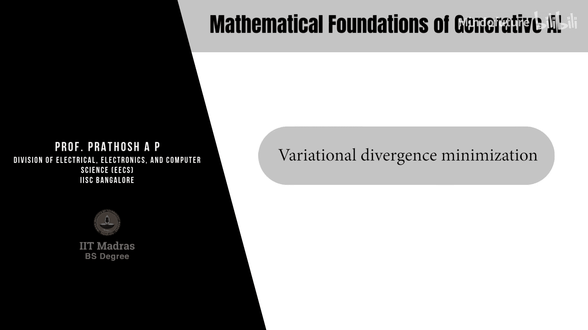
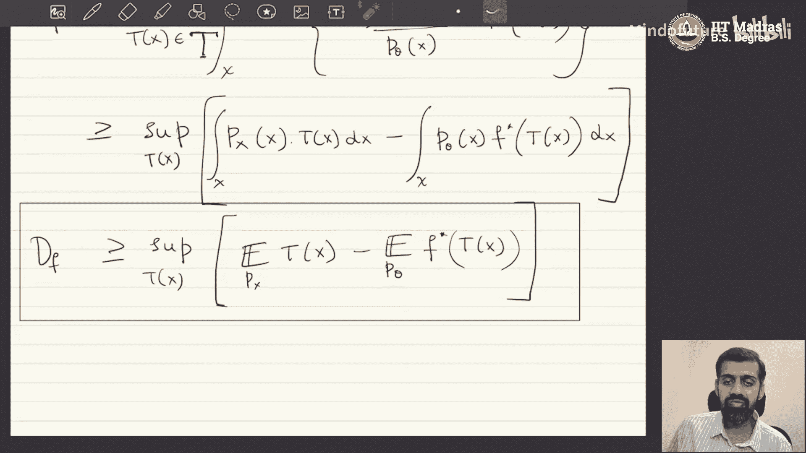

# 生成式Ai的数学基础 ｜ Mathematical Foundations Of Generative Ai p04 P04_W1L4-变分散度最小化 -BV1fperz7EjK_p4-

🎼。

Algorithm。F。If there were miniization。This is what we are going to do now。

 so please recall that in the setup of generative modeling。Yeah。

The setup that we have is the following， that we are given。A data set okay。

 a data set they not fit by D， but has samples。X 1， x2 up to X and。 So we have n。Data points。

That are all sampled IAD。From an unknown distribution， P X okay。A non distribution P X。 Okay。

 now we have this particular setup where。We wish to build a geneerative model。 So goal。

Is to learn to sample from Px。Sample for Nx。We want to central from the distribution and how do we do that so recall the general recipe that we had。

So we have a function。嗯。Represented using a neural network， a deep neural network。

We call that G theta of。Z where z is coming from any arbitrary distribution。

which we know how to sample from and the output of this neural network will give you samples denoted by X cap and we told that this we assume is coming from a distribution which we denoted as P theta of x cap。

Okay， now the goal is to I mean this will serve as a sampler for px or a generative model of 4 px given p theta of x cap。

Is same as that of px right So how do we ensure that the above setup。The above setup。

Become the sampler for page theta。We a sampler4 P E。Sorry， Sam blood4 Bx， if。

If my P theta is same as that of px right so that is the idea and how do we do that。

 we do that by solving this particular optimization problem where we fix the parameters。

Of the neural network。Such that it minimizes。The F divergence or any distributional divergence metric between Px and P theta。

 so we will choose F divergence here。To do this note that the algorithm that we are going to look at now is independent of the choice of a function that we make。

 So this algorithm works for any choice of f function that we make that we that we make。

 So this algorithm is general in that sense。 Okay， now the objective is to。Yeah。Objective。Yeah。

She is to come up with and Im rid of them。I will go to them to mini mice。Anyway ways。

The F derivativeerence， okay between。Between Bx。NBT的。Okay， be excellent be。Okay。

 now the other constraint that we have is okay。We thought。Without knowing both。

Right so please note that this is the most important challenge that comes up while building geneative models this is a common problem that comes up in any machine learning paradigm that you need to minimize or rather you need to optimize old functions involving distributions and density functions but one would not have access to the actual density functions or distribution functions so that is the key problem but what do we have we have。

Without knowing both of them， but。Having samples from them。

Right so now we have samples that are drawn okay from both the distributions because how we have samples from px because thats our data。

 we have samples from P Theta because given any theta we could sample as many points that we need from Z and pass it to the gene network and get samples from P Theta so maybe Ill just write that。

It's not samples。我谂。Okay， yeah， samples from Px is is nothing but the data set。Data set D， okay。

So samples from P。What are those the they are the output。Outputs of the G。😔。

Function of the neural network in this case。G twozeitz。Or rather far different these。What？Different。

Okay thats all So we have samples from both the distributions。

 but we do not have to underlyingline distributions right Now note that the definition of F dimensionrgs involves computing an integral over the space of data and the integral has both p theta and px in it now the challenge is that we neither know px nor we know p theta and computing this integral is also intractable because the integral that you are computing I mean even though have written that has a single integral this is an integral or a d dimensionmensional real space right you have to integrate over each of the dimension separately and a multidimensal integral that pool with very high dimensions is practically impossible to a compute so now the question is without having access to p theta and px and。

The fact that we are dealing with very high dimensional data。

 how do we solve this optimization problem involving divergence matter that is the question that we will be asking right？

😊，Okay， now， the key idea is the following。See this is a recurrent idea that comes up with all the generative models that we are going to look at in the schools okay I mean this idea is actually a very old statistical idea that is that comes up recurrently with all machine learning algorithms is that。

😊，嗯。Interlos。Integrals involving density functions。Involving density functions。En这ity functions。

In integral involving density functions。Can be approximated。Approximated。Using。Samples。

These can be approximated during samples drawn from the distribution， right samples drawn from。

Samples drawing from the distribution。You all know this the idea is the following， right， suppose。

Suppose we want to compute。We want to compute。😔，This Halloween integral， okay， compute D。我女 and佢。

Yeah。Okay， so what integral do we need to compute， lets say that we are interested in computing integral。

H X。Px D X。H X， P， X， D， X， or x， Okay， so now this is the integral that we are interested in computing where。

It is any arbitrary function it is a function or any function。It is a function。

On the random variable and。Px is as usual。The density function。Yeah。Right。

 suppose we need to compute this integral let us call that integral。😊。

That is called that integral some Ie。 Okay， this is what we need to compute。 Okay。

 What we have is that we have。We have。Samples drawn from Px。Samples drawn I from P x okay。

 we have I samples that we have drawn from。P x， okay。

 let us call the US x1 x2 up to x n and these samples are drawn I from px。

 supposeupp we have only this and we do not we do not know what p x is can we compute that integral is the question turns out we can because the integral is nothing but the expectation of。

A function h of x respectpir distribution px right I hope that all of you know this definition right so if you want to integrate a particular function h ofx with multiplied by a density function over the space of the random variable then that particular integral is defined as the expectation of that particular function with respiratory underlying distribution px。

Now， this is called the law of the unconscious statationbbreviator as lotus okay。Right。

 so now what we need to actually compute is the expectation of a particular function which has per poor distribution right now we also have this powerful result from statistics called the law of large numbers weak law of large numbers。

😊，That would say that。Now， if you have x1 x to x and drawn Id from a distribution px。

 then the expectation of runner the。Sample mean。The sample mean。Okay。

 all of these excs are actually coming ID from。That I'll write in a different line。

 So now all of these Xs are being drawn I from this the the distribution with respect to which we need to compute the integral。

 then if you have enough number of samples。A D limit as intense infinity， this particular。

Sample mean。Converge this or rather is equal to approximately equal to the。Okay。

 under the expectation， this can become anequ。 but if n is small， then I mean。

 n is not sufficientiently larger Then this becomes an approximation that this is equal to the expectation of。

This particular function is of x right so this is one powerful result that is used。😊。

Often in machine learning， right， the two expectation okay of。

A function of a random variable with a Spectroline distribution can be approximated using the sample averages okay where the samples are actually coming from Px So note that if these excs。

Are not coming from P， X。 This is not not true。 It is true only if the samples。

Upon which we are computing the average are actually coming from the distribution with respect to which we need to compute the export right So that is the idea。

 So know if we use the La large numbers。Then， the。Integrals that involve expectations of function with respect to distributions can be approximated using sample averages right so now why is this relevant to the discretion that we are doing so all we are seeing is。

If。The F divergence。Or any rever metric。Can be expressed。Can be expressed。In terms of。Expectations。

Yeah。Of functions。With respect to px and Pzeta then。1根。Comute。And be。So this is their idea。Okay。

 now well let' us recall so our F divergence involved integrals。Yeah。

 see the definition of divergence。involved integrals with p theta and px okay now this cannot be computed because as I said we neither know px nor we know p theta and these are integrals over all the space of random variables which are very high dimensional。

But we also have this idea in statistics that would say that the integrals involving density functions can be expressed in terms of expectations and expectations can be approximated using sample averages。

RightSo we only need samples percent the distribution but do not need the distribution to compute expectations。

Now putting all the pieces together all we need to do is somehow represent the f divergence in terms of expectations involving P theta and px if we can express the divergence with using expectations with respect to P theta and Px then perhaps we can use the samples from Pta and Px which we already have access to and compute the divergence and optimize f divergence so that is the good but turns out that one can actually represent the f divergence in terms of the expectations over P theta and Px。

So that is what we are going to see right now so no。😊，Yeah。Expressing。Yeah。不。Expressosing。

The ebience。In termss of。Expectations。Or。PX and Pt see this is what we need to do right now。

We'll see how can do that。ok。Now， let us start from the definition of F divergence。

 So this is going to be a little。Panttic， so please bear with me D。The definition of a diveverans is。

As follows。Integ over the space of random variable。 we have P u of。X times F of。

Px evaluatevaluator co x divideder by Pqta evaluatedvaluator。

The same point times dx is the definition of F divergence。OK然还有 review啊。

A rough overview of how this math is going to be。 Now， please observe that we have。

P theta of x which is a density function right and we have some function okay so please if you compare this with let's say the integral that I had written before which is x some density function times some function of the random variable x so this the definition of f evidence does not look similar to this y because while there is a function f which is similar to this some random function some means arbitrary function x H now the arguments for that function here was the random variable or rather samples drawn from random variable but here the arguments for the f function is the ratio of the density functions denss so now it you cannot write this as an expectation over P theta right away because is not in this particular form。

Okay so to do that what is to be done this so we have to somehow decoable this f function right from this px and p theta we somehow have to remove this px and p theta outside of this f function so that we can get this f diveence in this particular form which can we express size expectations so that is the whole idea of the algebra that we are going to walk through right now okay so now how do we do that to do that we need to first define what is called as a conjugate or a complex conjugate function a conjugate function for any convex function conjugate。

Conjugate function， conjugate function。For economics function。Yeah。So any convex function would have。

A conjugate。Corresponding to that particular convex function。 How do we define this if。If of you。

Is a convex function。Please note that u is a dummy variable here for view is a convex function then。

There always exists。Then there exists。Yeah。There exists a conjuggate。Yeah。건조gate function。

Denoted by F star of p， so please note that t is also a dummy variable here a star of p defined as follows。

Defined， as follows。Okay， now if star of t has a point by definition if star of t is equal to。

The supreme or the maximum。Or。The domain of F。Supreum is of this particular function。

 which is U T minus。f of you。Okay so this is the definition of what is called as a complex conjugate function of a convex function so let me explain what this is doing now this is a pointwise definition in a sense that to get every point of the conjugate one needs to solve an optimization problem involving the original convex function right I mean this is what is known as a pointwise definition where so you don't get f star of p just as some deterministic function of f of U but to get every point of this conjugate f star you need to solve this optimization problem over this particular function that is the idea what is this。

Toughly what happens is suppose you you have a function f of few， which is a convex function here。

 let's say that f of few is a convex function。What we are actually doing is constructing multiple lower bones for this function f of few at every point and the value for f star of t would be that particular lower bound。

 which is the tightest。Okay， suum corresponds to， I mean。

 you can look into that as the the maximum operation if the the the value is attained okay now。

Just what the understandings say， I can actually write this as max。

Over the domain of f So what is u here I mean u is actually the optimization is over the domain of f okay as I said u is a dummi variable here which is signifying the domain of the original convex function so what what what one is doing is inside the parenthesis what one is doing is constructing what is called as a conjugate function or a given convex function okay。

😊，In a pointwise manner， so how do you do that at every point u U1 constructs multiple lower bones on that particular u and chooses the tightest of all those lower bounds as the value of the conjuggate at that particular point。

Okay， so that is the definition of what a complex。So a convex conjugators so now every function every convex function would have a corresponding conjugate。

No。So， there are a few properties that we need to look at of F star so properties of star。

Properties of the conjugate。Yeah。Properties of the conjuggate。By the way。

 I did not define what a convex function is， assuming that you are aware of it。

 so maybe just for the sake of completeness， let me define what a convex function is here。😊，Yeah。

It we just write it here。A function F is convex。Yeah。A function。F of few is convex。So。

 if I don't leave。For all， you won。😔，When you do。😔，Belonging to the domain and。😔。

Some constant alpha 1， alpha 2， which are real numbers okay。Alpha1 times F of U。Plus。

Alpha2 times F of U 2。き을까요？Yeah。As always。Gder than not equal to F of。Alpha 1 U1 plus alpha 2 U2。

Okay， this is the definition of what a convertt function is。 Maybe I can make it to be。

Convex combination so what I wrote was a linear combination， let us make it a convex combination。

 So any convex combination for any convex combination both the alpha 1 and alpha 2 have to lie between 0 and 1。

You take any number between 0 and 1 and this is u2。嗯。

Then for any points u1 and u2 that are in the domain of the functions alpha times f of u1 plus alpha alpha 1 times f of u1 plus alpha 2 times f of u2 hat should always be greater than or equal to f of alpha1 alpha 1 U1 plus alpha2 U So this is the definition of what convex function is okay so let's get back to what we are looking at So of every convex function we have what is called as a conjugate corresponding to it。

So coming back to the properties of the conjugate， f star of p。So the properties are that F star。

 which is the conjugate。He is also complex。So one can when one can verify these properties。

 The other thing is the conjugate。Of the conjugate。Because the conjugate is also convex。

 one can take a conjuggate of the conjugate itself。Will give back the original function。😊，So。

 these are the two properties that are that will be using， so this implies。That。嗯。If for few。

What is f of you know it is the conjugate of the conjugate now can be represented in terms of a supreme over。

The domain of。F star， which is the conjugate of F。啊。Mus Et of the。

OkayPlease note that writing this P or UP does not have any preferential orderings we are both dummi variables all we are seeing is that given a convex function there exists a conjugate defined by this and given the conjugate which is also convex one can take the conjugate of the conjugate which will get back the original function which means that original function now become will become the conjugate of the conjugate which is defined this way right so you can define the conjugate for any convex function this way now S star is the conjugate and we are defined the conjugate of the conjugate which means that my original function now can be represented in terms of the conjugate of itself okay。

Okay， soの。Lets what is the relevance of this is just to what we are doing。

 so let us come back to the definition of the beverageverence。

The definition of the divergence was as follows。Yeah。We have integral。俾知打。😔，F of。Px， bype。Be it。Yeah。

Now， this is okay， this， we take this as the scalar U， okay？Okay。

 so now this is this can be written as integral this is over x， maybe Ill skip this every time。

 so p theta of x times f of u。The exp where U is the ratio of these densities。

The ratio of these tensities。 we know that F of U， which is a convex function。

 can be represented in terms of。The supreium or the maximum over t which is the domain of F star and the supreme that we take is of this particular function。

Yeah。There is something that we just saw， which means that I can write my abiverence。哦。

not write the arguments every time in terms of integral。鼻铁打。😔，Exclaimed。Pson max。Oh sorry。

 there is a sume。I I actually write that as Max butia， there's a supreme over。T。

 which is the domain of f star。 And you have T times u minus F star of。第。

So please remember that U here is the density ratio dx。Yeah。Okay。Right， now we'll unroll it。

 So this is integral over x。P it of x times premiumum or T。😔，And what we have is。P。

 which is a scale at at times。You have。Px of x divided by。Fed heat topicss。Lus。Estarta。B。Thes。O。😊。

Right so now remember what was our objective our objective was to represent the a divergence in terms of expectations。

Now， if we were to do that then we need to have the form where there is a density and some function and we still don' not have it we have a supreme here right so now to represent this integral in terms of expectation we somehow want the supre outside the integral。

right so that is what we will do however you look at this。

 we can't just put the supre outside the integral Why is that now note that this optimization problem okay is over a t。

😊，However， the。Function that we are optimizing over has x in it okay and the integral is with respect to x。

 so it means that I just cannot bring out the supre outside the integral because the supre that I am computing involves x。

Right now think about it。😊，If you solve this optimization problem okay for a particular x。

 you get some t which means that the solution for this inner optimization problem is a function of t。

 therefore， if I bring the supre outside the integral，O。Now， the supreme is not with respect to t。

 but with respect to a function of x， so why is this a function of x this is a function of x because。

The solution for this optimization problem that we are that I am having will be a function of x because this has x as its arguments。

 let me write that down。This will be some functional D。Bx。B topicsics。Minus Estov。

Some function biopics。This is because。Because the inner optimization problem。

Inner optimization problem。Involves x。Involves x and the solution。So using for it。Is dependent。

Rather， a function of。X。Right。Ill reiterate what we just did this t was a scalar that we were optimizing over now suppose you solve this inner optimization problem with respect to t you will get some solution for it now that solution is a function of x Y is it a function of x because the objective function for this inner optimization problem involves x。

Right now， if we push the supre outside the integral。

 then for every x right the the supre has to evaluate in such a way that。

If you plug in that particular x it will give you a t that is solution for this optimization problem because of the dependence of this inner optimization problem。

 the objective of the inner optimization problem on x。

 if I put the supre outside then the optimal of the search is not over a scale or t but over a set of functions t of x such that if you plug in a value for that function t it has to give you the solution for this optimization problem。

O。😊，Okay， so now this search is over a space。Yeah。Of all functions。Scrt T so what is script t。

So script T。Is。A space of all functions。So it is， this。

 this should be from x to domain of X star because not the the。

T when small t was a variable that we were using to represent domain of S star， right？

What is this these are space of functions。Containing。Yeah。

Or rather space of space containing containing solutions for the inner optimization problem。Yeah。

Okay， there is a space of function containing solutions for an optimization problem or T of x。😊。

Is one member of this。Whole familiar functions。 So no no note that are。

Optimization problem now is not over scalar p but over a space of functions what does it mean actually means that we are searching for a particular function from a space of functions you know think of this script P as a bag of multiple functions and from all possible functions from x domain of h star we are we are searching for that one particular function that would give it a solution for this optimization problem at all x that is all this supre I mean that is all this supre over t of x signify okay。

But does the problem solve the cures？That。While this is true， this may not be a strict equality。

 okay this will become an inequality， so remember that our RHs was the divergence measure F divergence or this will become an inequality。

 so why does that become an inequality。Now。嗯。Space of。Functions。Baial functions。B， okay。That。

We are optimizing over。We are optimizing over。May not。Condne。D。October D star。Optimity star that。

Is the solution for allx。The solution for the optimization problem， right， that is the。

Solution for the inner optimization problem。 what we are seeing is。

that while we are searching over a space of functions from all functions from x to the pi star。

 there is no guarantee that this space that we are searching over will actually contain that particular t star which would solve this optimization problem for all x。

Which means that this integral that is there or rather the solution for this optimization problem that you calculate may not be exactly equal to the f divergence okay it can。

A to best equal to the F divergence， or it will be more than that because we are solving a supreme problem here or a maximization problem。

😊，so that is the idea the idea is that this using the convex congate okay okay。

 so let me just copy this。😊，Or what did we？Show so far is that we created。Abound on the F divergence。

 Okay， so let me just complete this。 This will be a supreme over T of x okay and what is the integral here。

 if you just do the algebra， this would be integral。P uta X times P X， D X。Minus。인tegr。Sorry。

 this would be P X， I don't know P theta would cancel away。 So P H D and integral P theta of x。ds。

If start off。T X， Bx。Right， so now if you can appreciate。 So what do we have inside the。

Square bracket are nothing but。Expectations， and we have expectation of this function in P O X with respect to P X minus the expectation of this function F star of。

The effects。With respectspect to P topics。 and what this is what we have。 So it means that we are。

We have achieved our goal that we have expressed the F divergence in terms of expectations over。P。

 X and P The this is exactly what we started with， no。Let us look at our goal。

 Our goal was to express the F divergence in terms of expectations over Px and V theta。

We accomplish that by。Constructing a lower bound on the adigence。O。😊，Okay。

 so now this is the the objective that we wanted to achieve in this particular lecture so now we have expressed the F divergence in terms of the expectations over px and P theta now in the next module we will see how to use the this formulation that we have come up with in building the generative model that we are interested in。

Okay。

So this brings us to the end of this particular module。 Thank you all。

