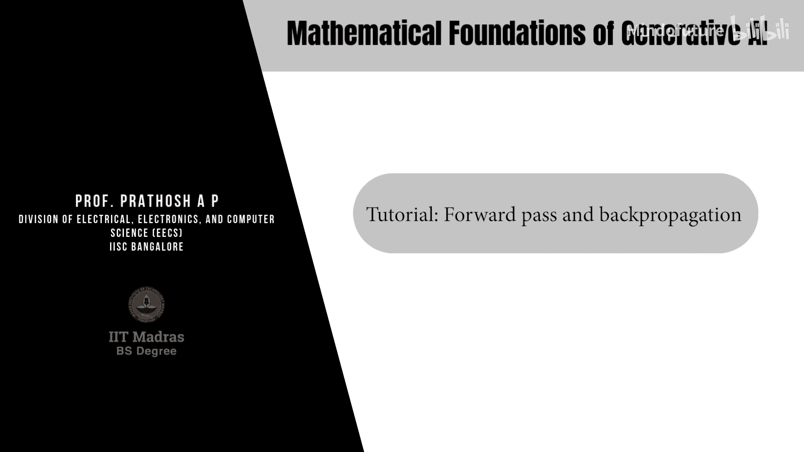
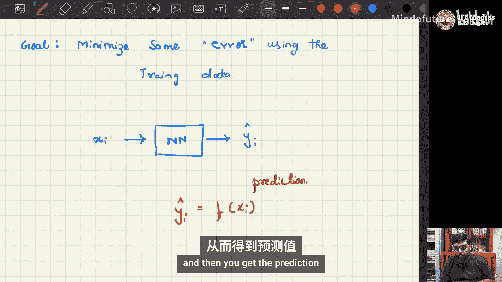
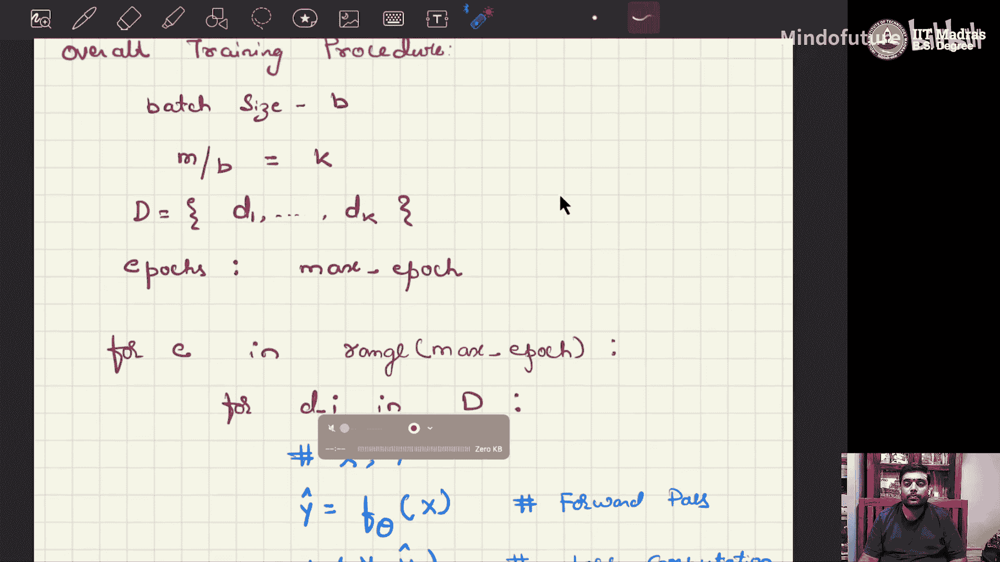

# 生成式Ai的数学基础 ｜ Mathematical Foundations Of Generative Ai p05 P05_W1T1-教程-前向传播与反向传播 -BV1fperz7EjK_p5-

🎼。

Hello， welcome， all of you to this first tutorial。In the region course。

Degenerative model course now in this tutorials now we shall be discussing predominantly on a simple。

MlP and how the forward pass will happen and how the back propagation。Using the edit will happen。

So a couple of prerequisites that I am assuming is that。😊，So。I'm assuming。You guys know the。basic。

Lture of。MlP so or the fully country network。What is there。反正。

And assuming that you are pretty much familiar with the task of。Regression， okay， so where in which。

It's a form of a supervised learning task in which you will be going to predict a number。Now。

 these are a couple of prerequisites that I'm assuming that you know for this specific tutorialial session。

So Ill give a brief introduction about the supervis learning as a whole。😊，See in supervised learning。

 you know what is the right answer， that is the underlying paradigm。😊。

So you will so you have the data that the data will be split into two parts now one is the clearing data。

One is the training data。So this is the data now using which you try to understand。

The mapping between your input。Now， the mapping between your input to your output。Okay。

And supervise the name， you know the right answer， So you want to understand this mapping。

 So now let's call this mapping as。Function f this is what you have learned now how do you learn this this is learned using the training data now how do you represent the training data。

The data trying data we represented as D。So when would you have。Pairs of Xi Y。

 so when which Xi is a feature and y is your target label and then you have。M such。啊。It vi。엑西。Is the。

Input feature。And why。Is there。Target label given。大。So。

Dep on the size of the dimension now you can assume that x is in some real space and y since we are currently working under the assumption that we are going ahead with a regression task you can assume that that is also in some real space okay now what is the goal of this whole thing。

No。The goal， the overall goal is。So we want to minimize。You want the minimum is。Some error。Okay。

As a goal of the overall supervising， you want to minimize some error。Using the training data。

Using the。对面地噶。Okay， and how does it look like， So you have a。Neural network， okay。诶唔啱。

It's probably concentrating an MLP here。You'll be given。The input Xi。And then。

 you will be predicting。Y hat now X is your input and this Y hat， which is there this is your。

Prediction。This is your prediction。So we can represent this via hat。You can represent this。

 why are you high。You use the function F。On this data X and then you get the prediction。

真系好了。Character is the error， so the error or loss， what is called us。

那 laws。So you can say that this is。Some L loss L， Now whichever between your。

Actual target level Y I and the predicted level Y I。好的。

This is the loss now which you want to minimize now this is the standard setting of your any supervised task。

😊，Now， to understand this so with a very simple intuition now let's take a very nice example of football okay now you have a football field so in which you are training okay。

This is a footfall field that you have and so you are trying to do some kind of a penalty kick or something like that or hockey or whatever now this is your goal post。

What happens is you are training。😊，This should be your actual trajectory know you should hit your。

Ba here this is your actual trajectory， but what is happening is now you are going off a bit okay。

 you are going off a bit and then you are hitting till here。So now this deviation， which is there。😊。

Now， this deviation， which is there is actually the error。

NowHow do you so the as now to reduce this error how do you reduce this error now you go on looking into practicing it now go on trying it using the training data now i am going switching back to the context of super learning that we have in hand so you go on practicing and finally this error will reduce okay this error will reduce this will not become zero this error that is there now this error will reduce action okay good so now。

Now， given the input， you go ahead and predict the answer of this。Process is actually all as。

Forward pass。This is called as the forward pass。And then you。Go ahead， and then。From the outcome。

 you calculate the error and try to update。Thanks， and this is called as them。Back where it passed。

Orre famously called as。Back propagation。Yeah。Now how does this happen that is the overall idea of so this is forward pass is from input to output now you have your input。

And then it will convert it to output and then in your backward pass or backward propagation。

 what do you do you calculate error it from。Eer。都。Weights。

 you update the weights each model is having some weights you update it so now for this this is the brief introduction。

Now， what we shall do us。this much of background in hand。We shall take a very simple。

new network structure or an MLP structure okay and then we will try to understand what are the some of the intricacies that are there and how does this backward propagation backward propagation or the forward pass it actually happens so lets try to look at both of them okay so now for this purpose what I shall do is I shall take my X。

With two features， now one is x1， the other is x2。Now input has two features。

Or you can say that I to represent that this is the I example you can have。

Subscribe there so now these are my input。It's I1。And x i。度O。Now， normally what will happen is。

We have something called as input nodes。These are called as。Input nodes。做啲 shirt。

Will not be having any no， any bas per se。Now， just the inputs will be given。And then。😊。

Youll be having some hidden nodes and taking two hidden hidden nodes in this case。

These are called as。I having one hidden layer， you can have multiple hidden layers like you have one hidden layer like that you have multiple hidden layers like this okay。

So and then here for a very simplistic approach， I'm just taking one hidden layer with two nodes okay。

 two hidden nodes in the hidden layer okay， and then Ill have a。Sple。😊，Output能。So this is mine。I不么。

this is the structure， which is there。So， let's put in some baits。

There is a fully count network or metal perceptron so。There's both the inputs。

Everything from the previous layer will be connecting to everything in the next thing that is the overall idea。

😊，Yeah this will be there。问。So let's make it more colorful。And then finally。

 they will have an output。Here output will be。Y a系。She。Okay。😊，对。是 now。Let's try to。

Put some names to this now we haven't done any namings for this。So now。This， I shall call that。

I will use the same coloring convention so that it is comfortable。Now， this is。二。In the first layer。

 first node。This is a in the first layer， seconding node。So now all these nodes， I'm calling it as a。

Is this is， let's say， this is IJ。 I have this is the。The layer number。这 is啊。Nord number。O。

And similarly， for the remaining things also， this is a。Second layer， first note。

This is a second layer， second node。And this will be a。Ely first。

I have named each of those node Im using a just to specify that it is an activation okay that reason I am using the word a so now lets try to put on。

😊，The names for the weights， how do I represent how do I name these weights？Now I use W as weight。W。

Okay。😊，No。From which node to which node？😡，It is connecting okay now you can say that from the first node。

 it is connect from the first node of the first layer。

 it is connecting to the first node of the second layer。

Now what I shall do is I call this one comm of 1。O。

Of layer one so let's try to understand these indices now my notation will be。W。喺个嘛。Z commmer系。Now。

 this K that is there now this will be the。😊，Which layer the I can call it as the。Nvy is near。

this ie， which is there。I call it as the。Destination node。And there's J， which is there。

이 got does there。そしの高。Because of which， so this will be。And this will be W。

It is going to the second node。From the first note of the first layer。ok。😊，And this will be。W。

From the to the first node， from the second node of the first layer， now this will be。

To the second node from the second node of the first row。And similarly for this。W。

The layer will be 2。O。This will be。From to the first node from the first node。

This will be to the first note from the second。Similarly， you can extrapolate these things。

I presume that these nomenclatures are pretty much clear now these are the standard nomenclatures that are being used okay。

So now now how do you compute these values of H now I have this w there will always be biases also it will be a Okay。

 yeah， I'll do it when I go ahead with。Writing the activation functions， I'll name them okay， so now。

Let's take， how do I compute this a？2，1， said 8，21， yes。How is this a to1 computed？Now for a21。

 that is this outcome。You have this and this。You have this X i。

W which is the same as a11 now since it' is the input node， this value and this value will be same。

This。The first feature， it will be multiplied by its respective weight。 we can use it。X， I1。

The convention is first， the weight will come。W one ga one one。边度。X even。不less。W。1 comma 2。

 comma 1 and 2。X。喺 do。Plus。I need some bias right now I should be indicating that bias as well now how do I indicate that bias now I will give it the term B now I should be representing the node and other stuff right now what I will do is now this is at layer1 the first node。

Okay， I should be using the same convention， this is an additive bias that I should be using now put this。

😊，Now we need an activation function now let's say that I am using the activation function G so we all know that the famous couple of famous activation functions that we have are one is sigmoid activation function。

Signmed way in which。The input is x okay or okay let's not confuse x we have already used for input let's consider it as some z if z is my input what is one over one plus E to the equal of。

Minus z the is sigm， and then we have Relu。Ftified linear unit now here， G of Z。

What will be the value this will be 0 if。Z is less than or equal to 0。Or it will be Z if。

Thisグトな zero。O。Now why do we use these activation functions these activation functions are specifically used for smoothness to model more complex relations between input and output now we normally use this activation function okay now similarly you have1h you have many such activation functions okay will not be going in detail with that。

😊，Okay， so now。This is how you calculate this， similarly， you calculate this。O。Now。

 normally what do we do as？This summation， which is there。Now we normally call it as Z okay。

Ifably use small is Z， okay， fine， no problem。Zed， which is there。This zgged， you want to name them。

The same indices of A we use it。This is that this is one more representation that is needed for us going ahead。

And similarly， let's compute for。耶嘟嘟。So now a22 will be。做。Again。

 so you can use the same activation function or you can use a different activation function。

 but people prefer to use the same activation function throughout okay that is overall idea。

Now g off。W from layer 1。You' are connecting to the second layer from the first one。X。Yes。W 2，2。

From the first one。Into x。喺度。Yes。B1。O。十老蚊。Then finally， you want to compute the。Okaycome， so now。A1。

3， how do you compute， this is W2。1，1 into。二。都玩嘅。This into this outcome。This into this。B。

This into this。Okay。pl。The blue from the second layer。1，2，2， into2。

A 22 and then you need an additive value in the second layer the first note。Yes。

You pass it through activation function since this is the last node that we have this is what we represent as。

Y i。this is over。Predicted value。 Okay， this is our。不れ didn 많이。Now。

 this is the overall process of forward propagation now this is if you have multiple layers accordingly you go ahead。

😊，So I presume that this is clear。So now， then what do we do us？Now， here。It is evident that。

This values are fixed now why are these fixed now this these are nothing but input。

 so these are fixed。大概。So now if you want to。Choose if you want to reduce the error。

Now these weights。That are there now all these weights are the ones that needs to be modulated。Now。

 this depends on this， this depends on this， this， which is internally depends on this。

You cannot change this input so you can only change the weights of it。

Now similarly you can extrapolate it to everywhere so now what do we do is now all the parameters that are there now we put it as a list okay we call it as theta so when which we put all the parameters。

😊，走。我就。Of the parameters of the。Network that we have。Because of which we represent y I hat equals。

The function F， which is having the parameters theta。Okay。你食。

Now this function can be anything this function can be a linear regression。

 this function can be a polynomial regression， it can be a neural network now depending on what is your choice now you go ahead okay。

那 this is the。This is the forward path。你啊。Forward plus that we have。Okay。

 so now now the next step once you have done the forward pass。The next step at hand is。It does。

Erer computation。是那不。See， the idea is you need to reduce the error using the training data that is pretty much clear for that okay so now what is the error。

😊，It depends on the task that you are going ahead now if it is a classification task that you are going ahead we normally use CC loss if you are going ahead with some reconstruction task now that is what we shall be looking into in most of our generative cases well be looking into the MSC laws or the reconstruction laws that we have we have KL divergence so on and so we have lot of loss functions now depending on the structure what is the aim that we are trying to achieve。

So now in this current case， now we shall take a very simple loss okay？😊，Now I'll call this L。

 we will be using the mean squared error loss。famously called as MSC loss。咁 as speak as。Means square。

Error that we have now we should be using this how do I have this this loss for one specific instance now we are only taking one data point if you are having multiple data points you just accumulate and take out the average of the thing okay now for that specific instance that we have。

1 over two。喂喂。Y is your actual target label minus。我我得个咗。The prediction that you have got。Okay。

 if P off all this is same as。OfIn。华 minus。Why I had their prediction。Also， this is a。系咪先。lo。O。

So now we want to reduce this specific MSc loss that we have in hand。Okay。

 so I presume that that is clear now。I want to just for completeness sake。

 So I want to reiterate that。So are。Assuming only。One training point。

If you have multiple timing points， know what you will accumulate all the error you take a sum of it and then you divide it by number of points that you have considered now which will give you the average of it okay。

Oh， yeah assuming one thing。And then the error that is there， this is。This is。

What we want to minimize。This is the error that。1， minimize。Now， how do we minimize this？

Standard trick that is known to all of us that is we we minimize the function by computing its derivative with respect to what we can optimize okay now you cannot modify or change you cannot modify or change the input the only thing that we can optimize is the parameters that are involved so finally so we want to minimize this by computing the derivatives with respect to the parameters。

So we minimize that。Any function by。你讲 building一。The computing is derivatives。Thepectト。我。

We can optimize。Or what we can change。Yeah。Now， this is famously written， written as a。

Optimization function， I should not be。 I'm not assuming that。So we are familiar with optimization。

 okay。So。And not be going ahead and writing any optimization equations， so now。

We can only modify theta now that too I take a specific instance of it now let's take that so。

They are taking a specific parameter。W I J。K that is at the k layer okay the previous layer is k layer the next layer is K plus1 layer now from the J node of the k layer and connecting to the eighth node of the k plus1 layer the weight is what I am considering。

I had a loss L。Now， I compute its gradient。Doel by do。So。

 I want to find this gradient once I find this gradient I will be using the gradient descent which all of us are actually aware of so then we perform gradient descent。

人 we。播放啊。Graadient descent。How does this gradient descent will work？The weight is updated。

 but yeah you take the previous weight。And then you use a learning rate into the the gradient or the derivative that you have computed。

Okay， now this is the standard。Back propagation that we do using gradient decent this alpha which is there this is what is called as a learning rate this alpha that we have here。

你这是子。Learning rate， we need lot of naack in choosing this learning rate that we shall learn in our coming tutorials。

 So learning rate this will this belongs to。So the positive R， okay， this is positive real number。

 Okay， now we shall be going ahead with the。What we shall be doing is by propagation。

 we should be doing the。By propagation。唔嘅。Gradient descent。This is what we should be doing。O。

So now what does this derivative actually say， what is the intuitive idea behind this derivative？😊。

So now if you， if you increase this。啊。Prameter that you have considered。If you change this。Now。

 how does。It affects the loss。😡，ok。Now that is what we want to actually find that so now。If啊。

We increase our change。😡，喂。We increase this weight。제께。How much。Does。nouse。进去。

That is what we are looking at， that is rate of change of laws with respect to weight。

So now now what we shall do is。Now， to understand the back propagation in much more detail。

 let us take one specific weight in mind okay lets that reason let us consider the weight。W 1，1。

 comm1， okay。Now let's consider this week。那公几来啊。This week。So understanding， okay。嗯。

So now what is that we want to find now now we want to see that how the loss will get affected as I change this weight。

Okay。Now， in that， the first thing that we should need to do is we should know what is a path。😊。

This W11 is being involved now as you can see here。This is the path in which W11 is involved order。

Let's highlight that path。 So just for。Okay， this is too dark， this is。It's up business I。没事 no is。

鉄砲な。This is the path in which there's going。This is the first thing now first we should look at now what is a path that is involved。

Now let's handle this。Once we have the pot。From the Sir。Weed under consideration to the output， then。

We can look at it， So now。Nowadays， I am assuming that all of you again know the basic idea of chain rule here。

This output， which is there， is affected。😡，By this value of a3。Okay， now in this path。

 A3 is affected by。This week。Okay， and this weight is。In the chain and this。不 guess是。Okay。

 there is a chain that is happening that now we should be taking into。Considerration。ok。

Now let's write it down。 How does it propagate。So the loss that is there。Is。

Directly dependent on the。The output。ok嘅。Which is same as a3， this is the first。Okay。

 so now the laws， which is there is directly dependent on this a。31 okay。

 now how is this a31 now this a31 which I have。Is related to this。Okay。So now that means that。

And how。내다 그리고。031。看。Now，印度。Now theres Z31 now which is this value。No， which is that in the path。

Okay， it is dependent on8，2，1。Okay。A22 will not come in the path。That is this。There three1。

 which is there。It is dependent on。咦。😊，杜王。啊。Yeah。And then the a21 which we have computed。

This 821 is dependent on this Z 21。And Z 21 is dependent on this w 111 okay。

 now you should actually trace back the path。This is。A21， which is a。Is dependent on this。Z to1。And。

This Z21， which is there。Is dependent on this weight w111 okay this is the full back propagation calculation now using the chain rule now which we are able to do。

Now， I have pre computeutd all these values， I have just taken the same equations and written them again and then what I have done is I have taken a very simple。

😊，Feature input now which is1 and0 now this is your input。

And I'm considering all weeds and biases that I have is。😊，1。

And then if I go ahead with this computation now a to 1。This will be the computation。Now your weight。

Into this one。Plus weight into the zero。You get this value。Similarly， I have a computer map。ok。😊。

And this is my loss。So now， now， let's。Go back to our loss gradient。Equation， now let me copy this。

I have written it in a very。没。Okayです。Yeah。AndLet me paste it here。This is the same equation Okay。

 so now one thing that I can change here is this is。This is nothing but why I hat。

 so what I can do is I can replace this。For all practical purposes， I can replace this with。话，你系。

Okay， so now let's go ahead and compute the gradients。 the first thing that I want to compute is。

How the laws will change with respect to mind。喂呀系。Okay。

 now I just want to write the loss computation。L equals half in 2。Y I minus。hy a hat okay， if say。

Take the derivative of this L with respect to this y now this will be。

Or there is a square here Im missing。Yeah。Now this will be by minus。hy is he hurt。好嘅。Now。

 you can this is like by the x of x squared is 2 x。So， you get。2 into this term this one。

 this two will get cancel so get。The term， okay， I am assuming that， you know， all those basic。

Rules of differential calicculus， Yeah I have computed this now。

So now the next thing that I want to computers， now how is mine？Why I had I have。

Is dependent on this。Third，3，1。Okay， just to give you a reminder。 how does this。Why I hat is。

Sigmoid of this。Third3，我 now。Now you should be taking the derivative here， it will be。

The derivative will be。This itm it off。Even into1 minus mode of。No。Its the same as。

Y I hat into1 minus。喂啊系。O。And I completed two terms now。This term has been computed。

 this term has been computed。So now， no。Let's take。好米。Z31 is dependent on。嗯。咦。😊，都云。

To understand that first， let us compute always。Z31 equals。skin layer。稳稳不稳。A to one plus。

Secondly from。Okay。嗯。In go there。Let's go back to equations and then compute。入 new。うと。Plus。

 there is a biot B。This is a gun。So now when you compute when you take the derivative of8 to 1 okay。

It will be the weight this will be。好嘅。Now you have computed this term， this and the term。

How is this the now？So now you should be callicculating。你做 one。Now how is a dependent on Z21。

Now what is this。诶都玩诶。You one off。I third the one。That means that this will be。我是这样咩。你你方唔同嘅系咧。你声。嗯文。

嗯什么。1 minus。你是C嘛是。8 to one into one minus。嗯知。ok。😊，So now the next thing， this term we are done。

 this term we are done， this term we are done。This song we are done。

 how is this z to 1 dependent on w11 is the next question？那。What is the z to one。物宣レト案。冇了。完完完。

This is my next question。Now how does it happen？嗯吃。王彪德。Here z to one equalizer。W 1，1， N 2 x。

I win yes。W。1，2，1， into X， A plus。b云稳。Because of which this will be。不题。还有。Okay。

 so now we have effectively calculated all of them。So now。Now let's put all of them together。

Into one equation。Yes。老日啊。This will be。Let's cinate each of those take each of the term。

Why I minus the why I hat。This is the first time。This stuff。I'll turn into this。你说。This， this。

If we want， we can label it。This is one。This is school。This is three。This is4。Thiss five。1。五。你。好。

 this is the multiage of them okay。And this。In two， the second term is。W I had in one minus。我睇。

Into the tumas。要玩什么玩书。年都。你都晚你度玩买啦，是啊。We do one we。Okay， now this will be the gradient of the pole。

Now you just need to compute this particular gradient similarly。Once you have computed the gradient。

 then what do you do you apply this。Amation method。

So now because of which your weight will get updated now this you do it for all the page that are that in your whole set of data you do it because of which your weight update now will。

😊，So now how does the overall now how does oral training procedure look like how does the oral training procedure look like lets shed some light on it。

好。我啦。Training procedure。So what we do is rather than taking each example at a time。

 we take a batch of them。The overall data now that we have M examples， what do you do。

 you divide them into。Examples of VB。Okay， so now let's take that I a。I have a bad size of B。

And then you have some examples。In each batch， you will have B examples what its takes is to say that I have some K batches。

Now， my oral data now will be a set like the1。嗯。嗯解。

When with each bi now well be having B examples now I'm assuming that M is of indivisible P now if not in the last batch。

 there will be some small number of examples。😊，系，那不着。

So now what do we do is now and then this is one right now we want to decide it on how many times you want to iterate over the whole data iterate for the whole data okay that is called us Es。

Lets say that I have decided that I want to go ahead and iterate over the whole data max E。😊，Okay。

 I want to be all the whole data next。O。So now， then what will happen is for。

He Im mean that you noty I am writing it noty big。你你印象。买衣服。Okay。then拿 for。你。嗯。B。To take one D。

 each D will have a bunch of。Xクス。And y okay， all the x put together， I call it as capital x。

And that the right。When which x is your input， y is your feature。What do you do you calculate。

By you hat， which is nothing but you take this。Function and then passes x。You like this。And then you。

广票 blocks of。为什么为 had。You compute this。This is what is called asda。For the past。And this is。大。

Los computation。好的。And then the third step， I just write it in a couple bit the third step is you obtain the gradient。

😊，Otain the gradient， okay。Now， once you have obtained the gradient， so then what you do。

 you update the weights。Okay this is the standard procedure that we shall be following in most of the cases。

 there will be some mix and match here and there， but overall structure remains the same now you will be running over this whole data okay this is one time you will turn over the data。

Now we finish off the K times， the K times this will happen。Oh。

So the number of times in which the waves are updated that is called as iteration and how many number of times you want iterate over the whole data that is called as maximum epos。

Unless specified this is the standard training procedure that is used and then you use the test data to calculate the predictions and then you measure it with whatever metric that you have in hand。

😊，Or having as per the choice of the problem that you have。This is the overall idea。

The training procedure， the forward pass so what did we discuss in today's tutorials today's tutorial was predominantly on the structure of simple MLlP that we have considered。

We considered the idea of mapping。And then the idea of error and then we took a very simple network into consideration。

 and then we understood the components that are there in this network and how you。😊，Put the names。

And then we understood the forward pass。And then how do you compute the error？

And then we understood the idea of gradient。And how do you apply the chain room in obtaining the？

Graads and once you have and then this is the forward pass with a simple example。😊。

And once you have that now how do you compute the gradients。

 each of one of them we cook separately and then we compute the gradient and then we compute the total gradient for one weight the same thing will be repeated for all the width and then you upgrade it。

😊，M。And then we looked at the overall training procedure。哦。

The supervis is learning in most materials and less specified now there will be some here and then some all modifications will be there apart from the the structure almost。

Now this is what we have discussed today， so thank you for patiently listening to me in the next session so we shall be in the next tutorials。

 we shall be looking into the Ptoch Bary。😊，はい。

