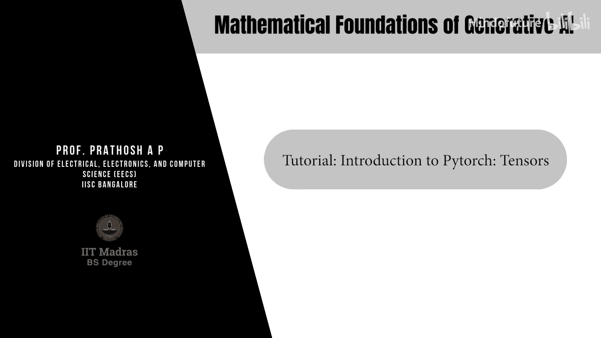
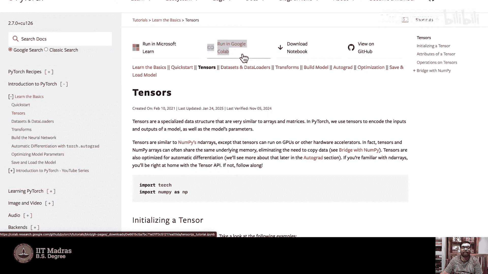
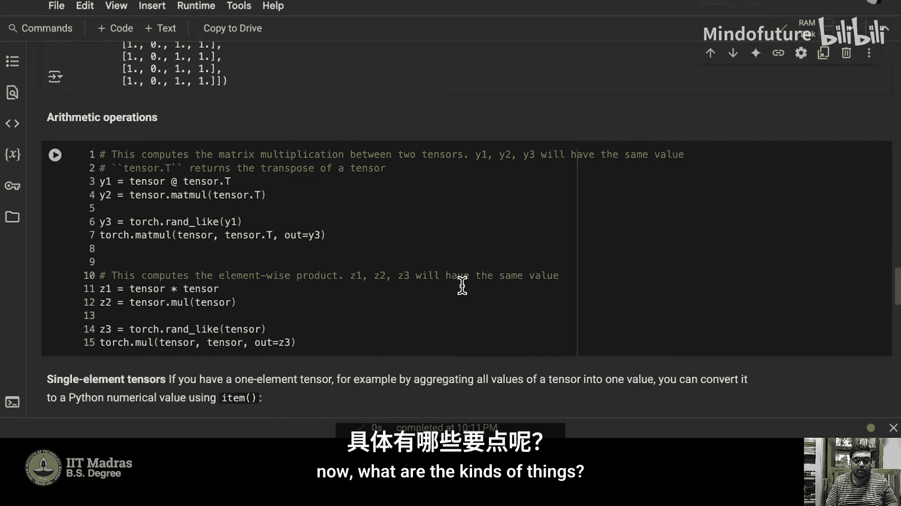
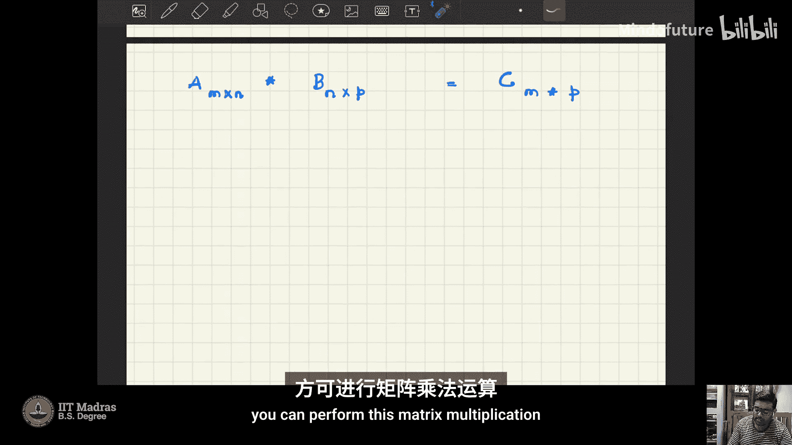
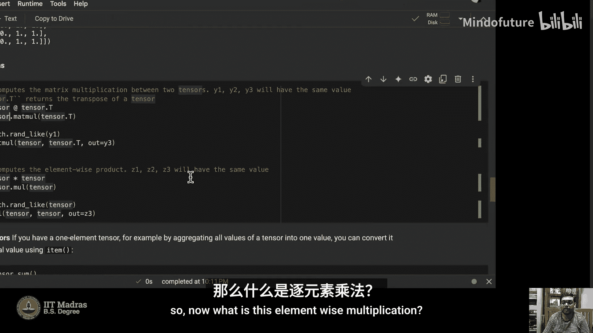
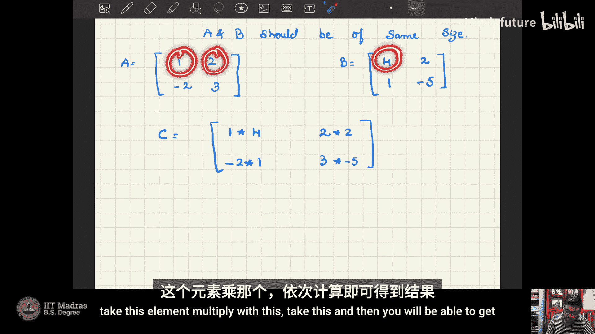
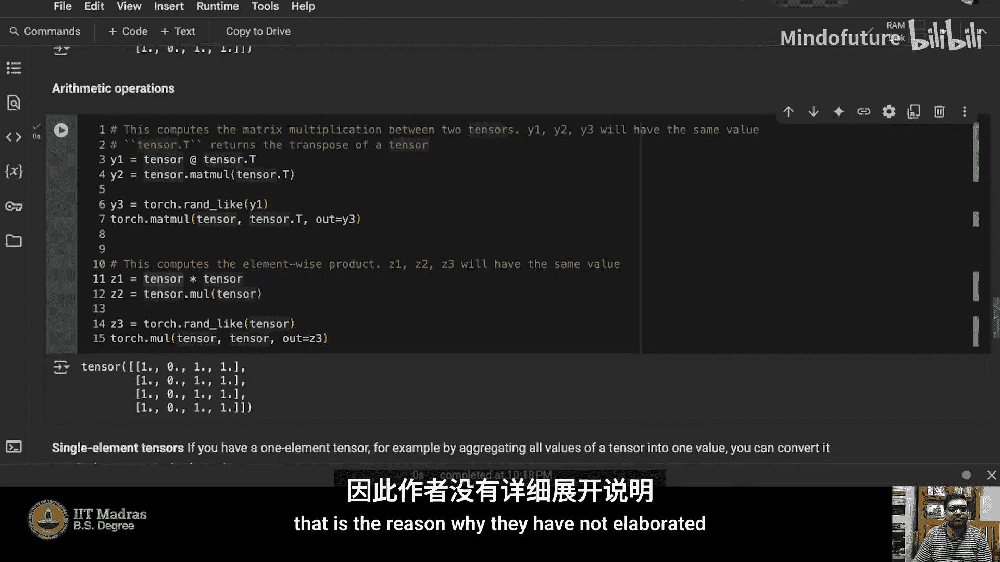
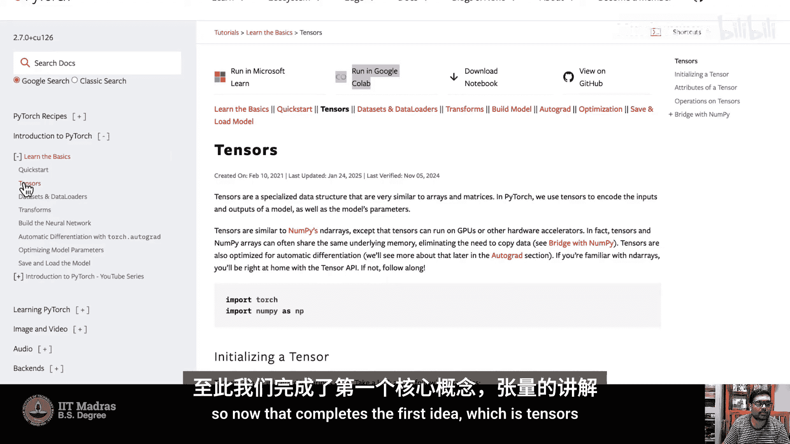

# 生成式Ai的数学基础 ｜ Mathematical Foundations Of Generative Ai p06 P06_W1T2-教程-Pytorch介绍-张量 -BV1fperz7EjK_p6-

。

Hello everyone， welcome to this second tutorials in the course degenrating models。In today's course。

 now we will be looking into the basics of Pytorch。啊。

The whole of the course you will be learning lot of theory。

 how can you mathematically formulate a model？And then in in addition to that。

 you will be learning how you can implement the these kind of models on。Some simple data search。

We will be using Google Collab for this specific exercise。

Now Google Collab is a platform which gives us access to a simple GPU well GPU we can use it now the whole coding exercise throughout the whole course now is structured in such a way that we will not be needing more than that we will be implementing a very simpler versions of those models and then we will be discussing how to extend those models if you have compute resource。

So in the previous tutorials that we have undergone。

 we looked at the idea of forward propagation and backward propagation on how does your gradients are computed and then we looked at the overall training procedure。

Now， in this specific tutorial， we will be looking at Pyth basic。😊。

Now we will be using PyOch in addition to that if someone is interested they can look out for resources on how to implement similar models using Tensorflow but the overall discussion is centered around PyTch。

Now， what do I assume as prerequisites for this specific period see I'm assuming that you know the basic structure of MLP and then you know the basic idea of thens。

So basic structure of MLP now we actually discussed in previous tutorial now if you are not very much comfortable with the structure of CNNNs or you want to have a revision of the CNN structure which you can look at one resource that has。

Stanford University CS23，1 course。You can look at this resource。

So here you can go to some useful notes in which they have curated a very interesting note。

And then you can look at the overall neural networks。They have explained each and every idea。

Using very nice examples as well as a detailed note has been provided。Now。

 if you are not so much comfortable with CNNnns， you can go to CNN notes and then here they have given a detailed overview of。

The convolutional layers， how do they work what do you mean by the idea of parameter sharing whatever are features now given an input how do you calculate this is how。

The operation of convolution happens what are the essential parameters that are there has been described。

In detail in this resource， now you can look at this resource。Now CSs 2，3，1 m， Sanford Co。

On computer vision they have elaborately given a very nice they have curated a very nice notes you can look at this notes then look at the idea of convolutions and the idea of neural networks all together I am assuming that these prerequisites are known then we have given the reference material so now coming back to Pyararch。

😊，We will be using the standard Pyto tutorial available。In public。

 we will be just going through that and then explaining you where much more elaboration is needed and then well be running those codes whenever needed and then at the f of this factorial what we shall be doing is we shall be writing a simple structure。

Read some of the data sets that are there and work on those data sets。

That is a overall idea without any further delay so lets。

Start into now how do you get to this page is just in your browser of your choice。

 just type Pyto tutorial。Now， you will be going to this is the official Pyth tutorials。

Or you can go to this link by To。t our tutorials。/lash indexext hastl you can go to this this is the basic tutorials and it has tutorials on most of these ideas but we be going ahead with a very simple basics we will be learning only we will be looking at only these basics and then the extensions of it you can actually look at it and it has on all these ideas。

So now let's start with quick start。Now what it has done is they have given for each of these tutorials they have given either you can run it on collab or you can download the notebook and then you can use your own local machine or the visual studio or the Jupyter notebook that you have you can use it or you can look at GithHub but what I shall be doing in this tutorial is we'll be running on the collab so that you are much comfortable with the collab environment as well and then you are comfortable with the idea ofor the idea of quite odd aspect yeah so this is kind of summary of everything so we don't need to go there now let's go to Tenss。

I'll be opening it in the collab。

So this will open a collab thing。Wellll lab notebook， okay。So。

The collab notebook that is there will have these kinds of dialogue boxes now this is having that extension IepTY ND。

 which means interactive Python notebook okay this is the name of the file。

So where this so whenever you are running any instruction or running a code now it has to physically run on some device right now where is the device the devices not present in this is this is not using your local resources now what is happening is in the Google server it has given you a chunk of resource and then you will be running your code in that specific chunk okay so now this removes all the problem of installing the packages maintaining those necessary packages all those hasss have been removed will not be。

Wrying about any of them so we shall be directly going ahead and learning know what is necessary and then what I assume is you know Python that is the assumption if you are not so much comfortable with Python now I urge you to go ahead and look at simple course on Python which so you can learn the basics of Python。

So now， what are tensors？tensors are the building blocks of this oral pyar now now you can think of them as some kind of a specialized structure。

Now which are very similar to the arrays or the matrices that we have now if you have worked with Ny now it has something called as Nd array so n dimensional array now this is similar to that but what happens is now this tensor which is there now it can run on GPU and other hardware accerators。

So now GPUs are the one which gave a huge push to the deep learning。Okay。

So you can run these sensors or the operations on these sensors on the GPU。

Okay that is the added advantage of these using these libraries Pytoch now which has a simple data structure called as a tensor now in this first notebook that we have so now let's look at how do you create a tensor okay and how do you do some of the basic operations on these tensors okay。

Now to do so the first couple of libraries that are needed now whenever you are working on Pytorrch the first library that is needed is you is torch now therefore you import torch and then so you need data now either you can create a list and convert it into a tensor or you create a nuy array and then convert it to a tensor now for a list you don't need to import any libraries if you are going ahead and putting it as a Ny array now at that time you will be needing a nuy so you need to import it let me run it the server you run it you just click on the play button now whenever you are running it for the first time it will take some time now because it has to establish a connection with the server so it will take some time to run。

Now these text blocks now this is text block and this is code block we dont so in the text block more information will be given now code block is where you write your code snippets and run。

😊，Now， I assume that you are pretty much comfortable with all these basic ideas。Yeah。😊，So now。

You created data。You create a two dimensional array。

 this is a two dimensional array or it is famously called as a matrix this a two dimensional array or a list。

Okay， so now what you are trying to do is now you are trying to convert this list or two dimensional array that you have into a tensor how do you do it？

Now， you just。Use the method enter toch dot tensor， you use this to dot tensor to that method。

 you pass this data as an argument now that will return。哦。

A tensor type data now with the same values in it。Now the values will not be modified only the kind of data now this will be a list this data will be a list now you can check it by using type type of data you can check it now this will be a list now you are changing the type of this lets run this。

And this is how if you have a list， if your data is a list， you can convert it into a den。

Now on the other way， if you have your data as anump away， okay。

Now so in the first line here I am converting my data which is a list into N array so now I have a N array now how do you convert your N array into a tensor？

So now you use this。Nampai array， torch the user method， torch dot from Numpy。You pause this。

Converted Empire。 Now， you get this。Tensor which has been created。

So now this means that you can create a tensor now using a list。

Enter your thing or you can do it using the numbery array under your。诶 data。Okay。

 so now now most of the times what will happen is you may need to create。😊，A random tensor， okay？

Or a tensor with some specific values like I want all the values as one or I want a random tensor of specific size。

Now， we have two ways of creating that。Now， one is you directly give the data now which is of that size okay or you say that okay。

 I want of this size。If you give the data itself now internally what it will do is it will calculate the size and then it will create a new pseudo datata or a du data of that specific size if not now if you give the size itself it will directly do well lets look at both of these ways。

😊，No。You have this x data。Now， I want a tensor where which all the values are one now what is this x data x data is a tensor so it is a2 data tensor okay I want a tensor I want2 data tensor again now where which all the values are 1。

All the values are1 now if this data now which is there has some specific some other properties。

 even those properties now will be transferred to x the the new x1s now that is being created okay。

Now， this is in which all the values are once now in addition to that， now if you want that okay。

 now if you want random values。So now then what will happen is you just pass this data and then you are saying that the data type of this should be float now but you can see that the data type here is intesger what it will do is it will override this x data now which is an override the type of this x data and then now you will have a2 deger now when which all the value will be a floating point values we can print them you can see that。

All our ones， you can see the size of it， it is a two cross to tensil。Similarly if I run it again。

 you can see that different values are getting generated because you are doing a sampling or random。

😊，This is how if you pass the data similar to that structure you can obtain。The tensors。Now。

 in contrary to that， if you have the shape of the tensor what I will do is now what they have done now what I know it is not me who has curated this this is the standard things that we are using now。

They are saying that okay now the shape of the tensor should be a2 cross 3 so now I am so tarj dot ran now if you use this method and pass the shape it will create a random tensor now of size2 cross3 okay。

Now if you want all ones now then you can use torch dot ones when in which you just pass the shape to this method and then you create all you create a ten when in which all the ones are there and then torch dot 0 so you pass the shape to this method when in which all the values will be0。

We can see this yet。A two cross three tensor is being created here。Okay。NowThis is a random tensure。

 the first one is a random tensture， the second one is a tensor when which all the ones are there。

 the third one is a tensure when which all the values are zeros。

So now that means that you can create tensors using if you want a structure， if you want a shape。

 specific shape， either you can relate it to the the data that you have and then get it or you can specify the shape and then you can get it。

Okay， so now then look at some of the attributes of tensors。So now one is the shape of the tensor。

other is， what is the type of each of those values that are there？

And on what device is it running see what happens is now whenever in your system， if you have a GPu。

Now CPUpu has to be present for sure now your tensure can be on the CPU or on the GP now depending on that now I can say that okay on what device it is is it on CPU or is it on GP let's run this and see。

the shape of the tensor is3 cross 4 as we can see that it is generated this block and then you can say that okay this is the shape and this is the type data type of it d type is data type it is saying that it has float 32 and then。

😊，The device on which these values are present are CPUs I am not still using my GPU。Okay。

Now these are some of the attributes that are there for now。

Now let's try to look at how do you actually move your tensor into an accelator if it is available now we will come back to this no let's not。

对 now。This is slicing and indexing now we will not be needing the slicing and indexing during our course so I will not be spending much time on the slicing and indexing if you know the slicing and indexing of Ny it is exactly similar to the slicing and indexing。

Now， you can look at it。Yeah。这个。So here the first one we can look at it now you are creating a torch you are creating a tensor way which all the values are one the shape of that is four cross4 and then you are doing some kind of slicing and indexing ideas that you are trying to do okay so I shall not be going into that。

Now， how do you concatenate tensors？Now you have a tensor now that means it it is a matrix how do you concatenate a matrix now when I say how do you concatenate a matrix the question is now do I need to put one next to another or one below another？

Okay now this will be the standard question that is there which needs to be answered whenever we say that okay now go ahead and take a attention and concatetnate it okay so now lets look at this thing and then lets see how it is there now to dot cat now that is the method that is used to concatenate when which you provide a list of fences。

😊，No， here。All of them is the same tensor and then you have something called this dimension1 what is this dimension 1 and then you are printing this okay lets see now how it happens each tensor is a fore cross for matrix now that is known to us lets look at this now what happened here。

Now you see。1。2，3， Okay， maybe I did not run it。 So I still have a sorry， I still have a two cross 3。

那我哋你就未知啊。O。Now this is the tensor that I have now it has one， two， three， four。Now it has four rows。

 and then how many columns are there，1，2， three，4，5，6，7， eight， nine，10，112。No。Yes yeah。

 so it has repeated threes okay now four cross four next to that four cross four next to that four cross4 so now you have 12 columns and then you have four rows now that means that dimension one what does it mean is now you are concatenating as columns now if you want to concatenate as rows now you just change this dimension to0。

And if you're on Nick。Now you can see that it has been concateized。

So now now whenever you want do concatetnation， the question that arises is no do you want to concatennate it as columns or do you want to concatenate heteros those things can be handled with changing the。

😊，Dimenssion of it Okay so now yeah， this is one operation that we need The next operation that is needed is the idea of matrix multiplication now which is the seminal idea in most of the neural networks now for all practical purposes now your whole forward propagation in a neural network can be thought as a matrix multiplication actually Okay so now how do you perform matrix multiplication is is the question here Okay I assume that you know the basic rules of matrix multiplication now what are the kinds of things okay let me tell you that rules again okay。

不。If you have a matrix。P matrix a。And which is of size。Mcroom。And then you have a matrix v。

 which is of size。N cross P， then you can multiply this matrix。Okay， then you get a matrix C。

 which is。Mク okay。So now these two things should match。Okay。

 the columns of the first matrix has the number of columns in the first matrix has to match a number of rows in the second matrix now then you can perform this matrix multiplication。

There is a standard rule that has used。 Okay， so now you are taking a tensor now。

 which is of size 4 cross 4。

Okay。So and then you want to multiply。Multiply it with water。

Now you have one matrix which is four cross 4 that you want to multiply now what are the options now you have to have four cross anything then you can multiply。

So now the tensor now which is a  four pro for matrix。

That is being multiplied with tensor dot T now what is this t now dot T is used to take the transpose operation。

😊，That is the transpose operation。Okay， and this act symbol。

 which is is used for matrix multiplication tensor。😊，Now it is a four cross for matrix into tensor。

 the transpose of it。 Okay， now tensor is a four cross for matrix。

 So the transpose of which will also be a for cross for matrix。 Now。

 you are multiplying a four cross for matrix with another four cross for matrix。

 The outcome will be a for cross for。Okay， now you can use at this is matrix 1 and this is matrix 2。

So you can multiply， this is one method of doing it。Okay， now then you have another method。Now。

 you can use。The first matrix。Dot。You can call a method from there from the ssor。

 which is max matrix multiplication which is as soft form as magm and then you pass the argument the second matrix。

Okay so now this is same as multiplying the first matrix with the second matrix now this is one more way of performing the matrix multiplication the third way of performing matrix multiplication is directly using the library task now it has a method called as a MAM now way in which you have to pass both the matrix A and V and not only that in addition to that you should even pass the result and matrix。

啊对。So now that is the reason why you create a resultant matrix which is a structure of it toched or trend like all the random values of y1 y1 is this matrix。

Okay that is y3 and then you are passing it now you multiply this tensor and with its transpose and the output will be stored in this y3 Okay now these are the three ways in which you can multiply。

Marices now one is using the act another is using first matrix dot max or you can use the torch dot max when which you will be passing both the matrices as well as where do you want to show the result and as the input okay now this is matrix multiplication。

Now the one more important thing that so we shall be needing is the idea of element wise multiplication so now what is this element wise multiplication just take a look at it okay lets look at this。

嗯。elementement waste multiplication is one of the core operations involved in convolutions。

Element wise。嗯。to perform elementwise multiplication， A and B should be of same size。A and B。嗯。

Should the of。Same size。Now let's take a matrix a。Let me put some random values。

 I'll just take a simple two cross to matrix， one， two minus two。3， this is one matrix。

And the second matrix B， which would be of the same size again to cross2 Ill take。富 do。one， three。

 okay。put three。你不。マイナス。how do you perform this element wise multiplication now that is c equals which will be 1 into 4。

2 into 2。Minus2 into one。3 into minus-。Okay， you take each and every element and then you perform the multiplication。

 take this element， multiply with this， take this。

And then you will be able to get of this this is the idea of element wise multiplication so now how do you do this element wise multiplication you you have a tensor now which is of size 4 cross 4 that we have already created into tensor you use this star symbol here。

😊，Okay， this is one or you can use tensor dot mu， not Macm Macm is matrix multiplication。

 so I presume that you know now you are pretty much clear with the idea of matrix multiplication and how is it different from element by multiplication。

😊，Okay， our element waste product as it is called us。the first matrix。Do mu。

 you call them method there。So， when then you pass the second matrix as an argument。

 or as we saw earlier， now you pass both of them torch dot mull。

 you pass both of them and even you pass the result。Okay。

 now these are some of the basic operations that you perform on the。单词是。啊，你说呢哎呀。

You can look comfortable， O。So now with this I assume that you know the basics of tensors know what are the attributes of the tensors and how do you create a random tensor a tensor with all ones and how do you perform the very basic operations of product element wise product and the matrix quantplication similarly you can do additions of action and other things and those are trivial tasks that is the reason why they haven't elaborated on that。

So now that completes the first idea， which is thetensors。

