# 生成式Ai的数学基础 ｜ Mathematical Foundations Of Generative Ai p07 P07_W1T3-教程-Pytorch介绍-数据集与数据加载器 -BV1fperz7EjK_p7-

。

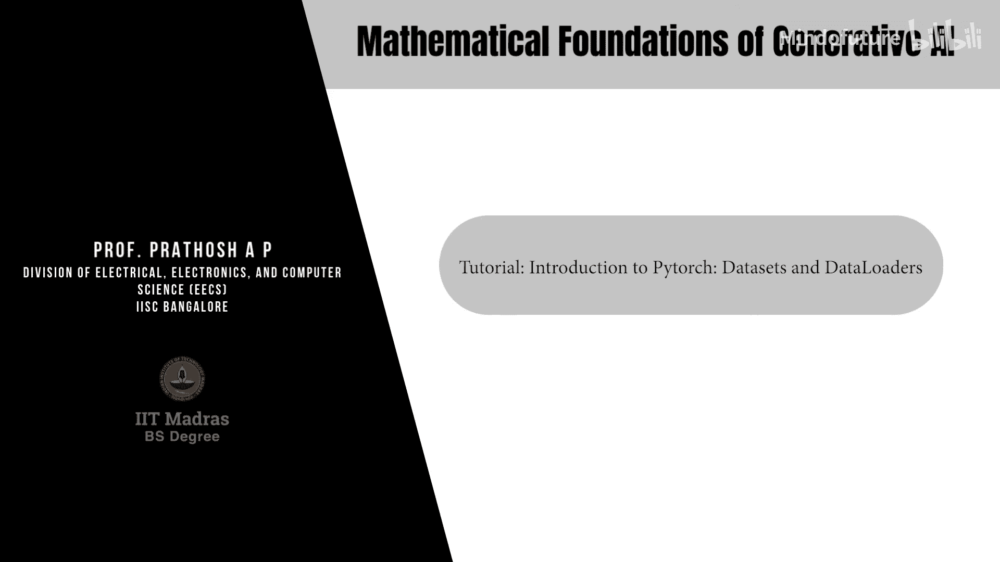

So now all of our data that we get now will be in the form of a tensor。😊，Or it has to be， you know。

 we have to convert it to the form of the tensor。So now how where does the data lies and how do you handle it how do how do you get this and then you want to get it in terms of batches okay now for the a of weight now how do you do all of them now is the next idea that we shall be looking into now in the second tutorial which is data second tutorial sheet sorry second tutorial link here which is data set and data loaders let me go there。

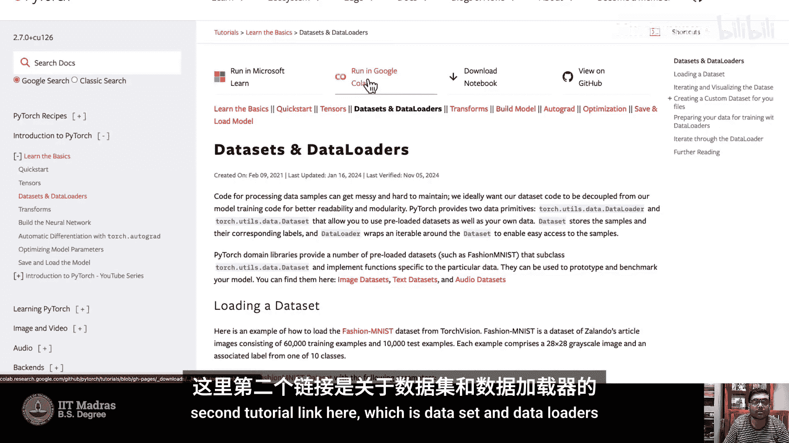

没。Now here is what they are doing is。

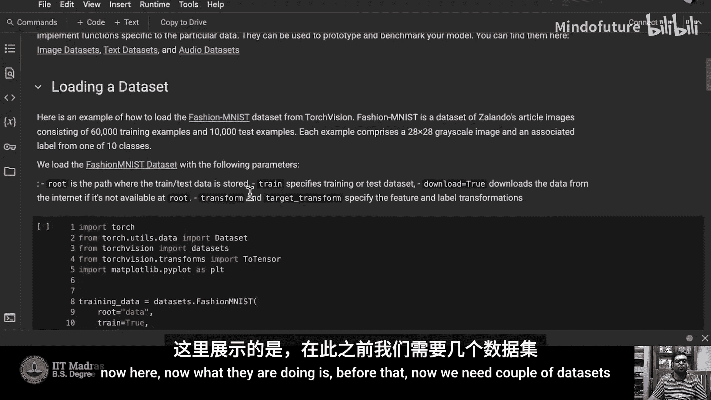

Before that。Now we need a couple of data sets now we need to look at this。Dash dataset sets。嗯。Okay。

 now what are the data sets that are available in Pyth？

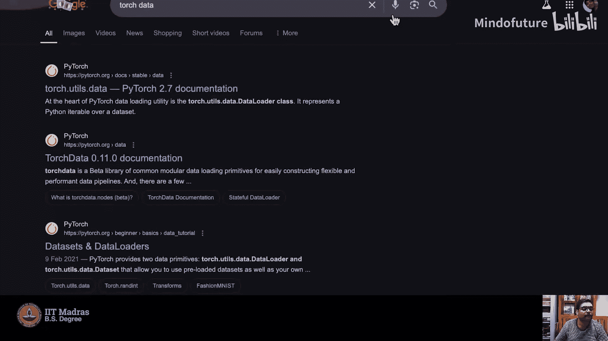

没有。我行。The one。

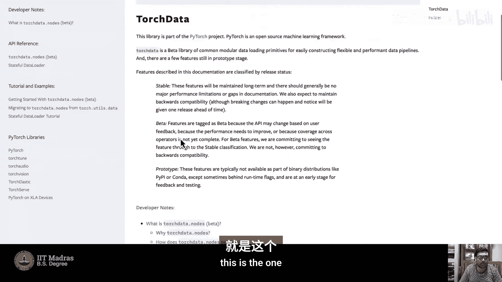

Reasonless。The。Yeah。呢边。没有。没有。Okay。

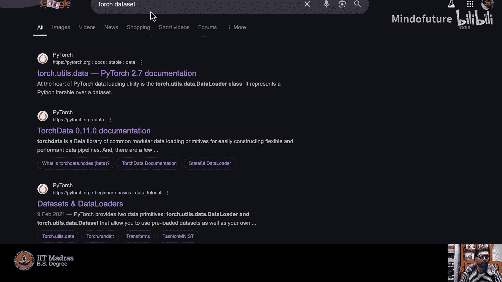

Yes。Yeah。Yeah啊。See these are some of the data sets that are available in Pytharch itself when it is available in the Pytharch repository itself you don't need to worry about much okay now when the most of times what happens is data will not be present here at that time we should know how to create a data loader as it is called now these are some of the data sets that are available Caltech 101 Caltech 205256 ce a5 10 so on and so forth now we have a lot of these image classification data。

😊，Image it and stuff， Okay， so and then you have image detection or segmentation data that also you have。

Image pairs， video classification， video prediction， so on and so forth。

 you have enough data now you can play around these things。Now， here。

Now we are using a data called as fashion Ms now fashion Mist is a group of 10 class its a 10 class problem。

When did you have them？10 kinds of clos okay now I' am not sure about what are the kinds that are there。

 but for all practical purposes you can say them from zero to nine now zero is something one is something。

😊。

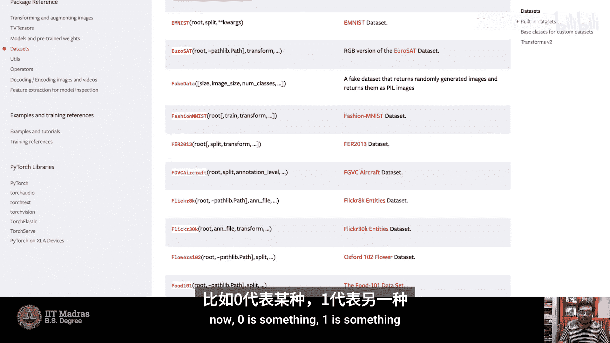

Now you can assume that。Now， let's look into。How does it work？Okay， so now。No。Now。

 what are the necessary libraries that you want to load the first library is the to itself。

Now then to dot utilize your data you have to get had to work with get the creator data set。For that。

 you need this data set okay you can see this capital here and then download。From the repository。

 you need this package called as data sets。And then now once you have got the image you need to convert that image into tensor for that you need this transform that is what is called transformation now you need to transform it to a tensor now for that you need two tensor and then you'll be plotting just to see how how the image is look that you need this pipe plot which is matlib pipepl has PLt you are allsing it as PLt and then you will be using it these are the necessary libraries now for our work okay so now as you are very much aware any data that is there is has two parts to it now one is the training data now in which you try to understand the relationship between input and output the other is the test data which is user to evaluate the relation similarly this also has two parts of it now one is the training data and test data they have been made separate so now our aim is to take them now where is that available。

Data sets dot fashion Mist， this is the name of this thing。Like a fashion emminist。

Now root equals to data now what does it mean as now where do this data is present now it is present in the folder called as data。

 that means that in the current working directory it is present in the folder data。

Now I'm looking at the training data。O。Praining data and then download is equal to 2 if the data is not present in this specific folder what do you do you download it and then once you download the image okay you apply this transformation now what is a transformation now it is an image an image for all practical purposes is nothing but a matrix now you convert it into a tensor。

Okay similarly you do it for the test data also it is present in the route which is from the working directory which is the data now if timing is false now that means that you are getting the test data download equals to true that means that if the data is not present in this particular route you download it and then once you download the images you convert them into tens。

That is the idea let's run this to take some time。Yeah，这啦。Take some pain。And meanwhile。

 this is used to just show the images yeah but。We are not interested in that。

 so I will not be going ahead of how P works。How how do you create this access and other stuff I will not be interested in that so just wait till this happens。

呀难。So and then it code prepared to visualize yeah， this is a code， this address。Yeah。

 these are different， what do you call labels that are there code dress sandal。

For all practical purposes， you know you can number them， you can say that this is from zero to nine。

 they have 10 classes。😊，Md from zero to9。

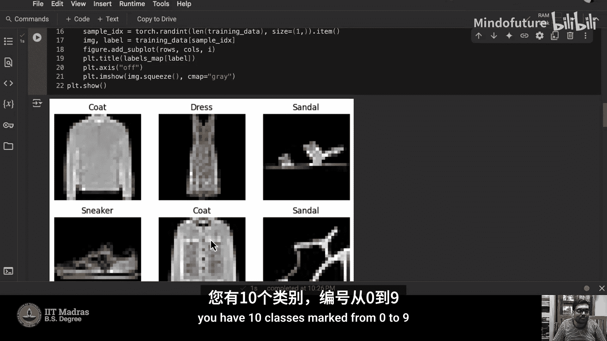

Yeah， now this is a good case now why it is a good case because your data that you need is present in the Pythrus repository itself。

But in most of the cases， we might not be so lucky。

Sometimes there will be some custom data or some sensitive data customer sensitive data or from confidential data might be there at that time your data that is there may not be in the repository of Pyth now at that time now you should create this。

Data you should curate this data on your own you should write the wrapper script around it to get it lets see how to do that and that is called as data custom data set。

So now， now whenever you have this。Custom data set。 Now， it is having。Two parts to it。 Now。

 what are those two parts。 Let us。Go there。

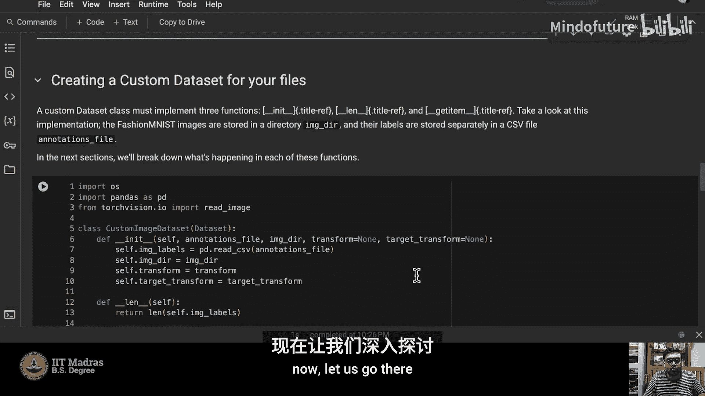

In this custom data。嗯。So got custom data sets。嗯。You have this route directly now that is called as。

Image directory， now this will be an OS path。And then you will be having something called us。

A notation file。Okay， now this will be preferably a CSv file now what it will have is it will have。😊。

The relative path from the image directly， how do you and the image name Okay sorry real relative path and the。

Image name or whatever data we are not pretty much concerned about the modality here。

 it can be sequenced also and then it will have the label。It will be a CSV file with。都搞了。

ThisNot to this。O。😊，Now， using this now we should be creating a data set now this is the folder。😊。

And then from that folder， now what is the image name， now what is the label of that image。

That will be there from here now let's look at how do you create your own custom data set。

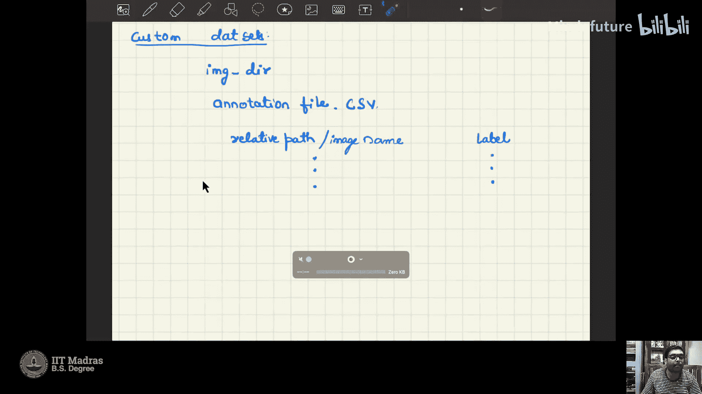

没。So now for that you need O now why do you need Os now because you want to retrieve the file from its path for that you need this library OS and then you need pandas now why do you need pandas now you'll be reading this CSV file and then you'll be working with that to do that we need a 3D data frames you'll be meaning data frames so that you need pandas and then to read the images you need this star visionion do ivo you need this read image。

呀。So now lets I' am assuming that you are pretty much comfortable with objectiented programming so what do I mean by that as you know what is inet you know what does double underscore mean here okay all those things you are comfortable is what I am assuming okay so now and then you are pretty much comfortable with inheritance is what is being looped into here are creating a class which is with the name custom image data set now which is a child of this data set。

And what is this data set now you can look at it here earlier。

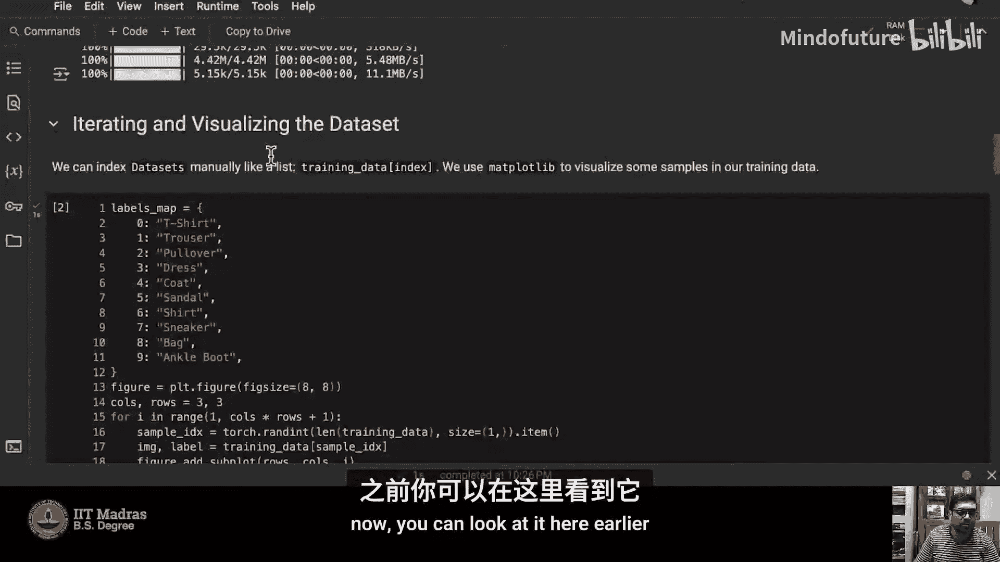

this is what is used to create a data。

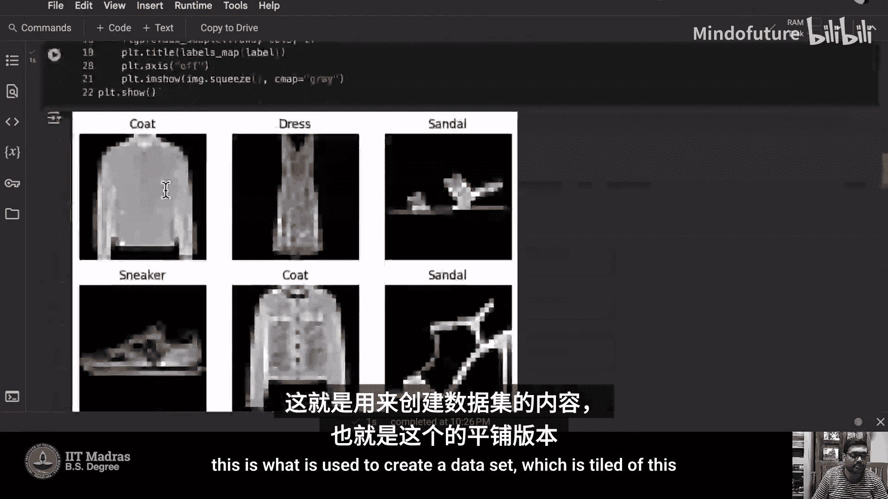

哪嘅。Which is child of this？So and then you are in your innate method， your constructor。

 you have self which refers to the instance itself。

And the annotation file now this annotation file is what I said as a CSV file know way in which you are all the image names and then the lead path or the image name and the labels will be there and then the image directly the route to that。

😊，And then transform now this is we want to apply some kind of transformations on the input data。

 on your features， on your x。Target transformation。

 do you want to apply any transformation on your y on your label？They they have been。given as none。

 okay？So now of self dot image labels now of。Now how do you get it noPd do the read CSv now you get you read this whole of the annotation p and then you sell dot image directly now this is a path now whatever transforms you have is being initialized in the construct method。

And then these two methods should be there。The compulsory methods。

 the whole thing should be almost as it is。Now the length now should it should be able to give the length of image labels now image labels is nothing but the CSV file which is there now whatever is the length of it now it should be able to give now that means that so many items are there that is the overall length。

Now how do you get the item now now how do you get the item is via its index？So， now。

Let us try to understand this now for this get item method now you are passing this index now what is this index now in a CSv file now I am saying that now。

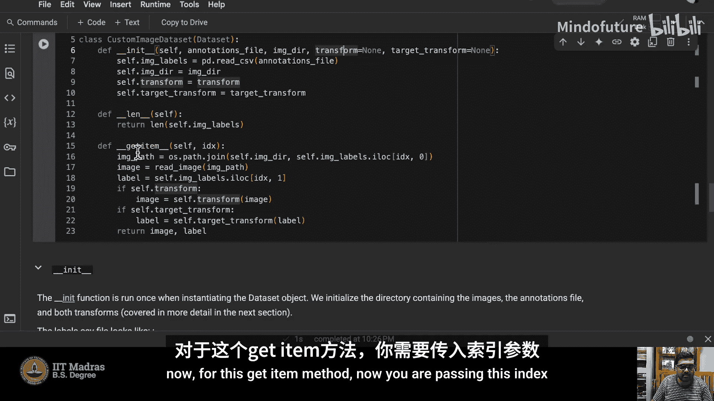

This， which example are you looking at？ Okay， now this is what is。The old here as IDX。Yeah。

Which example， which row you are looking into？

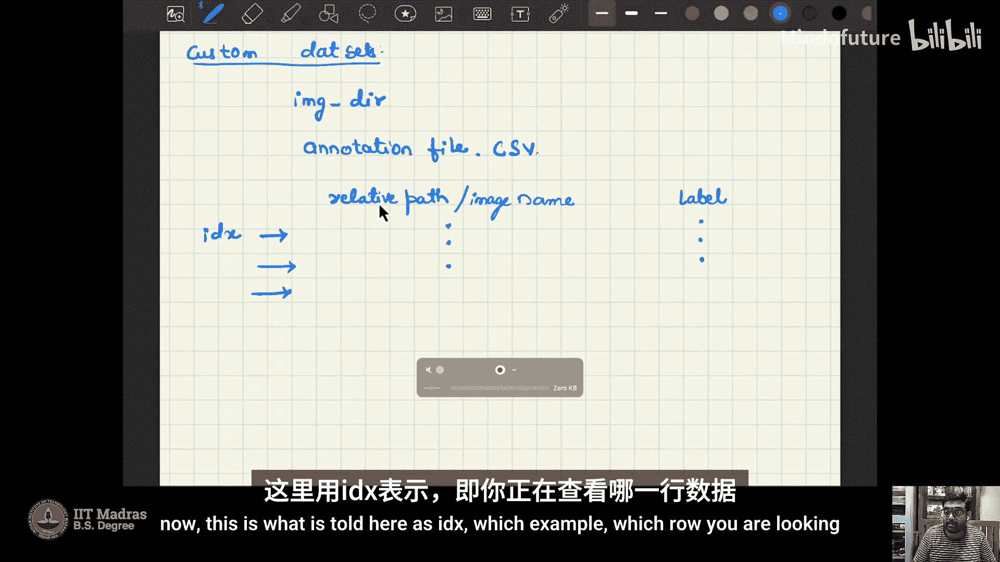

So and then image path。Image part。W is dot path dot join so you are joining two parts now what are the two parts now one is image directly that is your path and then image labels which is nothing but your notation file dot Io。

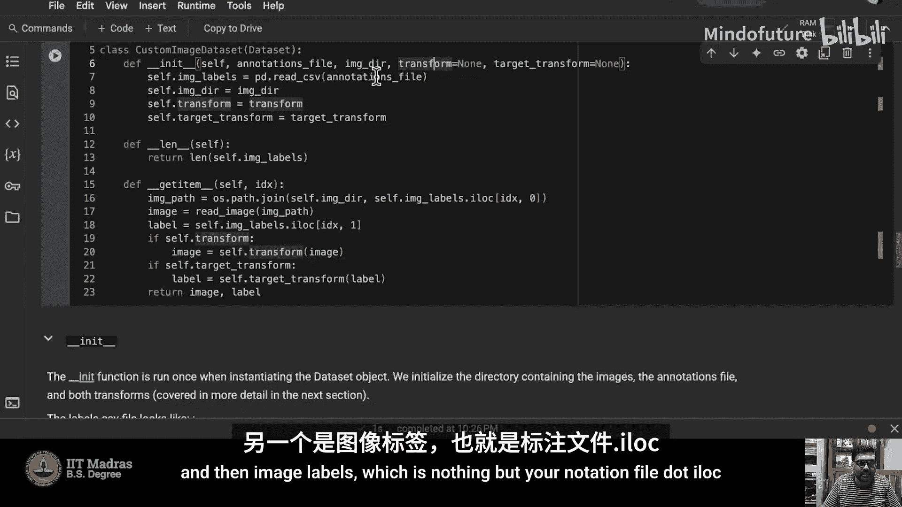

Now， that means IO is refers to I need to access rows， now which row you want to access。

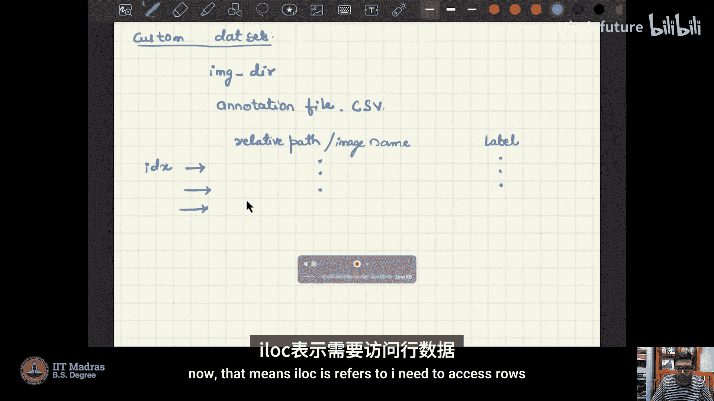

Now， you want to access the IDX not the index now which index you want to access lets say that I want to access this index of0 now that means that the relative path now that means that I am joining this image directory which is there I am joining this image directory。

😊。

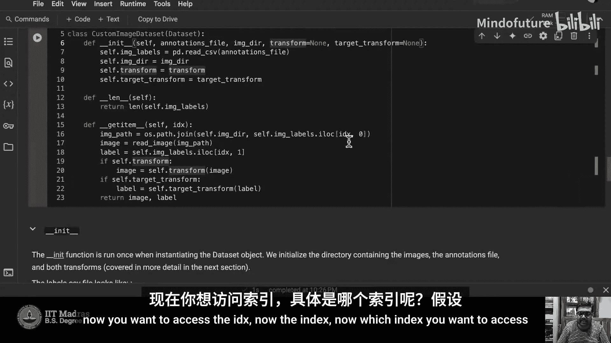

With this relative path now that means that now I have for an image have a full path that is。😊。

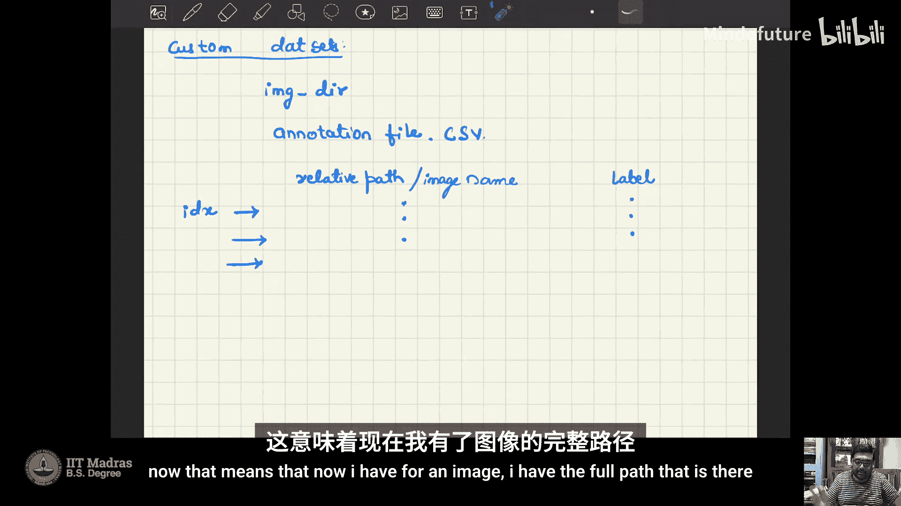

Okay， this is your the first thing that is your image path。once you have got the image path。

 then what do you do read that image？😡，Okay you read that image that is what read image from the image parts then what do you do now you have got the image okay fine and then you want the label right now where is label now in this image labels now which is an annotation file in the same。

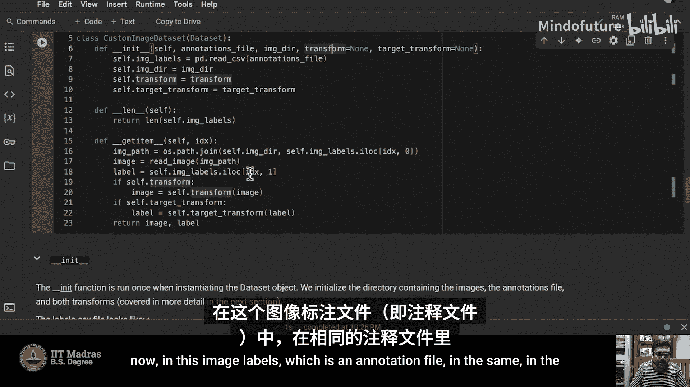

In the annotation file that you have in the index now the first column that you have is the label。

You get it okay IDx1， that means that you get the。

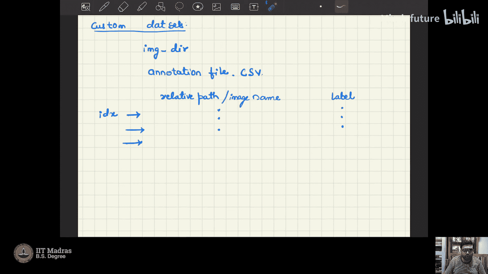

Now， if there is any transform that is need to be done self dot transform transform the image now using that。

 if there is any target transformation， you transform the label using this。

A targetarge transform which is specified and then you return the image and the。

This is a very simple code snippet what that is。😊，Use here。

Now most of times we will be needing this custom image data set。

 now you will be needing this specific thing and then we will be giving you custom data sets so that you can work on。

So that you should be very much proficient with how do you get this data whenever you have。

The data which is not present in your PyTch reposory。The same thing has been explained here。

So now you have got the data， okay， good。Now you have curated the data now good， so now then water。

Now， then you need to create something called as data loader。Okay。

 now to create the data loader now first you take the training data which you have fetched from the source。

And you are creating a batches of 64 now that is what I told you you are creating a batch of 64 and shuffle equals to2 now this is an interesting。

😊，Argument shuffle equals to2， that means that。😊，every time you shuffle the batches every time now it will not be in the same order every time you shuffle the batches。

That will give you the tri data loader and similarly test data。

Whatever the batch size you want to specify and then whether you want to give shuffle is true or not see in test loader or it is not mandatory that you should give shuffle equals to true it makes sense if you give shuffle equals to false not because you will be validating only once。

😊，Okay， so you will not be having multiple epochs over the test data。

 So now it doesn't mean anything now when you give shfle equals to true in the。Thatest case。

In the this data。Yeah， you can run this。And then you can access these using IE iterator next when you use this。

 you will be able to access the。Each block。听懂。This is just plotting it。 Yeah。

 So now what has happened is now now。

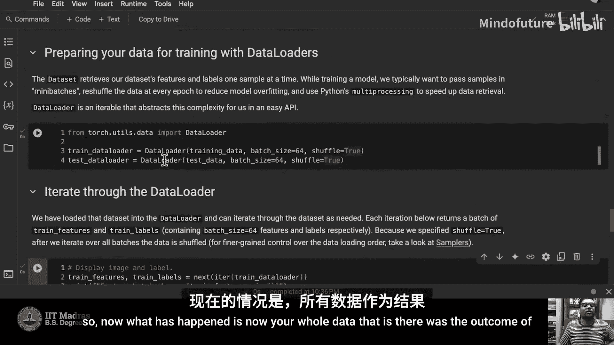

Your whole data that is there because the outcome of this your data has been。Divide into D1， D2。

So on until some decay。Okay， so where in which each De。民 be。X J comma yj， it will be a couple x J Yj。

J is equal to 1264 okay， now you have considered a batch size of 64 each of them will be a batch of 64。

还是不。Now this is how now now you have curated the data。😊，Now you have obtained the data。

And kept it in the form of a tensor。Okay， now。What is that we have done now？Data is ready。

This is the step that we have done now。

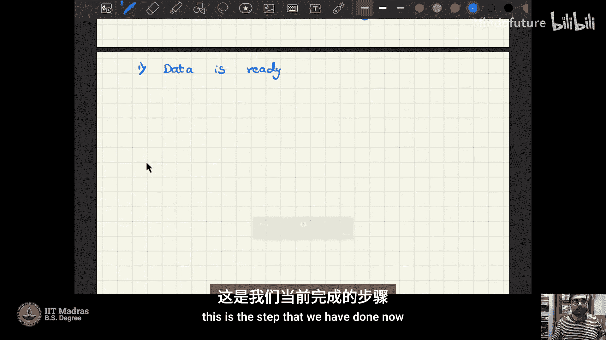

So now let's look into the next step。That's all is from this。Set， okay， let's go into the next one。

 Let me leave this。

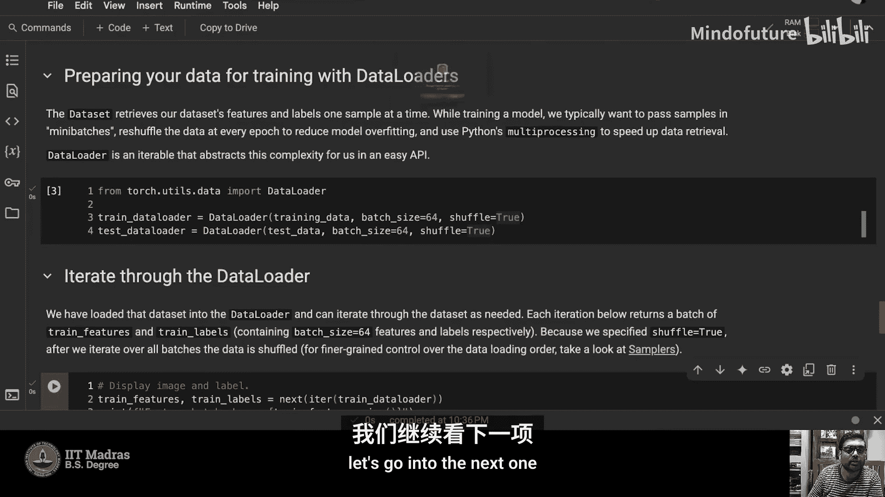

I don't need data， that's also。

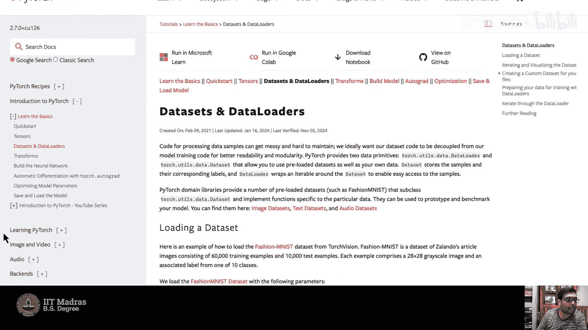

