# 生成式Ai的数学基础 ｜ Mathematical Foundations Of Generative Ai p08 P08_W1T4-教程-Pytorch介绍-模型构建 -BV1fperz7EjK_p8-

。

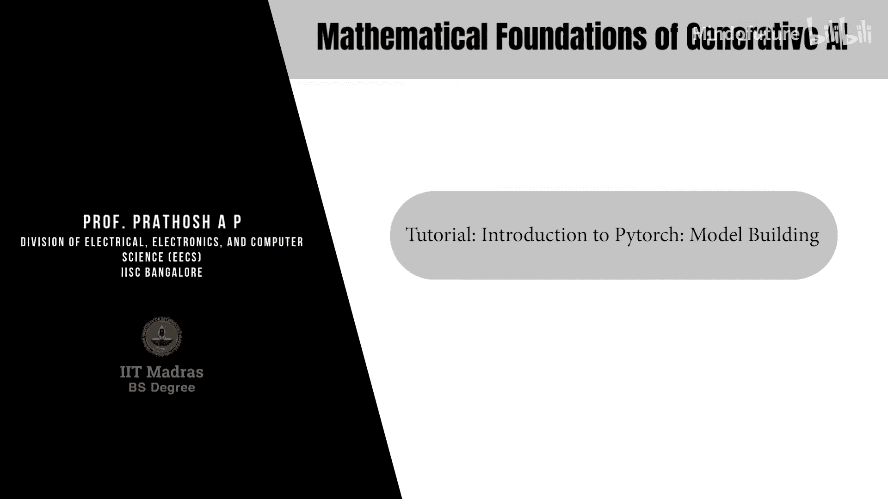

So now let's look at the transformation。What are the different transformations that are available they have just listed it up。

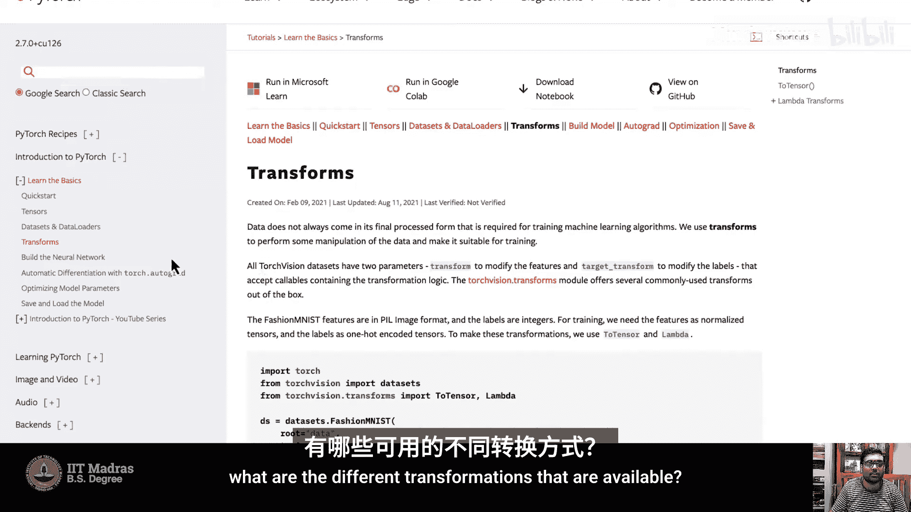

公司。So you have downloaded the data。Now， the transformation that we preferably use is2 tensor which is mandatory。

 there are some more transformations， it is not elaborated here。

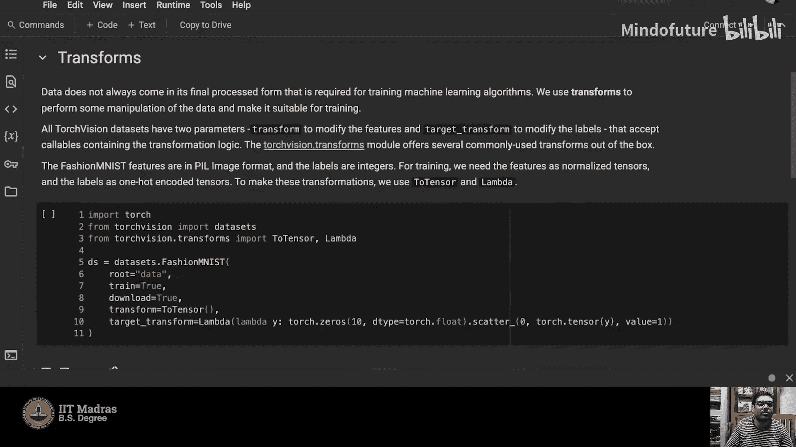

There are some transformations that we shall be using like random crop， resize。

 all those things we will look at in whenever we get the。

Time of it whenever we are looking at third code， then we will be telling you how。

Your input features。Has been transformed。Okay， now this is the。First就。The data is ready。Now。

 you have curated the data。So now comes the next thing， which is your。

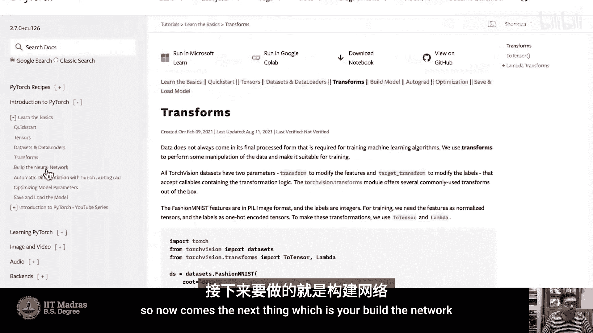

Build the network Okay now we should be building the network。

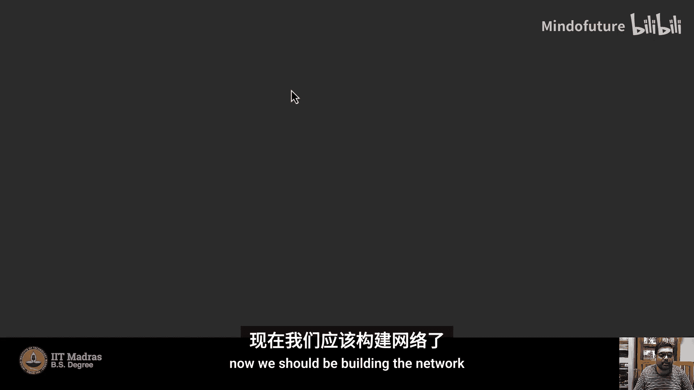

哦。So now whenever the next step now which is。Build the network Now first you should know what are the choices of network。

Now I'm assuming that we are in this task now we are dealing with。Image classification。

But almost similar principles holds for other modalities as well。

Whenever you have image classification， now the very crudeestt form that we can do is we use an MLP。

😊，Or you use CNNs。你见。Or nowadays， you can use even。The vision transformers VTs。Now。

 this is V T are for future。 Okay， this is for。So we will not be looking into Vts as of vision transformers。

 preferably we will be looking into multi layerier perceptrons and convolution neural networks。😊。

 so now whenever I say convolutional MLP， now let's take the first case of MLP。😊，明白。That is MLP。Now。

 there are some choices that needs to be made now the choices are。The first thing is。How many layers。

Okay。诶唔到。How many Nords？In呢。你咧。That also needs to be decided。What is。

Actation function that needs to be used。Okay， now these choices know needs to be dealt with okay。

 so now let's take these choices into hang and then create an MLP。

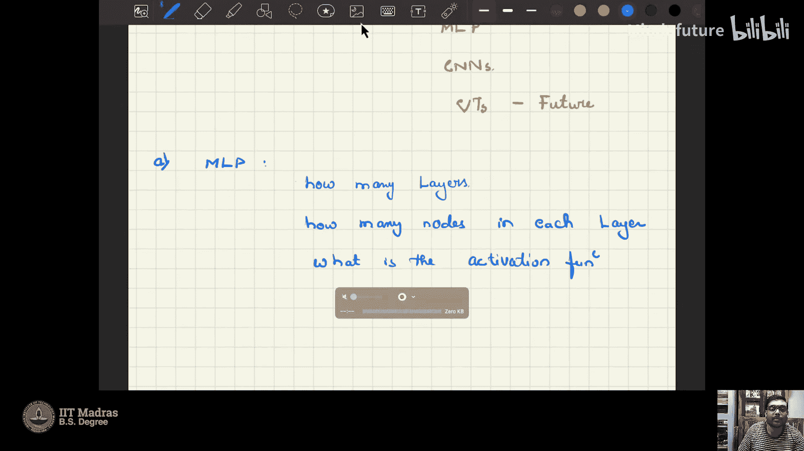

It's than back。没有。Now let's build a neural network the first thing is o now why do you need O now if you are retrieving anything from the system torch for byythrch now torch import Nn now this NN is transfer neural network data loader is needed to get your data and then data set and transforms are needed to transform your data now these are the libraries that we have already seen okay yeah okay this is something that we haven't looked at how do you get your device。

run and run it game。I should have told you how to get the device first。

It will take some time to initialize all these library。

 These are very big libraries It some time to initialize。And establish the connection。Yeah， okay。

 so now if you click it here。Click it here。 and then you can see here。Change runtime。

Now when you look at this， these are the available devices for free， they a CPU user。

 a T4 GP user and V28 GPu user。Ill use this T4 GPpU。

 it will say that it will terminate your current session， okay let it terminate no problem。

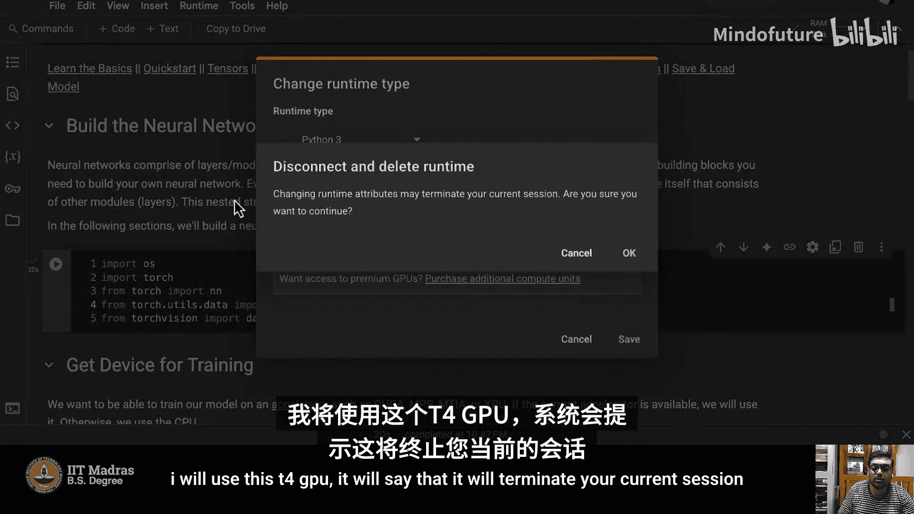

I saved it so now everything that has stored in the previous thing all of them will be removed so I need to rerun this so that all these libraries are reloaded again。

Or you can change this。 You go to this runtime。 You can change this。

 change runtime and then change it to。CPU CPU back and forth， you can work it out。对呀。お。

Now dos not accelerator， current accelerator if it is there。Use it else you use the CPU yes。

 now we are using the Ka device now Kuda is the name that is given for this all these GP devices okay yeah fine。

I am using the Qa device now now let's create a neural network that is what so we are intending to do now okay。

 let's do it。Now we have to create a class of this。Class， neural network。

 whatever name that you want to give。And that has to be the child of the parent called us Nn dot module。

 that is the name of the parent。Okay， fine， so now in the init method in the constructor。

IfYou have the cells， if you want any other arguments， you can pass it on。And then you call super。

 that means that you are calling the parent image method。Okay。

 in method is used to initialize all the parameters that are there。

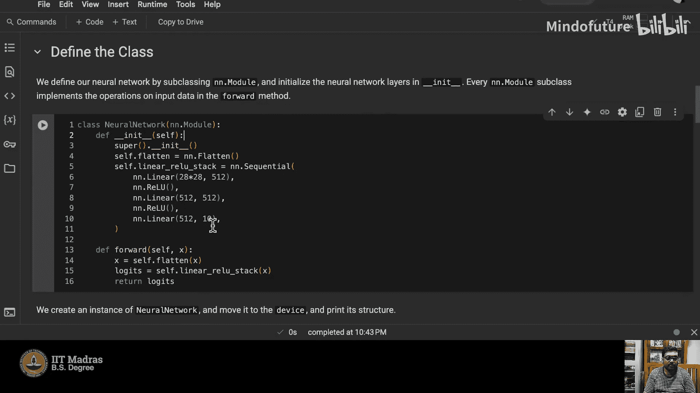

Now， what is the first thing that you are supposed to do？Now。

 since you are doing an MLP and your input is a。If we are doing fashion Mist， which is a。28 cross。

28 matrix is a single channel image。And then the input for your MLP will be a vector now you need to convert this into a vector。

눈2。Flatten it up， because of which the outcome now will be a。Vectctor。你这是。

ssHow do I get this 784 that is 28 cross 28 now how do you do it to take the first row put it here take the next row put it here the next row it here so on and so you put it and then you get a 784 cross  one block and this process is what is called flattening so now you have a vector which is of size 784 okay。

So now your input dimensions are fixed。Okay。Now which is 784。And their output dimensions are fixed。

 which has to be 10。Because you have 10 classes so the final it should have 10 thing you get the logics out of it now I presume that you know the theory and then you pass it through a softmax method you pass it you pass this through。

Softm。If I this through。Softm。Now按 get。Probably vector out of it。Of啥意思？

10 cross 1 we are taking a the case of fmness which is a 10 class problem so we will have 10 cross1 so another thing is what is there in between now you need to look into it now now this is what you should decide how many layers should be there now your input nodes are fixed 784 now you have this 784 things your input nodes are fixed how many hidden nodes and how many nodes that each thing now has to be fixed okay so now lets look at the code that is been given。

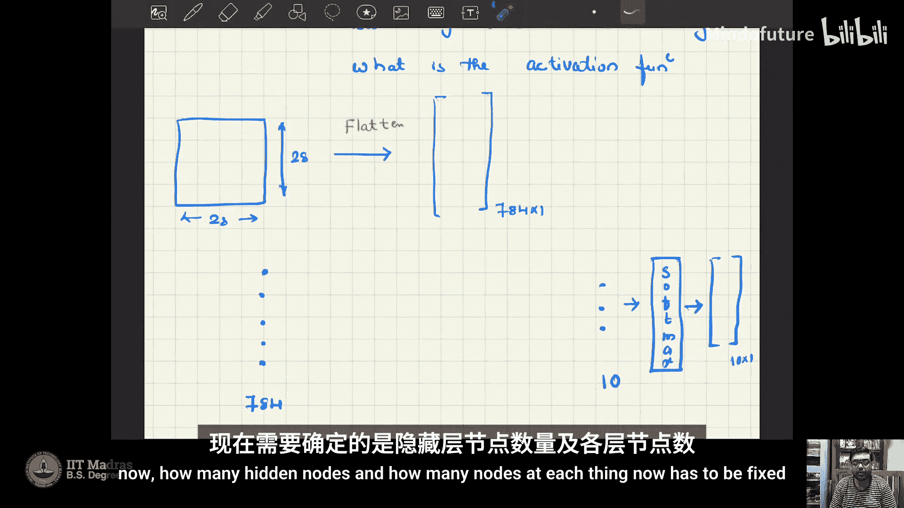

ok。😊，First， you go ahead and do self dot flatten。Where in which the image that you have you're flattening。

That specific image and then what you are doing is you are creating the next thing that you are doing is you are creating a pipeline the idea of pipeline is pretty much simple。

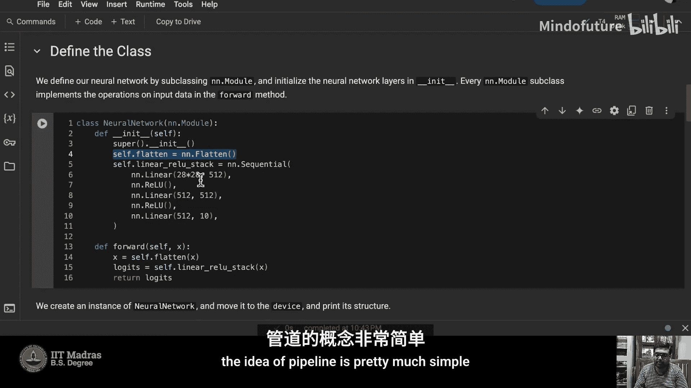

And you have。Multiple processor， multiple processes。ok。The pass your input。

The output of the first will be the output the next like this like this like this what you do rather than creating each one of them separately you create it as a single entity okay you create this whole thing as a single entity and then you can make use of it now this is the idea of pipeing。

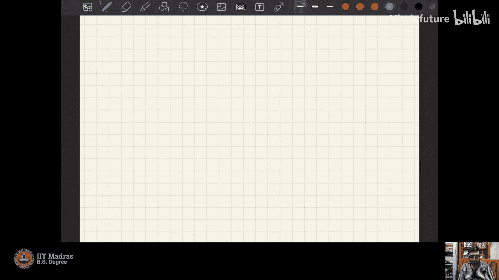

That is what is being used here。Self dot， linear relu stack。

I'm using the activation function Ray loop。So now they lose stack。

An n dot sequential now that means that as I told you， it's a pipeline。

 the output of one thing is input for the next stitch。I'm using n N dot linear， so this is。😊。

The first thing。Now you create one layer。He is saying that 28 cross 28 comma5 what does that mean？

You have this 28 cross 28， now which is your input。Then the next thing that you have is a。细都。O。

This is。One thing， this is one。This is normally this will have a。Weight vector now。

 which is is a matrix which is of size。This belongs to our。7，84 cross。废军。And then you have。The Bayas。

 which is an。This one。There's an r。O。嗯。Yeah。Now this is the first layer that we have specified。

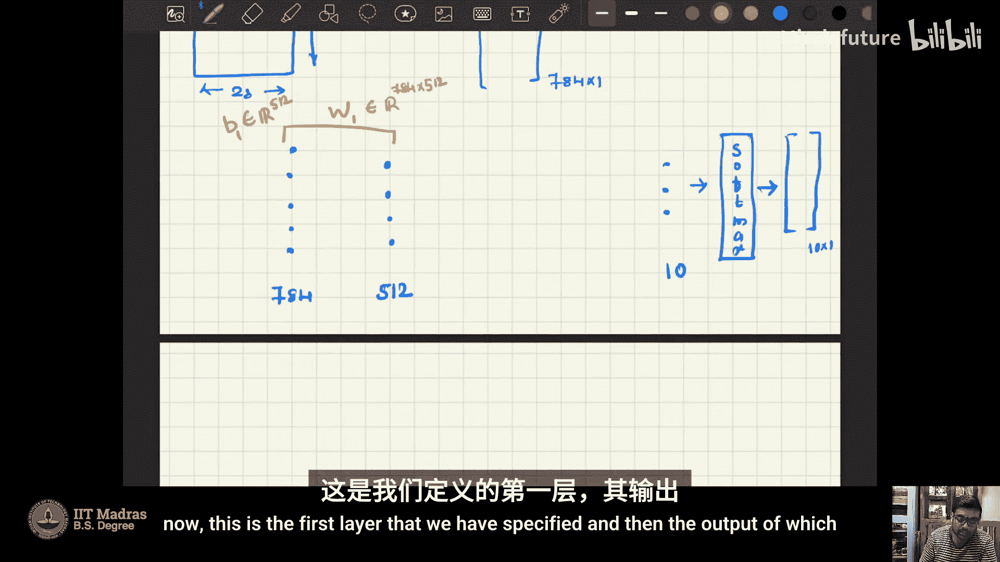

And then the output of which。After this transformation the 784 into Ph now using an MLP you multiply it how do you multiply that okay so now all the MLP you can think of it like if you have your input x。

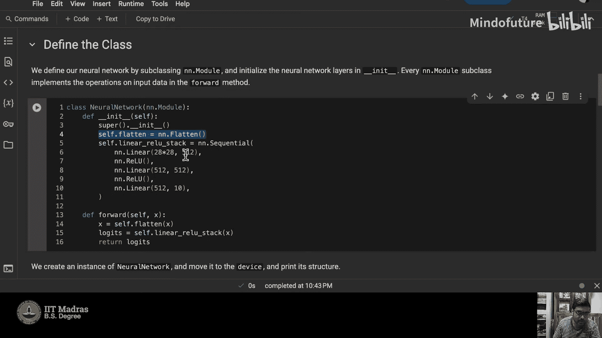

Okay。Now you have this w， this w transpose x now is one forward。Proropagation that you have Okay。

 so now if you case if you take any x now in this case my x will be in will be a 784 plus 1。Okay。

 what will be my w transpose， my w transpose will be。鬼般。Cross 784。Okay。

I can multiply these two things， so the outcome will be a。Fight will cross one。

This will be the outcome to this， you will be adding this B1。Which is a fight of a length vector。

The output will be a。But it will plus one vector。Okay， this is one step。

So that means that every propagation in the neural network， you can think of it as a matrix。

and vector multiplication or matrix matrix multiplication in case of cons okay so and then the output which is there the output that you have got the fight length vector that you pass it through a relu activation now we know what is relu activation just to give you a recap now。

😊。

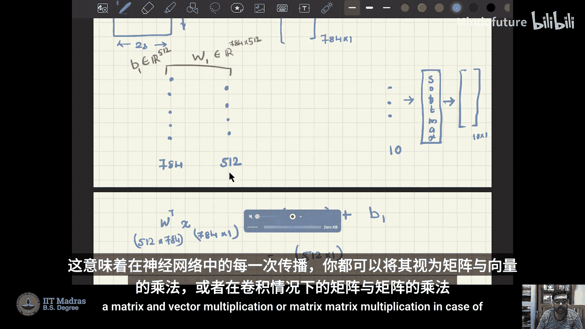

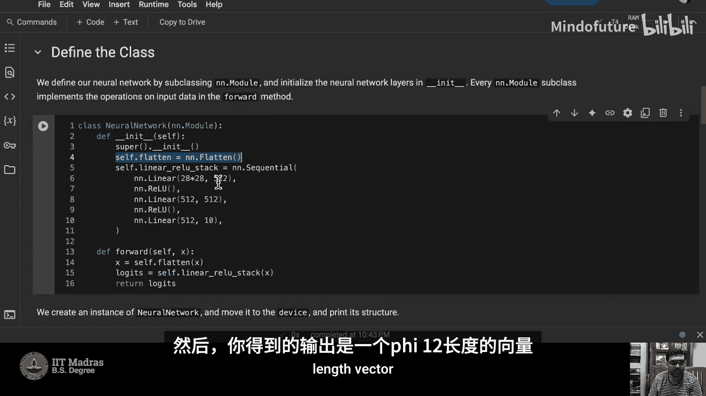

If your input is z， it will be0 if the z is less than or equal to 0。Z， if0 is greater than 0。

Okay now this is a rectified linear unit relu activation that has been used so now this ph length vector will be passed through this relu that means that each and everything now you have first element now it will check whether the first element is less than0 or greater than zero if it is less than zero it will become0 like that for each of the element it will check individually。

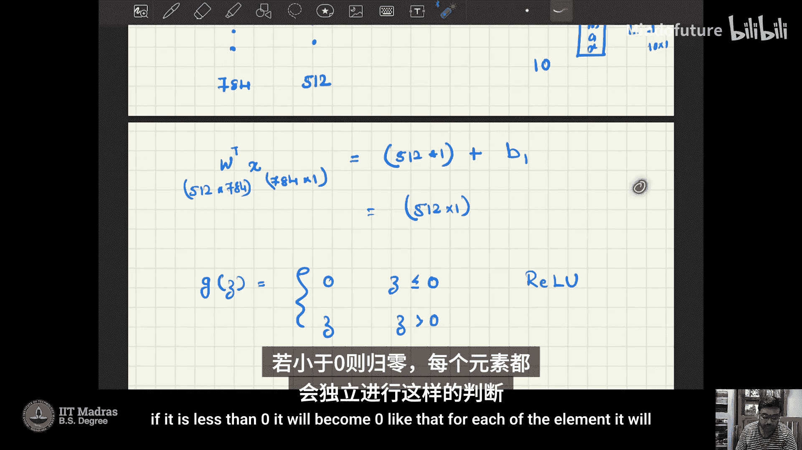

That you are applying this railway activation now after that again you have one more fight to fight now that means that。

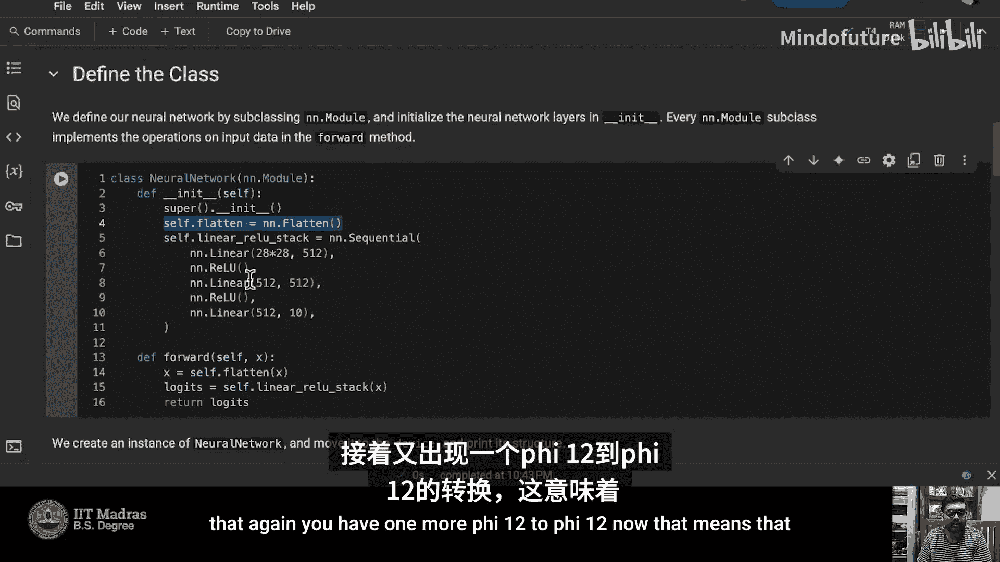

You have fixed this variable now now this is the input。😊，Now， from here， again， you have a。ワく。Okay。

That means that you have one more matrix now here。W2， just please bear with me here。

The blue2 not this is of。The matrix of size。Fite well cross5 well。

And then your biases2 now will be for each node， there will be a bias。O。😊，So， now， you have。

Let's call this with some。you have a。Fight will cross one。That you multiply with W2 transpose。Okay。

which is again。Fight well cross fight well。Now you multiply this， you get a。5 will cross one。To that。

 you add B2。Which is a fight length vector， it will be a。51 cross one。对。The output of this。

It5 France of one。

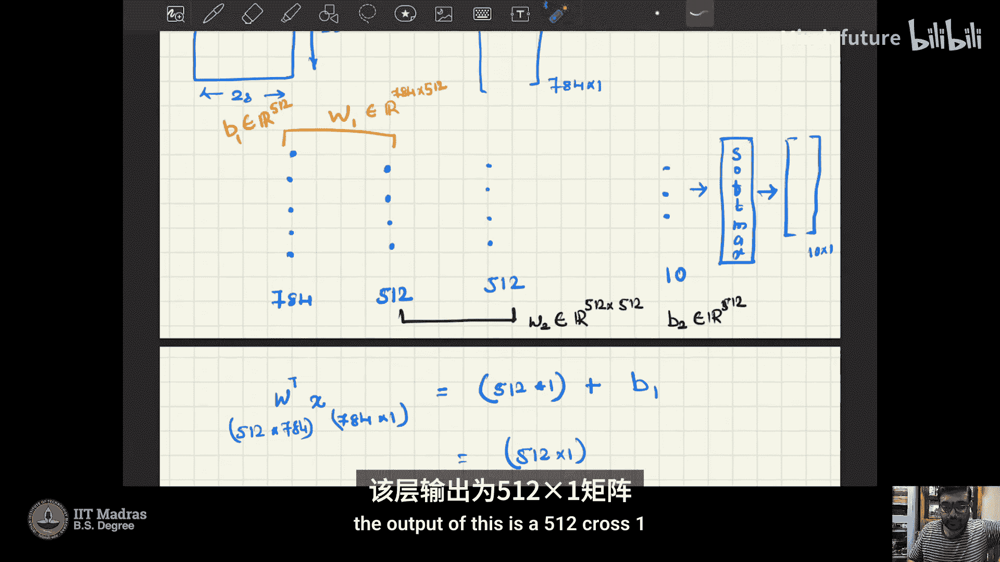

Again you use a re activation here and then the next layer is you have5 well to 10 that means that you have fight well here to 10 this is the next matrix that you are considering。

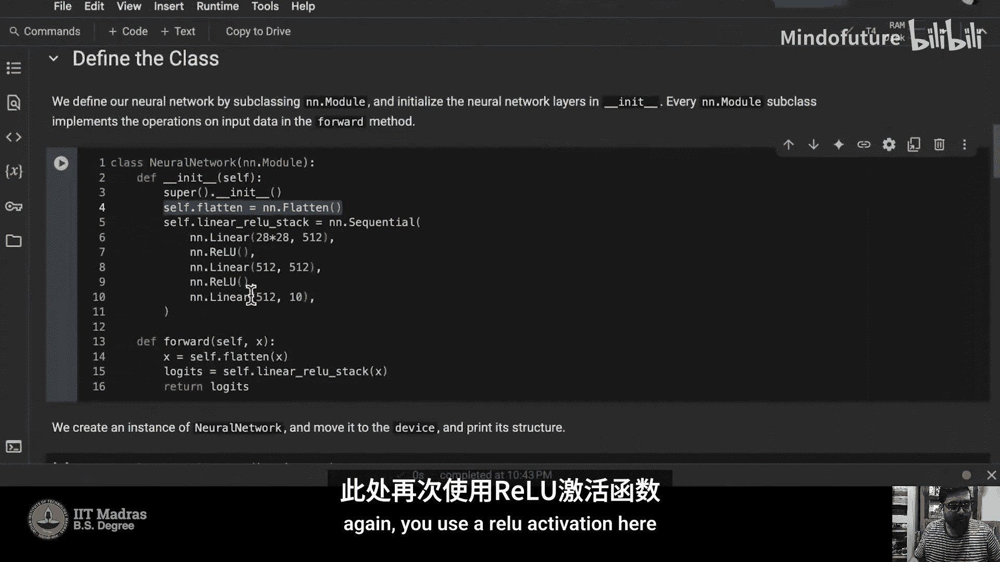

Let's consider that this as W3， this is our。Fite will cross 10 here B3 is a vector。So he's been。

And then what happens you have this。Fight will cross one。That you multiply with w3 transpose。

 what is this w33 trans transpose， it will be 10 cross。齐军。Now this outcome will be。Can cross1。

To that， you will add B3， which is a 10 lengthth vector。

So the output will be a vector of size 10 cross 1。And then this is what is called as logicits。😊。

That you pass through the softmax function。To get posteriors now which we call it as P。This is。Softm。

Or whatever。 the vector that is there， I just。since I haven't given any names to it now this will be a probabilities。

 This will be a post probability this is to be more specific this is P of。Y given X。For a given X。

Moal probabil that we have has been obtained。From this neural network。

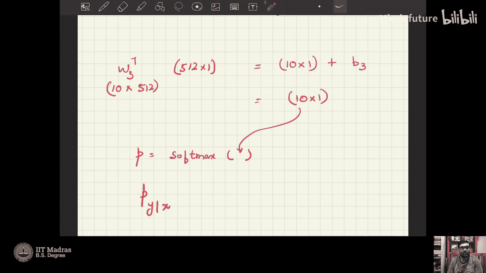

Okay。And please remember that for the last layer you should not use any of these activations don't even put trailerload or activations or sigma or anything now you should leave it up like that okay now this is your whole structure now here。

😊，See， you can use different activation functions， you can use different number of nodes all those things are up to your choice and then the forward method now which is your forward propagation。

😊，Now first you flatten it now that means that you have this 28 cross 28 matrix which is converted into a what you call 784 dimensional vector and then you pass it through this re stack now that means at first it will be transformed to fight well fight well to fight well and then fight well to 10 now you get the logics and then you return this logics。

Okay。This is the。Cls definition and then here you are creating the instance of the class or as a model now the neural network now you are creating an instance。

😊，And then you are pushing it into device now that means that until now it was on CPU now you are saying that now you deploy this on the GPu which you。

なんです。This is the network that we have。Okay。So now let's take a simple。

Input and then let's see how it works。I take an input now which is 1 comm 28 cross me8。

 now this is my input。And then I'm putting it， I'm placing it on the device。

Directly placing your on device， this is a random input。I don't know what it means。

And then model x now this x。You are passing it through the model now that means that。

It will undergo this forward pass which is nothing that transformation and then you get the logics those logics。

 you pass it through the softmax function。Okay， now that will get you the probability vector and then you choose the highest of that probability vector now which will your class。

We have seven noise is this is a random input so now we don't need to worry about it it doesn' not have any what be significance here once we take much more classic example。

Now this is how you build a neural network。So now let's go back and what are the things that are ready now？

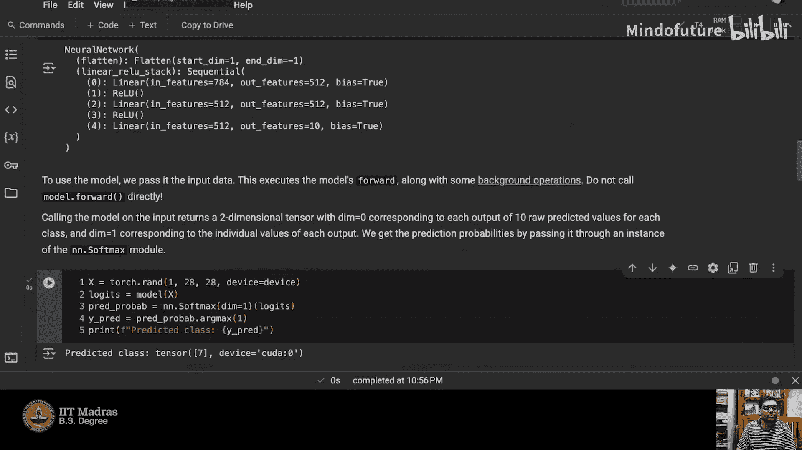

The things that are ready as of now is。Your data is ready。Data is。Soれ。其还有。Data is ready。And then。

 you。Network。Easr to do。O。These two things are done。

So now the next thing that is needed is how do you optimize this thing。

 how do you solve this for that you need an optimizer。

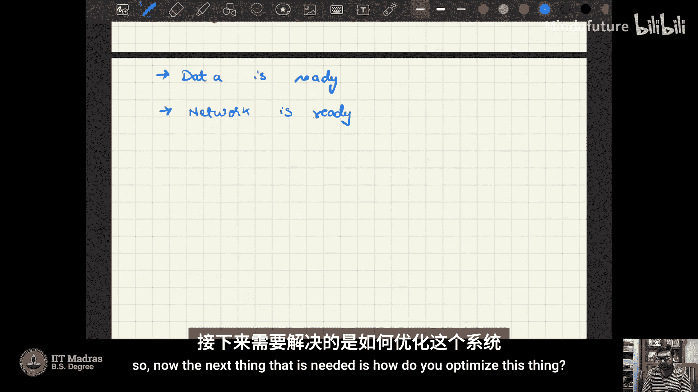

So I will not be specifically going into this automatic differentiation which is your how do you calculate the gras and st all those are internally taken care I will not be delving deep into it because will will not be needing those ideas we can look into this it is a pretty simple straightforward forward thing。

NowHow do you optimize the model parameters let's directly。

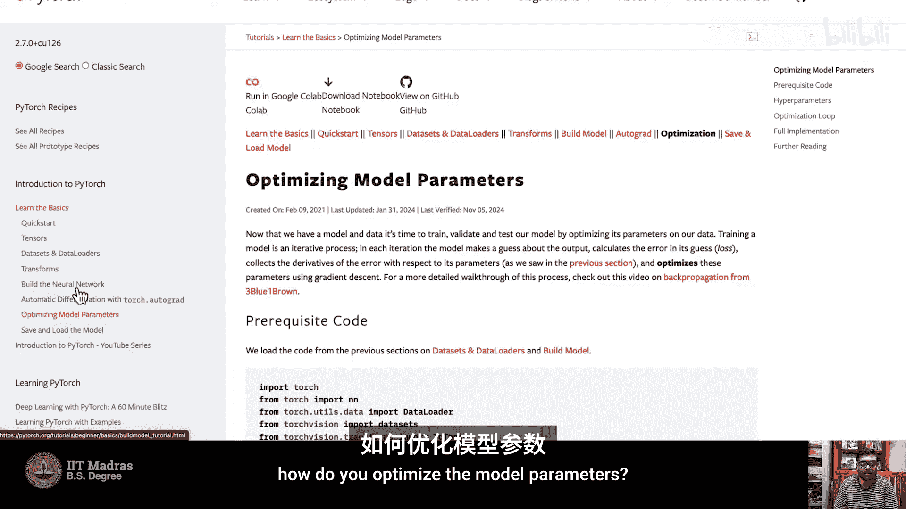

我更大。嗯如 the sorry。How do you optimize these model parameters how do you obtain these files okay now yeah now this is the prerequisite code I presume that you are comfortable these are nest libraries you are loading the data sets。

And then you are creating an instance， the model， all those things are ready。

Setting up the connection。It take some time。루so。Let's go back，' once it's done， let's look at it。Now。

Whenever， so we want to。

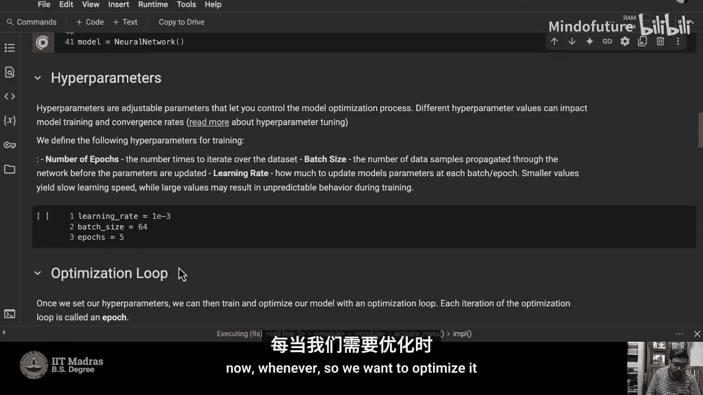

Optimize it so we we will be using gradient descent okay now what is the equation of the gradient descent or w equals。

W minus some alpha times a。Whatever is the loss respect to the W all those Ij have just removed it now this is the。

Graaddian descent now if you are using a batch of it。

 this is stochastic batch gradient descent is Gd as it is famously called as。NowYou have this alpha。

 which is your。Learning rate。痛。Well， we have many ways in which you can solve this one is what is the plane is GD。

😊，Is one way。 and we have this。Aom is prop。We can this is one more solver I'll not be going deep into this I was just giving you the names that you can read through how is one different from another and then we have this atom。

Now this is an adaptive method with momentum that is why it is called as atom。Similarly。

 these are some of the famous methods。With using one of these， you can solve。This problem。

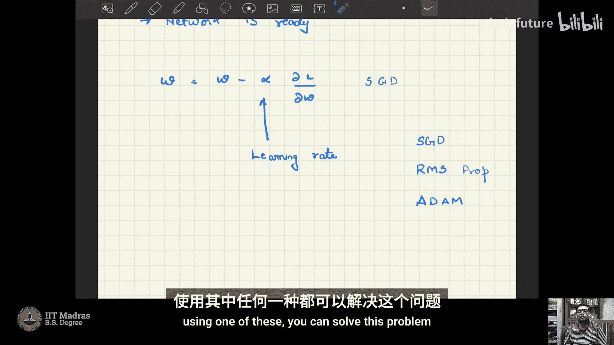

一样。So for that you will be na learning rate also called step size， which is 10 to degrees of minus3。

 1 e minus 3， 10 degree of minus 3 and then you have a batch of 64 then you are running it for five equals。

呢个先济单啦。Now， under you need a loss， you're using the cross entropy loss。

The CC laws as it is called desk。No， you need to optimize it。Okay。

 now you are optimizing on these parameters， all the model dot parameters。

All the parameters of the model， if you want to only do it on certain set of parameters system that can be done。

 I will look at how to do it。The coming sessions now charge do optim dot sgd you are using stochastic gradient decent on all the parameters now what is the learning rate equilibrium of minus3 which we have declared just in the previous。

And then let's look at the training group now now now it is interesting okay。

 now lets look at the overall training。This is a function now the function will be called only when the function call is made。

 so now let's go to the。啊，关系。Now you're creating an instance of your loss plus interruptpy loss optimize that you're using a ZD。

Epoch is 10， now that means that you're running it for 10 epochs。

For each e you will be doing this what are you doing first you print something fine then you are calling train loop now that means you are calling a method you are calling a functions or your method is a function or train loop now to that you are passing the test loader。

The train loader we passing the train loader model loss function and optimism now these are the parameters that we are passing now lets go there here。

Now we are in the train view we have the data loader model loss function optimize first you have calculate the length okay let。

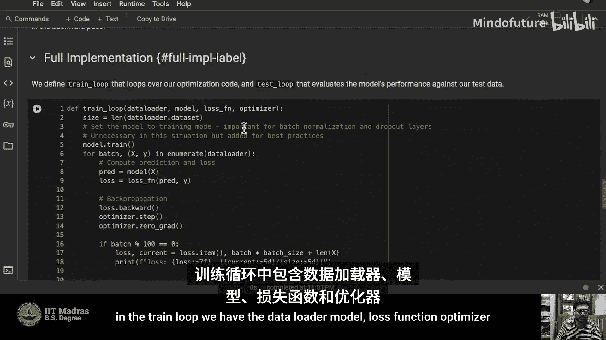

It's right to understand this overall thing much more clearly。嗯，リレnda。When路。

Okay first we have the first step that we have done as the size。我们这个是啊。Number of examples。

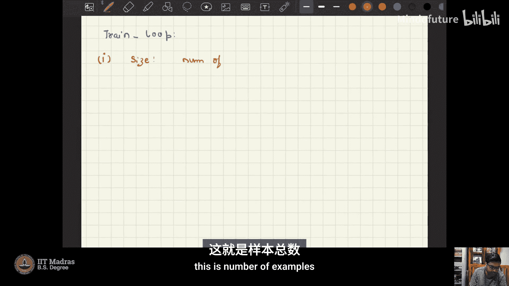

Okay， we help gain that。Now model dot train so now every model that is there now will be in two phase now one is either in training phase or it will be the evaluation phase in the training phase now you need to actually go ahead and compute the gradients in the evaluation phase you don't need to look at the ingredients。

😊，ok 系。So now you are saying that put the models into the training phase。

And then we are saying that okay， enumerate enumerate on the data what happens when you say enumerators now。

😊。

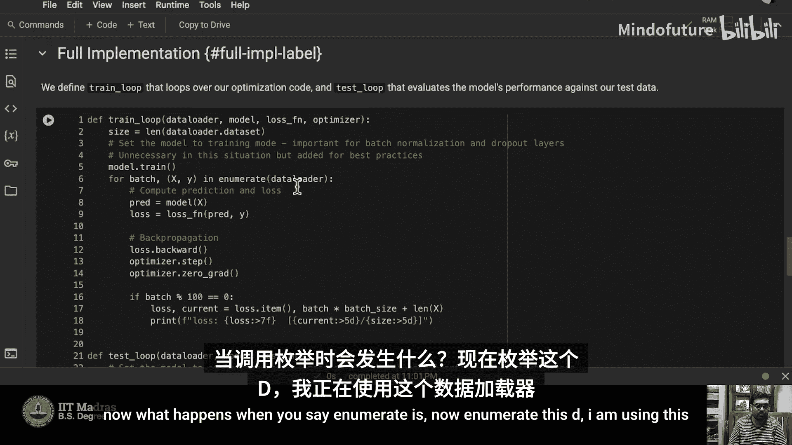

你要冇嘢哦。This D I am using this data loadr using this enumerate Now what happens what is this D or D even D2。

So until be right。Now how are the index models index 01？So until E minus is well。

 these are the indices。Now， what are the values now it is saying that batch。こマエ三。关 you anything。Now。

 first this zero which is there will be assigned to this batch because of enum of the index will go here and this D will come into this pattern。

Okay， then with。Okay， now we have got the batch index as well as it example now this is what enumererate does。

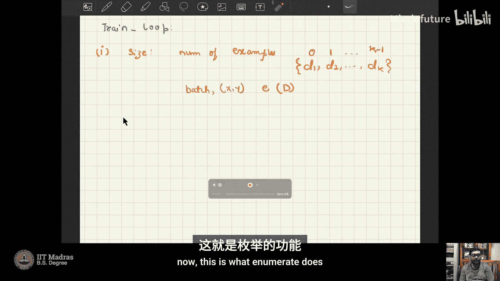

Well， then you。Computer。Forward pass， then you perform the forward pass， get the predictions。

Now once you have the predictions， you calculate the loss。

I calibrated in the loss if you remember those are the steps that。

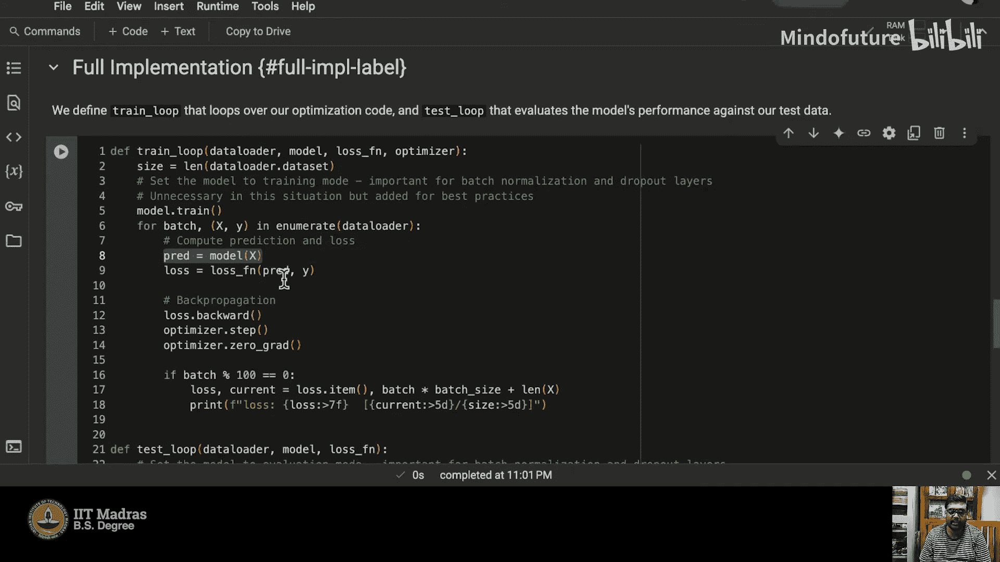

We looked at even in our earlier pials， just for a recap， I'll just open that。

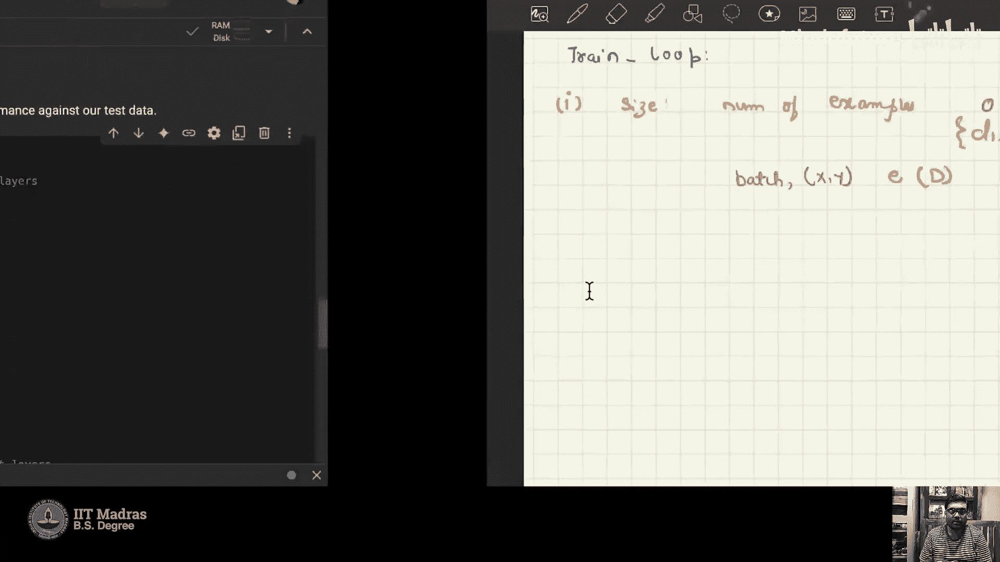

Okay。你还app饿是。X and y first you calculate the prediction or then u the loss that is a second step that we need to be doing。

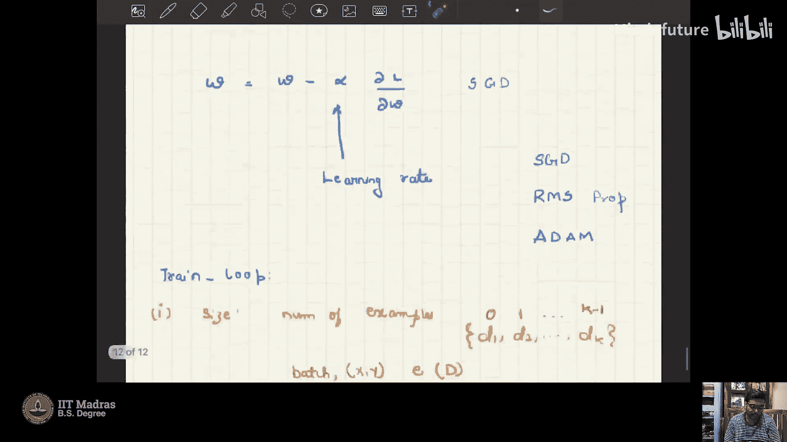

We calculated the loss， then loss dot backward， this will be computation of gradients。

And then optimizer dostep is where you update the map。好嘅。The forceps， the prediction。

 computation of loss， obtaining the gradient， and updating the weights。

And then optimizer for0 gra now what it does is now there will be an accumulation of gradient that happens after each gradient step what you should do is now you should refresh the gradient and make it as0 okay or the gradient have to be make it as0 now otherwise it will be having issues。

😊，So now that those are the skills that you are doing now when your batches a divisible a multiple of hundred then you lost that item。

 that means that you expect only the numerical value from this loss by only numerical value。😊，我没告事。

This loss is not just number no it has something more to it there is something called a computational graph that is involved I don't need the computational graph I just need the number so just lose that item to get the number and then you say that batch into batch size less length of x that will give that how much is the current size of。

😊，This is just to print the str。This is the overall training rule training one epoc this you are doing it for each epo you are doing this。

Okay， then you have test loop， okay， now let let's go to the test loop。

Data loader model and loss function are the input now then you give model dot Eval now that means that you are saying that okay so now how many sorry you are saying that I am working in the evaluation mode now。

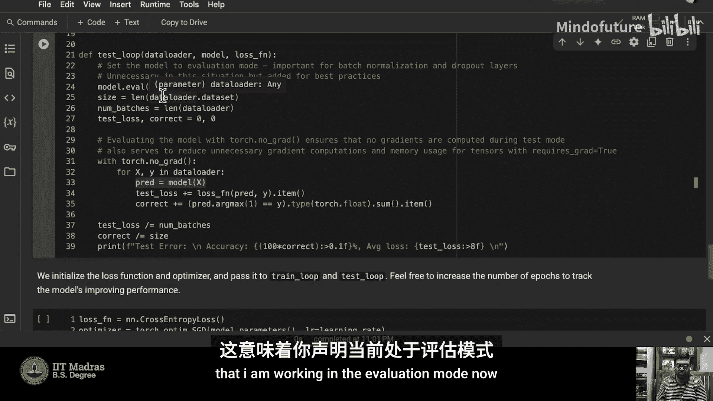

So按 then哦。我觉得，你不说的。That's路。First， you compute the size。那我这是啊。Number of examples。Okay。

then you have a number of batches。

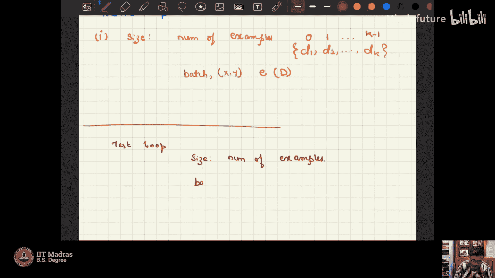

How many batches are there that also to take it into consideration size and number of matches？

So now you should be evaluating right， you should be evaluating how much is the loss and then how much is the correctly classified examples for that you need these two placeholders。

😊，Now with charge dot No， right now。Now why is this start that no gridd is useless now is ensure that no gradients are computed in the block which is indented now that means that in this whole block there will be no gradients that are computed。

Now you'll ask the question from why do you need？Yeah， probably believe we only need this。

 this is unnecessary， but this is added for bread best pieces okay。

So now you iterate over the data loader， which is the S loader， now you get x and y。

Then you go ahead and pass it through the model you get your predictions and then you get your loss and then add it to the test loss which is there you just need item you just need a numerical value of it。

喂。So now you have I didn the loss。No words。Now we are dealing with the classification for a problem for us the accuracy is much more important you know what do you mean by this accuracy now that means that how many examples are having I directly classified？

😊，That I need to calculate now， hold away。 See， I have obtained a。こラ部ブ。Now。What do I do。

 I have obtained。

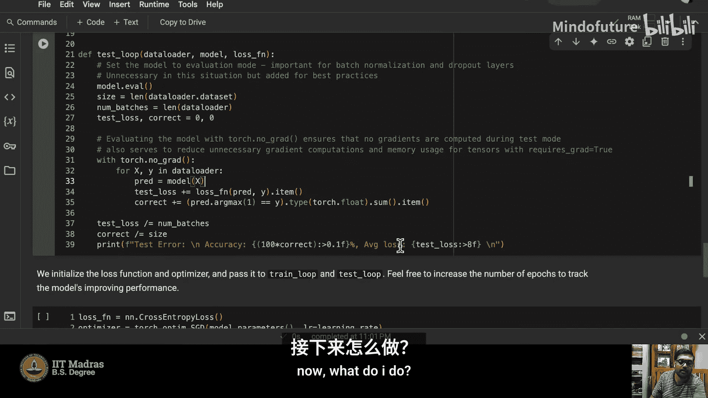

Probably with them。 And let's say have。P1， p2 and t3 this is I just have a three class classification now if I calculate the highest know which one is high？

Which one is highest？to that case I putting write which one is highest that we give you a value。

 but I need the index right， this is zero index first index or second index。😊。

And are you needing the？What is the？What is in。That is an next question again the index of。Okay。

 let's say that your P2 is yes。And then you get the index as one。

Now then you say that this is correctly classified when this one， this will be your y hat。😊。

This is same as y which is your actual value so they only say that what is correctly classical right I want to do this specific operation now。

😊。

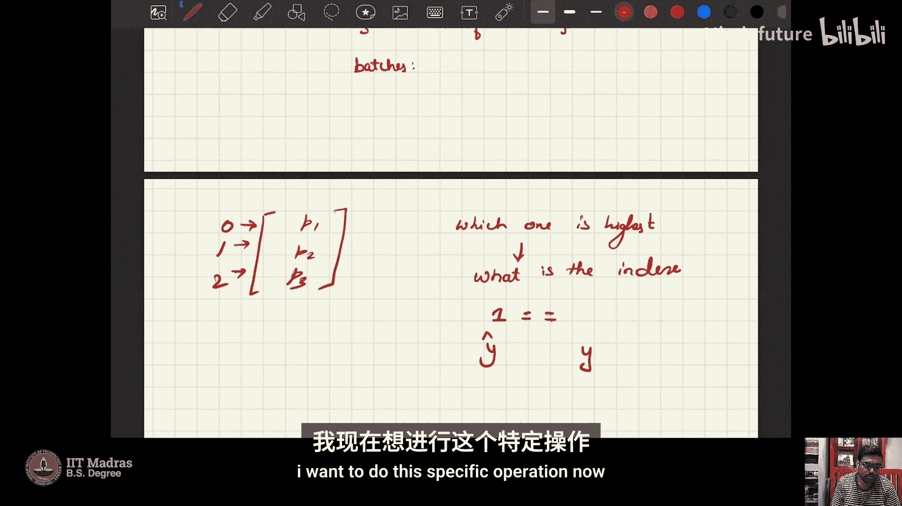

嗯唔牌。Correct me questionma， that means that you are increasing it。😊。

Now red now which is your predictions do r max now you are taking the index of it the first one。

 the top one is that same as the y now you are in that is my prediction is same as the y。O。

Now then it will be twos， right？Now we will get a vector all it is。6万多。Okay， now you have a batch。

 you will get a list of true points。Now that true or false， you convert it into。😊。

Tch plot now that means that now2 will be converted into 1 and false will be converted into 0。

So now in a batch， now if there are 10 correctly classical differences。

 I have 10 months and the remainings are0。😊，And if I some， I love them。😡，Now I will get 10。

 which is number of correctly classified example， I just take the item of it。

 that means I just take the number of it。😊，Because of which my correct be Okay， so now and then。

We run this so that I can have the laws I can show you by also。Now test loss。

 now we are c per batchge， so now you divide it by a number of batchges so that you can know that now's the test loss per batch。

And then the correct you know how many examples are going classified that you divide by size that you get the accuracy and then you multiply that with 100 will give you the accuracy and then you will get the test score of yeah you can see that。

😊，So how the for each00 thing you things are implemented and accuracy is 42。

4 and then your loss is 2。16。And similar the你。You can see that the accuracy is increasing and meanwhile the loss decreasing。

😊。

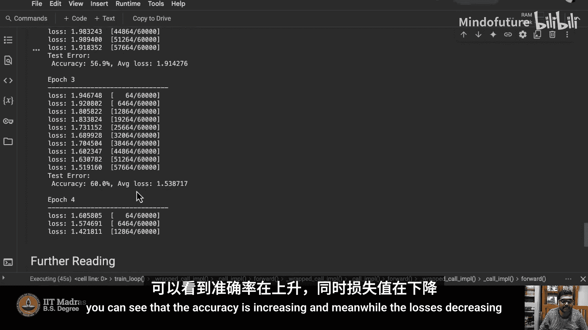

Now， in addition to this， now normally what one more thing that we do is we will have a list way which we app the losses we get a curve。

This is你保。听唔老师话你好。Now， it is we need a trend like this。不的。Will it train something in this。

That means that as the epoch goes， the loss which is there is reducing that often some and it will be flatten that means is that there will be no much of。

Now the next question that comes is now how many times you should pray it there is no standard answer for that now we will be looking at these questions when we start handling the。

Ptorials on the gene models by coding them yeah， and how do you figure it out all those things will how do you。

In a simple way don't worry on that。

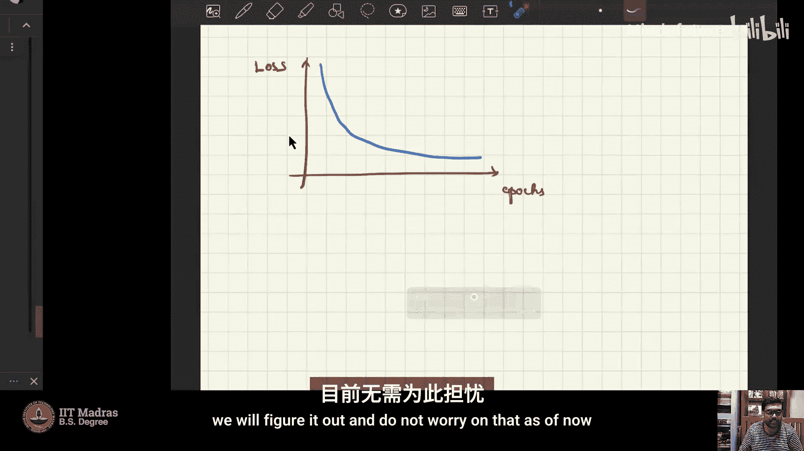

啊对。As we can see that。对就。We have gone 10 pops so we will run for 10 pops the accuracy that we have achieved as 68。

7 so the accuracy accuracy should increase but the last two decrease okay yeah that should be evident from the discussion that we have。

😊，Another mining is done。This is the overall process now。We trade this。

Pferre your data if the data is available from Python， let me take it if it is not。

 you create a custom loader。😊，createate the model， what are the parameters that are there in the model。

 you should be aware of that。You take the hyper parameters。What is the loss that you are using。

 what is the optimize that you are using？Train loop when with the steps are for you predict compute the loss。

 obtain the gradients， update the weights， make the gradient as field this is one additional this is a programming step to be more successful this is not a theoretical step。

And similar you go ahead and confirm with this and then whatever number of e of now you want to。😊。

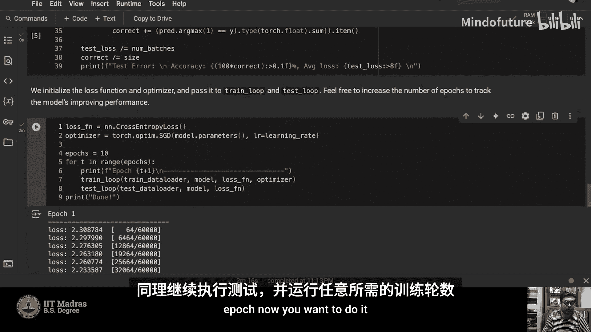

This is how you optimize your。哦。

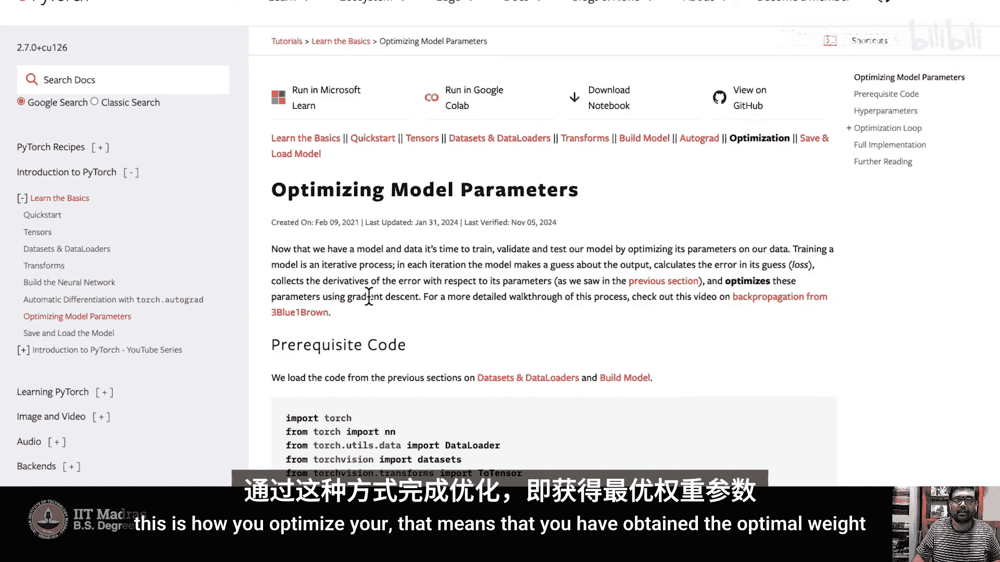

Now that means that you have obtained the optimal weight。

Now that you have obtained those Eta which is obtained it。OkayWhen with the losses lease？

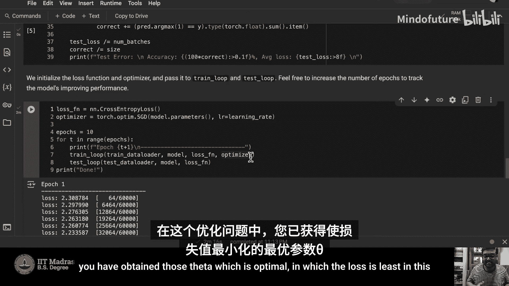

So now the last step that is involved is， how do you save these？😊，What are you seeing this？

Because every time whenever I want to deuse it， I don't want to rerun it again， retrain it。

 okay now you should be able to save it。

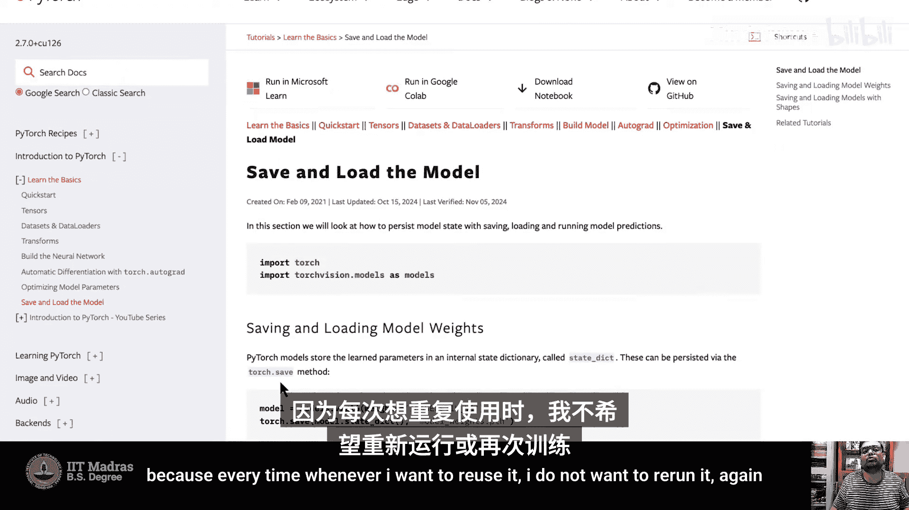

So now。I don't need this3， I just need these two treatment。

Whatever model it can be that we have saved that we have。怎好。

Tge dot save whatever model this is the name of the model this is a variable name you can use whatever name you want that in the current path you save it as model dot path T do save model you save it as model do P Ph now that is extension in P is extension of this you store at all this。

Now this is how you save it if you want to load it now how do you do it？😊，啊，有孩子忙的。Okay。

 so and then do not load created in the instance of the model。Model dot path。

 which is the name of this code and then you only copy the weight weight only。对。

Youre not only copying the ws or whatever is involved in that。Okay。对も对。O。😊。

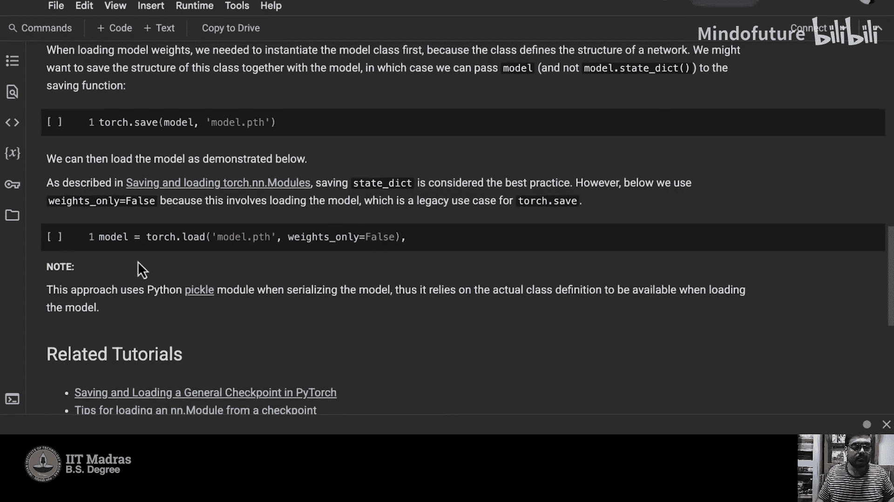

This is how you load the model these are some of the steps that are involved in looking at it now we have till now we have looked into the idea of how do you。

嗯。Create a model， preferably we have created a MLP model。Now， at the sta of the second tutorial。

 what we should be doing is now we should be looking into how do you create a CNN model？😊。

Yeah now that is the important thing now whenever you have I'm assuming that you are pretty much comfortable with CNNs。

Okay。No。那'吃啊。You at them。I see any more？Now， the first question that arises whenever you are considering the CN model is。

How many layers。Now once you have fixed this question， the second thing is。

The second thing that arises is you should specify in each layer I should specify。In China。

That depends on the input that you have when you should specify the。好整。This old channel is same as。

Number of feed。电话。And then you should be specifying though。And I size。We're using square kernels。

 so even if you say phi another that you are using the p square by kernel。And then what is a sp？はい。

And那 this was finger板。These three these five options now you should be specifying only the input channel here depends on what is the previous stages's input now that it depends other than that you should in these four parameters and then once you have specified them then now we are still dealing with an image classification problem that means that you should be。

嗯。Deciding on the classification。decidingiding on the question。

All the CNN models has some convolutional blocks， let's say that I have convolution one。

Now this one 2。I have this combination three， which whatever parameters that you have。50人。

Now after this， now you get a block you get an。かイメージが。Whi you flatten it up。

And then unit need them MLP。Now， this。哦哦。Lots of。Aution layer， which is famously called as。

Feature extractor。Okay， these are products feature extractors and then this MLlp。

 which is there now this is what is called。Mification。O。😊，Nobody to decide even on this。无作为了。

Going ahead and whenever an MLlP comes into picture yeah the problems of how many layers it's not like you have the input layer and then you have the output layers how many hidden layers I mean node in those hidden layers all those things also needs to be decided and what is the activation function similar activation functions and all of these layers also needs to be decided。

Yeah， and then now for it。

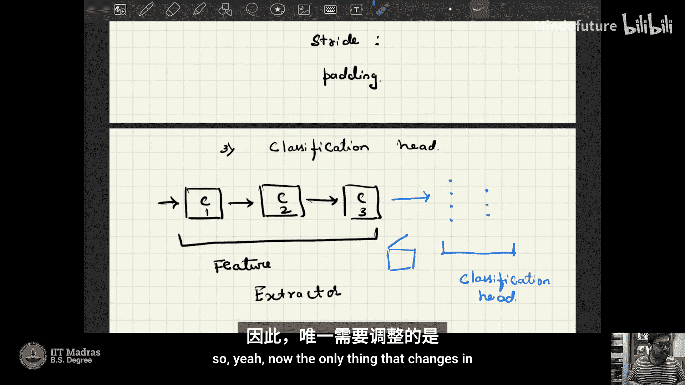

So yeah， now the only thing that changes that case is。Earlier the train loop loaders。

 everything remains same， only the neural network that is there that will be changed to a convolutional block。

Yeah。那。Whenever needed， now we shall be looking at this condition layer。As of now。

 let's stop these tutorials on these ideas just to give you a small recap of what are the things that we looked at today now we looked at cancers。

What what are tenses and how do you work with them， we look at the data loaders。

 we look them the transforms。How do you build the neural network。

 specifically we are looking at an MLP in that case。

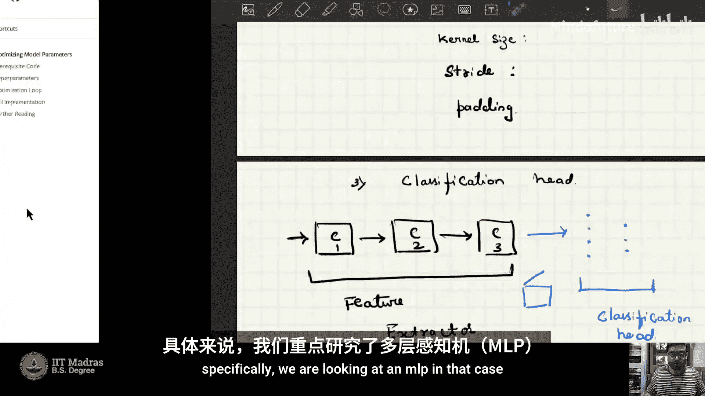

Now in an MLP， what are the parameters of the learning board and how do you work with them。

 we understood that。So again， and then the forward pass。And then the training loop， the test loop。

AndThen how does you can have even a CNN model also。

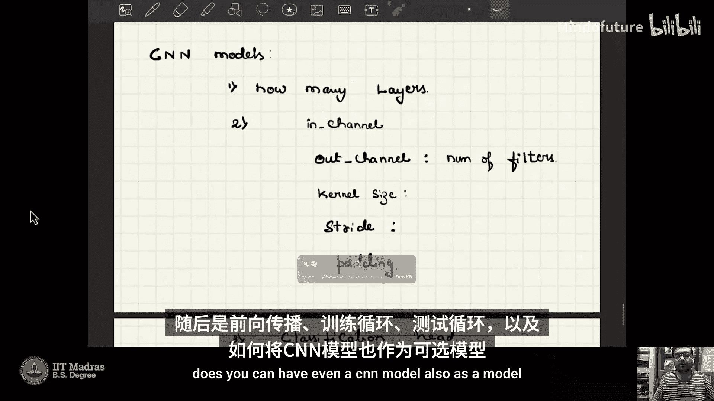

爱怎么呢？O。😊，So yeah with this， let's conclude today today's tutorials from the next session。

 we shall be starting with the interesting stuff we'll start coding guns okay。😊，Thank you。バイつ theね。

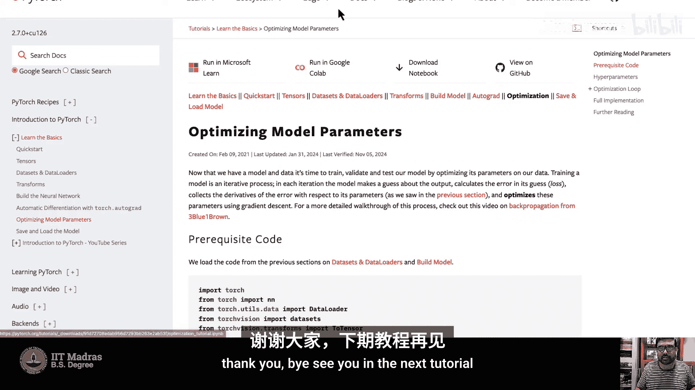

