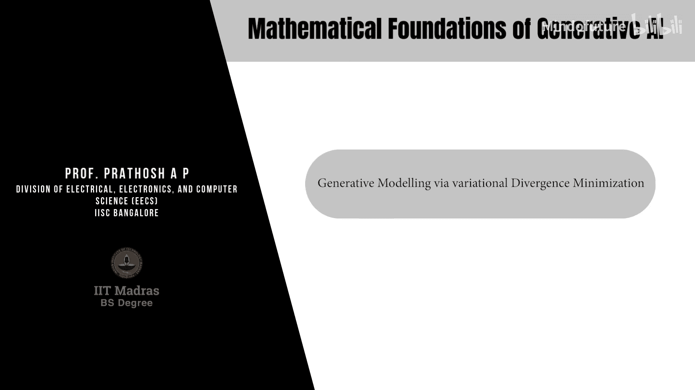
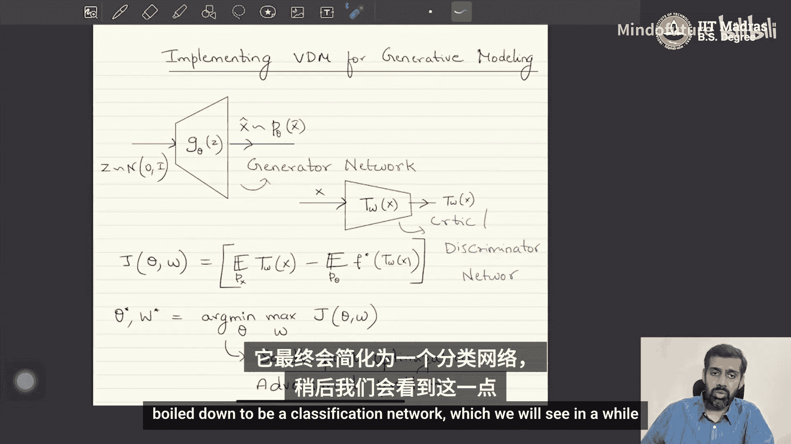

# 生成式Ai的数学基础 ｜ Mathematical Foundations Of Generative Ai p09 P09_W2L5-通过变分散度最小化进行生成建模 -BV1fperz7EjK_p9-

Welcome， everyone。We continue with our sessions。And this goes on deep generated models。

In this particular decision， we will。Continue from the previous session where we were looking at building generative models or rather generative samplers。

From the tech using the technique of variational dirgence minimization。In decision session。

We will continue from the previous session where we constructed a bound on the divergence metric that we would want to optimize。

And then we will see how to use the bound that we have constructed in building the sampler that we wanted to build。

Let me quickly recap whatever we had done the previous session before we continue。So， the idea。

Was that we are given data which are samples drawn IadD from an unknown distribution。

 so for the sake of completeness Ill write that all of these excise。

All the data points exerciseise are in some de dimensional space。

 and I also denote this as x script X。Now we have given in data points sampled according to an unknown distribution from a D dimension rail space。

The goal is to sample from the unknown underlying distribution。

 build a sampler for the underlying distribution。Now。

 the approach that we took was that we start by sampling from an arbitrary known distribution like a unit normal gaussian distribution。

So， we know how to sample from this distribution and we take those samples and pass it through a deterministic function。

 a learnable deterministic function， which is a neural network。

And we want the output samples from this neural network。

To follow the distribution of interest periodss。Now initiallynitially we say that this particular sample with the output of the neural network is denoted by X cap and we say that it has a distribution P theta and obviously this P theta depends upon the parameters of this neural network theta。

Then we set out our problem as minimizing or as finding out a parameters of this deterministic function G theta such that some distributional divergence metric between px and P theta is minimized。

Now， if we get if we define a good distributional divergence metric。

That would be minimized if only if these two distributions match。

 then we are we have reached our objective because。

If we find the parameters of this deterministic function theta in such a way that a a distribution of divergence is minimized between them。

 then the。The distribution that the output of this neural network follows will be same as that of px and we got a sampler for px。

 which is what we wanted。Okay now the next step was that we wanted to get an algorithm to minimize the divergence metric between px and P theta without knowing the samples of without knowing both of the distributions but only having samples from it so you can draw samples from the distributions but we don't have the distributions themselves right so how do we get samples from px it is by the data the data the given data itself is the sample are data itself will contain samples from px and samples from P theta obtained。

As the output of this neural network。For the divergence metric。

 we defined a class of large class of divergence measures called the F divergences right where given a particular。

Convex function， Okay， F， we have one divergence distributional divergence metric。

 which is called the F divergence。 So one can obtain multiple distributional divergence metrics by plugging in different choices for this convex function F。

When you will also solve saw this property of the distributional F divergence that it is always a non negative measure and it is0 if only the underlying distributions match。

O。Now the key challenge was that how do we solve this optimization problem when we do not have access to p x and P theta Okay。

 so we wanted to get an algorithm that would minimize the f divergence between p x and P theta without knowing。

Either of the distributions， but only having samples from them。Now。

 the key idea was that integrals involving density permissions can be approximated using samples drawn from the distributions。

So， that is the。기ア啊。That was there。然后。Why is this possible。

 We just saw a classical result from statistics demonstrates that integrals of this form。

 which is integrals。Of functions， some functions such affect with respect to probability density functions we of can be obtained or can be approximated using the samples obtained from the distribution。

 And this result is known as the law of last numbers。 So now the key idea is that。

If the f divergence which would involve integrals over the px and P theta can be expressed in terms of expectations of some function with respect to px and P theta。

 then perhaps one can compute the F divergence and optimize them over the parameters that is the key idea now then we set down to express f divergence in terms of expectations over px and P theta。

The way we did that was we first express the F function in the F divergence in terms of what is known as its conjugate。

 so this conjugate is also known as the f conjugate of a convex function the definition of convex the convex conjugate of a given function was given convex function was given and the。

The F function that appears in the F divergence was expressed in terms of the。

Convex conjugate okay and after doing some algebra。

 we just saw that finally we get a bound on the F divergence Okay will not get the exact。

The presentation of the F divergence in terms of expectations。

 but we get a bound on the F divergence in terms of the integral that we can compute。So， finally。

 the F divergence that we set out to optimize。Is represented in terms of bound lower bond on the lower bound involving the expectations over px and p theta which we know how to compute so that is where we were in the previous session so let us continue from there。

No。😔，Given what we look at today is that realization。off。Vadiationary divergence minimization。

Is what we。Look at it today。 So now we know what variational divergence minimization is。

We will see how to realize that in practice。 Okay， now， let's say， as usual， we are given data。

Given data。It is a set of samples， x 1， x 2。Uと 액三。And these are drawn IID from Px。What we know。

 And please remember the setup that。We have a neural network。

We have a neural network that takes samples from an arbitrary distribution。And give out samples from。

Distribution called P Heta。And our goal is to minimize。The F divergence。Between Px。

And P theta and this we want to do with respect to the parameters of this neural network。

G theta this was the goal and what we did in the previous session was that we showed that the F divergence。

Between px and P Theta。P， X and P Tta is。Bounded by the。Supreium， okay。

 for the sake of ease of understanding， I will replace supreium with a maximum。

 assuming that the su can be reached。 So now supre was over a class of functions。

From space of functions renoted by script2 T。 So what we wanted was that we wanted to。

Maximma is this。Express over these space of functions， these functions that we are talking。

 the objective function that we are saying is expectation over t of x。

 and this expectation is with respect to p x minus。The expectation over F star of。Bx。

So remember what f star is right we start out with N f divergence here right and this f star is the conjugate for this particular f divergence Okay that is what it is。

 And this second expectation is with respect to Pta。 So it is what we found out the previous time。

Now， what we want is， you know， we want a theta star right that would minimize。That would minimize。

The e divergence。Okay， that would minimize the F divergence now。

Because since the a divergence cannot be minimized as you I mean as it is。

 what we did was we expressed the adirgence in terms of the expectation that can be computed。No。

What we have here is not an exact optimization of f divergence。

 but an optimization of a lower bound on the F divergence。 So this is equivalent to minimizing。

The lower bound that we constructed。Ler bone on epience。

Now note that these two optimization problems are not equivalent because in thebo in the ebo optimization problem what we are seeking is the mini of a particular quantity I mean the second line what we are seeking is not the minimum of this quantity but the minimum of a lower bound of that particular quantity okay now minimizing lower bound does not mean that you are minimizing the actual function itself but this is a limitation of the method that all that we can do is construct the lower bound and try to minimize the lower bound instead of minimizing the function itself。

Okay， the function here is the epi divergence， so we cannot do anything with epirgs because it involves integrals that are not tractable and involves density functions that we don't know。

 What we can do definitely is construct the lower bound on this epi divergence and optimize the lower bone instead Okay。

 so thats the best that we can do and that is what we are going to do Okay。

 so now this is equal to the。没女吗。Oror theta and this lower bound that we constructed involves。

Another optimization over。And what is this lower bond rates the expectation of T of x？

Minus the expectation of。F star of T of X or P theta。So this is what we have to optimize。

This is what we are going to optimize now， so note that so how did we get this we wanted the theta star which are the parameters of this network of this function such that the a divergence between px and P Theta are minimized right。

Now， the F divergence cannot be minimize much cannot be computed because of the difficulties that we just stated。

 therefore what we do is we construct a lower bone on the F divevers and we would set we we set ourselves。

To minimize the lower bond instinct。Now， the lower bound that we constructed on the F divergence itself involves an optimization over some other the function T effects。

Okay。Now， the final objective okay involves。Two optimization problems。

 which is de minimization or some set of parameters theta and maxization or maxization or another class of function the effects of the same objective function。

Okay， so now this。一。😔，The out optimization is。With respect to。The pattern this。

With respect parameters of the G function， okay。And the inner optimization is with respect to。

A class of functions。A class of functions。T of x， which belong to。拉去。Family of functions。

This is what it is now optimizing over functions space of functions cannot be done analytically because these are we are talking about functions that are are not simple here。

 therefore what is done in practice is the following that we represent。我不认。😔。

The set of functions that we are optimizing from， which is script T by。Neural networks again。

Neural networks。 So let's call them PW of x where。Where W。

Are the parameters of that particular neural network。Are the parameters。Of the neural network。

Okay now what we did was we parameterize this family of functions t using neural networks okay because we know that neural networks are powerful enough and they are universal function approximations so we just expressed we just express T also as neural networks。

Okay， now what happens to the abovebo optimization problem？With this。With this。Op the objective。Well。

 boil down to following。So， we have。We have to optimize over two set of parameters。Theta and W。

 So we need to minimize with respect to theta， and we need to maximize with respect to W the same objective function。

 so which is the expectation of。PW。So note y we have a subscript w here because we have represented the t function using neural networks which are parameterized by some parameterss w minus。

The expectation of。If thought of。Tw of x and this expectation is the respect to P theta。So。

 this is our final objective that we would want to optimize that we have two neural networks。

 one is the theta one is parameterized by theta， the other is parameterized by w。

 so we have two neural networks。Now， what is the final setup。

 let me write that down so diagrammatically this is how it looks like。We have。唔识。呃，Implementing。

Implementing the variational divergence minimization for。But for generative。Sling。😔，Inative modeling。

 I can say。So this is how you implement finally this variational diveence miniization for generative sampling so we have。

A neural network， as usual， which。Is the actual sampler？

So this takes this is this is the neural network that converts。

That converts normal distribution of pushes forward a normal distribution into the distribution of interest and we have been calling this as the G network right and this is what we get here is excabd though which we which are samples from the distribution P theta of excabd okay now this neural network has parameters theta we have another neural network here。

That is representing the T function。So， this neural network is representing the T function。

Tw of x square this will take x as input and gives you Tw as the output right Ill call this as。

And ETW affects this network， okay。Now， we have two set of parameters that we would want to optimize。

 So our cost， okay， or the。Last function that you would optimize would be。嗯。And just。

Copy this so that I don't have to。Like right。So please remember what is that we are doing here。

 What we are doing is this is the。If dirgence that are minimizing with respect to theta。

 So we have this particular cost function。 and what we want to do is that we need to minimize this。

Co function with respect to。rather I can say that。We want the。提刀。

That would minimize this and we want a w that would maximize this。可。

This is what we we have so we have two neural networks okay one representing the sampler the other representing the the t function and please note what our t function is you know we get our t function when we construct the lower bound on the f divergence the idea was to minimize the f divergence we could not do it so we constructed a lower bond on the F divergence and why we are we were constructing the lower bond on the f divergence we landed up having another function T of x。

Another class of function T effects and we had to solve the lower bone itself involved an optimization problem So to obtain obtain the lower bone we had to maximize over class of functions t effects and of course。

 once we get the lower bone on the f divergence， the idea is to minimize the f divergence are the lower bone on it okay so finally what we did was we represented this class of functions t using another stack of neural networks。

NowFinally it boiled on that what we wanted to do is to optimize this particular objective function that we have and we have two optimization problems one we need to find the parameters of t such that the optimization problem is maximized and once we do that we will have to use the same objective function and we have to minimize with respect to degenerative parameters theta okay so this sort of problems where you have。

An alternative minimization and maximization problem over the same objective given same objective function these are called the saddle point optimization problems。

Called ci point optimization。Because what we are actually seeking is a side point。

 so what is a side point， suppose you take a function。It's difficult to father let me try that。Okay。

 supposeupp you have a function of two set of parameters one is theta， the other is W。

 so please note that these are vector valued parameters because you know we are talking about weights of neural networks here。

 but for the sake of demonstration I am writing them as scalealless and suppose you have a function that is。

That you are optimizing so saddle point is a point okay that we are that you are seeking such that if you move along the theta direction at that particular point the function increases and if you move along the direction of W star at that particular point the function decreases so what we are seeking is one point okay yeah these are the contours of the function so this point is such that。

It' is not well represented in this diagram， but yeah， this point is such that the at。

Let's called this as a theta star Com W star， a theta star Com W star， the function。Okay。

 in this case， it is J theta comm or W。Increases。on。T does start。And decreases。

Decreases around w star so you have the you have one point okay so if you traverse at that if you traverse in the W direction around that point okay the function decreases。

按。If you tra around the that point in the theta direction the function increases so this sort of a point is what is called as a saddle point let me just take this off。

Now what we are seeking in the variation dirgence minimization is a saddle point is by construction so typically in optimization while solving optimization problems the general guidelines is to avoid saddle points right because it it needs I mean it it is not an absolute optimized sense that in one direction the function increase the other direction the function decreases but this is one optimization problems a rare optimization problem where we are deliberately seeking a saddle point that is why you know you might have heard that training these kinds of networks are you know solving these kinds of optimization problems are pretty difficult because。

Getting to a saddle point is is not easy and there can be multiple saddle points for a given a lost landscape or an objective landscape。

 therefore it is not easy to find solution for these kinds of saddle point problems。

 but yeah so what we have is a saddle point optimization problem where。There is a function。

 and we want to seek the maximum of that function with respect to some parameters。

 and we want to see the minimum of that function of that function。

 of that same function with respect to some of the parameters。 right， So what we get here， these are。

Solution for a saddle point optimization problem。O。Now I mean， I'll just jump， but yeah。

 so for people who actually know how an adversarial training or geneative adversarial networks work。

 in fact， this is this is what a blueprint for an adversarial network is So any side point problem is called an adversarial optimization problem also right this is also an adversarial optimization problem。

In the sense that whatever Theta network is trying to do right which is minimizing this objective function。

The W network is trying to do exactly the opposite of what The network is doing and vice versa。Right。

 because there is an objective that data network is trying to minimize。😊。

And the same objective is being maximized by the W network and that is why these two networks can be seen as adversaries to each other。

 One is trying to undo what the other is trying to do right in terms of objectives and that's why saddle point problems can be called as adversarial optimization problems and hence the name adversarial networks know we will see more into it okay so with this what we will do next is we will see one concrete instantiation of this particular。

Set up， okay， which happens to be。Called the generative adversarial networks Orbeance。So， gene。😔。

Adversarial networks。2是。Popularly in one us against。

So thesees are nothing but a particular instance of the variation divergence minimization that we saw and by the way。

 this network is typically called as the the generator network。

Because this is trying to sample from the distribution of interest。 And this network is called the。

Critic or the discriminator network。So discriminate our network。

This is the discriminator network and this network is called the generator network and you can see why right。

 I mean this is this is a critic or a discriminator I'll tell you why it is called a discriminator network in one of the instances that we will do this neural network can be interpreted as a classifier we will see how that is a possibility This is called a critic network because it is trying to bound the divergence right I mean。

 whatever quantity that this network is trying to optimize this network is trying to construct a bound on top of it So it's it's sort of trying to create a bound。

 not sort of it's exactly trying to create the bound。

Which the generator network is trying to optimize and that's why they name the cr network discriminator because in one particular instance of this this network boil on to be a classification network which we will see in a way。

😊。

