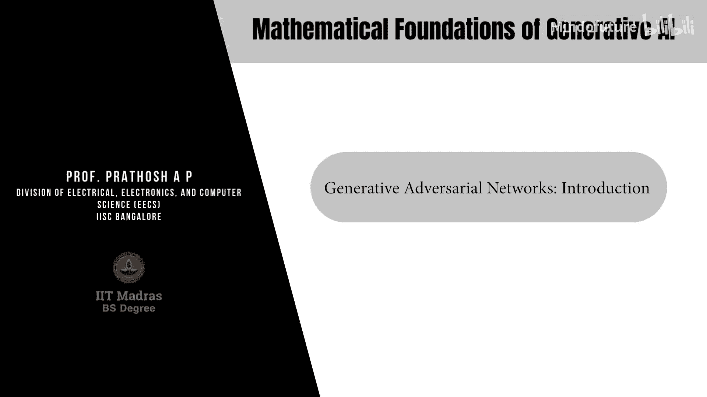
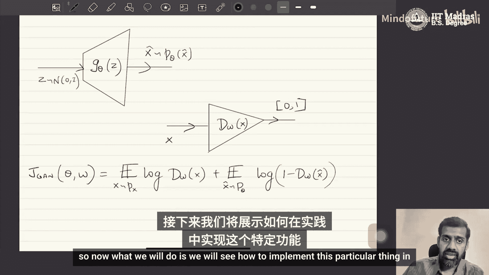

# 生成式Ai的数学基础 ｜ Mathematical Foundations Of Generative Ai p10 P10_W2L6-生成对抗网络-介绍 -BV1fperz7EjK_p10-

The other consideration。That one needs to look at right now is how do we represent this t function？

Now， remember that T function by construction was a function that is defined from the space of data to domain of F star。

This means that depending upon the choice of f function in the f origins。

 we need to tweak the t network in such a way that the range of the t network corresponds to the of f star now。

To do that， this is how it is done in practice that the T network， which we called as T W of x。

 is represented as a composite function of。It's called this sigma。

Which is a function of x F and another network Vw will call it， which is a function of x。

 So what is this。Where。Sigma F。Yese。😔，啊。F divergence。If divergence specific。Actation。Yeah。

And V degree of x。It simply a function that would take x and map two real numbers。

What is this what does that mean that means that the T network that we have to approximate or the t function that we will approximate using the neural network is represented as a of two composition of two functions where you have one network BW orex which will give you a real number so this means that here is a neural network whose last layer is going to be a linear layer。

그。Right， this is common across all the M divergences and there is。Another activation that is。

Laed on top of it， which is specific to that particular。F divversionence， so this is。

F divergence specific activation。So。F dirgent specific activation。

So which means that this entire network now from starting from x to the the output of the activation now adds like the t function approximately the t function that rotate x and this will map。

The x2 domain of F star okay now we did this as a composition of two functions okay where we first mapped x2 R and from r2 domain of F star。

From x to r is what is called as the VW network and from r to domain of F star is what is called as this particular activation so note that the specific activation depends on what is the f divergence that is used so that means that your final objective function now can be expressed in terms of this we have an expectation。

off。Recall that it was Tw of x。 now Tw of x will be the composition of sigma F。Operated on Vw of x。

This is what Tw of x was and this the expectation was which just put the Px。

This is our first function of the loss。 And the second component that we had was an expectation with respect P Theta。

 and this thing was。F startoff。At star， we had the T of x here again， so which is sigma f。

Of VW of x right all we did was representing T function okay we'll justlash this So what we had here was an expectation of tw of x with respect respect to px and an expectation of f star of Pw of x with respect to P theta Now this Pw was tw of x because it takes x now was represented what was this t function t function was a function that would start that would map the samples from the data space to the space of domain of f star So by construction this is dependent on the particular the choice of the f function that we do for f divergence So just to make it general the way that was represented is that you represent this tw of x as a composite function where you have one function that is common across all f divergences where it takes data and maps it to some real numbers using some linear layer a neural network that would start from x and ends with a linear layer which is a projection on。

A real numbers the space of real numbers and from there you have an activation this activation is specific to the particular webdience so then we rewrote the loss in terms of the composition that we wrote which is sigma f composed with VW ofex which is a neural network with linear neural layer。

😊，Okay。Now， we we look at one particular instance of e well miniization。

 let us call that as the I mean it。Operly known as the generative。Adverial networks。

It was a real it was。Geneerrative adversarial networks or gs in short。

These are a special case of there is a。People here is a generative。

Geneerativeocid networks also known as Gis。 So GNs happen to be a special case of this general class of algorithms that we just saw as variational divergence minimization algorithms。

 It is just see how that happens。 So now， as you know。

 the first thing that we should start with is a choice for the divergence。 So for Gs。

The F divergence that is chosen。If divergence is as follows。

So now choosing a particular fence right means that you are choosing a particular f function right。

 So F of u that you would choose for the J is u log u minus u plus1。logg。😔，u plus one。Okay。

 U plus 1 law U plus 1。 So now this is。Similar to gen salin divergence。

 but not quite exactly the gen xin divergence。It is quite similar to dirgence， but with a constants。

 but this is the F function that is used for the usual generative adversarial network。Okay。

 so once you use， once you have the f function， then we should also write down the conjugate for that。

 So F star of t for this particular you the F function con function is minus log of1 minus e over。

Eoverty。Okay， this is the F star function， which is the conjugate corresponding to this particular u function So now it is easy to see that domain of f stars。

Yes。R minus which is set of all negative real numbers okay that is the domain of f star now given what we just saw we will have to ensure that we choose this activation function for the P function in such a way that the activation function projects neural network with a linear layer to。

Negative real numbers。 So that is the way we have to choose our。Actation function。

 So the activation function that is chosen for this particular case know sigma of F。Sigma of F。

See note that the sigma will take a scalar right okay we should maybe I should also write it the previously sigma is an f divergent specific activation。

 so the sigma of f will take a sample v which is a real number so it will take a sample from real numbers and then map it to domain of。

S star okay so note that the way we have constructed it the sigma function always states a scalar as an input v which is a scalar as an input and maps it to domain of F star。

😊，Therefore， in this particular case of the applied version that is used。

 the sigma function would look something like this。Smafi is negative of。Log off。1 plus e power。min-3。

嗯。Yeah。As just discussed note that this is a scalar value function in the sense stack it takes a scalar that is the output of the V function and outputs are the scalar。

Which corresponds to domain of f star in this case it is r minus so one can see that this is r minus because you have log of a positive number and you have minus here。

 so it means that this is always r minus。So collating all this。

 what one should do is that now we have to。Rightite down this particular loss function。

 let me just copy this。Write down this particular v function with all of these values。

 so now we have everything that we need。 We have the activation function。 we have。

The F star function here and we also have Px and P the the expectations that we can compute using the sample averages。

 so we have to collate all this and write down an expression for this particular function for the G so let us do that now。

J gun。It is。A function of theta and W is going to look like this expectation of。Log of。D W of X。

Plusus。Expectation of。log off。1 minus D W of x。And this the first expectation is with respect to Ps second expectation is with respect to P theta so where。

😊，Vd。😔，D W of x。Is given by1 y 1 plus。E power minus v W of x。Okay， so people who are。

Converscent with the neural network literature knows that this is the usual。Sigma function。

That the user the sig function。Yeah。Sigmoidoid function Now we introduce another variable called d here just to be consistent with the notation that is used in the Jan litator okay。

So note that the original generative adversial networks paper does not motivate the loss function that they derive in terms of minimizing the particular f divergence now this is a most generalized version of how to look at thegan's activation function so agains objective function so now there in that paper the objective function that was taken for again was this one Jgan and just to ensure that whatever we are doing is consistent with the notations in the again paper we just introduced another variable here called Dw where simply dw is1 by1 plus e minus Vw objectss which is。

I think but a sig wide function。这到法院这里。So how did we actually get this one can just easily verify so I will leave the algebra for the to the reader so please do the algebra what one should do is look at this activation for look at this loss function that we have and simply have to substitute these equations here right for the sigma f this substitute log of 1 plus e power minus b and v is vw of x here right and for f star substitute this negative of log1 minus e power t in this case t would be sigma f of vw of x is we substitute these two things and rearrange the terms by writing dw of x by 1 by1 plus e power minus vw of x we will get this。

Past function or the equation for the Gs。 Okay， that's， that's exactly what it is。

 So now let us write down how would the， the implementation architecture wise would look like。

We have， as usual， the generator function。Or the generator our neural network。

Which would take samples from an arbitrary distribution in our case， it is normal 01。

 and this would give us samples from。P T top X or Xcap。

 note that this X and Xcap are dummy variables for this is G T top Z， and we have the。

Discriminator network here。And the way we have composed a discriminator network is。

That we first have caulated them。这是 scale了 so okay。Take it。Or， firstly have。Yeah。The V network。

 V W of x， okay that would the。It X and gives you real numbers。 This is our B network。

 And on top of it， we compose this with the。1 sigmoid layer。Yeah。Which is。1 by one plus epo。

Whatever it takes as an input。 So this is what we called as v， right？

 V is one by one plus e power minus v。 maybe I will。嗯。Id did a little pig， so that。

It's easier to bump him。그。This is composed with。Another network。This is so we get R here。

As what we call as v and here what we do is1 by 1 plus e power。Minus B。 And finally， we get。

The output between 0 and 1 versus by construction。This is what we have， and this entire network。

I is what we what we have referred to as。Yeah。The DW function here， right。Yeah， in the。

Original Gan paper， they describe this BW network as the discriminator network。

 where there's no breaking down of the。The discriminator this way， where we have。

 where we have one neural network that would the WD function。 And then there is a。

Seeig mod activation on top of it。 Now they have just combined these two into one neural network if you do that then it looks this scale let me just。

Do that。 So we have。Right on the final g architecture。Yeah。Yeah。Yeah。

If I gl architectures looks like this。 we can just perhaps copy this。Okay。

This is the generator network and we have our discriminator network here。

So what I will do here is I simply。Combine both the v function and the activation and make it it as one neural network instead of。

Wri it as a composite。So in this particular case， what we have is a scalar as the output。

And the output that we get is between 0 and 1。This network is what we write as Dw of x。

 Please note that the。The we were doing was the crit network in our formulation。

Had T W as the output right where T W was taking X and mapping it to domain of S star。

And what did we do we broke down Tw as a composite of some activation function operating on another function learnable function that would take the data and map it two real numbers okay now in the case of generative adversial networks we had a particular。

Actation function。 That would。Approximate our t function that we need to construct the lower bound on the a diverence okay however。

 when we plug that into the lower bound and rearrange the terms so we we got another formulation or rather another way of expressing it where the t function now is represented using this D function which is nothing but the sigmoid of the v function that we are looking at which is mapping data。

To the real numbers Okay so the reason I just mentioned that is the output of this discriminator network is between0 and 1。

Once you not confuse this with domain enough f star Okay so this is not exactly the t function that we are optimizing for directly。

 but of course we are optimizing for the t function in an indirect fashion because the。😊。

P function that we have is simply a con or rather a deterministic composite。

Composition of a function， the deterministic function of the D function。

 So if you know the D function then you know the t function as well。

 but there ranges happens to be two different things。 Okay。

 so just to make sure that we are on the same page。 Okay。

 so the final architecture would be that this would take X input。Okay， and give you0 and1。

 So what is the loss function that we have， Let me just copy that as well。Yeah。

Okay the I read it again so。The can loss function。 please know what cut this is nothing but the。

Lower bones that we have computed on the corresponding of。 So we have an expectation of。老个。DW of x。

 know， this these x are coming from Px。 we have another term， which is。Expectation of。

How of1 minus dw。Log of1 minus。Dw of x。let me call it as X cap， just to。

Different here though this x cap is coming from。비て다。

Right so this is what we have so now what we will do is we will see how to implement this particular thing in practice okay。

