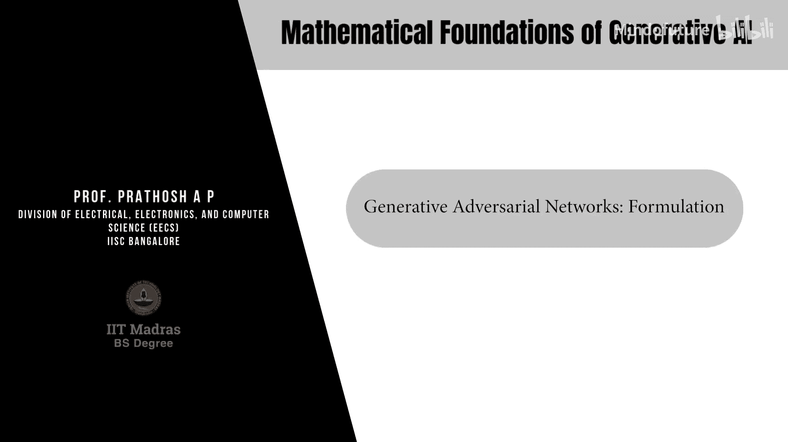
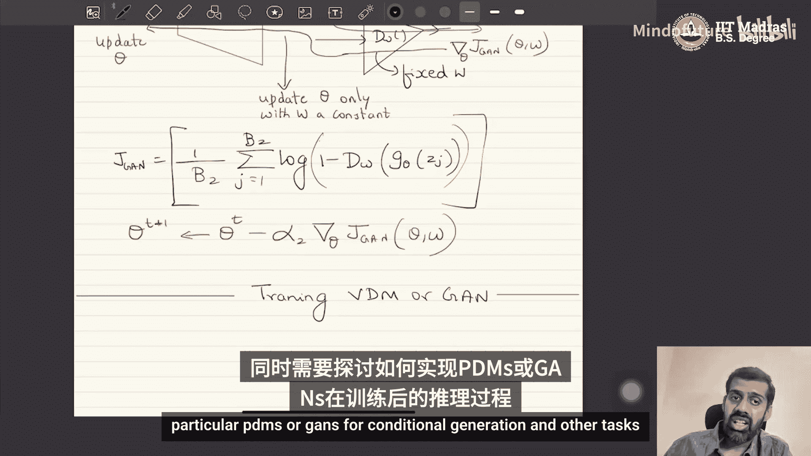

# 生成式Ai的数学基础 ｜ Mathematical Foundations Of Generative Ai p11 P11_W2L7-生成对抗网络-公式 -BV1fperz7EjK_p11-

All right。Pummentation。Implementation of。Again。Inarus。Yeah。

So here I am assuming that the audience of this particular course are well versed at timing neural networks。

 especially the error back propag algorithm using gradient descent。

 I will not be going through those algorithms assumingsum that the audience here know how to。

Trying neural networks typically what happens is you know as I have been saying this course is by and large architectures are agnostic。

 so I will not be telling you what sort of architecture that is to be used for de generatorer and discriminator it does not matter in general these things will happen to be some sort of neural networks。

So these can be any neural network right this can be a multi layerer perceptron which is also called as a pe forward neural network。

 or it can be a convolution neural network and so on。

 similarly with this so you can this is also another neural network with any kinds of architecture you can it can be a CN it can be an MLP and so on So we will do some of this during the tutorials but I am assuming that the audience here are v verse with the trading neural network so you have two neural networks that let us write the algorithms so the input for this。

But you only have data。Okay， you have n data samples。

So we are given in data samples that are drawn ID from unknown distribution P X。 this is all we have。

 Okay， so we need to choose an architecture for the generator and a discriminator network。

 So this is the。It generatorator network and this is the discriminator network。

As I said for this particular case， the D function can be equivalently represented using a function that would take x and maps it to a number between 00 and 1 because the d function is defined that way right it is the sigmoid of the B function so the sigmoid is always bounded between 0 and 1 therefore this can be interpret as interpreted as a classifier right。

A binary class pair。So we will see more about it in a in the next module but yeah。

 so this is called the discriminator。 So what we need to do is input is input。

That are given are just the data set with n samples drawn ID from an unknown distribution px。

So what we should do is we should train the discriminator the generator and discriminator alternatively so。

😊，What do we have the objective is that we made3ta star and W star。都 be。

Rather I write that separately so first we need our W star which is the equivalent of the t function。

 what do we need we want this to be maximized remember that we guard this bound by maximizing the F divergence the objective of of divergence with respect to the t function so we need to max this。

Expectation。Now I will change the expectations。I mean we'll do it the next step。

 So theres expectation of。Log of dw of x with respect to Px， and you have plus expectation of。

Log of1 minus D W of x cap with respect to P Theta。 So we know that while we are optimizing。

These kinds of expectations in factors will have to approximate these using sample averages so this is。

Out max。So， I am assuming that people also here know that that neural networks are trained using batch gradient and becent okay so I will approach I will replace this。

Expectations。In thumbs off。Bges， this is Laoff。DW of X I。Yes。One by。We do。Jas 1，2。😔，Me too1 minus。

 sorry log of。1 minus Dw of X J CAg。So this is what the S function is where X I。

Or x1 up to X B1 are samples drawn from B X， and x1 cap。To X。

 B2 cap are the samples drawn from P Theta。 So this is the optimization that we we should solve。

 Okay， so now how do we do this， Then we do one gradient step the。

Arameter update that we do is this way， minus some。So。

 note that we are maximizing so there should be plus some alpha 1 which is the learning rate times the gradient of the loss function which is J and theta comma。

The B U with respect to W。this is what we need to do okay so now how do we do this in practice so this is one gradient step。

This is one。One gradient decent step。So no discriminators。Yeah。

Lo we trained a discriminator and while the discriminator is being trained。

 we have the generator network to be constant right Similarlyly。

 we will have to look at the generator network as well， which is。

And need to minimize the bound that we are constructing on the above versions。

 we will minimize a theta。She thought， So did done。

The can so we have theta command W where to minimize the same objective and note that we have this adversarial nature here in the sense that the discriminator is trying to maximize the objective and the generator is trying to minimize the same objective。

 so if we simply。Replace that using sample averages， then we need to minimize the same objective。

With respectpect to the same objective has to be minimized with respect to theta here okay now where is the dependence on theta if I look at it the first term here is independent of theta and we can take that out right why we are training the generator we can take this thermo because this is。

This is independent red of Theta。그。Independent of。Of Theta， sorry， Yeah。

 This is independentent of Theta。 and the second term。Should be dependent on theta。 mean。

 while apparently one will not see the dependent San theta here。

 this is actually equal to the following way。 Let me write that down。 this is miniizing。

The spectro theta I'll just state the first term down here。 This is1 y B2， which is some bad size。

 J equal to1 through B2。 We have log of。1 minus dw。

 what is xj cab by the way Xj cabs are sample from the theta。

 so what are those those are simply xj is equal to G theta of Zj right this is the way we have defined our。

Ex J cats。 So this would be D W off。G theta of X J。

Right so now the dependence on the jta function is apparent here right So this is the loss that we are going to optimize for。

 Okay， so what we should do is one step one gradient step。

Towards the a of the generator would look like this。 So note that this is one other step size。

 gradient of the loss function。With respect to Cta is what we should see。 And this is。

This is one gradient decent steps。One gradient decent step。Throughデgene through thegene。

this is one gradient decent and step through generator and here we have a step size this is a step size。

Gdient step size， and we have another gradient step size here。

 So we need to use it can use this to be the same or we can use use these to be different step sizes as well。

 But yeah， so these are。I D E B and sorryia。These are step sizes for gradientc。Right。

 so here while we are doing this， we have to keep theta as a constant。 right over here。

 theta is kept a constant while you are。😊，While you are optimizing for the discriminators。

 while you are optimizing for the generator， obviously w is ka constant the parameters of the discriminator are Ka constant。

Okay， we have to will have to solve these optimization problems alternatively that you。

Update the generator step， generator parameters。 And by keeping the discriminator parameters constant。

 and then you update the discriminator parameters， keeping the generator parameters constant。

 So please see that。While the generator by the discriminator is trying to solve a gradient ascent problem because typically when you do when you solve optimization problems you do gradient descent because most problems in machine learning are cast as minimization problems here you have a plus here while。

Updating the discriminator parameters because we are maximizing here right I mean。

 you have plus the parameters here are trying to maximize this function and the parameters here are trying to minimize this function。

 And that is where the adversarial part of it comes into picture。Okay， so let me just。Write down the。

Ting steps secretly。 So to train the。Discriminator2 okay， well lets yeah to try in the discriminator。

So I am the discriminators。是か。How do we train the discriminator So we keep the generator。

Keep theta constant so we are not touching the theta network okay， however。

 we will just spell just right down here so note that to train the discriminator network。

We need samples both from Px and P theta let me write that down。We have Z samples sample from No 01。

 we have Gt of z， and here we get。Excap sample from Dtta。

What we should do is note that we are given some samples from the data so we have。Data samples x 1。

 x2 to x。 So we select a batch of samples from。 So first。

 what we have to do is define B1 to be a batch of samples from x 1， x 2。

Up to x b1 so it need not be contiguous right it is simply some random samples taken from D Okay。

 this is a subset of B just take one batch of samples from the given data set Okay then so we are training discriminator here。

 right。So maybe what we are training， I will。Either in a different color。😔，So what is being trained。

 let us write that。green color， so we are cr the discriminator。Okay。

D W okay now know that the loss function for this。J theta。So he did gun。😔。

W is a function of both tta and W is given by this particular equation that we wrote right let me just copy that equation and write it。

We have to compute this equation now。Yeah。Yeah。Yeah。YeahSo J theta is given by that。

 So how do we compute the first term here。The first term is computed by simply passing x1。

It's to up to X B 1 through this， and we can compute this particular term， right some of。i。Its 12 B1。

 we have log of Dw X I we can simply compute this term here。

 so what we should do is that we should simply pass x1 x2 up to Xb through the discriminator network right just pass them through the discriminator network which is also called one forward pass we pass them pass it through a discriminator network and we get this。

So how about the second term， how do we compute this trend term here？

So note that this in the second term W J cap is nothing but。G theta of Z J。

 that is a definition of Z J。 So what we have to do is that。

Maybe it will with it but we have some space there。😔，Okay。

 what is to be done this first we need to sample。Sample。G1 z2 up to Z B2。

 all of these are sampled from normal 01。Okay， then。Us。zeeven。Through Z2。Through the generator。都知铁噶。

😔，With fix and theatre， are right。So because， you know。

 note that we are updating the discriminator of parameters here so we have to。Keep the fixed theta。

 So what happens is we have here z1 up to Z B2 we are passing this through the discriminator network sorry the generator network。

Let's fix the theta。 Okay， we pass this and what do we get， we get G theta of z1。Do g two go off。

Z V2， So this is what we get So here。We write fix it theta， so we have a fixed theta here you。

We are not changing the at all。 Okay， what is being tried is written in the green。green colors here。

Now， what we do is that once we get d theta 1 to d theta 2， we have to pass this。G theta Z1，2。

 G theta Z B 2 again through the discriminator。Okay， and once we do this。

 we can compute this1 by v2 J is1 through v2 log of。1 minus。1 minus DW of G theta Z J。

This can be computed。😊，I don't think there are three buckets here。

Hope that this is clear so what we do is that the discriminator I mean the last function has two terms one where the samples are coming from P right the first expectation the second expectation where these samples are coming from P theta okay so for that we need to first get samples from P and samples from P theta how do we get that so samples from Px is simply get some B1 samples get a batchge select take a batch of samples from。

The data set itself。 that is straightforward。 Okay， then to get samples from。 Okay。

 so maybe yeah to get samples from。P theta what do you do is that you sample Z2 Zv2 which is a batch of samples from normal distribution and pass although all those through the generator with the generator parameters being fixed。

 So now you will get G theta Z12 G theta Zv2 which are the samples you know the water are these actually these are actually samples from P the topics cap right。

Okay， and these are samples from P， obviously correct。

 So we have samples we now have samples from P theta of x cap。

 you know have samples from P of p as well。 So pass all those and by the way， these are not， I mean。

 you can you can do it either at a batch level or you can do it at a sample level depends upon what sort of implementation are you doing。

 So pass samples from P X。Through the discriminator and compute the first term in the loss and pass the samples from P E。

Through the discriminator compute the second term in the last。 So once you compute these two terms。

 what is to be done is that you compute the gradient okay of this J G。

D again with respect to W right and then back propate this loss back propate this loss。

Through the discriminator till you get to the input of it。

Ievte the get to the input of the discriminator right once you do this simply update the parameters of the discriminator。

😊，喂。Usual gradient descent， but with a popless sign here because what we are doing here is gradient ascent。

Let's say this completes one step of cl。So they discriminateator network hope that this idea is clear。

So while we are doing this， we will keep。 So maybe I will write this。 So this is。

The green is for a forward prock。Forward propagation and the redispo back propagation， right。Okay。

So all only this green network is dry， so we don't。

Will not that the generator network at all why we are carrying the discriminator Okay hope this is clear So we will do a similar thing for the generator now so to train the generator network。

To tie the generators network。嗯。Now， all do we do this， Let us。

It do the same thing we have the network here。Okay。

 I will write this in green now because this is what we are going to try。

By keeping the discriminator parameters fixed。So we have the generator network here and we have a fixed discriminator。

While the generator is being trained， we have the discriminator to be fixed。可。

And these who take samples， we will write that down later。So this is Dw。Okay， so now this。

 as we know， will take samples from。Samples1 Z is G Tta Z， and we have。Yeah。S plus。 So now here。

 right， this is。A fixed W because we are only training the generator。

 So what is the last function here， as we are the the first the。

The first term is independent of theta so we can completely ignore that we will only take the second term。

 which is this one。Yeah。we need to compute this term now how do we compute this it is pretty similar to what we did the previous time but note that in this case we don't need real data right or rather data from px is not needed at all while you train the generator network or the discriminator network you need and while trying the discriminator network we need data both some px and P data but while we trying the generator network we don't need data from px at all because the first is independent of the generator parameters are independent of the first how do we compute this simple so we pass sample。

Z1 through Z B1 did we call it B1 or B2， okay， we sample z1 through Zb2。사람01 okay？And then we。

Bs all this。So Z1 through Z B2 through this network。 and what we get here is。G2 dot of。G ti off。😔。

Z B2， you had all these samples， right， which is needed here。

 Now take all these samples and pass them through the discriminator。 Now note that。The discriminator。

Pararameter are held a constant here。 Okay， take all these sampless and pass them through the discriminator。

First them show a discriminator and compute what should be compute。

 we should compute Dw of G theta of Zj。Right， he compute this。Of course， I mean。

 we need to compute the entire thing， okay。滚。We me read this。 Okay， so let me just reiterate it。

 So what we need to compute is we need to compute。1 by B2。Sigma J is 1， through， B2。😔，Log 1 minus Dw。

G theta of Zj， so we need to compute this。Yeah this。log is and bear the team。Okay， you compute this。

Then what we do， we compute the gradient of。This particular thing with respect to。Yeah。

With respect to。T okay so this is what our J G is right。

 this is R J again And so in the case of discriminator also yeah。

 this is R Jgn in the case of the data this is our Jg so we compute the gradient so we pass the gradients from all the way from the output of the discriminator okay。

Do the。Input of the generator please note that while we do this， we keep the。This is only to update。

Yeah。B tutor only。With W a constant okay。So why the gradients？As through the discriminator。

 the discriminator parameters are not going to get updated are while you are updating the generator parameters。

Okay， so let me repeat what is to be done is that why you want to compute the gradient Okay。

 so let me complete that step so after we do this how do we update we update theta plus1。

The new theta will be the old theta minus。Some of that learning rate。For step size。

 we have this gradient with the specta for this particular function。Right。😊，Okay。

 so now let's just summarize。 So to get the。To update the parameters of the generator。

 we dont need the first term or we don't need the samples from the real data at all because the first term is independent the generator parameters。

 so we take some B2 samples B2 number of samples from the normal distribution and then pass to one forward pass pass it through the generator。

To get the generated samples from P E so these are。As we know， these are sample for B theta， right。

 so we get sample from B theta。Yeah。yi。😔，E2 and these are samples from P Theta so pass all those samples from P theta。

Through the discriminator and compute this particular loss。 Okay， this can be computed。

 Once we compute this， we compute the gradient of this particular loss with to theta。

 which is the power of the generator parameters。 Okay you know what cut this is actually a function of generator parameters as well right。

 because we are doing a far pass through the generator parameters。

 So this is entire loss wing here is is a function of the generatorer parameters as。

 So we compute the gradient of this loss with to generator parameters pass the gradients through the discriminator by keeping W fixed and then。

😊，Continue passing the back propagating the gradient all the way through the input of the generator network。

 and then here you the simply。See update The here， right？Ud it using gradient decent。

 so that completes。One gradient step through the generator。

 So typically what is done is that the generator and discriminator trading are。Altter it。

 so you take one step through the generator and one step through the discriminator and keep alternating vitamin it Some of the practical tips include that now people don't use。

Alternating same number of alternation mean alternating the training between the generator and discriminator but generators sometimes generator is trained more than the discriminator meaning you know you try you take five gradient steps through the generator and one through the discriminator and in some situations you take five gradientd steps through the discriminator and take one gradient step through the generator and so on it depends upon the particular use case that you are looking at so what is the top criteria here。

Typically in the g training， there is no well defined stopping criteria。

The way it is done is that one would look at the quality of the generated data。

 which is speech the using some metrics and depending upon whether those metrics are。

Reaching the satisfactory levels， that is where the training is stopped。 Okay。

 give you more details about how this training is stopped when we look at the classical interpretation of this scan in the next form view Okay。

 so that we just。Read rate what we just read so we looked at one instance of variation dience variation di to normalization as a gener to a serial network right again in practice so what did we do。

😊，We had of course we had a pushpon network， we have a generator network and this discriminator network where did this come from for all practical purposes。

 this discriminator network is nothing but R T function okay which would construct a lower bone ground the epi divergence so there is one epi divergence that this is trying to minimize remember that why should this work it should work because。

We are trying to minimize a divergence metric between P theta and ps okay so once we do that then sampling through g theta sampling using g theta is equivalent into sampling from px so that is the whole idea that is still there so how do we do that we start off with an epi divergence construct a lower bound using this f function。

And then minimize that lower bone。 So have an f function construct a low have a create a lower bound and then minimize the lower bound for this the special case of generative adversarial networks。

 you start with this particular f function and that would correspondingly give a conjugate and that would give an activation function also which would make our t function have the proper form that the domain of the tree function the range of the t function has to be domain of S star then we plug those when we plug those equations to the lower bound that we construct it can be rewritten in terms of another function Dw。

 which is simply the sigoid function on top of the B function that we had so in that case your。

Setup looks like this that we have the user generator network and the the T network is equivalently written as this discriminator network where we have the v function composed which us sigoid at the output。

The final G architecture just looks like this and here is the loss function and we know that these expectations are approximated using sample averages so implementation wise we do it using a batch gradient de where we take a batch of samples and we do we take one gradient step and we un through the entire data which would make it one complete epoch and de is done for multiple epochs I hope that the audience here is aware of what batch gradient recent is。

How do we do that， We first keep the generator parameters fixed and compute the discriminant。

 solve the optimization problem for the discriminator using gradient descent we just saw how to do that so for the training the discriminator you need data both from both from P data and from the real data we do that by sampling some samples from the neural distribution passing it through the generator by keeping the generator parameters fixed so we get some samples from P data pass those through discriminator and the compute the second term in the loss and we take one batch of data from the real data and pass that through the discriminator and compute the second first of the loss add them both compute the gradient with respect to w back propagate through the discriminator and do one gradient step through the discriminator so while doing all this the generator parameters are keep kept fixed and to train the generator network。

You do the same thing， but by keeping the discriminator parameters fixed。

Take a samples Z1 through Z2 from the normal distribution and pass it through the generator to get samples from G theta generator training is independent of samples from px this is also part the real data so now take Gtta Z1 through G theta Z2 pass it through the discriminator compute the second term of the loss and take the gradient of that with respect to the theta parameters back propagated through the discriminator all the way to the input of the generator network and while doing all this keep the discriminator。

 the parameter of the discriminator network constant and then take one gradient step through the generator network this is how the training is accomplished。

In the， this would take us to the end of。This training。

BDM variational diverence minimization or one special case of Gis Okay so in the next module。

 we will look at how to do inference on this and we look at the classifier interpretation of this particular special case of Gis and we will look at some of the improvisations or GN and how that can be used for different use cases。

 I told you that with different f functions you will get different sort of。

behavior imposed on this epi divergence and therefore the generated data will have different kinds of behaviors So we will look at more on how to improvise this to do different things and we will are to also start with how to accomplish inference。

Post training for this particular pms or GNs for conditional impression and other tasks。

Okay， thank you。

