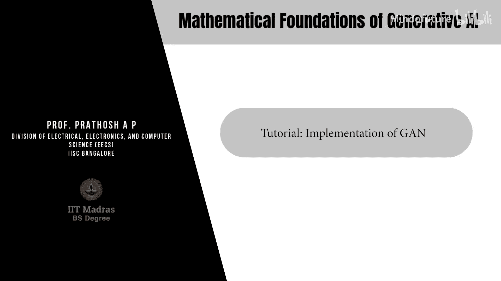
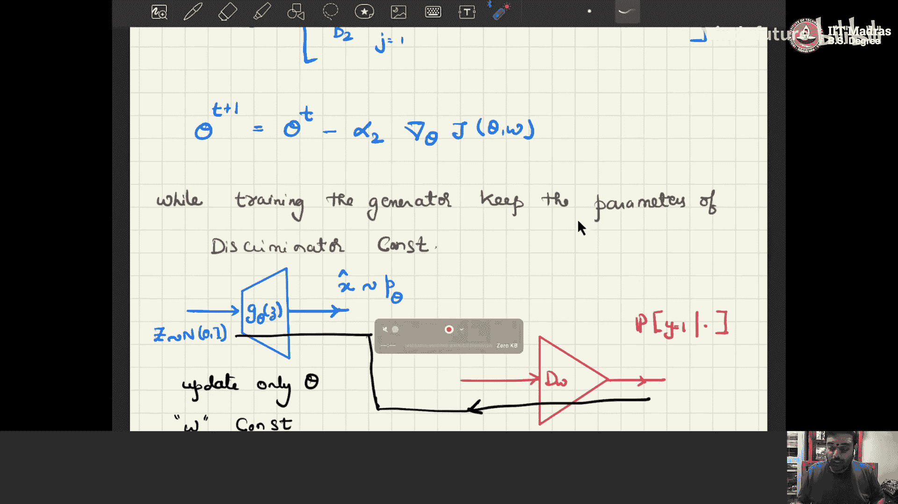
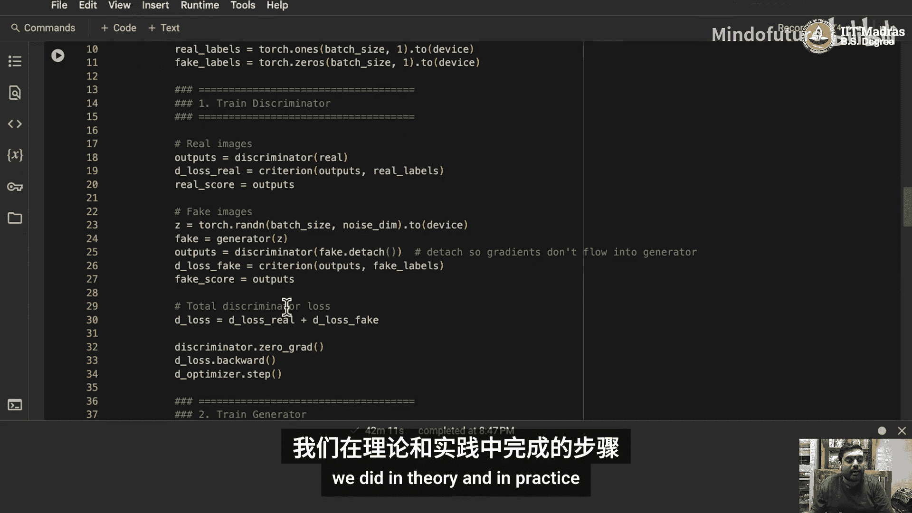
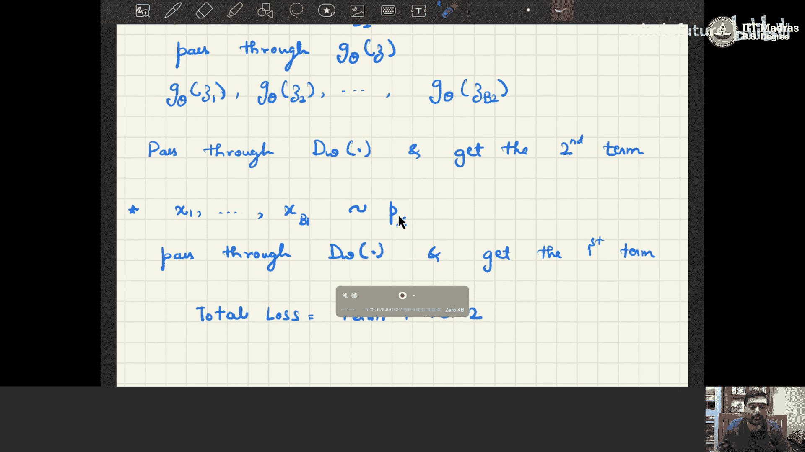
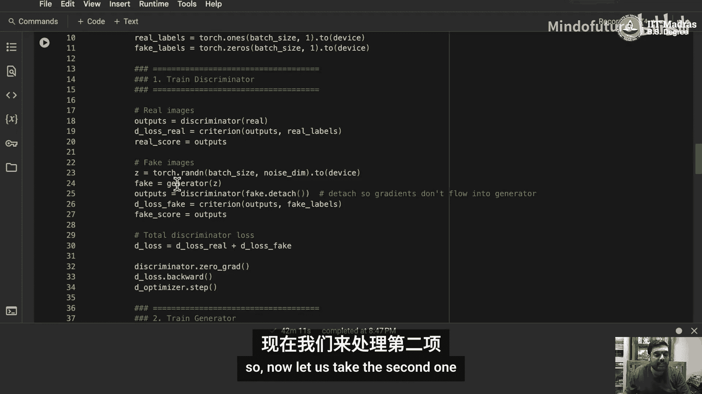
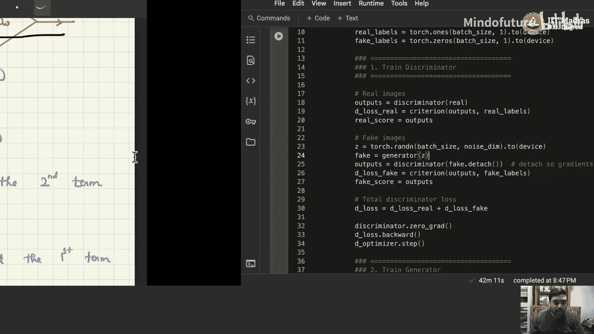
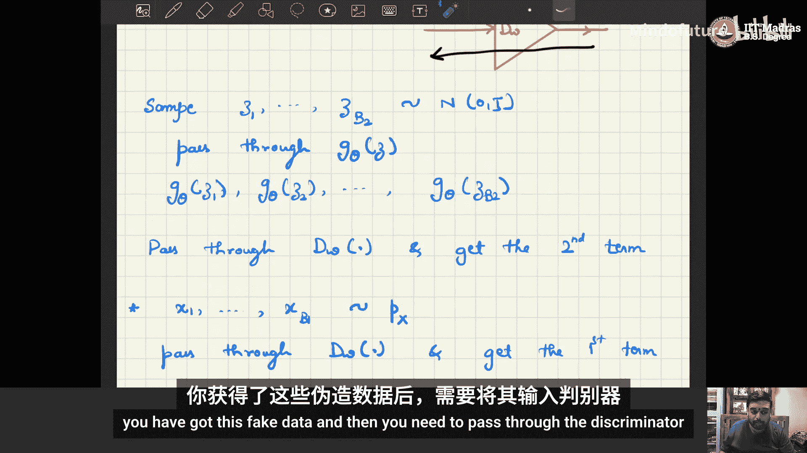
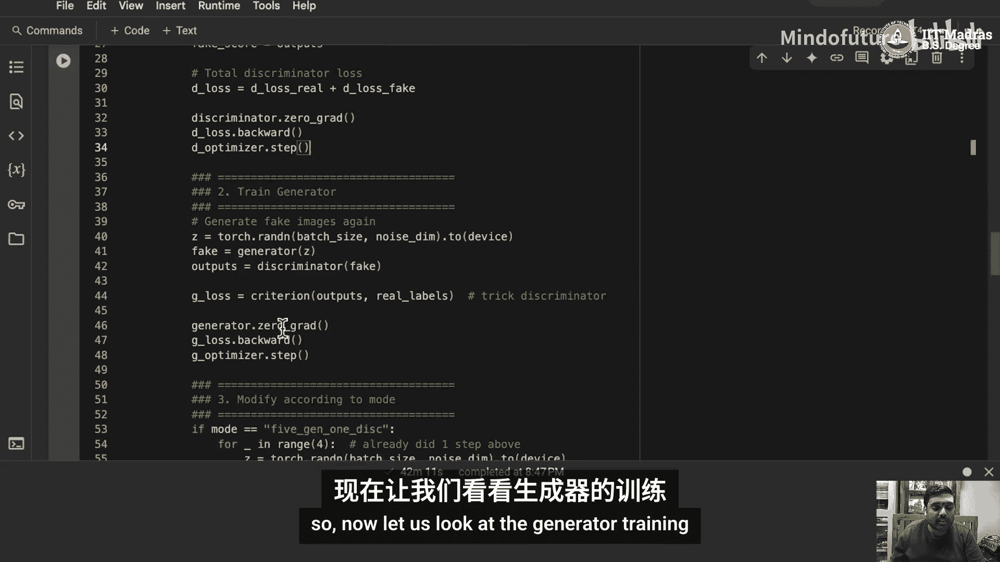
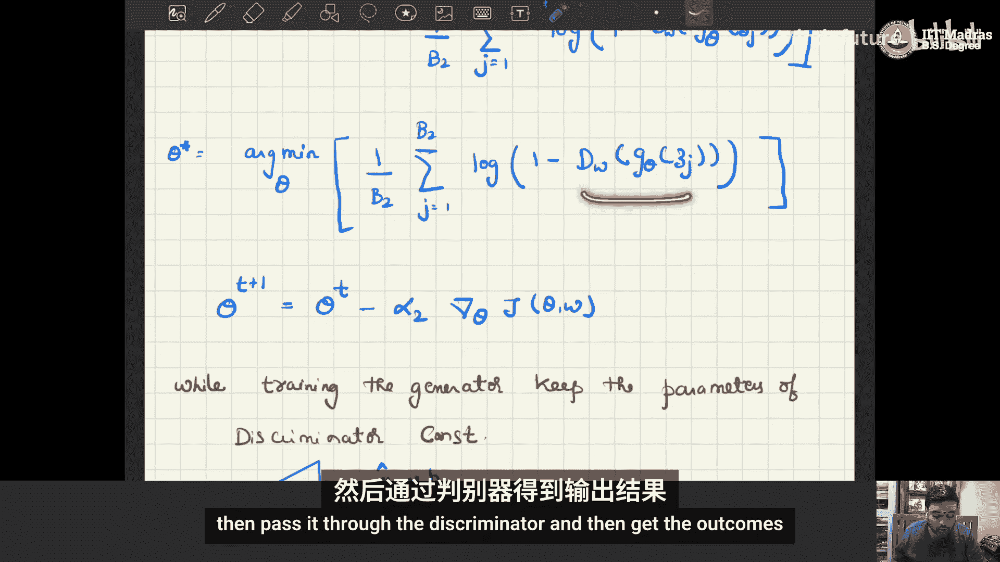
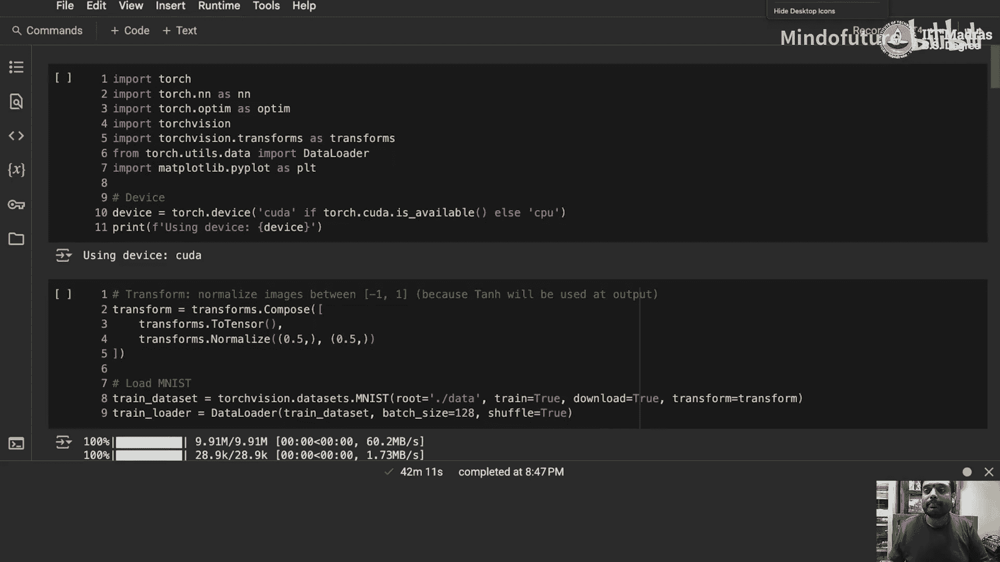

# 生成式Ai的数学基础 ｜ Mathematical Foundations Of Generative Ai p12 P12_W2T5-教程-GAN的实现 -BV1fperz7EjK_p12-

🎼。

Hello all， welcome to this tutorials on implementing vanilla G。

So by now you would have looked at the mathematical formulation in DT。And again。

Has been formulated using。Redium。So now let's start take it from there and then see how do we implement。

都问你来讲。So now let's start。嗯。The input， we are implementing the the。

Vangan okay now why it is vanillagan listen it not any flavor of it okay there are a lot of flavors of thegan now we are implementing the the basic flavor so it is called as vanillagan。

😊，Now in your theory sessions， now it would be like justgan just as many likegan that。😊，Okay。

 now the input that we have。嗯。B。Is。Set of input x1， x 2。So until X M。Drawn IAD。From the distribution。

 P。Okay。This is the data that is given in our implementation now we will be using data。As endless。嗯。

So then which we have images， which is of size the dimension of image is 28 across 28。

 the reason why we have taken a very simple set is。

So that now we can run it and then see the outcomes。Now since our computing resource。

 the GPU resources that we have is limited， we want to take miniature。

Data sets and then see its implementation in working。Now， this is what the data that we have chosen。

 so now we should look into them。The generator and the discriminator network。什么。

The generator network that we have。Yeah。You takes samples。From Z。

Whi is normal distribution with0 and I。Yeah。We have this generator network parameterized by theta。

Take the Z as input， and then。It gives。It generates。Except。From the distribution， E theta。

This is the generator。And then we have the discriminator network。😊，那我真是。1。It takes x or。

Exceptt as input。This is called as discriator for that reason it takes x or x hat as input。And then。

 it will give。There will be a sigmoidoid function at time now it will be giving the probability of y is equal to 1。

 which is with how much probability it belongs to the region。那たOkay。Of given the in。O。So no。

we should choose the network now we should be using simple MLP in both the case we look at the MLP structure when we go to the collab link。

😊，Of the generator network that we have。嗯。嗯。Generator network first we should decide on the dimension of z。

Now Z dimension， we will take it as 10， you can take something else also， but we have taken 100。

A random thing okay now this will be the input for this generator network。😊。

And then what will be the output of the generator network now it has to be an image so which is of size 28 cross 28。

So now that means that I should have an output of 784， now which I then reshape it into 28 cross 28。

Now， in case of the discriminator network。Again， Ill use one more MLP。Discriimminator network。

The input now will be 784 now which is 28 cross 28 dimensional image now will be the input the output now will be the probability。

嗯。That y is equal to  one given whatever the input from the distribution that we have。Okay。

 now this is the。network structure。Well， then。W will be the loss function？

Now you have derived the overall loss function， I'll just take that one equation from there now which will be。

Comfortable to us。五个。The last function will be。只 off。Metacomably。Equals expectation。

From the true distribution the。Lo off。The outcome of discriminator。Now，You choose X from。

The true distribution here。Yes。嗯。嗯。Exation of。With respect to P Theta。1 minus sorry。

There is a log off。Log of 1 minus。DW of x。Now， this x is obtained from。No。E theta distribution。Okay。

 now you have expectations what we will do is now there is a step involved now we approximate this expectation with respect to sample mean and then we use the batches。

😊，Then we use the batchges。嗯。The approximate。Expectation。Using。三本明。嗯。😊，Use， but。Now， because of that。

 now assume that now I take from the distribution px。A batchge of beav and from the speed。

About of we do， okay。So now， because of which， my G of。Theta comma W will be one over。D文。

Summation I is equal to one。V log of。The W of Xi。O。no不s。1 over。We do。Sumation j is equal to 1，2， B2。

攞 off。1 minus。DW of。X只系。Okay。Now bit in which。We have。X 1， X 2。Till X， B 1。From other IID， ID。

From the distribution。P X， And then we have the。X。one hat。It's too hot。So， until x。V2海。系一点。

P theta from the distribution， P theta。O。😊，No。How did we get this？

Fake image as it is called as the fake image Now what did we do was now we sample it。

From this normal distribution and then we pass it through the generator at create。

And then we obtain this fake images now because of which what I can do， I can rewrite this equation。

 especially the second term of this equation。你个是。Go pay this whole thing。

I can rewrite the second term in terms of the generator function。Because of which it's all we like。

呃XG。Will be。GT do off。30。So where in which you will be sampling。嗯。Z 1， Z 2。Soun Z。We do。From IAD。

Normal，0，5。Okay。Now， this will be the。And then you have to have the min Max。

 there will be the adversarial criteria。So in which you have to maximize。

The parameter of the discriminator。And then should we minimize the parameter of the generator that is there。

Yeah。So now。Now let's look into the generator network。

 I just recap this and then we will go to coding。嗯。Now let's answer that。The generator network。哦。

Now we have this objective W star is。A max of。嗯。W。The same equation。 you can just。Copy this equation。

嗯。谢。It is this。Is this normal writed Italy？嗯。Is the equation that we have。Of this。

We want to find the。A Max。With respectpect to W， that will be our W star。Okay。

 now since we have a maximization problem now we will not be doing the gradient descent actually we will be doing the gradient acent okay because of which。

😊，W T plus one is is assigned with。WT。Plus， the learning rate。With respect to the。

The discriminator function now we can we will be having different learning rates for generative generator function and then the discriminator function will be having two different learning rates。

And灯。The gradient with respect。Through the generator parameters of。No。Objective function。 Okay。

 and it is。Makes sense that while training the discriminator。

 all the parameters that are involved with the generator。

 or the theta which is involved with the generator are kept constant。我要。training的。Discriminator。

A parameters of。Generator network。Generator network， which is Theta。re kept constant。Okay。

So now how do we do it？Okay， now you have a。This two networks now let's take this network images。

话你你停得唔。嗯。嗯。Yeah。How do we do it now just for reference， we'll keep this。first， we will。散半。

That one till。Z D 2。From IAD， normal 0 I。O。😊，Now do you look at the objective。You need this。

Then you have to pass it through the discriminator function。

First Z you sample pass it through generator function。

 you get the fake images that you pass it through the discriminator function that will give you this last value。

我阵要。嗯。Fss through。The generate function g theta of z because of which you get g theta of z1。

G hit of Z 2。So on。G hit off。Z B2。Okay， now these will be here。Faake images。Now。

 once you have these fake images， you pass these fake images。😊，You pass this through。

Pass through the discriminator network。And的。Get the。Second come。Okay， you get the second term。在 now。

See it is 1 minus。Okay， now you should be looking at this probability using BC loss or we can get it which a straightforward forward implementation of BC loss。

O。😊，So now then。Then what do you do you。Big。极算。Till X， B1。O。To take a sample from。Bx。没嘅。😊，Then啊。

Fss through。The discriminator network。And get the。トレ。Okay。😊。

Now you add these two terms now your total loss。我日。The discriminator。

totalal laws for a discriminator will be。Tumb 1， let。

Tm 2 okay using which we only update the parameters of discriminator okay what do we do we only update these parameters using these loss。

Okay。Now， this is how。有。Implement。The weight update。

 the gradient ascent of this has to be done for the。Disriimminator network。

So now coming to the generator network， how do you。Work with the generator network。

Now let's start with that。Lets take the generator network into consideration。

You can generator network。You have to find the theta star。冇冇只事啊。The admin of。Goff。Peter。我们这边。

This is what we need。哦我。We can obtain this from the previous we can just need to reiterate the same previous equation because of the reason Ill just copy this equation。

嗯。嗯。嗯。Yeah。this， you have to find the。Argment now with respect to theta。O。😊，Now。

 if you close the look at this equation， not this first term。😊，Has no theta involved。 No。

 it is just the discriminator。 Only the second term is involving the theta。 therefore。

 we can get rid of this first term since it is。Independent of theta。

 The first term is independent of theta， therefore your。Theta star will be。

Arban with respect to theta。How do you do it。1 over b by 2 summation j is equal to 12 b2。老个。1 minus。

BW of。支持道。嗯。质是意见。11。嗯。Brackets， need to take care of them， okay。

Now you need to update now we use the gradient descent in this case because it is a minimization problem。

我知得。T plus 1 is equal to。别太咦。Learning rate， it can be same or different。So， gradient。Withre to them。

对。Now， whenever you are training the generator， we are training the generator。

 we have to keep the parameters of the discriminator constant。😊，怀现啦。嗯。Training the generator。做乜嘢噶。

E though。Give the parameters of。Discriminator。Constant。Because of which your gradient。Passing okay。

 let me put the diagram once we put the diagram， it will be much more clearer。嗯。

The two network diagram that we have。嗯。嗯。Yeah。Whenever you are doing this， well do is。

The gradient will pass through this whole network I'm just taking it other way around so。Yeah。

This is the backward moment while doing it， but we don't update the weights of W okay。我。嗯个。Update。

我呢睇得。With w。Go smoke。O。Now， how do you do it， you sample from so you need this。The first sample from。

The normal distribution， then you pass it through the generator function and then pass it through the discriminator function。

And use BCc loss with respect to the real images as you need to click the discriminator you will be using the Vc loss with respect to the real images your target will be the labels of real images。

 which is one in our case okay。So now。Now， with this much of background detail in hand now let us go to collab now what I have done is now I have pre retain the code。

 the so reason why I have done that is we can just skim through the code once。

And then I have kept the outputs ready。 Now， we can look at。Those outputs。O。

Let's go to the code。This is a Google collab we have discussed this in our previous tutorials then which we loop into Pytorch。

Okay， so now。These have been a city。Packages now T is to import the pythrs for neural network for optimizer to get the data a star division to transform the data use transforms to get the data loader you use the data loader and then to plot the generated images we use PLt。

Okay， these are the necessary libraries that I have imported and then we will be using the。

The Ka device now will be using the GP so Tra device kuda if Tra ka is available now if this is true use use kuda otherwise you use CPU。

And then。You have the transform here now you have composed a group of transform now one nurse now first you convert it into a tenor now once you have converted it into a tenor you normalize it with mean 0。

5。And the variance 0。5s okay now this is the the main tu this is the variance tu now if you are since we are using MN which is a single channel data we are giving only one value if we are using a multichannel data we should be giving multiple values okay。

So and then you are obtaining the data sets， Tor visionion。 datas。 mn。O。

Now the data you are downloading again into dot slash data。

Now train equals to true you are downloading the training data we don't need we are not doing any inference so I don't need that test data download equals to true now once you have download the image you apply this transformation what do you mean by that you convert it into a tenor and then normalize it similarly you create a data loader now which batch size of 128 and then。

You shuffle them。Now， look at the generator network。😊，Now。

 in the generator network now as we discussed earlier。

 now either it is a see finally you want to approximate the function G theta。😊。

So now you need a function approxim either you you can use any variant of linear theoretically you can use any variant either the choice。

😊，Now， either you use。MlP， or you can use convolutional neural networks I have used MLlP。

So I have created a class generator， which is a child of N dot module。Now， in which。

I should be giving。In the init method apart from the instance itself I should be giving noise dimension now which will be fixing as 100 and then the image dimension which will be 784 now these are the two parameters which can change and then you are calling the parent that is nN dot modules constructor with the generator as the parameter and then you are creating a stack nN dot sequential these are the sequential process is the same way in which we discussed earlier also now first you have nN dot linear you have a MLP from noise dimension which is 100。

😊，Do。256 now then you use raillu。Actation， then you have 256 to 5 well。Again。

 you have raylu phi 122 1024， again raylu 1024 to image dimension now which is 784 in our case。

 and then Im applying panh because we want to normalize the image now it has to be in the range minus1 to1。

Okay， this is my generator method。😊，And then let's go to the discriminator method。Now。

 where and which？You have similarly， you have initiated the discriminator an n sequential linear from the image dimension。

 which is 784 to 5 well。Now here I am simply using leak redo。Different activation function。Okay。

 and then fight 1 to 256 again I have likilu fight256 to 1 now why I am using one because you should be getting the probability so what I am doing is I am passing it through a sigmoid function this is my discriminator method。

😊，O。😊，Now， both of them are MLlP multilayer peritrons or fully count layers。

or fully entered network or whatever you want to call them now the noise dimension is 10 now this is the parameter that we have fixed。

😊，And then now you have image 28 cross 28 that is the size of your input image Ms 28 across 28。

 you are creating an instance of the generator bypassing noise dimension and image dimension and then you are putting it to the device。

And then you are having the discriminator with image dimension and then you are putting it as a device。

And then you have two optimizers now because so from our discussion now it is evident that whenever you are updating the values of generator。

 your discriminator values has to be。😊，keep constant and whenever you are updating the discriminator the generator value has be kept constant because of which I am having two different optimizers now one optimizer is for generator the another optimizer is for discriminator G optimizer and D optimizer now both of them are atoms。

Okay， and then with learning rate。2 in into the power of minus4 and then the loss that we will be using is BC loss now by now when you look at the outcome of a discriminator as a probability as the outcome of a binary classification problem now you can understand。

😊，The log of 1 minus not Dw or just log of Dw， you can interpret it as the outcomes of a binary classification problem and then you can use BC loss there。

O。These are the necessary parameters and the optimizers。

And what am I doing is I am using some fixed noise now to generate， Im using some fixed noise。

Generator I'm trying to plot the generated images。Using this fixed noise， I'm generating it。

Always for all the loops I have keeping this as fixed。Okay。

And then I renormalize it and then plot it okay this is just a plotting function I will not be going deep into this now this is not a plotting session now we will not be going into the attack okay so now lets look at the training now before looking at the training now lets look at the function call from where the training has been。

改。Okay now as was discussed in the theory session now you can have multiple variations of training now you can update the parameter of generator once and discriminator ones now that is one way you can update five steps of generator and one step of discriminator。

😊，Or the five step of discriminator and one step of generator。Now。

 whenever you update generator more， now you tend to get。Good fake images now discriminator more。

 it is able to classify。😊，Okay， properly between the real images and fake images。Now。

 looking at the images that are generated now， you should come up with a stopping criteria。

 I have just used the simple 50 epoch so that it is just the。What do you call a trial run？

So now we will see actually with 50 now you don't get very good reconstructions。

But you will start seeing the。😊，what do you call the initial stages of images getting reconstructed。

 the image is getting generated， not reconstructed generated to be more specific。Okay。

So now let's look at these three cases now all of them I have implemented in only one。方程。Okay。

 now you should give train loader and then the number of epos and which mode do you want to work in11 where in which you have one step of generator and one step of discriminator。

Or you want to work in the mode of phigenn 1 discriminator or phi disk and 1 gen。Okay。😊，Now。

 this five is not something the holy， okay， now you can change it and then you can do what there。ok。

😊，So now let's look at this。I have taken the fixer noise now as so that I can generate for the same noise images after some epo and then compare them comfortably。

😊，Now， for epoch in range number of epochs， now you are training it for some 50 epochs。You have。

You have enumerate train loader now first you will so whenever you have this enumerate first you will get the index and then from the train loader you get the image and its le now since we are dealing with Mnes the labels are also there but labels are not of consequence to us in vanilla again so let' us not consider the label。

I'm calulating the batch size。Okay。And then I'm flattening it， okay， so batch size comma1。

I'm putting it into device。And similarly， I am getting the real labels toch dot ones now where in which all ones are there。

 what is the size， bad size comm of 1。I have taken batch size of 128 so now 128 ones will be there that also I am putting into a device fake labels which is starts at 0 which is an indicate0 is an indication that it is the fake data that also I have 128。

😊，ok。😊，Now this data is ready。😊，But now。Now， let's look at training the discriminator。

Now let us go back and revisit the equations and see the one to one mapping between the steps that we did in theory and in practice okay lets look at the training of discriminator。

😊。

O。No。First， you take real images， which is from Px。And pass it through Dw to get the first one。

In the lu。Okay， now let's see whether this is being done。

Now， you take the real images， pass it through discriminator， and then you get the output。Okay。

 and then you calculate the loss using the。BC。Function， okay。

 that means that the first term is ready。好嘅。So now let's take the second one。

What is that you are supposed to do？You have to generate the samples。From the normal distribution。

 pass it through the generator and then pass it through the discriminator。

Okay， to get the second term。Now， this is the step in which toj dot rank then you are generating from。

Standard normal now with the bad size and then the nice dimension which is 100。

That you are putting on the device， you are passing it through the generator you are getting there。😊。

Fake data。

我试咗。You have got this。백利だ。

And then you need to pass through the discriminator。😊，And then you pass through the discriminator。

 the reason why you have put dot detaach is that so that you don't need to compute you don't need the fake data which is generated to be there in your computational graph because of that reason you have detaching it so that the gradients dont need to flow in that direction you don't need to calculate。

😊，And then呢。You calculate the loss now you have got the outputs now using which you calculate the loss now outputs which is from your discriminator and the label which is the fake label。

 you calculate the fake score。😊，Okay， now you have got。Term 1 dealer is real。

 which is term 1 and dealer is fake now which is term  two， you add both of them， okay。And then。

You need to update the discriminator values discriminated at0 grad now you clear of all the previous gradients。

D loss， which is addition of these two， you do the backward now why only。

So you are using dealers here， please remember that。😊，And then you use the optimizer dot step。 Now。

 that means that only the weight of the。Discriminator will get updated。Okay。😊，This is the。

Discriminator training。ok。So now let's look at the generator training。

Okay， now let's go back to the generator， how is it done？那有三本 from。

Look at the equation you sample from Z。바세트로드。Generator then pass it through the discriminator。

And then get the outcomes okay。Now， get the。Samples from Z。바세트로드 제。

Then pass it through the discriminator to get the output。

And then to trick the discriminator now as I discussed earlier。

 now you will be passing the real labels and obtain the loss。😊，Now， and then you zero gra all the。

Graadds of the generator or the parameters in the generator。You calculate。Only。Okay。

 you calculate only the gradients with respect to the weight of the generator。

And then you update only them。看。So now。 this is the。Trading of。Discriminator and generator。

Okay11 train now then what I have done is now if your mode of training is phi gen and 1 discriminator now you have already done one step of generator and discriminator so now you need to generate four more so you need to update the weight of generator four more times now the same code I have placede it here for I in range4 if that is the case this will happen。

Now， if this5 disc one generator， now one gen has already been upload updated。

 now the discriminator is updated four more times a here。Now， similarly， this5 is not anything fully。

 now you can just use it。😊，And then for every 10 epochs。

 I am printing the loss and then of both discriminator and the generator and then I am plotting the generated images using the fixed noise。

😊，Okay， now we have fixed the noise here。For the same noise after each 10 steps and showing。Now。

 when I run this I will start getting the output now this is the training of one step gen and one step discriminator after 10 epos now this is the discriminator loss。

 this is the generator loss and these are eight cross 8 generated images after 10。After 20。

 now you can see some of the images are becoming much more comfortable。Of the Turkey。

You can see more。After 40， you see somewhat structure。After a 50， now you see。我咪得咯。

A thing that is happening。Okay， this is one generator one discriminator。

Fhi generator and one discriminator。You can see this here。Okay。一 the。Outcomes are not so great。😊，But。

You can make sense of it and similarly phi discriator one generator。NowThis is the overall thing。

Yeah， I hope you had fun now what I suggest you is a couple of simple exercises now you can keep will be sharing this collab with you。

😊，You can keep all of them same。 Now You can change this MLP to CNN and see how the。

generatedrated images will be better and then one more thing that you can try is rather than using mn which is a straightforward forwarder simple data use some other data and see how。

Actually， the regeneration happens。O。😊，Now， I hope。The tutorials was helpful and fun。Now。

 see you in the next tutorial。Quoting the next variation ofgan。听了，拜拜。

