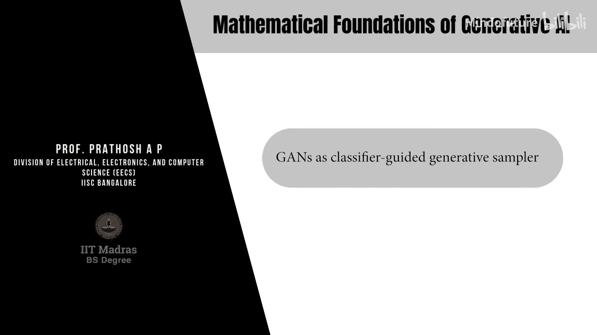
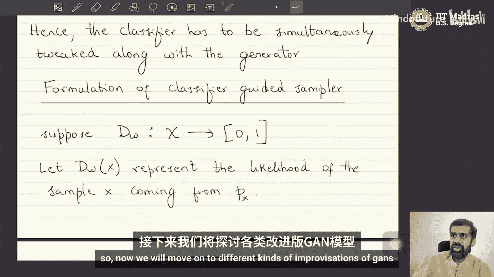

# 生成式Ai的数学基础 ｜ Mathematical Foundations Of Generative Ai p13 P13_W3L8-GAN作为分类器引导的生成采样器 -BV1fperz7EjK_p13-

🎼。

Hello， everyone。Welcome to this module of thegenerative AI course in the previous session we looked at。

How to train a generative sampler using the variational divergence minimization algorithm。

 we also looked at a special case of Vium methods which was called the generative adverse network。

In this session we will continue from there and the objective of this session is to look at some of the improvisations over the naive generative adversarial network I will also discuss a couple of famous applications of generative adversarial networks in。

Tasks like domain adaptation are the。Distributal transformation and so on。

 Okay that is the objective of this particular module， So let us start this module so here。

The first thing now just just a quick recap of what we were doing。

 so in the generative adversarial network。Which is a special case of variational divergtence algorithms。

So we had the two neural networks， one we called the generator network and there was a discriminator network。

The idea is to start with an arbitrary random variable and use a neural network to transform to random variable of interest by minimizing a distributional divergence metric。

So we used f divergence as the distributional divergence metric and minimizing the F divergence directly is not feasible。

 therefore we constructed a lower bound on the F divergence which turns out to be this particular objective so we optimize we minimize for that lower bond and while constructing the lower bound the construction of lower bond itself involves an optimization problem which is solved which is solved over the class of functions which is represented by the discriminator network so we alternatively solved a maxim problem which is finding the lower bound on the F divergence and then once we construct the lower bound on the F divergence we minimize that and we alternate between these two optimization problems so this is the broad description of what we saw so far now I would start today's module by giving you another interpretation of the。

Adversarial network as classifier guided generative models。 So let us interpret。嗯。Interpretation。Off。

Interpretation of agan。As。Classify your guided。Classify your guided。Geneerrative samples。Okay。

 now what we what we saw so far was that again was a special case of。

Vational divergence minimization algorithms where we start with an f divergence。

 construct a lower bone on it and then optimize for it right so this is another interpretation of again as a classifiedifier organic generated sampler so let us look at it as usual what we have is a data set which。

P samples of data。Which are drawn I from Px this is our as usual setup Now we also have this sampler。

Which we are calling as the generator。hi would take samples from an arbitrary distribution like a Gaussian distribution。

Takeate samples from normal distribution， G T Z， and we get samples from them。嗯。

The output of the generator network， which we designated as P3 topics。Okay， now the goal is to。

What is our objective or objective has always been。That， we want。P The of its X gap。To be close。

2 px or rather p theta we want p theta of x to be equal to px and we do it by minimizing the f divergence we know that。

We know that interpretation of again right now lets say that there exists a classifier， suppose。

Suppose there is a classifier。There is a binary classifier。Okay。对。

Such that now let's call this as Dw， the classifier as Dw。 So we have Dw。Such that D W is one。If。

X is coming from P Theta， let's call this dw of x， and it is0 if。

X is coming from oh okay so maybe the other way around it is easy to interpret it that way whenever x is coming from px this classifier will give1 as the label and whenever it is coming from P theta this classifier is giving。

0ero as level。 So now Dw Dw is a binary classifier。Okay。Is a binary classifier。到。

Between the samples of。Yeah。Between the samples of。Px and P theta。

 So let's say that we have a binary classifier that would classify between the samples of px and P theta now the question is。

So let's say that the question that we would want to ask is the following that can。Can Dw of x。

 which is the classifier that we just described。Be used。嗯。4。没给。嗯。P Theta and P X。不对的。

But the question that we would want to ask is can we use this classifier to make P2 time and px close to each other so it turns out that a classifier can be used for making Pt and Px so let me write the classifier here lets say that we have this classifier。

Which is a binary classifier。We have a binary classifier。😊，对。

So this would take x or x gap both as input， right？

Dw of x or x cap and what this would give is one if it is x0 if it is x gap。

 so this is the classifier that we have right。Now， the question is。

 can this sort of a classifier be used？To make Px and P theta closer，It turns out that it can。

 So the answer is that。Suppose you have a classifier， okay？Now， let's say that。So， tweak。

Treg theta which are the parameters of G theta。嗯。Parameters of G theta。Bill。The classifier failed。

Till the classifier fails。To distinguish。To distinguish between。Between the samples of。

Between the samples of Px and P Theta。Now this can be a strategy that can be used so what we are saying is let's say that we have pretrained the classifier okay that would classifier that would give one if the samples are coming from px and it give 0 the samples are coming from P theta what am I saying is that you one should keep changing the parameters of the generator till this classifier fails to distinguish between px samples of px and p theta so think about it when does the classifier fail to distinguish between samples of px and p theta。

Itss when the I mean one of the cases when the classifier would fail is when pX approaches P theta or rather P theta approaches pX。

 because if P theta becomes same as pX， then the samples from PX and samples of P theta becomes indistinguishable and therefore the classifier fails。

Okay。So now， but the thing is。Yeah。Okay。While I said that one of the failure cases of classifier is when P approaches P Theta。

Classify your failing need not imply pH being close to P theta。 the converse is not true。

 So what does that mean is that however。However。Failure of the classifier。Failure of the classifier。

Classifier does not imply or need not imply。Need not imp the distributions matching okay px being equal to p theta。

 so why is that。Let me just show you a rhetorical example。

 let's take the counter example to show this。Okay， let's at the counter example。

So let's say that our data is in two dimensions okay this is for ease of understanding let's say that we have our data in two dimensions。

 this is the space in which the data lies and I would say that lets the data is distributed this way so let's say that this cluster represents data from px or rather let's say that this represents data from p theta and we have。

The data from px represented in using this particular cluster lets say that this data is from px we have the crosses and dots dots represent data from B theta and cross represent data from px now lets say that there was a classifier so this was the classifier that was initially there。

So let's say that this is let's call it Dw1， which is the classifier that we had。

Okay now what we are doing is we are we have the we are tweaking the parameters of theta okay such that this classifier is failing now what do you mean by changing the parameters of theta as one changes the parameters theta right this cluster moves around right because if one changes theta P theta changes and this moves around okay now okay so let's say that this is being sampled from P theta yeah now when we change our theta such that this classifier fails all that the the optimization changing theta should do is move this cluster right somewhere here。

Yeah。でてて。てて。Okay， let me call this p theta 1 for the ft of parameters and this shall be p theta 2 after we say that okay。

 we want our classifier to fail。To distinguish between Bx and P theta 1 so note that the way this binary classifier is working is all the samples that are to the left are above this particular line okay given by specified by this classifier belongs to one class and everything that is below this line or to the right of this line belongs to the other class because it is a binary classifier。

Now， when I change， when I request my optimization problem。

 optimization problem to change the theta in such a way that this classifier fails。

It is very easy for the optimizer to push my theta in such a way that。

All the data that was coming from P to 1 is just moved to the other side of the classifier so that the classifier fails right when the data comes to this side right here in this scenario or this scenario the classifier fails to classify。

Okay。嗯。Rather， I should say the classifier Dw1， the particular classifier that we have Dw1 fails here。

To distinguish between P theta and p theta 2 okay so this means that when my px overlaps with P theta。

 we know that the classifier would definitely fail。But。Classify your failing。嗯。

This does not imply Pta to be rather okay， I have to say that these are not。

This does not imply that P theta is matching with px right so now this is the counter example where you can make your classifier。

Fail even without making px and p theta the very same okay now what do we do so now this algorithm that we just saw right you to keep tweaking your theta till the classifier fails to distinguish between samples of px and P theta no longer holds because one can make the classifier fail okay。

In spite of P3 times px not being equal to each other Okay。

 now how do we solve this problem the final I mean one way to solve this problem is you know one therefore and。

The classifier。Past we。Simultaneously。Simultaneously tweaked or changed。

Simultaneously change along with the generator。Okay。

Right so now all this analysis that we did was for the case where the classifier was fixed Now let us not fix the classifier let's say that our classifier can also be tweaked So now what will happen let's come back to this diagrams so now when we have our classifier when we have the flexibility of changing our classifier2 and what might happen is that once we move our data to p Theta 2 from p Theta 1 what we can do is we can simply。

Change the classifier as well。The classifier can be this so let us change the classifier and call this Dw2 now under Dw2 the the classifier dw2 does not fail to distinguish between px and Ptta 2 right so now Ptta 2 has to be moved again to some other place。

To ensure that the classifier Dw2。嗯。So let's call this new cluster p3ta 3 okay so from p theta 2 the data has to move to p theta 3 to ensure that the classifier dw2 also fails this is the idea that one would keep alternating between a classifier okay。

Maybe I'll just take this down because this might be confusing。嗯。

Or maybe Ill draw the coordinate axis in a different color let me just do that。嗯。Yeah。

SoLet's say that we have。This is the coordinate axis right so let me call this we have a two dimensional feature this is x1 and this dimension is x2 our data x now is in r2 okay so every X here has this particular form that it is。

So every data point X now has this particular point。Particular form。

 it is a couple of two data points call this。X1 i and x2 I okay we are talking about two dimensional data。

 So the idea is the following right so what we just said is that。Yeah。

Suppose you want to make Pt ta close to Px。You can use a classifier to do so。

The idea is to build a classifier that would distinguish between samples of px and p theta and keep tweaking the parameters theta till a point where the classifier fails we saw that if you fix the classifier then it is very easy for the optimization。

Problem to optimization to simply find out a theta such that the classifier fails。

 but p Theta is not equal to px right so now when the distributions become equal to each other the classifier would definitely fail however。

 classifier failing does not mean that p is equal to p Theta okay so now what is to be done is that one does not have to just keep。

Tweaking theta by having a fixed classifier， the idea is to keep moving the classifier as well。

 such that every time。You move your data so from one point to the other till a point where P theta gets P theta gets overlapped with px such that there is no classifier that classify between these two points that is the idea one might get this question that the data okay or de generated data or P theta。

This cluster can keep alternating between alternating between multiple points and the classifier one there can be a classifier that would fail for one particular configuration of P theta and then you know to make sure that that classifier does not fail you move your P datata to a different location and the classifier gets alternate to the previous location and this can get this can get stuck for eternity this is a possibility okay this is what is called as the mode collapse problem in GNs well the optimization problem that we are solving which is the main demands problem that we are solving would not get to a good saddle point that your P heatta may not get overlapped with P at all so that's a possibility so that is why it's one of the known failure modes of GNs where。

So you start with some P theta okay then there is one classifier that is there and now you want this classifier to fail move this P theta1 such that this classifier fails and you move it to this point okay this classifier fail then you learn another classifier okay dw2 and now you want to move your P theta2 such that this classifier fails now now your algorithm can just put your theta back to this particular place where both of these the second classifier also fails now you change your classifier again to ensure that this fails and it will come back to this P theta2 and keep alternating between P theta 2 and P theta 1 and never approach px that's a possibility okay if you translate this idea to the variational dirgence minimization framework what we are actually saying is that we are alternating between。

Constructing a lower bond on the F diveivergence and minimizing in this right the lower bond that we are constructing is similar to learning this classifier okay so the tighter the lower bond that we construct on F divergence the better this classifier is going to be and the better the minimization of the up divergence is going to be however practically speaking it is very much possible that the lower bond that we construct on the up divergence are the classifier that we are learning is very weak in the sense。

That when the minimization of that weak lower bond that is constructed may not make the generated data P theta2 come anywhere close to the true data P and it can keep alternating between different kinds of saddle points okay which are not making my P theta and p close to each other this is a known failure case of G so please keep this mind keep this in mind however the idea here is that we not only change in the classifier guided interpretation for again what we are doing is we are not keeping the classifier fixed but we are also。

Retraining the classifier simultaneously along with the generator。 So that is the idea。 Okay。

 so now with all this， let us formulate the。Cost function with this interpretation。 So formulation。

Formulation of classifier guided sampling。Yeah。So we are formulating the classifier related the generative sampler。

 no suppose。Suppose DW， as I said， is a classifier。

 it's a function that would take samples from x and maps it to0 in 1。

So it can give a real number between0 and 1， will say that let。DW of X。But不认。Yeah。

Represent the likelihood。Okay。The likelihood of。D sample X。Yeah。Likelude of the sample X。

Coming from P。Okay， so in our case this Dw is a neural network。

 it will just give you the likelihood of mean we want that to represent the likelihood of the sample x coming from px。

Now， log of。So we know that the objective is to maximize the likelihood of。

Log likelihood of the sample x coming from px so we want to find our W okay。So that's that。

The objective is， okay， so let me rewrite it。Yeah。嗯。The objective。The objective is to。Is to maximize。

To maximize。The log likelihood。Yeah。Lg likelihood of。Of x coming from px。So， for any classifier rate。

 the objective is to maximize the likelihood of data coming from。

The distribution right distribution of interest that is the objective of any classifier so we want our classifier to be learn in such a way that we just want to maximize the likelihood of the data coming from px okay so what we want is our W star for the classifier has to be such that we maximize the likelihood of obtaining the data from px okay so that is how we will try the classifier now。

Since this classifier also sees sample from X cap， okay we want what is this， this is。Maxim race。

The likelihood。Likelihood of。X sample from px， this is what this objective is doing。 Okay。

 there is another objective that we would want to optimize， which is。We also want。可。Yeah。对。

Classifier， so classifier。嗯。Should also。Should also maximize。Lancy Mo。The likelihood。

Likelihood of x cap， okay？Not coming from。Not coming from Px。When。When xcap is sampled from P theta。

 so what does this mean the classifier has to also maximize the likelihood that xcap。

Does not come from Ps whenever it is sampled from P theta obviously right so how do we write that mathematically now when if dw of x represents likelihood that x is coming from Ps。

 then1 minus。DW of x would tell you the likelihood that x is not from px right so what is this this is the likelihood。

Yeah。Likelihood that。X cap is not sample from P X。 This is that likelihood。 Okay。

 what do we want to do， We want to maximize this as well。 So we want the log of。

Log likelihood of this。Under the expectation whenever the I mean the expectation is now taken over p theta right because whenever the samples are drawn from p theta we want the log likelihood of those samples not coming from p to be maximized right so that's that what the classifier is so now we want our W star also to max noise。

This particular likelihood， which is the average or expected log likelihood of。Yeah。

Excap not coming from Px。Whenever Xcap is sampled from P theta so now basically what we are saying is what is this let me write this。

 this is。This is Maximlace。This is maximizing。The likelihood。The likelihood of。

X cap not being sampled from px okay whenever it is sampled from p theta right so we want two things to happen for this particular classifier that assuming that dw represents the likelihood of a sample x coming from px we want two things to be happening that whenever the sample comes from px we want the log likelihood of that to be maximized right so we just take the expected log likelihood of dw of x whenever the samples are coming from px and we want that to be maximized。

Okay so I can write this as whenever x is being drawn from px okay now we also need I mean note that this Dw also takes x cap as input where x cap is coming from P theta whenever x cap is drawn from p theta this dw of x should give us0 right I mean that is how we have designed our Dw which means that it has to maximize the likelihood that x cap is not from px okay whenever it is coming from p theta we represent that as the expected value of log of 1 minus dw of x cap whenever x cap is coming from p theta so one minus dw dw of x represents the likelihood of an x coming from px one minus dw of x cap would represent the likelihood that whatever this argument is x cap is not from px and we want that to be maximized whenever my x cap is actually not from px or rather it is coming from P theta right so we want these two objectives to be。

Satisfied whenever we are learning W star。 So let us combine that。 So the final objective for。嗯。

你 combined object。The combined objective。For the classifier training。Yeah。

Classified training is as follows。 What do we need whenever the samples are coming from。

Whenever the samples are coming from Px， we want that objective to be maximized our likelihood to be maximized and whenever the samples are coming are not coming from px or rather they are coming from P theta。

 we want the log of。1 minus that particular。Likelihood to be maximized。Okay。

 this is my final objective， so what do I need is that I want whenever my samples are coming from px。

 the log ofduct。Particular likelihood has to be maximizeized and whenever the samples are coming from the theta the likelihood1 minus the likelihood log likelihood of that particular thing has to be maximized right so we want my W the classifier to be such that。

This objective is maximized。The star has to be such that this particular objective has to be maximized with respect to W blue。

So I mean one can very easily note that this is nothing but the lower bone that we constructed on the f divergence right so this is the lower lower bone that we constructed for the F dirgence so let us call this J theta command w okay now what is the objective for the generator now the objective for the generator。

Objective for the generator network or the GT network。嗯。啊。Yes。Such that the。Classifier has to fail。

 right that is the way we have。Such that the classifier has to fail。

we have to tweak our three times in such a way that the classifier has to fail now how do we do that mathematically that we simply in。

So invert the optimization problem that is for the classifier that's all inver the optimization for。

The classifier。We do that， then we will ensure that our theta will be such that the。

Classifier objective is inverted。 So what do we do。

 we just minimize the classifier objective with respect to theta Now while the classifier is trying to maximize a particular objective with respect to its parameters。

 we will just minimize what do you mean by inverting change the optimization problem from maxim to minimization that we find out the generator parameters simply by minimizing the。

그スフ けて。So finally what happened is that we get our theta star and W star which are the generator and the classifier parameterss such that you have one objective function and the generator is trying to minimize that objective function and the classifier is trying to maximize that same objective function。

And what is this objective function， this objective function is try trying to classify between the samples of Px and P Theta whenever the samples are coming from Px it is giving you one and whenever the samples are coming from P Theta is trying to give zero what we are doing is we are trying to find the generator parameters such that the classifier fails and we are trying to make the classifier learn the decision boundary such that the generator。

 the generated samples are being able to be distinguished from the true data so there is an aversarial game that is going between the classifier and the generator hence the name the aversarial networks one of the reasons why this is called the adversarial networks what told you why this is called the adversial networks because what we are trying to do is trying to solve a saddle point optimization problem which involves one objective function and two set of parameters while one set of parameters is I mean one set of parameters is。

Being chosen such that the objective is being maximized the other set of parameters are being chosen such that the objective is minimized that is why they name the adversarial optimization icon。

Tell you this， this is the adversarial part。Okay。Yeah。

This is the classifier guided interpretation for the G so note that from mathematical standpoint and what is happening right algorithmic standpoint。

 whatever we saw as variational divergence minimization is absolutely the same as classifier guided training as well but this is just another interpretation of how one can perceive the knife again please note that this interpretation is not generalizable across different other f divergences right why because for other f divergences there is no guarantee that the t function that we use to bound the f divergence does not have an interpretation that the t function is a classifier only with this particular choice of the f divergence that our t function has an interpretation which。

which ideas to that of a classifier right and once this can be interpreted as a classifier one can see this entire process of adversarial optimization as way to guide the generator or the sampler。

😊，Using this classifier so what is the story we want to transform a Gaussian random variable into the random variable of interest which is px in this case and we do that via a classifier what is this classifier trying to do this classifier is trying to classify between the samples of px and P theta the moment this classifier fails to sample between sorry classifierify between samples of px and P Theta we are done correct but if you fix the classifier then it is very easy for the generator to make this classifier file and still not make px to be equal to p theta so what we do is that we not take a fixed classifier but also change the parameters of the classifier along with the generator parameters such that。

We keep changing alternative alternating between the classifier and the generator parameters till a point where p theta actually overlaps between px or diagrammatically speaking。

 what's happening is that we are moving this cluster around right I mean first you have some p theta 1 there is a classifier which is classifying between these two p theta and px right and then you move your P theta to some other location P theta 2 such that this classifier fails then change the classifier from dw1 to dw2 such that the classifier is again able to classify between p theta 2 and px that change your p theta our theta in such a way that p theta2 goes to p theta 3 such that dw2 fails and keep doing this So this is the idea so I mean if divergence minimization perspective what we are doing this we start with some generator parameters Theta that we construct。

A lower bound to the f divergence between Px and P theta and then we change the P theta depending upon that particular lower bound that we have constructed once we change the P theta the f divergence also changes right so therefore we have to construct another lower bound between that new P theta and the existing px and we alternate between these two so basically what is happening is that start with the theta construct a lower bound on the on the current f divergence and then mini that f divergence okay in the hope that the the minimization would actually make the lower bound the new lower bound that we construct a little tighter then you change the theta again construct another new lower bound and minimize that and keep alternating between these two processes from a classifier standpoint。

Move your P theta such that the current classifier fails okay and then tweak your classifier such that under the current the you can distinguish between the real data and true data and keep alternating between these two processes okay so as you can see one can get stuck in a place where the classifier keeps。

Foling the generator and the generator keeps fooling the classifier so to speak right classifier makes the generator fail and the generator makes classifier fail in the alternate steps and that is a known failure case of GNs where they can get simply stuck between these two and you will never reach px by clicking P theta that's a possibility okay thats why people say that training the GN is an nonal task and it is the GAN table is known to be sorry GN training is known to be notoriously unstable okay so now we will move on to different kinds of improvisations of GN。

