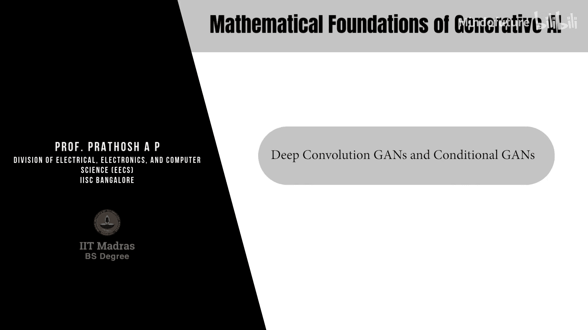
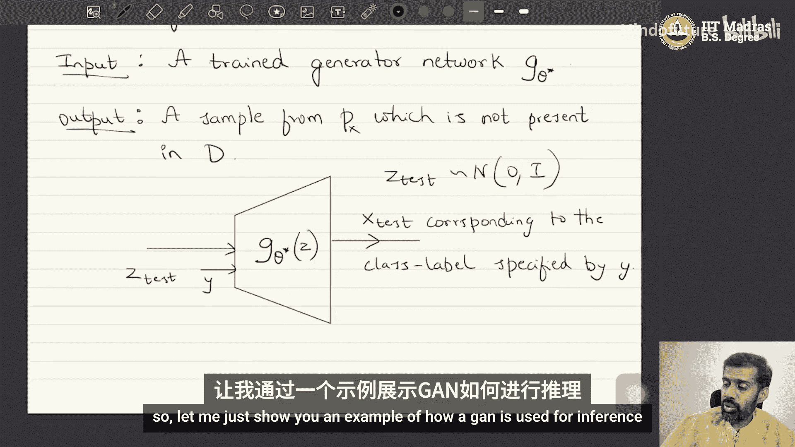
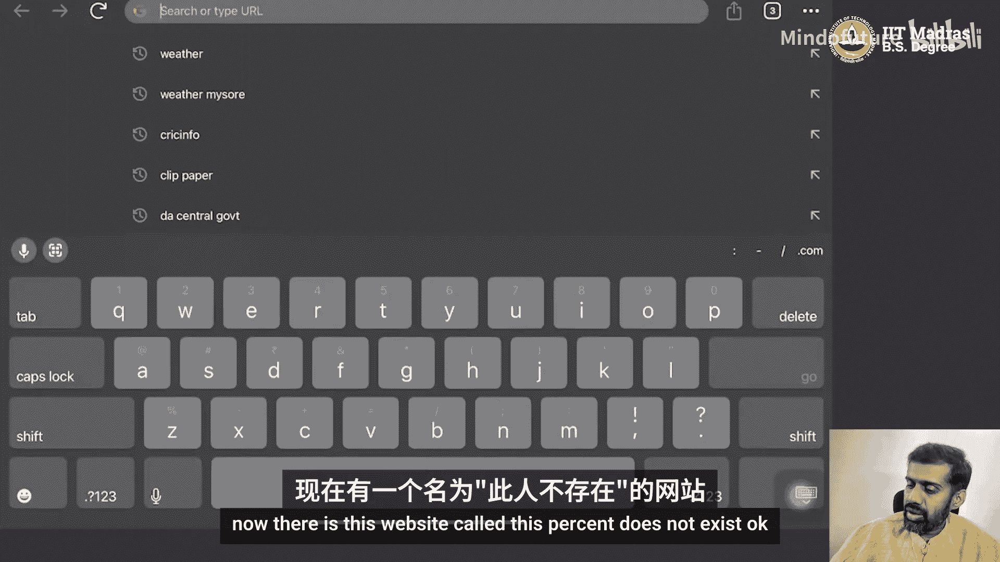
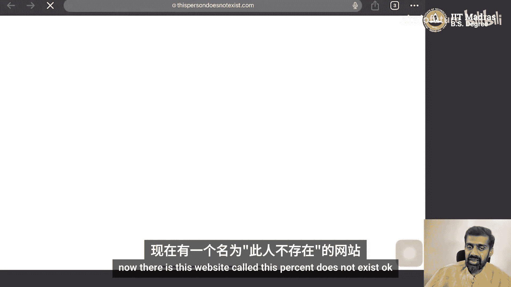
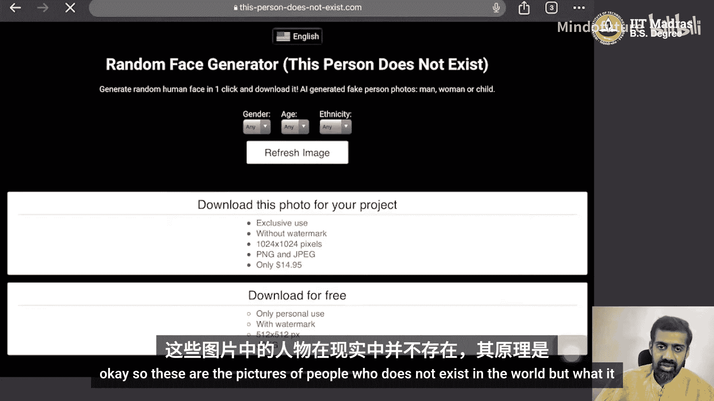
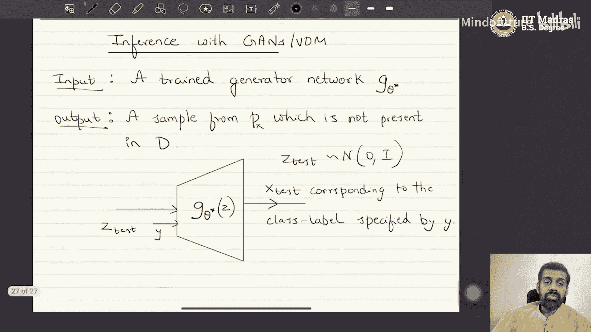

# 生成式Ai的数学基础 ｜ Mathematical Foundations Of Generative Ai p14 P14_W3L9-深度卷积GAN与条件GAN -BV1fperz7EjK_p14-

🎼。

So let us first look at what is called as the DCc G or。嗯。Deep convolution will be as it is called。嗯。

It is also interesting to note that in any of our treatment， we have not。

Restricted our data to be of a particular modality right so we didn't say that the data has to be the image or it is it is a speech or anything all the theory on the treatment that we took so far for variational divergence minimizes ors as samplers are data modality agnostic you can use these ideas with any of the data modality okay。

Okay， so in DC again what people do is see typically in a。Typically， in a gun。对。

The dimensionality of Z， which is the input to the。

Generator network will be some K dimensions and of course our data as we said is some D dimensions so typically what happens is a K would be much lesser than the the dimensionality of the input random variable is much less than the data dimensionality so the typical architecture of the generator network would look like this you start with some D dimensional sorry K dimensional data and then you keep increasing the dimensionality till it goes to D dimensions okay。

So here you have D dimensions。So typically this would be some 16 dimensional data so z is in some 16 dimensional data then you go to some 32 some 64 and keep going and finally it goes to some D dimensional data right this is keep increasing the dimensionality of the generator network that is how the typical architecture would be and this can be a。

A multilayer。Orcepro and MLlP。嗯。Can be a multi layerer perceptron or a fully connected neural network。

It is called MLP， okay。In a deep convolutional G， right DC G， what is done is。In the DC gun。

Convolutional layers is typically the up convolution or transpose convolutional layers。

Up convolutionally。Our transpose comm layers are used in the generator。

Transpose convolutional layers。Are used。Indeed these are。嗯。Okay， so what is done， you start with。

呃 some。Z that is in let's say， some 16 dimensional space and then you keep increasing the dimensionality of the data using transpose convolutions。

Transpos are upco solutions。Okay， till the point where it reaches。嗯。

So it reaches the shape of the data， so DCG is typically used for the case where the data are images。

Okay， so data。Is images。Of the dimensionality images are represented as some row times column times3 right of one for each channel red。

 blue and green， so using transpose commututions， the final layer would have this sort of a dimensionality。

Whi is。Comparable to that of the。Its exactly equal to that of the data， so this is row。

 this is a number of channels number of columns and you have three dimensions here Okay。

 so the final layer is going to be an image as an output typically what happens here in an MLP is that even if you use images the data is。

The reshape。 So once you get in R D， you reshape。In the form of images， even if you have an image。So。

 what you get is the flattened version of the image and when it to reshape after getting the output in a deep convolutional G or DC GN there is no reshaping operation that is done but the transpose or upconvolution layers are used so that you start from a 16 or a 32 dimensional。

Real number space and then the final layer would have the data in the appropriate shape as that of the the actual data itself you don't have to。

Reshape the data， so that is what is typically referred to as the convol again this is this is specific to images being used as data。

The next architecture or the next improvisation that I want to talk about is what is called as conditional g。

also referred to as seagans。So far， the sampling that we saw was unconditional sampling in the sense that。

Once the the generators are trained okay there is no way that you can control what sort of images that are generated Okay but in the practical use cases one would want to generate images that corresponds to a particular class or let's say a particular textual description and so on right for instance。

 let's say that we are。Building a generative model on the data set that comprises different types of pictures of different types of animals。

Now once we build the sampler we would want to have a control over what sort of class or what sort of animal is being generated from the the sampler okay in the formulation that we have seen so far there is no control so as to how to how to regulate what the generative sampler is sampling okay so now to ensure that it happens we we need to look at what is called as conditional again the data for that。

Particulars。Use case has to be this way that you have the pairs of x comma y。Okay， it's one， y1。

x2 y2 note that the data that one would need to build conditional samples are very much similar to the data that one would need to build discriminative machine learning which is the classifier so this is drawn Iad from a joint distribution Px y okay so examples can be that you are x。

Can be images。And why can be a class label or a textual description and so on。 Okay。

 this can be a class label or this can be a。Texectual embedding and so on。

If you don't know what a textual embedding is worry we will look into this later in the course think of it like there is a class level corresponding to x right for every x we need a class level a textual embedding again corresponding to x so now a textual embedding is that so let's say that you have some image and a textual description of it converting the textureual description into a particular vector is what is called a textual embedding we will see later in the course how to get embeddings of this sort so assume that that we have access to this so for the ease of understanding let's say that all we have right now are class level so basically we have a data set of images and each of the image has a particular class label associated with it you can take the example that I just gave that we have image of animals and each of the image has a particular class level associated with it that would that would signify what particular animal class it is what is the objective here the object。

キて？Objective is to sample only conditional distribution。Objective is to sample。そら。

The conditional distribution。Samples from the conditional distribution。B x given y， okay。嗯。Now。

 instead。Instead of px so now in the unconditional case we were sampling from the marginal distribution px right which is which had no conditioning variable here we need to sample from px given y instead of px okay how do we do that is the case thankfully nothing changes in the formulation that we just had okay so what we have to do is that solution is to simply。

We need to。Estimate we were estimating px so far right we need to now estimate p x given y px given y。

And make P Theta to be close to Px given1 y for all white， make Pta。Approach or like。P the approach。

Approach px given y， okay for all y， this is how you do this。Now。

 how do we do this algorithmically is its pretty simple what we need to do is modify。嗯。

Modify the generator and the discriminator， modify the generator。And。The discriminator。Disriminator。

To operate on the conditional distributions， to operate。

To operate on the samples of the conditional distribution， operate on the samples。

 samples of the conditional distribution。The conditional distribution。Conditional distribution Now。

 how do we do this。Conditional distributions now its pretty simple to do this algorithmically what we have is that we have the generator。

Gtta of the。Now， this was。Already taking samples from normal0 and as input， right， now， additionally。

 one should also fear y that corresponds to that particular x as the。Input。

 so the class label also goes as an input to the generator。

 So what does this generate this generates a sample its cap conditioned on the standard that particular text let's call this P。

T dog， okay。Of the。我啥的。P theta of x condition down y okay。

 this is the distribution that we want to model Now how does the discriminator or the t function look like in this case。

Same thing， the discriminator also now will take。So one we had the samples of x or x capab right I mean this is the usual discriminator along with that we will also give y as an input to the discriminator as well thats all so now this will be dw of x given y so this will again give 0 or1。

Okay now how does the loss function get modified so we have J theta comma W is now we have the expectation of log of this this GW network also we take x and y as an input and the data is now so x comma y are now being sampled from px Y。

Okay for that particular class plus the expectation。Of slog of。1 minus dw of x。Cap come away。

 and now X gap come away are coming from B Theta X gap come away。

Thats it So nothing changes okay all that we need to do is give by as an additional input。

To both the generator and the discriminator and whenever we are giving the samples we have to ensure that we are giving samples from that particular class so now in the example that I gave where we have data set of animals with differ classes what we do is whenever we give as an input let's say doc images will give one particular label as an input to the generator and we give that exact same label as the input to the discriminator as well while we are trying the discriminator that's all and we can whenever we are giving a particular image as an input you also append that the corresponding class class label as an input to both generator and discriminator how do we do this suppose this is。

Discrete number of classes that we have， we can use the one heart encoding of these class vectors。

So where suppose you have K classes then each of the classes represented using zeros and ones where the one will be at the case location and 0 otherwise now that's the user one- heart encoding Im assuming that students here know what one heart encoding is you can just convert each of the killer class killer as a one heart encoding and give it as an input to the de generatorator and also the discriminator this is how one would change our term an unconditional G into a conditional GN where。

We have began no sampling from the conditional distribution。Now。

 one other thing that we should see is how do we sample right or do inference in again we have not seen this。

 its pretty trivial but lets do this so inference。With GNs what is inference inferences。

 I think but data generation here， okay inference with Gs or mediums， how do we do this。Or input。

 what are we given。 We are simply given。ATed generator network。A trained generator network。

So let me call the task G tta star this is what we are given now the output are the objective。I。

A new data point， a sample of okay， so let's call this a sample from P。A sample。From bes， be。

Which is not there， which is。Not present。Which is not present in。

Dep right so because we know how to sample from the distribution now that whenever we do an inference which again okay we get a sample from pis that is hopefully not in D so how do we do this we just have we take the prime the generator。

After solving the。Mean max optimization problem， so we have G tta star。

 this will take z as an input okay。So you take a z， which is a sample， let's call this a Z test okay。

 now where z test。Is some sample that is coming from normal 01 and finally you got an output here。

 which is x test。Okay hopefully is a sample from px because now p theta has become close to px if the training has happened properly。

 this is how you do inference and again so inferences data generation from again So now if it if it were a conditional。

Again that you have trained， you should also have y as an input here。

An additional input and this would be test x test。Corresponding to the given class。

If it's a conditional again。Corresponding to the class。Or class label。Specified by why？Okay。

 this is a one uses again for inference， so let me just show you an example of how a G is used for inference。

No， there is this website called。

This person does not exist。 Okay， so what is actually happening is that every time。

So， maybe this is。The resolution is not。

Compatible， okay， so of this。Is a picture of a person who does not exist， Okay， really。

 So now whenever I refresh this web page， So what is happening is。

A Gaussian random variable is being generated and it is being passed through a trained generator network。

 a trained G network and it is giving you an unconditional generation。

Okay so these are the pictures of people who does not exist in the world。

 but what it is doing is that you have trained the G okay this is actually a stylegn there is an architecture called style Gn by NviDdia so now this is the inference that is being done on the stylegn architecture So every time I'm refreshing what is happening is that a sample from the Gaatian distribution is being generator and it is being passed through the pretrained the generator the generator at and you are getting the image that is being generated at the output okay this is the unconditional generator because there is no control on what sort of pictures that I am generated So one can also make it a conditional generator where you suppose you have data of human faces where each of the phase at a class label say it it's a boy or a girl or an adult or a female or anything so one can give that as an additional input to a generator while。

Wriing and you can control whatever image that is being generated。Okay。

 so now that is how one would use again for the inference。

