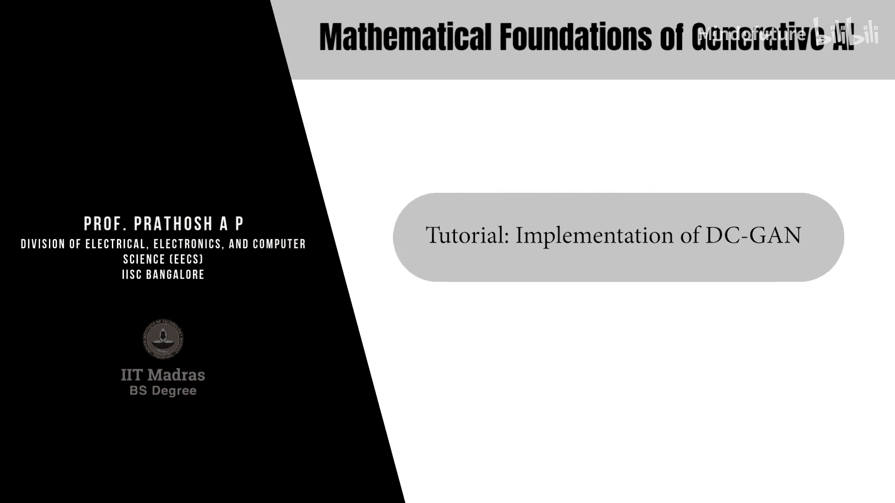
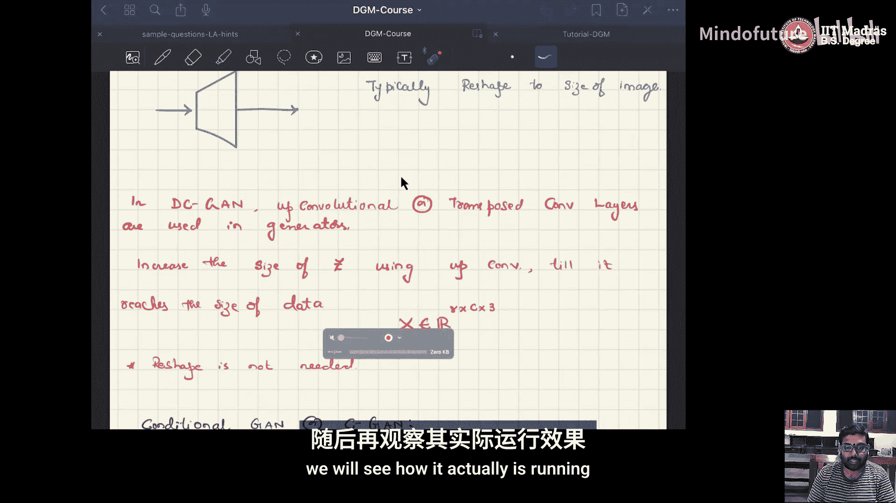
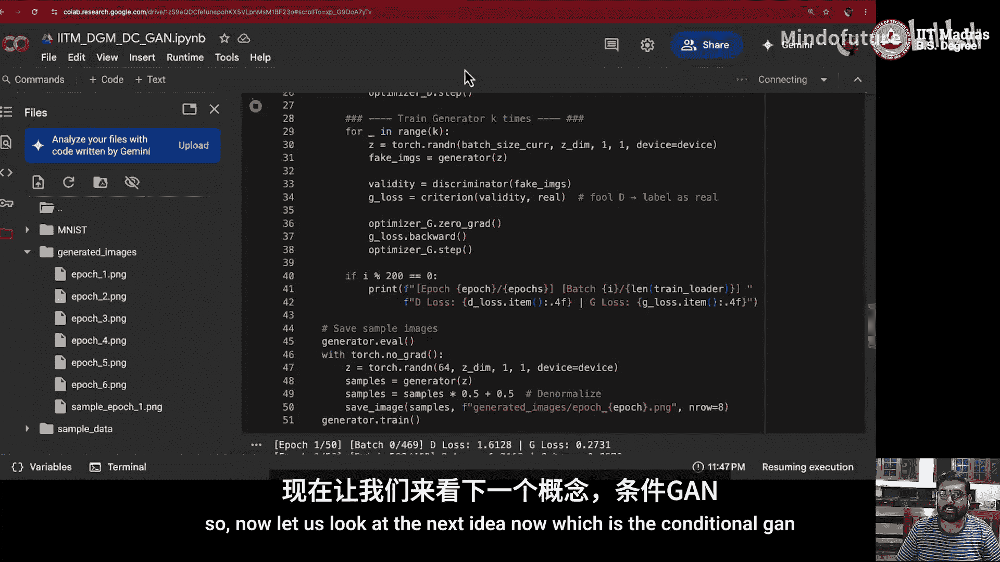
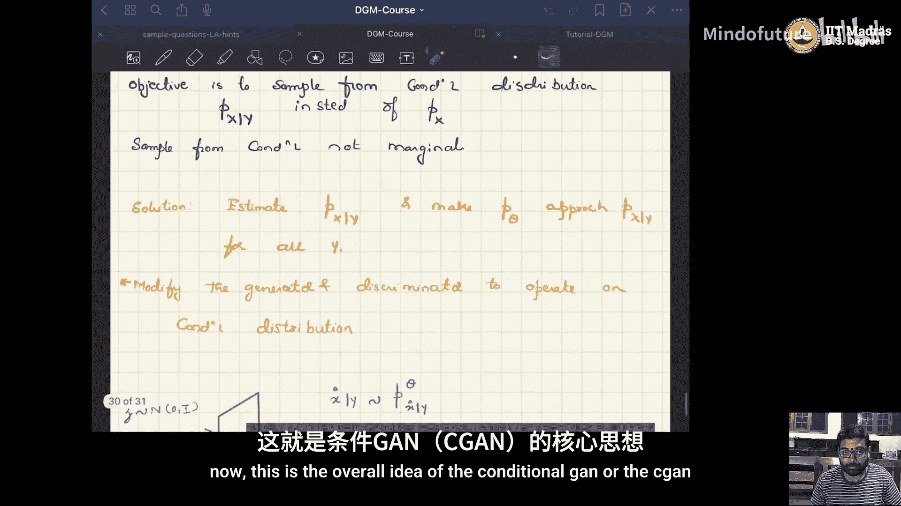
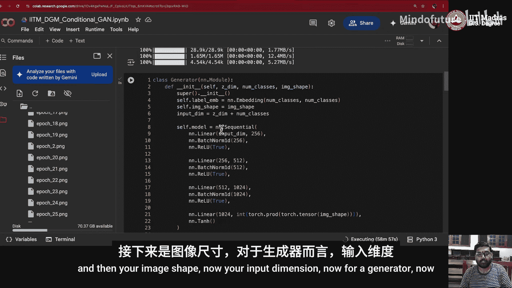
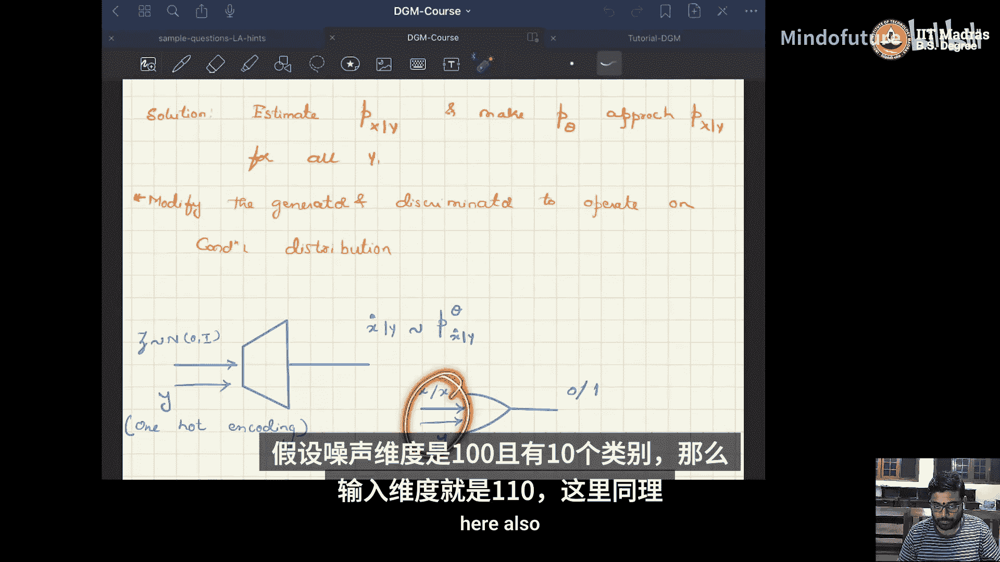
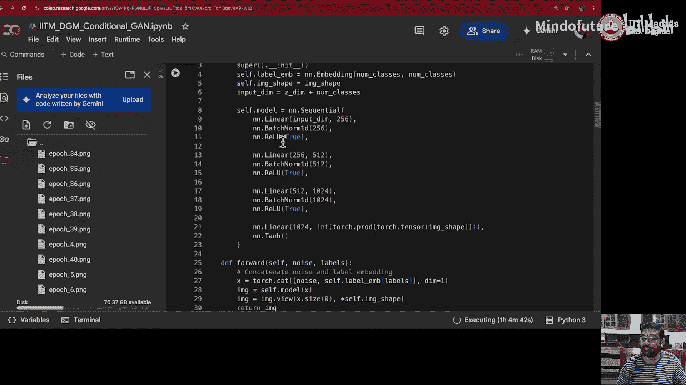
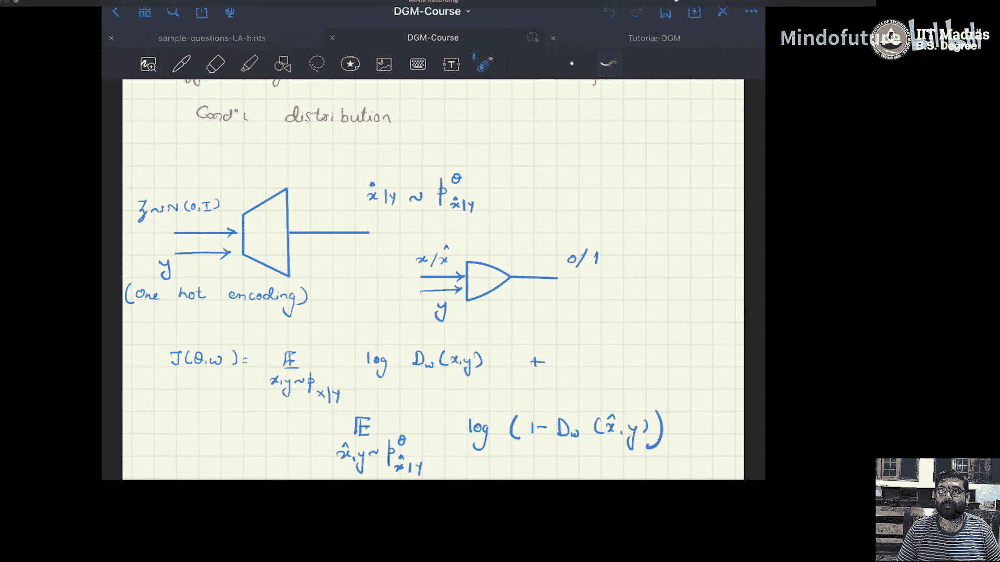

# 生成式Ai的数学基础 ｜ Mathematical Foundations Of Generative Ai p15 P15_W3T6-教程-DC-GAN的实现 -BV1fperz7EjK_p15-

🎼。

Hello all now welcome to this tutorial， where in which we will be discussing the coding ideas involved in DCc GN。

 which is deep convolutional CA。And then the conditional G， also known as CN。Now。

 in the previous tutorial， where in which we looked at the idea of vanillagan or also called as naive G。

Now， the generator， the function approximator， the neural network。

 which is used it to approximate the generator。Is an MLP。Or a fully content network。Now in BC again。

 now what happens is？Now， we will be using。What is called as？

An up convolution or also called as transposed convolution。

 or also called as convolution with fractional stride。Now， this thing will be used。In。😊。

The generator。Okay， so now lets try to understand now what is this idea of up convolution or the idea of。

Convolution with fractional slide。Now， whenever you apply a convolution operation。

 now what happens is。😊，After the operation， the size of the input reduces now for example。

Let's state this。Now， if you are applying a convolution operation。

 now consider that this is the input。Okay， H in cross w in。

 what happens is now this H in now will be smaller than this H out。And similarly。

 W n will be smaller than W out。Now， this is what happens in a typical convolution operation。

Okay now but in transposed convolution， what happens is？Actually， after the operation。

 the size increases。😊，Okay， now that is， now hit out。Is of a bigger size compared to H N。Now。

 what are the parameters that are involved in this？

Transposed convolution are also called as convolution with fragmentracment pride。

Now you have your input size。You have your kernel size that is it's a fore cross4 kernel。Okay。

 안 then。The pride that you' are having is two。Now there are two kinds of padding in this case。

 now one is called as padding or also input padding， the other is called as the output padding。

Now what do you mean by this input padding， now consider that this is your。Hdge in。

Where this is your input Okay， now， whenever I say input padding， I'm adding this。Pad on the input。

啊惊。Now， this is before application of。The trans convol operation。Okay。

 now this output padding is something new， that is now you have obtained an output。😊，on top of it。

 you will add a pa。Now， because of which you are manipulating the size post operation。😊，Okay。Now。

 these are the two kinds of paddings that are available in the convolution with fraction of stride now how do you compute the output size？

Now， we have seen how do you compute the output size in the regular convolution operation now similarly now we can compute the output size here also。

Wherein you have heing minus1 into the value of stride minus2 into the input padding plus the terminal size plus the output padding now I have substituted these values and then we get 15。

Similarly， we can calculate w out also now since w in and he in are same now hatch out and w will be same。

 so the input that we had now which is a 7 cross 7 has been transformed into 15 cross 15。

And then the number of channels is。Le， okay。Some no。Here we can see that the size of the output is。

Greater than the size of the input now let's take a very simple1 day operation to understand this how how does this happen now how do you apply this now lets take one day input okay。

😊，no。The same thing can be extended to 2 d algebra consider the 1 d input。

Let's say that I have more input A， B and C。Okay。😊。

So now what does this mean now if I have that if I have。Sride equal to 2。

 now what does this mean as now you insert。You insert zeros。Between each element。嘅。And what happens？

A0， B，0。C，0。ok。😊，This is what。Is the input that is taken？So now you apply the kernel， now。

 let's say that I have a kernel。Clonnel of size。3。😊，Then what will happen， I'll apply it first。

Then I apply for this。Then again， I'll move in two， similarly， I'll be applying。O。😊。

That is what now we shall be。Going ahead is a mistake here。😔，Yeah。

Now this is how the idea of transverse convolution works so now lets。Delve back into them。

Hey of the can Now， your generator now will be a。Transpose convolution block。Now because of which。

There is an increase。In the size post Z， which is your noise dimension。Now。

 I'll be doing it till I reach。The desired input。Dimmension okay now lets look at the code now now the training procedure that is there that we saw earlier for vanilla again now remains the same。

 Now we shall be only looking at。The ideas of the architecture。

 and then we will see how it actually is running。

So now let me go back to the code have always started the code okay now because at least we should have some runs to look at okay。

So these are the necessary libraries， now we have seen all of them。😊，So Ill not be repeating。

Now batch size is 1。8 now that means that at each batch at each instance you'll be taking 1。

8 images for updating of your weights。Your nice dimension is 00。

You remain sizeist 28 now we are still taking the data set as Mist now because it is less what do you call it is computationally less expensive and then。

It is faster to learn the number of channels that are involved is1 the number of epochs that I will be doing is 50 and the learning rate is 2 of minus4。

I'll be using an Adamom optimizer because of which my beta will be 0。5。

I'll be using the Q device or the GPu or the accelerator if it is pleasant。

And then all the images that we have will be stored in the generated images directly now if it is there then fine as creating that directory。

😊，And this is the transformation that I am using first I am reshaping it to the size of 28 then I am converting it to a tensor and then normalizing with me and the standard deviation as 0。

40。5 now I am downloading the data。Only the training data is what I' am loading。

Now here comes the idea of the transpo convolution now having the generator now in which I am creating a n n or sequential block。

 now my input now will be the z dimension that I' am transforming。ok嘅。呃。Into 256。Okay。

 and then the third parameter now being the kernel size。

 the fourth parameter being the stride and the fifth parameter being the padding。Okay。

 now then I have the idea of batch normalization and I'll be using。ARlu as the activation function。

Now post this now again， what would happen is。I would have transformed my input into a 256 channel block。

 now from 256 I am converting it into a 128 block now with kernel size S 4。2 as a straight。

And one as the padding now bias equals to4 no that means that in my weight thing now I have only the kernel weights I don't I am not considering the bias okay now that means that the bias is set to zero actually and then a are performing the batch normalization now whenever you have sufficiently deep neural networks now you can avoid these batch normalizations but whenever we are notice is a standard idea that whenever you are having the smaller networks we preferably use the batch normalization。

😊，And then youre using the idea of we are using the activation of rail loop。

And then you have the con con。Transpose convolution again， from 128 to one channel。

You are decreasing and then finally you are using an activation 10h so that the your image now that is there is actually in the range of minus 1 and 1。

😊，And then since it is a sequential block that is there now that means that whatever input is given now it is passed now the input is given to this。

 the output of this is given to the next one and then after that the output of this is given to Raylu the output of raylu is given to this the output of this is given only like that it goes in a sequence。

Now this is the generator now which is that until the discriminator discriminator takes the。😊。

Image now， okay？Now， in the vanilla again， what used to happen is now it used to take a vector。

Okay input vector again used to flatten the output of the generator and then used to give it for the discriminator now that is not what I am doing I am directly giving the input as the image now since I am directly giving input as an image now the convolution okay the regular convolution now will come into picture。

Now from one channel to 64 channel， now withs four as the kernel size。

 not two as the slide and one as the。padding I am using and then Im simply im just trying to introduce one more activation which is leaky rail please look it up it is a nice activation。

😊，And then I'm using one more con layer。And， finally。I am using a fully count layer， I flatten it up。

 use a fully count layer and pass the outcome through a sigmoid now which is interpreted。

As the probability of。Predicting the。The real class， okay， or bun。Now。

 which is the real class in our case Okay， now this is the discriminator。And then， I'm creating。

The instances of generator and discriminator networks I am using B laws why I am using B loss now you can please refer back to the vanilla again tutorial when which now we have discussed in length why we are using the B loss and what is the and even if you had looked at。

呃。TheThis week's sessions。Now where in which you can interpret the idea of vanilla again as classifier guidance now there now it is evident that your discriminator is a binary classifier since it is a binary classifier now you can use DC loss which is evident even from our previous discussion that we had in vanilla again and the current discussion。

那有规定的。It optimizes separately for both the networks。

And then this is where your function to generate your image after each epoch so that you can see how the image transition is happening now first you put your generator into evaluation node and then with no gridd all those things we have seen now you are creating a noise you are creating a random noise okay now which is of size 64 with z dimension okay that is the 00 and1 con1 now this is your standard size that is given that you are passing through the generator and then now you are multiplying it by 0。

5 and then you are adding 0。5 now youre deormalizing it now you have normalized it now before sending it as the input now you are deormalizing it and then you are saving it as a Png form now in the folder the generated images。

This is just to save your images not during the epos during the traininging epos and then so normally now it has advice that。

NowYou train generator more and discriminator less so what we are doing is I am having this K and P when which K means that how many times I am updating the weights of the generator and p means how many times I am updating the weights of the discriminator updating the weights of generator thice and discriminator once。

Now I' will be doing this whole exercise for 50 epoch now that means that this is four times and50 almost 200 epochs。

 I'll be doing it okay。So I use a train loader and then I am getting the real images now I don't need the labels okay and the same way I will not be going ahead with this training procedure now because this is the same as what we saw in vanilla again。

And then you are generating the images， so let's look at these images。This is post first epoch。

你 going to四错咗 down。好嘅。one has some come two has come， okay， now you can see that。

Now it is far better than the images that we generated with vanilla again or let us look at the recent the most recent one as you can see that the images that are getting generated are better and better。

Okay。And it is it will be still running I have run it for a very minimal number of epochs。Now。

 if you continue running， now you get the better results in DC gap。Okay， now this is DC again for us。

😊，So now let's look at the next idea now， which is the conditional da。

Now， incondal， then the idea is。You want to generate。The images with some particular class。

 now in vanillagan or in BCgan that we have seen。Now we have no control over the images that are getting generated。

So now can we look at it in a conditional sense way in which I say that no， I want。

Image of this particular class needs to be generated now in this case。

 my data will also have the label into consideration。

And then all those conditional estimation of conditional conditional distribution I should not be going into the theory of it now Ill just giving you the idea here now you for your discriminator you will not only give the noise as the input but you will also be giving one hot encoding of the label as well。

Now that will give you the conditional so we are approxiating the conditional distribution even for the discrimment of the same thing you are giving the。

Image generated as well as the label of it。And then the training procedure is similar to that of the vanilla again or that of the DCc again now that means that now we should somehow modify the structure of。

The generator and the discriminator to not only take。The noise in case of generator and the。

Generated the plain or fake image in terms of discriminator。 in addition to that。

 now should enable it to get the。Y， which is the。Output also。 Okay， now this is the overall idea of。

The conditional again or the C again okay， so now let's go to the code of this。

I have already similar to this， I have already started running。Now yeah。

 this is similar to the structure that we have had earlier。

 these are the necessary libraries and then I'm using a GPU。

I'm running it in collab okay so now the reason why we are not taking heavy data sets is now the amount of computational resources。

 the GP access。Everybody。May not be having it now with the constrained resource that Google gives for us now we should be able to get some good research because of which we prefer taking a small sector。

And then these are the needed parameters and then I am creating a directory which is Cgan generated and the transformations we have just seen similar to that。

😊，Now what I'm doing here in the generator is。And sticking， going back to the idea of。

Using an MLlP as part of the generator。And the discrimator。Now。

 you can combine this with the idea of BC again， now where in which you can have the transpo convolutions。

To approximate the function， no that is possible。You can do it， you can take it up as an exercise。

 but in this case， what we are doing is now I am just sticking back to the previous idea when which we just use the。

AP MLlP as the function approxim。So what we should be doing first is。

Now you should be getting the embeddings。Okay， now the embeddings that you are getting is number of class in the number of classes。

 not typically you are getting a10 crust and embedding that means that for each of the。呃。

One hot encoding now you are getting an embedding for it。

Okay now what is an embedding and for things now we will get back to the idea of embeddings now you can think of it as some kind of learned representation of what class it is okay it is a learned representation for class label and you can think of it like that as a。

😊，And then your image shape now your input dimension now for your generator now the if you remember your generator。

Now， should get the。Nise and white。Okay， now if this is 100 and you have 10 classes。

 so your input will be 110。And similar here also。

That is what you are calculating here。Now your input dimension will be z dimension that is your noise dimension plus the number of classes。

😊，That is what you are doing now this is your model and then that's sequential now you have looked at what is sequential。

Okay。就。Into dimension。Now as I think it is z is 100。

 110 to 256 you are applying batchomization of 1 d because your output is a vector now in earlier case now I just want to draw back go back to this you should remember it is you are doing a batchomization of 2 d because here the outcome is a block。

Okay。And then you are applying gray loop， and similarly， you can look at the。

Structure of this and this is not something that is holy you can change the structure of it。

 I have taken very simple representatives structure。😊。

That finally I' am converting you to 10h now we know it y。

And how does the forward function look like now it will get the noise as well as the labels and then you concatenate them first and then you pass it on through the model。

😊，Okay， then you pass it on and then whatever you have got that you reshape it to the image size that is what you are doing in the generator。

😊，In the discriminator。😊，Now again， you will have an embeing you' will be learning this embedding。

 now you can consider it as a representation of each class。

And then your input dimension now will be now whatever is。

The image size now in this case which is 28 cross 28 which is 784 plus the number of classes which is 10 which is 794。

 794 to 5 12。😊，And then there is an activation function of leaky relu。

And5 2 256 and 256 to 1 y 1 because discriminator now we are looking at it as a binary reclassification problem as we have seen earlier and then you can see this in the forward method now first you reshape first you flatten the image and then you concatenate the flattened image now with the label embedding。

😊，Okay， and then you are passing it through the modern。😊，Now this is the。呃。

Think about generator as well as the discriminators。And then you will use the image。

 all those things， standard stuff。And here also I'll be training the generator thrice and then the discriminator once。

The training loop of G here， even Cgan or the conditional G is similar to the top DC G or vanillagan for that matter。

Okay， yeah， you can plot these laws。And then finally， I'm saying that， okay， you generate the images。

Now， one point to look at here。Now， whenever you are。To the generator now earlier。

Generator or the discriminator for that matter earlier we only used to send the noise or the image now you are sending the labels as well now for noise what labels you will have now what do you do in that cases you will create a fake label。

Okay。Now， with number of classes you create a fake label and then you send that fake label through the generator。

 okay， that is what you should be doing。And for the real you have the real labels itself。

 that is what you will be looking in the train loader itself normally we never used to consider this parameter which is real labels now you are considering this parameter and then passing it through the generator。

😊，And the disc password。O。😊，So now， yes， let's look at this。😔。

You have the labels and then you you are sending both of them to the generator and then you are deormalizing it and then you are saving it here and then finally now you are saying that you generate a specific digit。

Okay， now I have I am generating7 and after this it is still running now pause this I am saying that you specifically generate the image7 now lets look at some of the generations okay which is the latest epoch。

39。给。You can see this， the images are not so great， it is 0123， the reason is you are using MLP。

Now I leave it as an exercise to you now if you remember our。Generations in DC again are far brittle。

Are far better now compared to the generation of。C again， that is the condition again。

 the reason being your structure you're using MLP now change this structure。😊，To use。

The transpo convol， now you will for sure， get good results。Im specifically showing it。

 now these are still blurry images， okay0，1，2，3， till  nine， now you are able to create it okay。😊。

That is the exercise that I' am leaving it for you。

To try it out and then we are making all these Google collab notebooks public the link will be shared with you so that you can take this code as the first reference and then build on top of it。

😊，This concludes。

Today's tutorial just to give you a recap of what did we do now we looked at twogan architecture in today's tutorial now one is DCc G now where in which。

A function appxi that is used in generator。Es。A convolution with fractional stride or the transposed convolution operation。

And then even in discriminator sends my。😊，Transpose consideration give me an image。

 it has to look at the image itself。Now because of which I'll be taking into consideration the con operation。

And then conditional again， in addition to the noise and the real RF fake image， Im giving the。😊。

One hot encoding are the embeddings of the classes also。

Now because of which I can generate image of a specific class。😊，Now。

 I hope the tutorials was helpful， now we will meet again in the next tutorials looking at further ideas of G。

 thank you。

