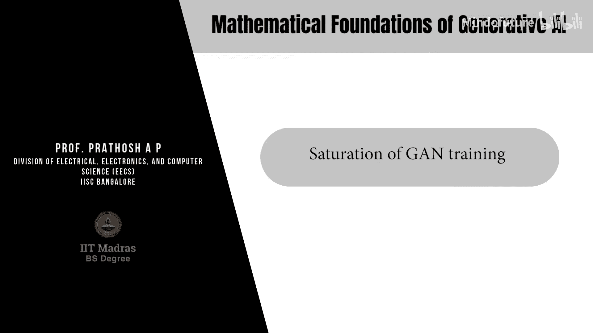
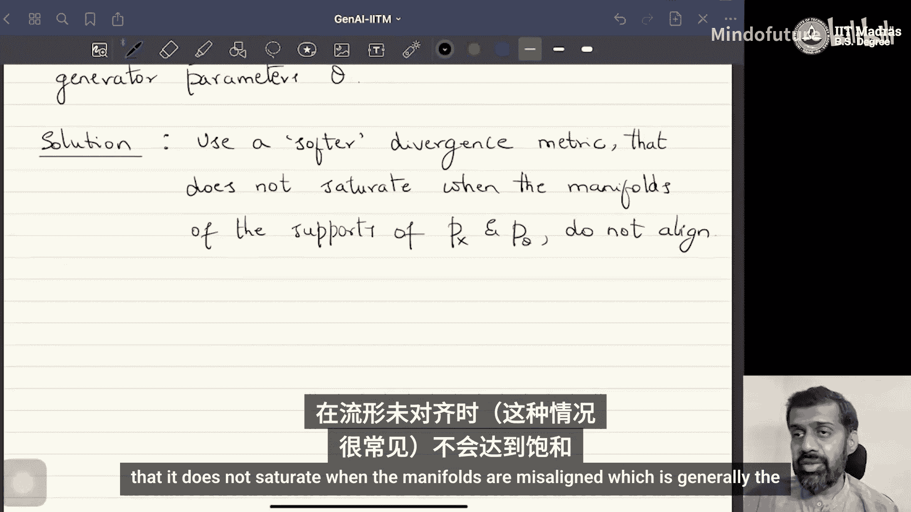

# 生成式Ai的数学基础 ｜ Mathematical Foundations Of Generative Ai p16 P16_W4L10-GAN训练的饱和 -BV1fperz7EjK_p16-

🎼。

Hello everyone。Welcome to the next module in the。T ready course。In this module。

 we are going to continue our discussions on adversarial learning。Specifically， we will look at。

The improvisations that would be done on adversarial learning to ensure that the training is stabler。

And we will also look at a few sample applications of where adversarial learning can be applied other than generative modeling。

So， let us begin。The first topic that we are going to look at today is。

What is known as the ver sustains metric， also known as the optimal transport。Lo sustains。Guns。

The motivation for this comes from the fact。That training a variational divergence minimization。

Using the approaches that we just saw， which was。That you start by constructing a lower bond on the F divergence metric。

 and then you try to minimize that lower bond， which would give rise to a。

A mean Maxax optimization problem， which is a saddle point optimization problem。

 also known as the adversarial optimization。So the issue with that is。

Because it is a saddle point problem， it is very difficult to obtain the optimal that is one part of the problem the other part of the problem is。

Any argence minimizer， so let us write that down。If divergence minimization。

Leads to unstable training。Unstable trying。So most of theganNs and its variants。

A based on the fact that we are constructing an f divergence， we start with an f divergence。

 construct the lower bound on the F divergence and then try to minimize it。

Now the and we do it alternatively， right that is what we saw。

Now the alternative optimization or alternative minimize and max problem that we solve depends on how good the lower bound is getting constructed right because every time we construct the lower bound on the divergence and try to minimize it。

 I also meant when I gave you the classifier equivalence。

For the g with the particular f divergence or the f divergence minimizer which the gen standard divergence as the F chosen frgence。

 we also saw that。Training again is equal into constructing a classifier that would make the sampler fail and construct making the sampler in such a way that the classifier fails and we alternate between that。

Now， what happens is that the goodness of the the sampler that we are constructing during the minimization phase。

Depends very much on what is the what is the bound that we are computing on the of divergence。

 which is learning the discriminator in terms of g training Okay now the question is。

The question that is of interest is。It has been absurd that it is very difficult to。Ting guns。

 So now why， what is the reason is the question， The question is what makes gun training。Unstable。

Let's say what makes guarantee training difficult or unstable。

So we will see some answers or rather some possible remedies for we foresee what makes training grants very hard。

 and then well probably see one。Remedee。Towards making it more stable and easier to try。 Okay。

 so this， the entire analysis now。Is based on this hypothesis called the Manifold hypothesis。

Mifold hypothesis。The idea in manifold hypothesis that。

The data that we observe in in practice you know be it images are the be text or any kind of data that we encounter in our practical world they reside on a very low dimensional manifold in the ambient space so this is the fundamental idea of manifold hypothesis now what does that mean that means that。

Distributions， let me just write that down。So， distributions。Of real data。Such as images。そはにです。L oil。

啊。Lower dimensional manifold。Lower dimensional manifold。In the a space。Okay， now what does this mean。

 first of all， we use this word manifold right So what is a manifold and not go to the。

Riggorous mathematical dimension of what a manifold is， but one can think of it like a subspace。

In the ambient space or typically the ambient space of data we have been writing this as RD right so data such as images and text。

 etcter， they lie on a very low dimensional manifold。In the upgrade space。Now， as I said。

 manifold can be seen as a lower dimensional subspace。

So there are certain mathematical differences between what vector space is and a manifold is lower dimensional subspace。

The a space so this means that you imagine that you are holding a sheet of paper in the three dimensional space you are holding it in your hand now one can think of that sheet of paper are all the points that are on the sheet of paper。

As lying on two dimensional subspace of the ambient three dimensional space right another example can be if you hold。

A thread with theoretically zero thickness in your hand。In this space in the amb space。

 So now one can imagine that all the points on the thread are lyinging on a one dimensional manifold even though all the points on that thread can be represented using three coordinates because the amb space is three dimensional they are effectively lying on a one dimensional subspace that is what the idea of manifold is。

Now， this is a hypothesis because there is no way that one can。

Confirmatively test whether the data is lying on low dimensional manifolds。

 but with a lot of empirical evidence， one can say that the data that we get lies in very low dimensional manifold So a convincing example can be following right。

 let me just give you that example。 Lets say that we are conducting this experiment where we are filling a。

28 by 28 grid， okay，28 by 28 matrix。So imagine that this 28 by 28 grid represents an image and each of the boxes here corresponds to one single pixel now which is the lowest unit of the image now lets say that we do this experiment where we toss a coin with probability P okay toss a coin with probability P and if the coin turns off to be head you fill this pixel with one okay pixel with。

Let me say。So pixel P or P J is equal to1 if。你大s。His heads。And it's equal to 0。If de tosses。Tales。

 so what are we doing， We are simply。Constructing images are filling this 28 by 28 grid by tossing a coin and if it turns out to be head。

 we will fill it with one if if it turns out to be0 then it turns out then we fill the corresponding sorry if it turns out to be tails then we fill the corresponding pixel with0 and let's say that one represents the dark pixel and0 represents the white pixel one represents the black pixel and0 represents the white pixel this is a binary image that we are getting Now the question is。

What， what are the odds or the likelihood that。Doing this sort of an experiment will。

End us with images that have semantic meanings such as you know what is the probability that doing this experiment will land us with images that would look like alphabets。

that is the question。 now， one can。Estimate those probabilities and those probabilities would be extremely low Okay so one can imagine that right I mean this is is very similar to the famous the monkey typewritertor problem where the idea is that suppose you make a monkey sit on sit in front of a typewriter and make it type random letters or the what are the odds that the monkey by type by doing random typing would end up。

😊，Generating Shakespeare in work Okay so that is the question and it turns out that probability is very。

 very less I mean， as one can imagine so similarly in this example where if you are randomly tosing a coin and filling the filling a 28 by 28 grid by0 or1 pixels according to the the random the outcome of the random task the likelihood of that。

Particular experiment landing up in in figures that make semantic sense would be very low。

 So why am I saying this Im saying this that suppose you went 28 by 28 right all the images that are generated by this sort of experiment can be so all the images。

All the images。Gerrated。W are the abovebo random experiment。Andandom experiment。

Can be represented in a。784 dimensional binary space right。

 I mean because we only have0 and111 as the values this will be represented in a 784 dimensional binary coordinate space in this space every image that we generate will occupy one point okay but now all these semantically meaningful images also are members of this particular space now if we can if we just group all the points that are semantically meaningful in this space。

One can imagine that the support or rather the subspace on which these semantically meaningful images are supported in this space of 01784 would be very very small。

 why because in the whole possible outcomes in all possible outcomes that would generate these kinds of images by random experiment。

 the ones that end up being semantically meaningful will have very low probability which means that that the images that correspond tomantic semantically meaningful pictures。

 they occupy a very small manifold in the high dimensional space in which the entire images are supported。

So， extend this to natural images and if you look at all possible images that are possible。

 I mean this includes all all kinds of noisy images， all kinds of images。

 the ones that we get as data in practice。😊，Lies on a very very low dimensional manifold compared to the ambient space now this random experiment that I just described is to give you a rough idea of why this manifold hypothesis be valid Okay now the question is okay so what right I mean we are just saying that all the data that is there in that that we get in practice lies on a low dimensional manifold。

 So now how does this impact a divergence miniization or guarantee training Okay now。Recall。That。

PX and P theta， which are the distribution that we are dealing with。There are distributions。

There are distributions。Over RD。These are distributions over I because we are talking about talking of distributions over the。

The space of data。No。Since。Since the。Data。There the real data。Lay on manifolds。

Like on lower dimensional manifolds。Lower dimensional manifolds。Any food supports。Of。PX and P Tta。

Represent that say May will not be aligned。Not be aligned with。A very high probability。Okay。

 what does this mean this means that we know that our data lies on lower dimensional manifold in the ambient space Now both px and P data are supported over RD okay now lets say that we have we have some real data that we are working with and we have some generated data right now since both of these are supported over RD。

 we know that both the real data and the generated data so I should write it that since the real data and de generated data real。

Real and the generated data。Both lay on lower dimensional manifold because both of the on lower dimensional manifold。

 the support of the corresponding distributions Px and P theta will not be aligned with very high probability。

 So what do you mean by support of a distribution， the support of a distribution is the set on which the corresponding density function has nonze value Now。

 let's say that we have two density function or two distributions here Px and P theta and since the real and de generated data are on I mean are lyinging on lower dimensional manifolds the corresponding supports for px and P Theta will not be aligned。

 So what does that mean the supports of both px and P theta will not be the entire space R D。

 but will be very。Will be two different manifolds in on in RD because there are two different manifolds they may not be aligned and the misalignment happens with very high probability which means that if you when you they are not exactly the same manifolds but there are two different manifolds and two different manifolds without alignment。

Okay， fine， so what next see what what did we say we first said that because of the manifold hypothesis。

The data that we get both the real and de generated data will not will not take the entire ambance space but will lay on a lower dimensional manifold in the ambient space we also made the point that the corresponding distribution px and P The that we are working with they are also not supported on the entire manifold but they are supported on manifolds in the ambance space and because they are supported on the the lower dimensional manifolds in the ambance space their supports may not align okay now what now comes to the main theorem okay it says that。

It can be shown。It can be shown that。A perfect discriminator。A perfect discriminator。

Which means that you have a DW width。With 100 percent accuracy。Can be learned。Can be learn。When。

The supports。And the support of。Two distribution that are of interest which are Px and P theta。

I'm not a。This is the main result that there is of interest。 what can be shown is that if。

The supports of the underlying distribution P X and P theta do not align， do not perfectly align。

 Then one can always find a discriminator that would give you 100 percent accuracy。

 What does that mean， you can always find the discriminator that would separate of the real data and the generated data with 100 percent accuracy Okay Now what does this mean this implies that the grant training。

Or the adversarial optimization that we are trying to perform saturates。

Here the grant writing saturates。Okay， why is this the case So recall what are we doing every time So lets go back to our can training mechanism。

 So what is happening is that there are two neural networks right One is the generator。

 the other is the discriminator。Yeah so we have two networks one is the generator and the discriminator What is the discriminator trying to do the discriminator is trying to classify between the samples of the real data and the generated data Now at any point in training suppose the discriminator gives you 100% accuracy。

On this classification task， then the gt writing saturates because at that point of time。

 after that point of time， the gradients that we compute with respect to generator simply vanishes because the discriminator gives you 100% accuracy so this is saturation of saturation this is what saturation of gt writing means。

Though， one you never。Let the discriminator。Have 00 percent accuracy。

 because if that happens and there is no signal to the again。

 no signal to the generator to tweak the theta parameters。

 So what does this again mean in terms of the midm problem that we are solving this。

 that if and when we get。Not a very tight lower bound on the F divergence。

 then the minimizing that weaker lower bound on the F divergence is of no meaning okay。

That is why one of the remedies that is suggested for this is that when you are alternating between the the generator and the discriminator training。

One of the。Sugges that is often given us that one should not train the generator and the discriminator with the same dry ratios so one would train the discriminator lesser compared to the tough generator so that the discriminator never saturates the guarantee rating does not saturate。

Okay。Now， okay so this is the problem this is actually the problem why gantite is hard because we know that data always lies on lower dimensional manifolds and we know that the distributions are supported on manifolds and if theyre supported on manifold then you can always find a discriminator that would give you 100 percent very。

 very strong discriminator and if the discriminator becomes very strong the gantri saturates this is called the perfect discriminator theorem Now what is the remedy for it。

 one remedy for it is that you don't train the generator and discriminator equally but that is also an empirical way of solving this problem is there a more principled way of solving the problem it turns out that there is now what can we again shown us that when this happens when when you can find a discriminator with 100 percent accuracy then。

The F divergence between the real data and the generated data， this will become。Independent of。

This will become independent of the generator parameters theta。

Independent of the generator parameters。Genator parameters theta。Okay。

 this is what is causing the gun training to just saturate when the discriminator becomes very powerful。

Now， what is the way to solve this problem One way to solve this problem is that we come up with another metric than F divergence that is more softer compared to F divergence in the sense that this metric。

Will not only see whether the supports of the corresponding distributions are aligned in the overlapping or not。

 but will be。Depenent on will be also quantifying how far the manifolds are the manifold of the corresponding distributions are so。

Let me rephrase what I mean So a thelogence what is it doing the moment the supports of the corresponding the moment the manifolds of the the moment the manifolds of the distributions involved are not aligned。

The F divergence is saturating and has become independent of generator parameters Now we don't want that to happen what do we want to happen。

 we want a metric okay at the distributional divergence metric。Which would quantify。

The distance between the manifolds of the the distance between the corresponding manifolds。

 but do not saturate when the manifolds do not align we anywhere know that the manifolds will not align because thats what the manifold hypothesis says。

 So we want a metric， which would not。Be saturated when the manis do not。When the manfolds are mis。

 so that is the objective that we will be working with。Okay。

 so let me write that down so what we need is the solution for this。嗯。Solution is that。Use a。

Softter divergence metric。defineefine what I mean by softwareer。Soer divergence metric。That。

Does not saturate。When the。Manifolds。Mifolds of。The supports of。P X and P Theta。Do not align。

Okay so now the manifolds are not aligning whenever the manifolds are not aligning you want a metric that does not saturate now all we are trying to say is the problem lies in the F divergence。

 the way divergence metric has been defined that these no matter what I mean or rather most of the commonly used F divergences like gensen and and divergence scale divergence and the pearce and distance and so on they would saturate when the manifolds is not overlap and that is something that we do not want。

So now the the solution for that is to come up with a metric that is softer in the sense that it does not saturate when the manifolds are misin which is。

Generally， the case。

