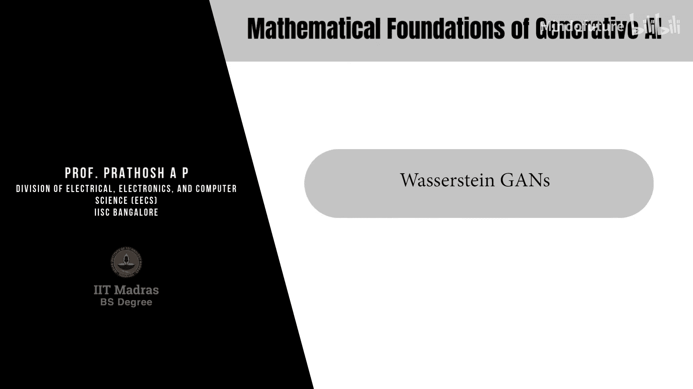

# 生成式Ai的数学基础 ｜ Mathematical Foundations Of Generative Ai p17 P17_W4L11-Wasserstein GAN -BV1fperz7EjK_p17-

🎼。

One possibility of such a metric is what is called as the versus science metric that is derived out of an idea called optimal transport。

 let me that the versus science metric。Comes out of an idea called optimal transport。

So please note that now what we are doing is that we are moving away from the F divergence and going into another。

Family of metrics called the vers strain metric or the optimal transport we will look at the definition of the optimal transport so the idea is that one can show that the ver strain metric which we will define now will not saturate or will not be matched out or be independent of generator parameters even when the supports of the manifolds or the manifolds of the supports do not。

Allign with each other so that is the idea how do we define the the versus transmit so given two distributions。

Given to distributions or rather given to density functions。

Given two distributions p X and P theta So please note that I've already told you that I'll be using the terms distributions and density functions interchangeably even though it's not I mean its it's a slight abuse of the the nomenclature I mean just assuming that all because the distributions that we will be using are of continuous random variables and the density functions exist okay so all my definitions will be with respect to the density functions。

 Okay so if you have if you are given two distribution corresponding density functions P X and P theta the ver strains metric。

Which would measure how close these distributions are the states metric between P X and P Theta is defined as the minimum。

Of the expectation of x。inus x cap。The distance between them， where。X and Xcap。

X and X cap are drawn from。Some joint distribution gamma。Okay。

 and the optimization is over all possible distributions， all possible joint distributions。Between。B。

We did okay at me。Define it as X bar。For convenience， so。

Given to distributions px and px bar the ver stands metric is defined or px cap they are defined as it is defined as the minimum of expectation of the distance between x and x cap where the expectation is withspect to the random variables drawn from join distribution between x and x cap and the optimization that we are solving here is the optimization that is there here is withspect to all possible join distributions between px and p cap so let me define that So of px and。

Lambda。Ofer。Lambda is a joint distribution。Lambda is a joint distribution between。

Between Px and Px cap。Yeah and by。Amda is one join distribution。

 G lambda is a join distribution between Px and P cap and p is all possible join distributions。

All possible joint distributions。St dark。The marginal of this joint distribution over。Whether it is。

It may be convenient to write it as x co x curve。Because if it's a joint distribution that we are talking about。

 it's always better to write it this way。X and X。And explain this in a bit。 So x and x cap。Okay。

 so if we marginalize this joint distribution with respect to x what we get is spx and if we marginalize this joint distribution with respect to x cap。

 I think this is x cap and if we marginalize this with respect to。X cap， we get px。Okay， okay。

 so now what are we saying here is the following that。啊，不得。O。Now， the definition here is saying that。

The resistance distance between two distributions Px and K P Px and Px cap are given by the minimum of the expectation。

Of the distance between the samples X cap drawn from a join distribution and the minimization is over all those join distributions such that when the join distribution is marginalized with respect to X you get one of the constitu distributions and when you marginalize over the other random variable you get the other constient distribution Okay so we need to search over all possible join distribution such that the marginals of these joint distribution happened to be the same as the distribution of interest。

 So this is the definition， the mathematical definition of what was the same distances。

It might seem a little daunting at first， but yeah let me just explain why this makes sense。

 you know why can this be called a good distance metric。

 why this can be used as a distance metric between a pair of distributions okay so suppose。

I it' is easier understood by taking discrete distributions， suppose px and Px cap。啊。读。

One dimensional discrete distributions。Okay， this is just for the illustration purpose。 Okay。

 so this is example。Or illustration of the F divergence。

 So we are talking about the P and P X P X cap， which are two one dimensional discrete distributions。

 which is that you have a discrete probability mass function， discrete PMm。

 And let me just write it that way。 So we have two。ProD mass functions。

And one can represent probability mass functions using histograms， right？So this will call as px。

We have x along this direction and we have different discrete values， x1， x2。

 and we have x k here and there is another distribution。It just。

It is what we call which is what we are calling as x cap， and there is some other distribution here。

Which has a different form。 Okay， now this is the。That this distribution be P X cap。Right， now。

 imagine。That we want to change px onto px cap right so we want to redistribute the mass in the x axis or the the px distribution such that it is transformer get converted into px cap Okay So now what we what are we saying is that the mass。

The mass in Px。Can be redistributed。It distributed， such that。Such that， Px。Transforms。say。

Get converted。读。To get converted into Px cap。Okay so what does this mean think about it so let's say that we have some mass at x1 right so what we will do is that we will take some mass from x1 and put it in lets say x lets call this as let's give some names its one cap X2 cap and we have X L cap here so maybe for to make it。

A little more convincing， let us make the distribution this way。Okay。Now。

 if P has to be transformed into Px gap， what do we have to do is that we will take some mass from x1 right and transform it or put it in x3 so that the mass in x3 or x。

This is x1 this is x2 and this is x3 So now what has happened this is x1 cap this is x2 cap and here we have x3 cap so now we have more mass in x1 and in px cap we have more mass in x3 right so if you have to transform this px n px cap what do I have to do is take some mass from x1 and pull it in x3 so that the mass in x3 becomes equal to the mass in x3 cap right so I can redistribute all the when I can go all the points in in px and。

Ristribute the mask in such a way that it transforms to Px cap， I hope that the idea is clear。

 so we want to transform this pH into Px cap by redistribution of mass。So redistribute。

This transformation has to be viaa。Ristribution。O。Now。

There there is no one way to redistribute demomas。 There can be multiple ways in which demos in px can be redistributed so that it it starts I mean it transforms itself into px gap okay so now it is very easy to see that every redistribution。

Or rather， we'll say a redistribution， every distributionriion is true， but is a redistribution。

A redistribution scheme。So what do you mean by a redistribution scheme I want to say how much mass has to be taken from x1 and like where all it has to be distributed。

 you take the mass that is there in x2 where all is it is to be distributed and so on。

 So every redistribution scheme can be represented。As。A joint distribution。

As a joint distribution between。Px and px cap right So why is that think about it。

 Let's say that we have a table。So for a discrete distribution you can represent the join distribution using a table right so we have x1 cap here x2 cap and we have Xl cap and this is this dimension is px cap and here we have。

X1， x2， and we have x。K here and this is the the axis of px this is the px axis。

 this is the px cap axis。Now， what are we saying， we are saying x1。

 you take mass from x1 and you put。Some 。3% of that in x1 cap， you know。

 you put 02% of it in x2 cap and in x3 cap， you put select 0 6% there just add it up to1 so we have to ensure that this does not add up to 10 this is 89 and you have you distribute 0。

05 here and so on so all you need to ensure that every row and every column adds to1 because you can redistribute x1 you can take I mean it's saying that you take all the mass in x1 and redistribute completely so they have to add to 1 so you do it for all values in px so that you get you transform that into px cap okay Now what is this table the table is nothing but the joint distribution between px and px cap。

This is。This is a joint distribution。Between。Px and P X gap。Right， now。呃。

Every redistribution scheme can be represented as a joint distribution。

 So every redistribution scheme。Redistribution scheme。Is a joint distribution。Okay。And it's called。

And is called。A transport plan。Okay， now what does this mean。

 this means that given a pair of distributions。We can find a transport plan。

 which is nothing but a joint distribution between the correspond underlying random variables。

Wwhich would convert one distribution to the other okay so this is easy to see in the discrete discrete space as we saw so I can actually invert the argument and say that if you give a joint distribution between the underlying random variables。

You are implicitly giving me a transport plan that would tell me how。

One of the constuent distributions can be transformed into the other distribution or rather how one of the marginals can be transformed into the other marginal right I hope that this is clear so now I am saying that given two random variables every joint distribution between them can be seen as a transport plan that would tell you how to convert one of the constituent distributions to the other one of the marginal distributions to the other marginal distribution so the question is。

Given that there are infinite transport plans that are possible in other ways。

 there are multiple joint distributions that are possible between a pair of random variables。

 can I quantify the amount of work done or rather amount of efforts involved with。

Each of the transfer plan。 Okay， so while I am changing P X to P X cap。

 Im doing I'm putting some effort to change P X into P X gap right because you know I'm taking x1 here and moving the the mass X1 across the other places here so that it it will start looking like a P X P X cap and I'm doing it for all other values。

 So every transport， every redistribution of the transport plan comes with it its own cost of doing so。

 Okay Now the next goal is to somehow come up with a way to quantify how。

Effort fully is a given transport plan， Okay， so we will do that so to quantify。The effort。Involved。

In a transport plan。A third involved in a transport plan。Now let's do that， suppose。Aas。X。

All let's say that。Yeah， the suppose。제。Some must。This mood。Some。It's2 xcap。Okay。

 so while we are executing this transport plan， let's say that we take some mass from x1 and well move it to say x3 x x x4 or something right we are taking from here x1 and moving something to x1 cap we are taking from x1 and we are moving to x2 cap and so on。

 so let's say that some mass is moved from x to x cap Okay then。Can compute。A distance。

 some Euclidean distance between the difference between these two points。

 and this will give you the sense of distance between。A rather distance of the movement of the mass。

 right。So when we are moving some mass from x to x gap。

 if you take x and x gap and measure the distance between them。

 you get the distance rather it will give you a sense of distance between distance of how much。

distance of the movement of the mass Im saying lets say that you take x1 and move it to say x5 here right then this x1 minus x5 will give you how long the mass has been moved that will give you a sense of distance between the distance of the moment。

Then， you have。The。Join distribution， which is let's call it。喂。That was computed。At。Xcom my X cap。

 So what would this give you is it tell us the amount of mass that was mo。Why is this？

Look at this every entry here is pi of some x comma x gap right this will tell you what is the amount of mass that was moved correct so let me represent this as。

闭。X and x cap will say this it is a joint distribution between x and x gap for two different random variables。

Okay pii of x and x x cap represent the joint distribution between two these random variables so pi of x comm x cap will give we will tell you what is the amount of mass that was moved from x to x cap okay now we know that the distance times the the mass according to physics will give you a take the product of the pii of x comm x cap and multiply that with。

The distance， what is that， what does this give you， this will give you the sense of work done。

In moving。Dema from。It to xcap， right distance times the the mass will give you the work done in moving something from point A to point B。

 right？Okay， so now this will give you， this will give you the the amount of work done by movinging like some mass from X to x cap。

 Now， what is the average work that is done by one complete transport plan。 This is。

 you need to do it multiple times to execute one transport plan， right？

 So what is the average work done。Average work done。Or rather， in a transport plan。

And a transport plan。Can be simply given by the just adding or rather integrating all the。

Individual works。And you integrate that over all possible values of x right and this integration is over x and x gap。

This will give you the average work that is done。 So what is this。

 This is simply the expected value expectation of。There is the expectation of。It's minus6 gap。

And the expectation is with respect， too。The join distribution between X and x gap。

This will tell you what is the average of the work that has been done by。A particular transport plan。

 So what we are trying to say is that we said that every joint distribution between a pair of random variables will correspond to a transport plan。

 Okay， what is a transport plan Its yeah its it's mathematically speaking。

 its a joint distribution between it is a joint distribution between the corresponding random variables from a from an intuitive standpoint intuitivetuition standpoint。

A transport plan is a scheme that would tell you how to convert one distribution to the other as we just saw so now every transport plan has to do some work while converting one distribution to the other and the average work done in a transport plan is given by the expected value of x minus x gap。

The norm of the x minus x cap under the expected value of norm of x minus x cap while the expectation is taken with respect to the joint distribution between the de variables and this is the particular transport plan that we are looking at so given a particular transport plan pi expectation of norm of x minus x cap with respect to pi would just give you the amount of work done。

While I mean， why are that particular transport plan， Okay。

 now the question is remember what we are looking for。 We are looking to get a。

Distributional divergence metric that will tell me how close or far a given pair of distributions are Okay now the question is given。

Given that。Given that multiple transport plans can exist。

So what do you mean by multiple transport plans， multiple join distributions right every transport plan is a joint distribution。

 so given that we there are multiple joint distributions given that multiple transport plans exist。

Ex exists between x and x cap。Okay， the question is。Which of。啊。

Corresponds to the least amount of work done。Correspond to the least amount of work done。Right。

 so if I have to calculate this， how do I do that， So lets suppose。

Pi of Xcomx cap represent a transport plan。Is a transport plan。

So what do we need transport plan between let's say P and P theta so we have sorry Px and px cap so we have two distributions P and P Px cap the the the requirement is that the distribution。

 the joint distribution that we are。Operating over has to be such that if I marginalize over one of the random variables I should get P and if I marginalize over the other random variable。

I should get the other constraintuent distribution。 So why is this the case。

 This is this is required because。This is P X cap。 when you marginal is over x you get Px cap and when you marginalize over x cap。

 you get P X。 Why is this the case。 See， this will not become become a valid transport plan unless the the distribution that you get after redistributing the masses has to be the joint distribution I mean the marginal distribution if that does not happen。

 then this is not a proper redistribution So how do you quantify the fact that it's a proper redistribution。

 it is by mathematically， it is by saying that if you marginalize the joint distributionion over the constrainent random variables。

 you should end up getting the marginals that we are looking at now suppose pi of x x is are transport plan between p and px cap and we have a condition over pi that the marginals have to be equal to P and P cap。

 The question that you want to ask is given that there are multiple joint distribution exist such that this happens。

 which of them correspond to the least amount of work done。 How do we get that。

And that by solving an optimization problem。 So the expected value expectation of。

The norm of its minus its cap。And the where the expectation is computed over the joint distribution。

 So we know that this will give you the average work done by a transport plan。 Now。

 if I take the minimum of this。With respect to all possible。Joint distributions。Okay。

 so I maybe I used。Okay I used Lada here for the join distribution， okay， let me just be consistent。

Suppose La of Xcomx cap denote our transport plan。You know to transport plan。

 then we know that the average work done here。SK by this。 So what I want to do is。

What is the minimum amount of work done which of the transport plan corresponds to the minimum of the work done is the question that that we would want to answer so we need to search over all joint distributions okay。

All join distributions such that where Pi is a family of joint distributions。

Family of joint distributions between the random variables， such that distributions， such that。

The marginals。When I integrate it over x， then I get to px。And if I integrate it over x。

We get Bx gap so what are we saying Okay every joint distribution will correspond to a transport plan okay and every transport plan has a corresponding amount of work that is done Now the question that I am asking is amongst all possible transport plans。

Which one is the one that corresponds to the least amount of work done this is what this this expression would give you so let me just write the down write write that down so this。

Responds to the。Least rather the。If searching over all possible transport plan this corresponds to a transport plan。

Transport plan， leading to。The least amount of work。

Solving this optimization problem should give you a particular transport plan and this particular transport plan should correspond to the least amount of work。

That is done， okay。Now， one can intuitively see that。The lesser。

Is the least amount of work that is done to transport one distribution to the other。

 the closer the distributions are correct。What am I trying to say？If。Let us call this some W。

Let us call this W。PX and P Theta P and P gap。Okay， now。What we are seeing is。The closer。

PX and Px cap R。Okay， the。Lisen。The blue will be。Why is this the case one can intuitively see this right I mean if pX and Px cap are very close to each other that are closer to each other then the amount of work that needs to be done to transform PX into PX cap is not much。

So what happens is the all the joint distributions which give you a transport plan。

You can always find the joint distribution， you know。

 which would have a lesser amount of work that is done。 Okay， so now this which is。

The minimum amount of work done， rewrite it again。So。The ver strains metric。

W sustains metric between。Two distributions。P， X， N P， P， X， and P， X cap。You given by。

So this is what is called as the versus strain matrix。

 So versus strain metric between P X and P Xca is simply equal to the minimum of。

The average work done。By。All possible。Transport plans。The minima is over。

Would the right lamb of its command okay？Expect is over。A join distribution。

 which is a transport plan， and the minima is over。All lambmbdas that are belonging to。

Family of joint distribution such that the pi， the joint distribution pi that we are operating with is having this possible properties let me just。

Gooperate here。Thats it so this is the definition of the versus strains distance and if if you use the pth norm here in general this is called the pth versus strains distance this is also called the optimal transport plan right I mean for obvious reasons because every joint distribution is representing one transport plan and amongst all possible transport plans right we are seeking the one that has。

The least amount of work done。 So in that sense， it is the optimal transport plan the。

The question that we are asking here or rather the optimization problem that we are solving here is。

Given that I can transform Px into。Px cap via multiple ways tell me the one that corresponds to the least amount of work done that gives you a sense of how closer far the constrain distributions are because the lesser the amount of work done in transforming one distribution to the other the the closer the distributions are so this is the definition of what the versus sustains matter case。

Well the question is。How do we use this for constructing generative models。

 one factor is that the strain metric does not saturate unlike f divergences， so versussteins metric。

Versus stainsymmetric。Does not saturate。Unlike。E diigences。When。The support of Px and P The does not。

Supports of P and P theta in our case does not。Wdla does not the name。

This is the take home message that we came up with a metric which is called the ver sustain metric that does not saturate whenever the manifolds of the corresponding distributions。

 supports of the corresponding distributions do not align。

Okay now the next question that is to be asked is how do we use this for building a generative model right so we know that how do we build our generative model we have the exact same formulation where we have a sampler。

Which we are calling us G Tta。Of z and this is taking z as an input and we getting x cap from P theta we have the same setting here right So what do we want to do is here we have to minimize。

Or rather get our parameters such that the ver strains the distance between Px and。

P X and P data are minimized。Okay， because we know that ver stands metric is a better distributional divergence compared to have divergence。

 so we want our theta to be such that the ver stands distance between px and p is minimize how do we minimize the versus strange distance as the question Okay now the question is how to。

Anyways。Was sustains distance between a pair of distributions。 So it turns out that。

That there exists a result called the。Cantro which。D winsteins dual。

Whi would say that versus strength metric between two distributions px and P theta is given by。

The marks of。Max or expectation of a function Tw of its。X is coming from px。Minus。

The expectations of expectation of。TW of Xcap， where Xcap is coming from P Tta。

And this maximization is over all functions Tw of x okay。Re2。1 lip。 Okay。

 I like to tell you what that is。 If you， there is this result。

 which is called the can which rub strains dual that would tell you that the ver strains method between two distributions is given by this particular expression。

 So remember that our definition was。Minimizing the optimal transport and if you know if if the students here know about the duality of optimization。

 every minimization problem can be represented using a dual problem which which involves a maxization so basically the cult which rub instance duality is a dual for this primal optimization problem which will involve maximize maximization。

Over a function Tw X okay and there are expectations with respect to x coming from px and x x cap coming from P theta we know from our analysis so far that we can compute this sort of expectation using sample averages you know this looks very similar to the a divergence minimization objective that we had you know but for the presence of mean absence of x star here but it looks this can be computed now what do you mean by Tw being one lipssheds Okay so it it is simply saying that Tw of x。

Should be one lips， so this means。Which means that the。

T function which we represent using neural networks have to be such that。It has。

Bounded derivatives this way。What is this This is a derivative of for W right it has to be less than or equal to one。

 So this is the definition of。And function B 1 lipshs。 So what do we have to do now， we know that。

Our theta has to be such that the versus strength distance have to be minimized now。

How do we minimize the versus strange distance， we can't compute this vers strain distance because we don't know how to compute this expectation as as usually because we don't know the underlying distributions so just like we express the f f divergences in terms of expectations over the distributions that we have the ruben strange dual will enable us to represent the ver strain distance in terms of expectations over px and P theta so we use that what happens is our theta star and w star just like again will be you first have to minimize the versus strange distance but the versus strange distance itself has。

A maximization here。这 is my order。我。TW， right， such that the T W network is。1 left。

 that is what we are saying。 So this is very， very similar， the Ebo objective。

Abo objective is very similar to that Tafg。But with the only constrain that the discriminator network has to be one lifted。

 Of course， there's no F star here， right， I mean， that way the the loss looks slightly different。

 but it's extremely similar to the SS the the Gs。 And that is why this。

Architecture of this method is also called the ver sustains Gan or W Gan in short。

So what happened to the final。我个。Similar to Gs， and therefore。

This method of minimizing the F divergence。A sorry， versus sustains metric。Md of minimizing。

Nma is in the versusstein's metric。Its called the W again。Okay。

 now finally what how does one train a w again trying a W again is very。

 very similar to training a again， but with just one constraint。That one needs to。

So we have a generator network and we have a critique network that would give you Tw just as the case of a GN or an fiv menu measure so this would be a Tw network take x or x cap both as input right because the last function has x and x cap being taken as input and you get Tw of x here the only constraint this this is very similar to that of GANs but the。

Only cons as Tw X has to be made1 lip fit right because you are suing over all functions that are one lip fits T W has to be made。

One lip。Now， because this is a neural network， how does one make a neural network a lipid function is a is a is a is an area of research by itself。

 but one of the。Practical ways of doing it is by。Nmalize。The weights。Of T W。

Such that they are always in norm of them are always equal to one right after each。

After each a gradient step。SoThis is one practical way of who to make a neural network one left so basically we are training this as a a again which you know first we trying the TW network and then we train the GT network while we are training the TW network we have to ensure that after the very gradient strip take all the weights of this particular neural network and renormalize them so that their norm is equal to one so if you do that。

One can ensure that the neural network that is being built here is close to being a one lecture network right so that way I mean the th a Wgan is extremely similar to that of normalgan with this particular objective function but one has to ensure that the discriminator or the critic network So this is the。

The generator network。And the discriminator network is typically called the critique network in the Wg Wg literature one has to make sure that the TW network that is given here is made onelips by putting by normalizing way it after every gradient Now what is the advantage of this I mean it finally looks like again but what is the advantage of this the advantage of this is that the training here is much more stabler because we are using a software metric that will not saturate when when when the manifolds or not over lab with each other so therefore the suggestion is that whenever one is training again one should always use the ver sustain metric and try the W againhan not the naivegn because it is much more easier to try another W again so that's the take home message that let me just summarize what we did so far we just look at the reason why a naiveg fails。

It does because。The manifold hypothesis tells you that the data practically the the data be practically obtained based on a lower dimensional manifold and when the manifolds do not overlap then they always exists a perfect discriminator with 100% accuracy which would make the GN training which would make the G training suchur rate now to ensure that it does not happen we wanted to come up with a software metric we saw a software metric that was called the ver stains metric and turns out that the strains metric is very similar to optimizing mean minimizing the stains metric is very similar to that of optimizing G so it still has an adversarial optimization problem with a minim formulation but two differences one is。

The the adversarial optimization that occurs in a muscle strain G is exact rather than a lower bound unlike the case of f divergence。

 the other thing is allowed to ensure that the critic network that is involved in solving this adversarial optimization problem is one lapdes and one will do that by just normalizing the weights of the critic network after every gradient step it is observed that training of a w again let me decide that the conclusion。

Is that。Tining。A Wgan。This。Str， star。Let me say more stable。Compared to that of Iibn。

There is the conclusion， so it is always advised that one would use a ver strains formalization versus Stas scan or Wgan while one is trying to use a build G for whatever applications that are there。

Okay， so with this， we will conclude this particular module in the next module。

 which is the final module on GN， we will be looking at some of the applications of using GANs。

In in applications that are different than。Geneeration task sampling tasks。 Thank you。

