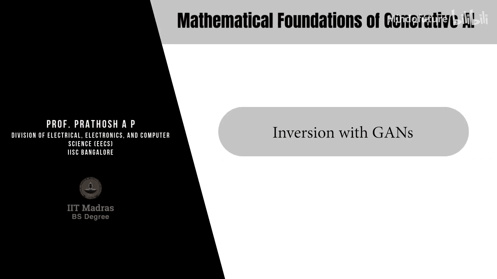
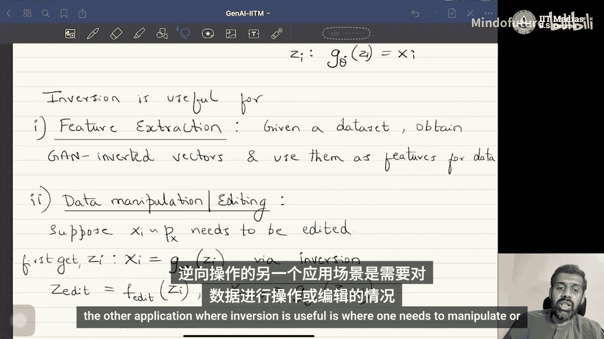

# 生成式Ai的数学基础 ｜ Mathematical Foundations Of Generative Ai p18 P18_W4L12-基于GAN的反演 -BV1fperz7EjK_p18-

🎼。

We shall continue the discussions。On generative adversarial networks and adversarial learning。

So the next component that we are going to look at is。Inversion with guns。Inversion。

Such generative adversarial networks。So in a naive G， which we saw so far。We can generate data。

From an arbitrary input space， So typically what happens is that。We have。A generator。

Which samples from the distribution of interest， which is our data distribution。

 So the input to this generator are samples from normal distribution。And this will give you samples。

Sunday distribution of interest， right， this is P the topicss， which is close to P。

That is what we have been。Doing so far。Now， suppose。We want to invert this process。

 what does that mean so write that down again in its knife formulation。Is a function。Or rather。

 well say a tri again。A rained gun。Is a function。From。

Z space to the data space right that is what it does takes an element from normal 01 and it maps a link the data space。

Now， suppose。是。Suppose。1 is interested。In ining the whole process。Inversion of the Abo function。

That is。Given an image or given some data point， let's say x。X I that is sampled from。嗯。Px correct。

Gal。Is to find。The corresponding z。Cresponding z。Okay。

 what do you mean by finding a corresponding Z that is？Find a z such that g the of z is equal to X。

Cs called this Z I Okay， we want to find a particular Z I such that when that particular Z I。

iss pass through the generator， the tri de generator let us indicate the tri de generator by G theta star okay because the training has been done and we have a fixed theta star now what do we want to do is suppose you are given it an point X。

The goal is to find the corresponding Z that is。That z。

 which would have generated this particular data point X。Okay。

 so this problem is known as the problem of inversion where we are not interested in generating a data point from a latent variable。

 rather we are interested or rather we are not interested in generating a data point given the input Gaussian variable Gaussian vector rather we are interested in finding out。

Wwhich is the Gausian which is the vector from the Gaussian distribution that would have generated a given particular data point。

Okay now if you look at the formulation the knifegan formulation there is no provision to do this right post training what we can do is we can sample the data point from the normal distribution and get a sample。

That is generated from the generator。However， there is no way that we can invert this particular process where given a particular input。

😊，Data point sampled from Px。 we cannot get the corresponding Z。 Now， the question is。How to modify？

What if I had again？So's start。Such that the inversion is possible。Okay。

 we will look at a couple of approaches to solve this problem。

Before we look at the approaches to solve this problem。

 let me just motivate you so as to why this is of importance now why does one need the corresponding input variable for a given data point there are two reasons why one would one would look at inversion so one is。

Okay， so maybe let before we take up this question， let us answer that。So innovation。

Is useful for mean multiple there are multiple use cases。

But I'll just list two of them inversion is use useful。For1。Fter extraction。

What do I mean by feature extraction now we know that。Again。

 is constructed to sample from a given distribution px data distribution px。

 which means that if we have trained。Well， if you have trained again well。

 then it has implicitly learned the distribution of the data， it means that。The corresponding。

 if we can invert the generator function of the G， then the vectors that we would be getting from the generator or by inverting the generator will be representing the features of the data so which means that if we can somehow get this function get this get this inversion done then we can take a data set and do an inversion using this particular G and all the vectors that we get post inversion would correspond to some sort of feature representation of the data。

Right， so feature extraction， which is that。So inversion is useful for feature extraction。

 which is given a data set。我边。Gan inverted vectors。And use them as fetus。Use them as features。

For data。So we also know that the dimensionality of z would be typically much lesser compared to that of the data。

 which means that。If we invert， then we will be getting a lower dimensional feature representation of the data and that can be used for a classification that can be used for any other downstream task involving the data distribution。

 So that is one reason why we would want to invert again the second possible use case first inversion is。

Data manipulation or editing。So what is meant by this Think about it。

 Lets say that I have given a particular image let's say that we are building again for。

An image data set and post training， suppose we are given a particular image the question is。

 can I edit this image using G。Right now。A naive G will not support any editing tasks because a na G can only take a vector from an ga ga distribution and generate data。

 but if you want to edit a given particular image then one first needs to get the corresponding input inverted vector representation of a particular image and then。

Edit the corresponding input vector and then generate the new image。

 the edited image after editing after manipulating the input inverted input vector Okay so that would possibly enable editing in gap。

 So what do I mean by that suppose。Suppose what we want to do is that we want to edit。

Xi or manipulate Xi。Suppose Xi that is from px needs to be manipulated or edited。

So what do we do first？We get the Z， okay。Corresponding to this particular Xile。我야今。可以。

We first get Z corresponding to this particular X via inversion， so this。this X should be equal to Z。

Get。1 needs to fu。Get。Z I okay such that the X is equal to G theta star of Z y inversion。

 So I'll tell you how to do this inversion we'll just get the the corresponding inverted Z then。

Then do z edit。is is some function， let us say a edit。

 some deterministic function that is applied on Z。So。

 this f edit can be anything now it can be addition。

 it can be some traveral starting from ZI any any kind of edit function that is there then get x edit。

S。G Theta star of。Z it。This is the idea。 So the idea of manipulation。

 data manipulation using the G inversion is to first get the inverted。

Iput vector okay using the inversionsion process and then manipulate the inverted vector using some edit function。

 so which can be anything。And use that edited input vector。

In the generator to generate the edited input image or input data points。

 So that is how one manipulates the given input data points using ga version， so therefore。

Inverting again which is finding out what is the input vector that that would have generated a particular given data point is of importance so there are two possible applications there can be multiple other applications as well but two possible applications are that one it can be used for feature extraction the other application where inversion is useful as where one needs to manipulate or edit the data okay。

