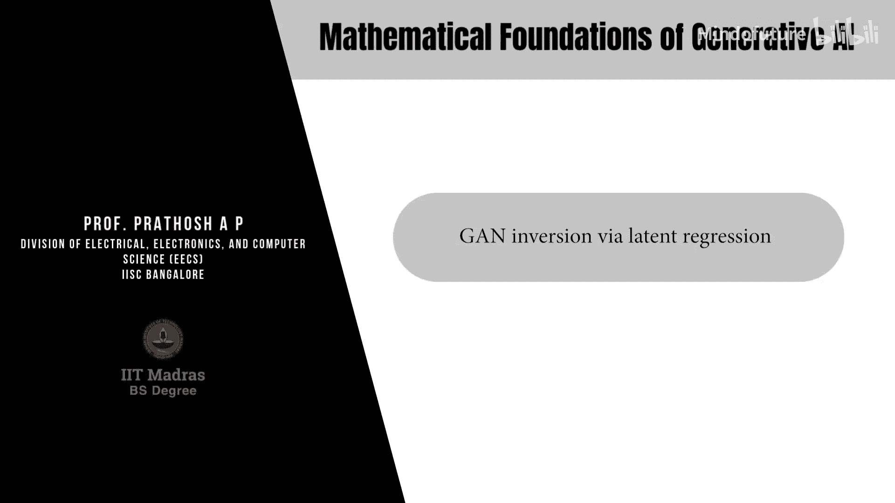
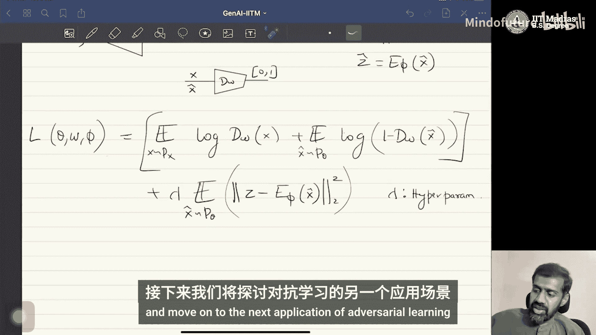

# 生成式Ai的数学基础 ｜ Mathematical Foundations Of Generative Ai p19 P19_W4L14-通过潜在回归进行GAN反演 -BV1fperz7EjK_p19-

🎼。

I said there is one other way to do Gin version， which is。So again in via。Nnt regression。

Kyon version via what is called as latent regression。 So how do we do this。

 It is very similar to bygan， but。In terms of。Instead of explicitly solving。

The problem of inversion via minimization of the matching the join distributions。

 what would the latent regressor linear would with latent regressor would do is。

That it still has an encoder network because without that canbiden。

 so we do have an encoder network here that would take x。So this would take x and gives。

Directly regresss Z here， okay， Z cap， it's called this E P。Of x cap， it can take x cap。

 so there is still the discriminator， but the discriminator would just function as it is as in the case of a9。

This is Dw， so now Dw simply separates between x and x cap as usual。However， dad。

Simply rigorous over the input light vector， which is。

So just take z and try to reconstruct it back using the encoder networks and here z cap is simply equal to the。

Output of the encoder network for a。嗯。Give an x or an x cap。 Now， how do we do this。

 So the loss function for this。So we will say latent regressor。Simply the usualgan loss。

 which is log of Dw of。嗯。X。Its coming from Px。We have the second term as expectation of。

Log of one minus T W of。Sap。Where Xcap comes from P theta。 So just add。One more term here。

 So sometimes some lambda times。Z minus。Z card， which is。E phi of x cap。

Just take the norm square between the difference of the input。Fector that has generated a particular。

Data point and this is expectation is overall generated data point。

 so this is one term that is simply added for the G training okay where lambda is a hyperparmeter。

Have a parameter that would tell you how to weigh the particular losses。 So this thing。When also。

 this particular loss。Also has three components to it。This has theta， the Genator parameters。

 a discriminator parameters and the。The aggressiveor parameters and all three networks are now trained simultaneously so this is trained as the usual g and take an Xab that is generated by a particular Z and pass it through the encoder and the encoder gradients are computed。

And here the difference between a bygan and a latent reggressor is that in a byggan。

 the discriminator is modified in the sense that instead of giving x and xcap as input。

 the discriminator learns to discriminate between the tuples of x1 point from the data space。

 the other point from the input latent space。But in the latent reggressor。

The discriminant of the Gn is not modified， G is trained just as the knife Gn but there is an additional encoder network that is simply trying to regress upon the input latent vector so why is it called a regressor because this encoder network is effectively regressing over the input data points or input latent vectors so add a regression task or a regression cost to the knife GN cost and train the encoder。

So， however， it has been found out that modifying the discriminator and solving。The joint。

Solving for the join distribution yields a better yields in a better inversion quality compared to the tough simple or naive regression so these are two techniques that are generally used for can version that have been many other techniques that have been proposed in the literature but in the test of time I would just stop here and more on the next application of adversarial learning。

