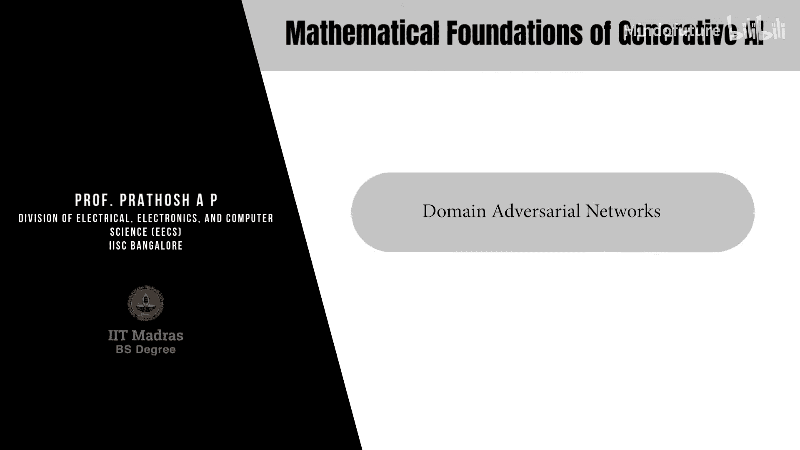
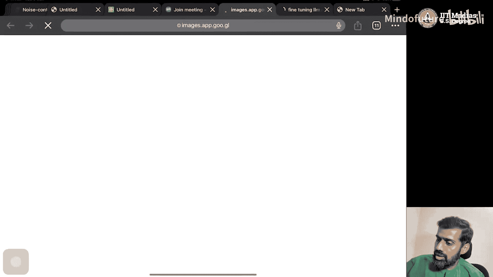
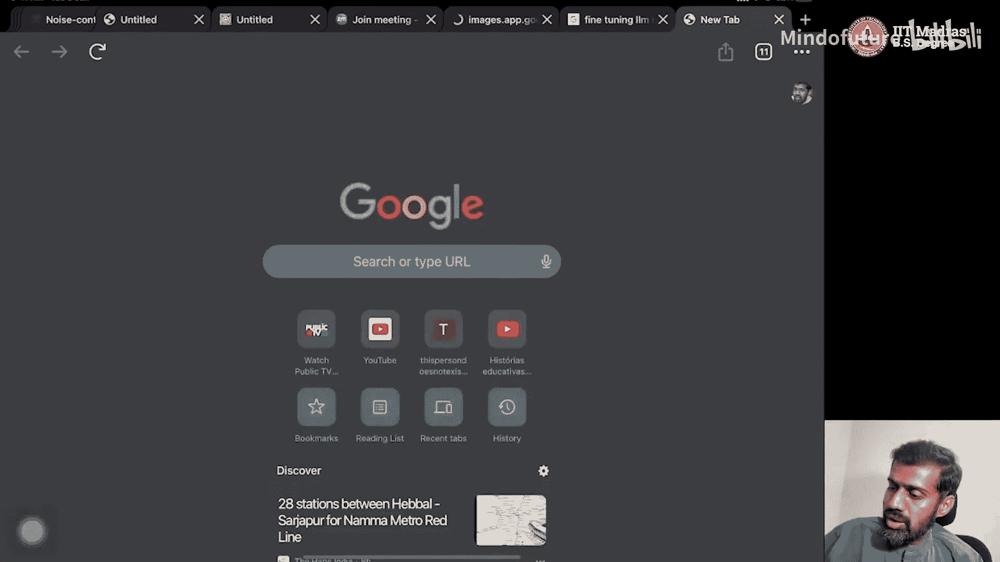
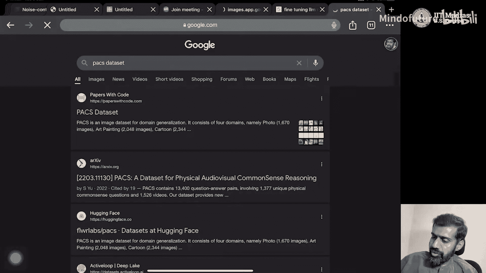
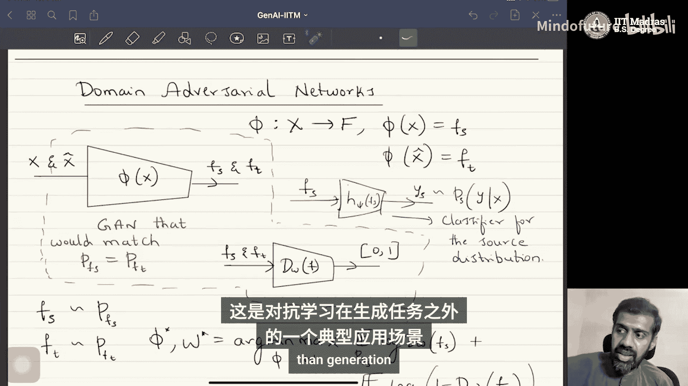

# 生成式Ai的数学基础 ｜ Mathematical Foundations Of Generative Ai p20 P20_W4L15-领域对抗网络 -BV1fperz7EjK_p20-

🎼。

So the next application of。Adversarial learning that we are interested in looking at is。

What is called as。Adversarial learning for domain shift。放海玲。Domain shift。

So this idea of adversarial learning that we just saw， which is。

Using a mini Max optimization problem for。Translating one distribution to the other is not restrictive only for only two generative models it can also be used in a gamut of other applications and show you one sample application where adversarial learning can be used beyond。

G generative tasks。 So that task， that the task that we are interested in。

As an application of adversarial learning is what is called as the problem of domain shift what is the issue of domain shift。

 let us look at that。Suppose。We have data。From a distribution。It's called this DS S， which is。

Tuples of sorts of x1 comics。Y 1 x2 come through， and we have。X and comm again。

 so this data has been sampled ID。From a distribution Px P， So this Ds。

 is called the source distribution。Now， the task is to。Come up with a classifier。

For source distribution， can it say that the task that we are solving is that tough。Classification。

So we know that all classifiers would estimate。The conditional distribution of y given x right This is what every classification classification task would solve。

 So we are interested in solving a classification task。 However， what happens is。In practice。

The distribution that we would want to test out our classifier on will not be same as that of the source distribution。

 So what happens is during test time。データ。Comes from a different distribution。

Comes from a distribution。That is。Different。Different from Ds so which means that there exists another distribution okay call that Dp which is the target distribution。

Let us write it here itself。 So during test time the data comes from a distribution D T。

 which is different from Ds so mathematically know DSs。

Or DT that comes from the that comes during it as time is not the same as。

The soil distribution in those scenarios， what happens is classifiers。

Classifiers or any kind of no regress， as it doesn't matter some。

Function app that we have trained on our source data， classifiers or regressors。Trained on。Ds。

Would feel。On duty。So obvious right supposeupp you have a data on which you have trained a classifier whenever it comes from and when the test data comes from a different distribution than the the data upon which the classifier has been trained then the classifier is bound to fail so let me show you an example of what I am talking about here。

So， this is。

So there is a standard data set for this this is called the PACs data set。

Yeah here is an example of what is called as the patch data set。

 so there we have data coming from four different distributions， one is called the photo。

 the other is called art painting the third is carto and the fourth is sketch。

Let's say that our training data is coming from one of these four distributions。

And you have tried to classify around this but as human beings we have no problems in identifying what the class category is irrespective of the distribution that it comes from。

 however if a neural network is trained to classify the data from let's say photo distribution and during test time if I start showing it data from sketch distribution then the classifier that has been trained on the photo distribution fail okay so now the question that is of interest in domain shift or domain adaptation is can we come up with a method where classifiers that have been trained on source data。

Would continue to do well on a target distribution that is similar to the source distribution。

 but not exactly the same as that of the source distribution Okay。

 so now lets call this the problem of。It's called unsupervised domain adaptation。

Unsupervised recommended adaptation。UD。 So here the problem set up is the following that we are given。

D source data。Which is same as the one that we just described， we have X comma Y I。

That have been sampled from a source distribution。And we are also given the samples from the target distribution。

 let's call them as Xcap I。So I is 1 to M， I'll let otherwise lets call this as a X J cap J is 1 toium。

 this is sampled ID from a target distribution P。Okay。

Now please note that the problem setting in unsupervised domain adaptation is that we have access to source data where we have the source images or source data from the source distribution and the corresponding labels but from the target data we only have access to the raw data without the labels so this is the set for unsupervised domain adaptation there are cases where this assumption that we have access to target data without labels is also relaxed those kinds of problems are called domain generalization problems you know it is not the focus of this particular course I'm just showing you where the idea of adversarial learning can be used so the problem of unsupervised domain adaptation is where we assume that we have during driving time we have access to the data from the source distribution along with its labels we also have access to the。

Data from the target distribution， but we don't have access to the target labels。

 you know this is sometimes this is a practical assumption to make because it is not very difficult to get data。

 what is difficult to get are the labels。 So lets say that we have data from the source distribution along with labels and from the target distribution we have only the data without the labels Okay we have。

PT or the distribution is not the same as that of the target distribution right I mean that this is what is called as the domain shift。

There is a domain shift the question is the objective of domain adaptation。Yes。Given DS S and DT。人。

The presentations are features。Or the classifiers。Such that。It performs well on。Both。The source data。

And it target distribution P right the question is。

Can we learn a classifier or a feature representation such that the classifier or the feature representation that we have learned。

Will perform well both on the source data and the target data now supposed we build a classifier only on the source data it does not it will not perform well on the target data now that we are given some examples from the target distribution as well Can we learn representations in such a way that it performs well on both the source data and the target data so this is the task that we have turns out that this task can be solve using adversarial learning Ill just show you that。

SoIt can be solved using adversarial learning using this method called dous adversarial networks。

Doma are two serial networks。Dance， we can use domain aversarial networks to solve the problem of domain adaptation。

 How do we do that， So here we have。A neural network。That is used as a feature extractor。

So we have a neural network， let's call this as a phi of x this will take both x and x cap from the source and the distribution as inputs so this phi network。

妈ps。From data space。To some feature space， let's call the feature space as some。

wasThinking what alphabet to use。Some F for feet space。 So this will give you a。A feature vector。

 Let's call this f of。S and F of T。Okay， now what is F of So the feature vector that we get on。

The samples from the source distribution， I am calling them as FS。

And the future vectors that we are getting from。第。Target distribution I am calling it as F T。

 So this will so whenever x goes， it will give you fs whenever x cap goes， this will give F T okay。

Now， we have another。Discriminator here。And this discriminator。Would discriminate between。

 let us call this as T W of F And this discriminator would take F first。

And F T has input okay and this would as usual give you a values from 0 values between 0 and 1 here。

Lets say that Fs the features for the source distribution has a distribution Pfs and the features from the target distribution has a distribution P FT。

Okay， if you think about that。This entire structure that we have here。Is a G。

 so we train this advers really。That would match。P of us。

Which PFT right so so if you recall what a knife g does。你讲。Would take。

Distributions from the9 G is trying to make distributions of distribution of P theta to be same as the of px。

Right here we have two distributions。P F S and PF T。

And this entire setup can be trained at to ensure that the distributions of PFS and PFT are the same with each other。

Right， how do we do that will train。 So let us write that down。 There is this。Fe network。

 which will be， which will be acting like a generator。 And there is a discriminator network。

 So we want to。Sol the same in max adversarial problem。Now。

 what is the loss function that is used here， we have the expectation of。Log of。그래个是。Call this DW。

 because we have been using D for discriminator。 DW。 This is log of D W。

 and this will take samples from。Fs。Right， so this is over P of S plus we have expectation of log of。

1 minus DW， the data is now coming from F T。This is P ofT。

So we know that we can use adversarial learning。To match distributions right， I mean。

 ultimately adversarial learning is a technique that is used to match distributions here what we are doing is we are trying to learn these features fee in such a way that the distributions。

offff。The feature vectors that we are getting for the source distribution and the target distribution are exactly the same。

Okay，Now this would ensure that irrespective of the fact that the data is coming from this source distribution or the target distribution。

This fee network is going to give you features that comes from the same distribution。

 so this fee network in a way is trying to learn features in a domain adversial fashion。Okay。

 it does not matter it does not care what the the distribution the data is coming from。

 it will ensure that the features have been learned in a manner that is agnostic to the domain。

But there is also an issue here。 The issue is that while the feature distributions are made the same。

 there is no guarantee that the features that we are learning here have to be conducive for the final classification task that is at our hand to ensure that what is to be done is that let us we should learn。

Another classifier simultaneously。This is thegan， so we have another classifier here。

So this classifier only takes features from the source distribution， so let's call this。8。

It's high that will take F S and gives you labels from the。Soce distribution。 So this is coming from。

 So P， Y。What did we call it P。P S y given1 x， yeah。This is estimating the posterior of。

The source labels。Yeah， this is source labels given the source data。 This is， this is。

 this is simply a classifier。Classifier。For resource distribution。

So we have a classifier for the source distribution。

Now what happens is that the fee network is trainedd with。Two objectives， one。

 we need to train the fee network。To ensure that the distributions of the features are the same irrespective of it coming from source or data。

 we also have to train the the S network， which is the classifier network。读。

Minimize the cross central pillars。So binary cross and tropy laws between。

Y which is the source data and the output of this。W just coming from the source distribution so。

The classifier has to be trained in such a way， but we also want our fee network。

To be trained to ensure that the binary class entropy。

 which is the classification loss is also minimize so what happens is that this fee network has gradients flowing from two different directions we have gradients flowing from the classifier's output。

downs of fee。还是。2 objectives。One is the adversarial objective。

So the other is the classification objective。The adversarial objective would ensure that this fee network has been trained in such a way that the features that we are getting are agnostic to the domain。

 the classification objective would ensure that the fee the features that we are getting are conducive for the classification task because otherwise。

If you only train the free network in adoial way， sure it will learn to find the features that are agnostic to the domain。

 but those features。May not help the classification task okay。Now。

 since we also have the labels from this source distribution。

 we will use them in this classifier and we train in this fee network simultaneously not only to ensure that it will give you features that are dominant agnostic but also that it will give you features in such a way that the the final classifier。

Is also trained properly。 So now when we train these networks simultaneously， that is， you know。

 we train in our feature extractor to ensure that the features are domain agnostic and the classifier also classifies well on the source data。

 Then the hope is that。This classifier okay is learning to classify using features that have been learned in a domain agnostic manner。

 which means that post training during inference。SoDuring inference。The same classifier。

Which is its size star。Can be used。On board。The source and the target data。And target distributions。

So why is this， this is because the classifier has been trained using features。

That are agnostic to the source。 now we have ensured by adversarial training that the the distribution of the source features matches with that of the target features。

 it means that a classifier that is trained down the source features is。是。

Is same as a classifier that would I bring train down the target features， however。Now。

 since the classifier we only have labels for the source features we will train the classifiers for the source feature during inference。

 the same classifier can be used both on the source and target data。As long as。

The features are used as input。Used in the input。So what does that mean given。

A data point X cap that we have sampled。 So let's call this as x cap test。

 So we have a data point X cap test。That is sampled from P。Test， okay。

 then what we should do is that we should first。Find out if。B。Test。

The feature vector corresponding to this by passing that through the train the feature extractor。

 we train we pass exccap test through the train the feature extractor。

 we get F the feature for this particular test dataset set， then the class。

 the final output or the class。Which is white cap test。S the。Output of the classifier。

 which would take FT test as input。即。Now， not that who sins。Fe would。And short。Ensure that。

The distribution of the source features is same as that as the target features。

Why are the adversarial training？It's free。The classifier would。Classifier will。Function the same。

丰筝的县位。I this be off。The domain， this is the idea。So now。

 what we are doing is that we are using adversarial learning to ensure that we learn features。

In such a way， that。The features are domain agnostic once the features become domain agnostic a classifier that has been trained only on the source features。

Or any of the distribution can be used on the other distribution as well。

So one might have this question right， I mean we can can we train this classifier separately。

But not while but not along the fee and the discriminator training。

 the answer turns out to be no because。The features have to be learned in such a way that it satisfies two objectives。

 one， they have to be dominant agnostic two they also have to be conducive for this particular classifier。

 therefore the classifier and the feature extractor have to be trained simultaneously but one is trained using an adversarial objective。

 the other is trained using the usual。Supervised classification objective。

 but the feature extractor is trained using both the objectives of making the features domain agnostic and making them conducive for classification。

 This is one application of where adversarial learning can be used for a task other than generation。

