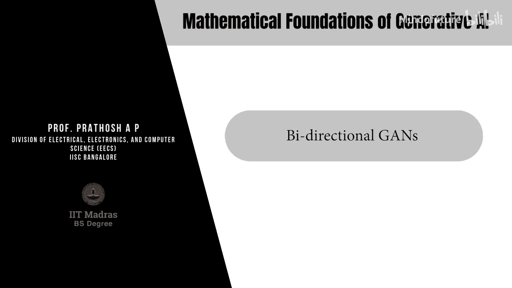
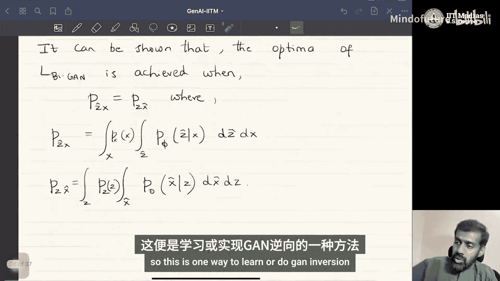

# 生成式Ai的数学基础 ｜ Mathematical Foundations Of Generative Ai p21 P21_W4L13-双向GAN -BV1fperz7EjK_p21-

🎼。

Now， the question is， let us consider how to do this。

 how to modify again such that the inversion that we just spoke of is possible Okay so first let us look at。

An approach called。Bdirectional G or by G。Okay。Now in a bidirectional G， so in in a knife G。

 what happens is that we have two neural networks right in a knife G。na gun。

There are two neural networks there is。The function G theta of z。

 which would take a vector from normal distribution and。

Map it to the data distribution and there is the discriminator network。

That would take data that would take points from data distribution and maps it to 01。

This is what we saw right So in bigan or a bidirectionalgan in addition to these two functions。

In addition to。The generator。And a discriminator。There is another function。There is another function。

G。The encoder network or the inverter network。Encodeder are the inverter network。Inverter function。

 what would this inverter function do， I mean one can easily guess。Let's call this E。废。衣废。

This E5 would take samples from the data space and。Mps set two samples from。The input。

Z space that is what the encoder function would do and it is parameterized by another neural network phi。

Okay， so if I write it。Dragrammatically， so we have。A generatorer function。

So this generator function would take。Data from Caus distribution and maps it to。

The data distribution。Okay， and here there is。Of course， there is a discriminator。

That is used during Gant training。And this would take。Data from either x or x cap。And。Marbit2。

The range 01 in a bike can， there is another network it is called the encoder network。그你。

I it a little far away， so that。Another neural network。Which is called the encoder network。

That would take。Data from x。So， there's picks。Comes from a Px and let us call this E P of x。

And this would give you a Z。Okay， let us say that this has let me call it Zcap and this has a distribution P P of Zcap。

So this is how one would construct a bidirectional plan now the question that is to be asked now is how do we ensure that this encoder network gives the Z that corresponds to a given x？

Right， so there is no mechanism in a knifegan training that would ensure that this encoder network would give you the z or the input vector corresponding to this a given particular X。

 So how do we ensure that So in in in the bygan formulation。The idea that is done as the following。

 the discriminator so in bygan。The discriminator or DW。Is designed。To classify。Between。

The data tuples。Of the phone。Tta tables of the farm。X干 on。G theta of z。2。Z comma。E phi of x。Okay。

 so what is being done here is the following that in a knife gun， what do we do the discriminator。

Discriminates between x。And exc。So in a knife ya。DW network DW classifies between。We have x， and。

G theta of Z。Which is also exccalate the points from the true data。

And points from the the two data distribution and the generated data distribution right that is what a discriminator does in a knife can in a in a by yard instead of。

Classifying or discriminating between x and G theta of x， the classification is between。The tuples。

 I think there's a mistake here。Theups of the following sort。 So we have x。And。

The corresponding output of。The encoder network and we have z and the corresponding output of the generator network。

So look at this， the tu of the one of them is from the data space。

 the other is from the input input vector space。And here。Okay， maybe the order has to be。Read。

 this is from。The data space G theta of z is from the data space。And。

Is from the gl space the question that we are asking is given a particular data point drawn from the two data distribution。

 I should write that so where。X is sampled from the X。And we have E phi。Of x。

 this is sampled from p phi of z。Okay， and。Z is sampled from norm 01。

And we have G theta of z a sampled from P theta。Okay， so these are the， okay， so we have。

 we've been calling the Z cap。 These are the four distributions that we have here。

 So the question that we are asking is， given a true data point。

 given a data point from the true data distribution。

Look at what is the output of the encoder network is or the inverter network is。So。

 group them together that becomes a pair the other pair is the generated data given a particular z。

 look what is the generated data。Okay， now what we want is that the distribution of the pair of these two random variables and the distribution of the pair of these two random variables have to match。

If that happens， then this encoder network would be sampling from this encoder network would be sampling from the same distribution。

Which the input layeror comes from Okay so that is the idea。

 So now the discriminator now will not take x and x ca， but will take the players of x。And。

E phi of x， this is one pair。 the other pair that it takes is from G theta of z。干嘛。四。Thats it。

 So if we have a structure like this where we modify a discriminator such that。

Instead of taking data points from the true data distribution and the generated data distribution。

 it take it would take pairs of data， kups of data。

 which would have one point from the true data distribution and the encoded data encoded the input。

Space and it has points from the generated data and the true input space then the discriminator has to discriminate between those two pair of distributions if we do that then one can show that this entire setup would learn the encoder in such a way that it can。

Correctly give you the corresponding input data point input vector give on a particular image。

 Okay that's the idea。 So let us write down。 what is the objective function that is。

Used here in bygan。 So we have an objective function， L bygan。

Now this would contain three parameters， the generator parameters。

 the discriminator parameters and the encoder parameters。 it has three different parameters here。

 and this is equal to。Li。Expectation。Of。Log of。TW now Dw takes two points， right，1 x。And你。Encod。X。

Okay， and the。So the inner expectation here。 The inner expectation is as。E P， okay。

 so let me use symbol。 So let's call。Z cap to be equal to。E p of x， okay。

 so this expectation is with respect to Z cap。Coming from。 So。

 and let's also say that this has a distribution given by。P P of G， as we are being saying。

 So this is coming from P P。嗯。There is an outer expectation as usual， which is with respect to。

E of x coming from px。 this is the expectation that we anywhere had in the the G formulation。

 and we have the second term， which is。Log of。1 minus。Dw。Here we have。G2到 z。讲嘛在。With。

The expectation of x is x r。Okay， let us call this。X cap as usual is equal to g the of z。

 and that has the distribution P theta of x cap right that is what we have been using So x cap comes from。

P heat off。 So this is。Nothing but x cap and here this is nothing but z cap。Okay。

 so now x is coming from P Tta， and then there is an outer expectation with respect to。

Z that is coming from pz and what is Pz。No，B Z。NowZ is sampled from p that is equal to normal 01。

 I mean， in our case mostly it is equal to normal 0。 So this is the last function that is used in a。

Bdirect again。 So now what happens is that。This entire。

Lo function So what is the this is the loss function and what is the optimization problem that we will be solving here。

We want this entire thing to be。Meni waste。With respect to the generator parameter theta and the encoder parameter phi。

 and we want this to be maximized with respect to the discriminator parameters W。

 So now what happens if you remember how thegan was trained here。

 all three networks are trained simultaneously in the sense that。Start。

From sampling a particular Z and then you get X。Pass it to the generator you get x cap once we get x cap。

 we get z comma g theta as the pair and we take a particular x。From the data。

 pass it through the encoder network， you get the Z cap now take the pairs of G theta Z and z and x comma E5hi of x。

Give them to the discriminator and then back back propagate the gradient。

 back propagate the gradient just the way we are training the gun。 Okay， here。

 the G T network and E fee network are。Traed simultaneously using the discriminator where one gradient pass。

1 gradient passes through the generator network using Z and X cap。

 There is another gradient pass that passes through the encoder network， using x and。Zika。

 that is of the vibrationration of again is trained， so once trained once。A began strain。

The generator network， G Cta star。Is used。Fult。这个雷神。And Y free star。Of x。Is used for inversion。Okay。

 so once trained， what can be done is that。Given a particular Z。

 the GT network would generate an image just like the usual generator。Given a particular x。

 the E network would give you the corresponding input vector for this particular x using the encoder network。

 Okay， that's what happens。 So now why should this work。Let me just tell you。

The theory is a fact and then I will not prove that so what can be shown us？It can be shown。

Can be shown that。The optimal， optimal。我我点啊。off。The loss for Bikan。This。What。问。

The joint distribution between。Let's call this P。E X， or， rather P。P Zcap x。Its famous。B。Z， X cap。

Where。P Zcap x。Is equal to。The joint distribution between Px， the true data distribution and。

The distribution that the encoder is imposing。The encoder is imposing a distribution P cap given a particular x。

We have B， ZC， D， Z， Dx。And we have P Z。Excap。Is the distribution。That the generator is imposing。

 which is traces over x。This the gap。We have P Theta of。X given Z or P the of x cap given Z， we have。

D Xcap and B。 so this can be shown that the objective of byan。

Will achieve its optima whenever the join distribution between the encoded input and the true data is same as the join distribution between the true input and the generated data okay and these are the join distributions that are so this is。

P x， I can write that red this has Px。Avald an x， and this is P Z evaluated at a particular Z。

So this is simply the。The law total probability that would write its un distribution in terms of conditionals and marginals。

 Okay it can be shown so what is happening here is that if we train bidirectal again this way that。

Then the joint distribution between the generated data and the input latent。

And the joint distribution between the true data and the。

Encoded input vector R the input distribution is also referred to as the latent distribution at times。

 So the joint distribution between the true data and the encoded input vector R the latent vector。

They would match。So when that matcheses then what happens is given a particular input vector or input latent vector it would generate a data point and given an input data point it would generate the corresponding latent vector or the input vector that would have generated this data point using this。

Generator network Okay so this is one way to learn or do gain in version。

