# 生成式Ai的数学基础 ｜ Mathematical Foundations Of Generative Ai p22 P22_W4T7-教程-Bi-GAN的实现 -BV1fperz7EjK_p22-

。

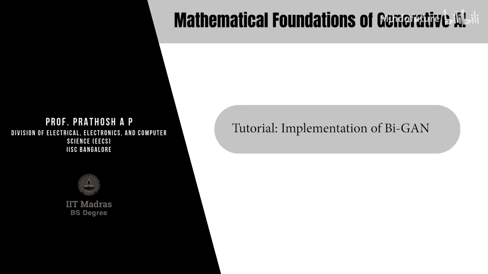

Hello， welcome to this crettorion。In which we shall be。Discussing the ideas of bidirectional can。你看。

So let's start。Byデ的。Bdirectional can， also famously known as the。The bike can。So now in the naive。

Vanilla G formulation。 Now， you have your。Generator network。Now， which will take input from。

An normal distribution。噶。Now， it will take Z。That is the latent dimension and then map it to the。

Image， image， image space，And then you have your Cri network。Which will take the input。

 either it is a real data， real image or the generated image。And then it will map2。0 one。Now。

 this is a formulation in the。In the nave gang。Now， whenever we look at the idea of inversion。

 that means that you want an embedding。好的。So。For your image， Okay， now， you know， we will be looking。

Into the idea of bidirectional game。So now in bidirectal G。

 what happens is now you have your generator network。Now， which is from your late in dimension。

To your image space。And then you have encoder。Okay。Now。

 which is from your image dimension to the latent dimension。

And then you have your Citique network which take。A combination of image dimension。

And then the latent dimension and then maps it too。0，1 now this is the。麻病。

In by gap now this encoder that you will get。Now， you will be able to get the。

Encoded information properly。 No， that is hope Now you will be going ahead with it。 Okay。

 so now what happens here is now。You have your network。You have your input Z。From normal0 I。

And then you have your G theta， just your generator network。You will not do。If you don't know。

 which is your。Generated image space。Okay， and then。You haven't。Encoder。Let's。Take this encoder。

You have this encoder。And it sticks。Input， which is your real image。

And then now it will try to learn how to get the embedding now this is the generated embedding。

Which is parameter his by E。Okay， now I call it as。Encoder。Which is paraized very feet。Okay。

 now this is only done for your real data。For generated data anyhow you have already you have the encode coembedding or the latent value is already present。

😊，ok。😊，So now and then you have your critique network。She。You have your Qique network now。

Now Criique network now will take pays now。😊，Now you take x and then the embedding that is obtained for this x。

Okay， it takes the pair of。The input， and then it's embedding。A。😮，It takes the generated image。😊。

And it's eming。Okay， and then it should be able to say to which domain it belongs。

Now earlierli in all of our things now either we used to take x and x hat now in addition to x。

 now we take the generated embedding okay。That is the reason why I only generate it for only the real images and then the generated images which I get from my generator network with the。

Embbiddings， latent dimension that has been passed toward。Now it has to differentiate between。😊。

This pair of values now I'll just modify my loss function accordingly。Yeah。

 you will have your saddle point problem as it is， just ride the loss。You have是。By gang laws。

Now you have three networks， one is parameters by theta， the other is by W， the other is by phi。Now。

 how do you get it？You have you。Outler expectation now with respect to the。Real data。

And then you have your inner expectation。With respect to the generated latent dimension。So log off。

The C network parameter is by W。X comma。E phi of x。It should be evident this E P of x。Is this C hat？

O。this与 I。Now， the other thing。You have you。After expectation。C。Normal0 I。

And then you have your inner expectation。With respect to the generated data。Then you pick log off。

1 minus。DW of。G Theta of Z。And this is me。Next slide。Okay。😊，So now you can understand that， okay， no。

 no， this is similar to the。The naive G training。Okay， you are passing x and。Zbar together。

 now that means that the input dimension of this cr network will change。Okay。

 and then you have one more your encoder network， which take image。The generator oh sorry。

 the real image as an input and then it generates a。Latnt dimension okay。

 it generates the latent value in the latent dimension Okay。

 so now lets see now how does this work in coding。

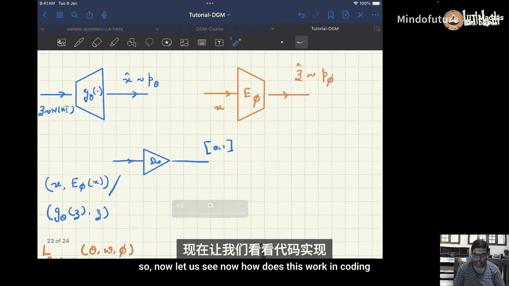

Let's try do that。I assume that all these。Things are pretty much comfortable to you。

You have the device， bad size， latent dimension， epochs， and then the learning rate。

 you have to train it for multiple epochs okay。So， and then now。

You have your transformation and then you obtain the data loader。

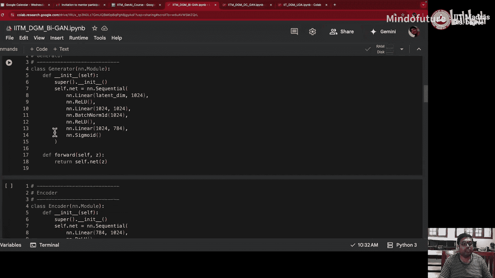

Now you have got your generator network， Okay， so now if you look at the generator network。

 now this is。The latent dimension and x1 now that is if you latent dimension is 50 50 to 784。

 okay now that is what the transformation should be okay latent dimension to 784。

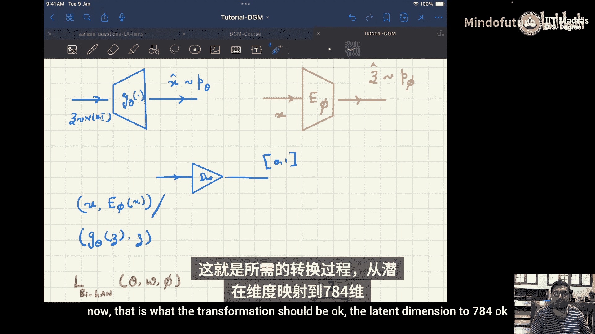

Okay。😊，So now。And then you have your encoder。

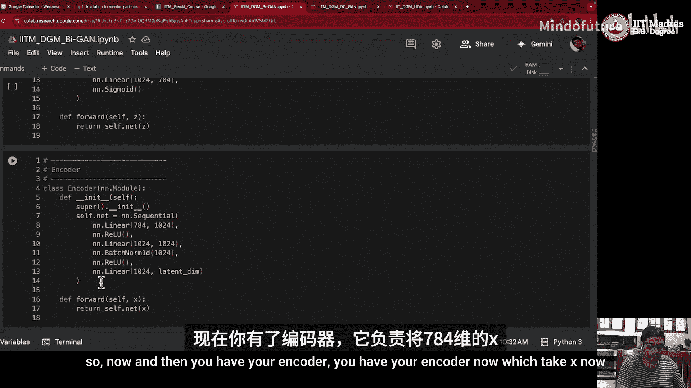

You have your encoder now now which take x。Which is in 784 dimension。Do的。

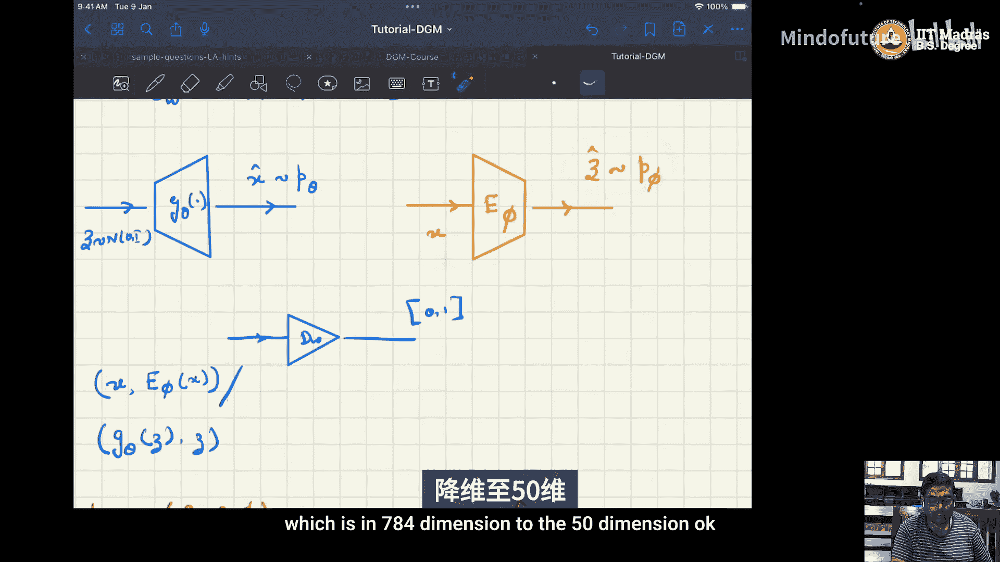

50 dimension， okay。So now 784 dimension to latent dimension and 50 dimension。

And then you have a discriminator your discriminator network。

 now how does your discriminator input now this is 784 plus 50。

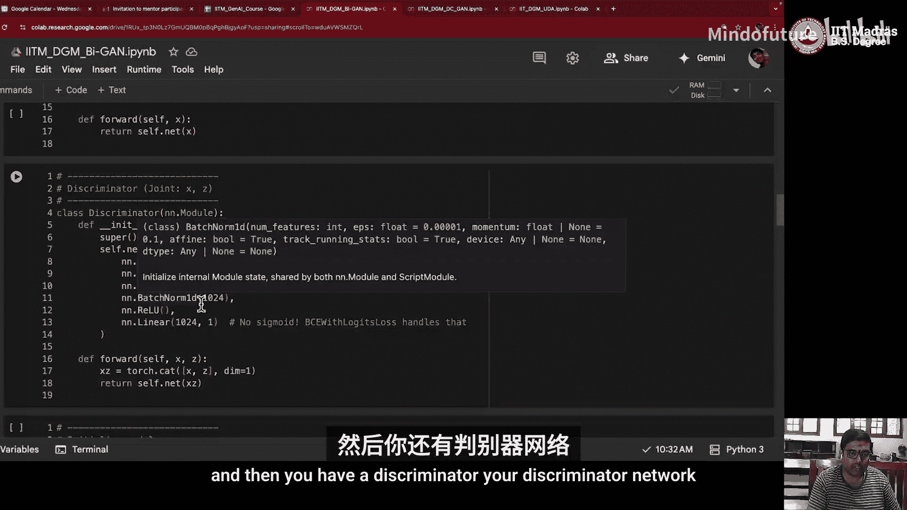

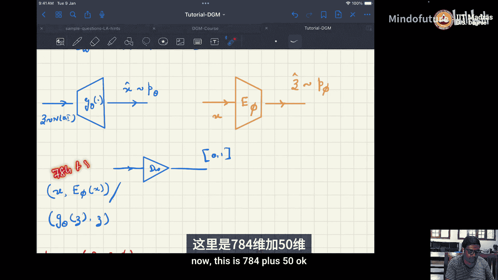

Okay， that should be the input now。So84 plus late to mention that your。

Converting into 124 yeah now this is how should be the transformation and all those now you can manage。

Okay。😊，Now， you get x and z separately， you concatenate them and then you pass it into the network now this is your discriminator network。

O。Yeah， you create instances of them。And then the loss that we will be needing is BCc loss。

You create。Two parameters， two optimizes。 Now one is for。

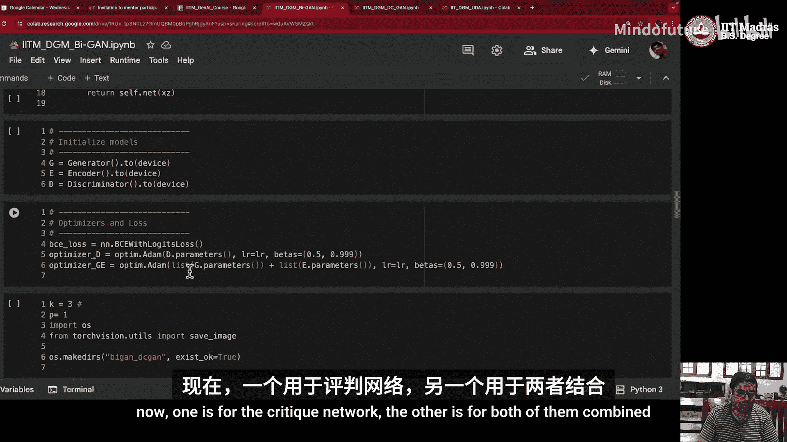

The critique network， the other is for both of them。

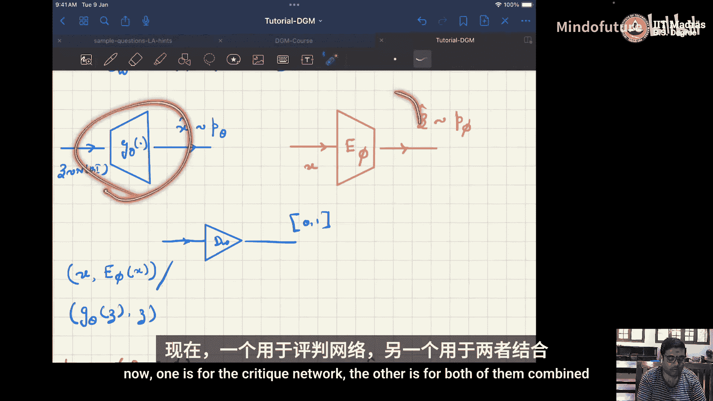

Combined。O。So， now。Yeah， and then you store it in by again okay， have okay。

 it is not DCc again I just used by again。Yeah， so now let's look at the。

Iea of running the training group okay so now first you are training just the discriminator now because of this your generator and the encoder are both of them in the evaluation mode okay so yeah。

You should be comfortable with first， you get the train loader and then you get the。X real。

 first you pop it onto the device。And then you get the serial okay now those are the random things that you have got the random values which is same as the number of elements now in your one batch now whatever the batch is that we have considered。

Okay， so and then。Let us try to understand the discriminator loss okay now discriminator loss has two parts now one is x and。

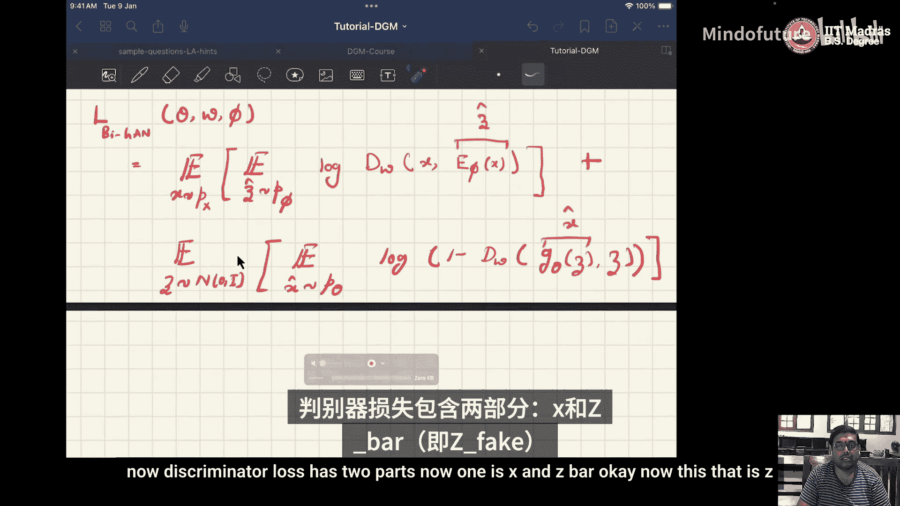

Z bar okay now this that is z fake now which is your encoded value when you pass the x real into the encoder you get the z fake now that is z z generated let's not call it fake that is generated okay and then。

You get the z real now y it test cholesterol that is actual value now you pass it through the generator now you get the。

😊，geneenerated values now here fake means generated okay and then what do you do for the d real the value of the discriminator real now what is that you have to pass now now you have to pass。

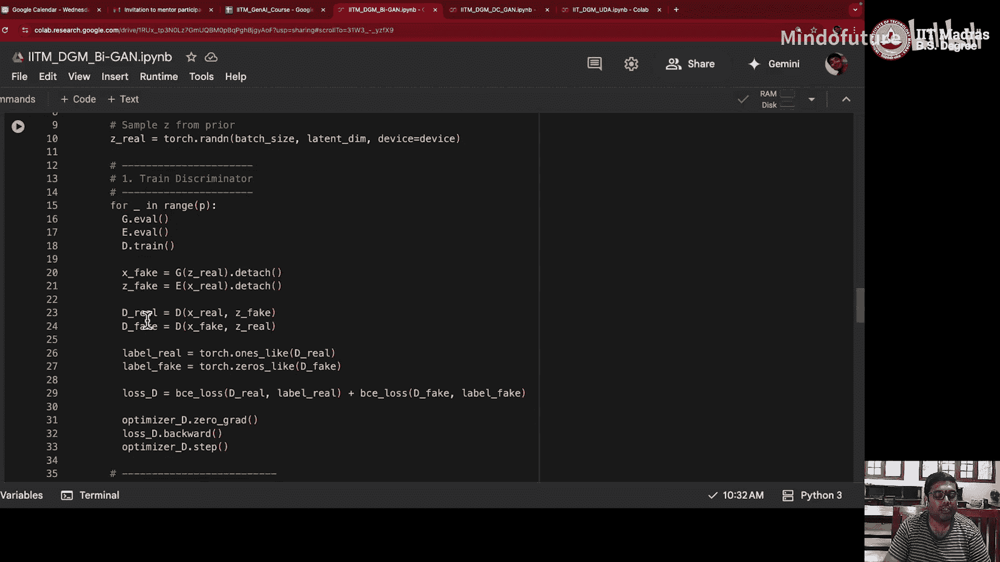

X and then the Z cap now Z cap is given by Z fake in our case， now you pass these two things。

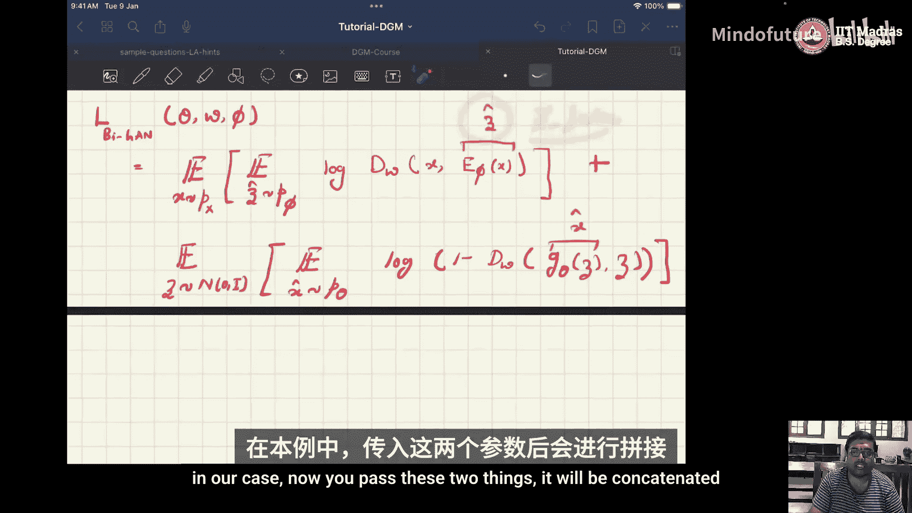

Okay， it will be concateed and then pass it through the network to get the defect fake that is this value。

😊。

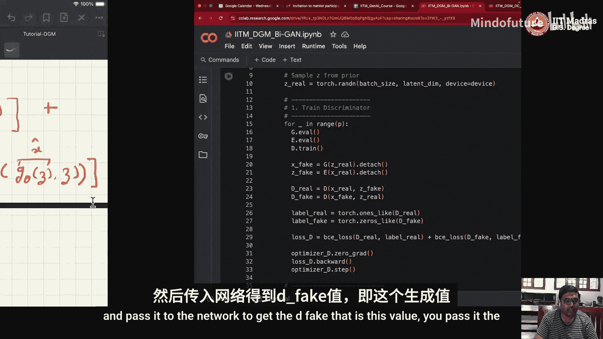

You pass it。

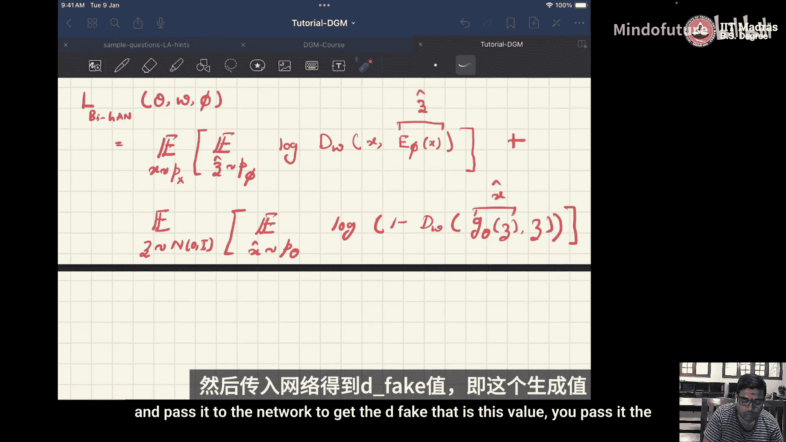

The generated value and then the0。You get do。Generated which is xfi and then the zero。

Okay and then you get the labels now this is the discriminator value you have got。😊。

And then for real now you make all ones for the fake you make all zeros and then you take the bc loss of them okay why do we take the b loss we have discussed it earlier for D real you pass the real labels or d fakeake it was the fake labels and then you will be able to obtain the loss and then。

You back propagate it， update the values now for training the。Generator and the encoder。Now。

 you please。The generator and the encoder in the training mode and then the discriminator in the evaluation mode and you follow the similar structure and then back proppoate and update the reach。

And then you finally generate samples after some epos， Okay， and this is how。就 dream。The invention。

The late inversion that we have been discussing in the bygan there was one mistake that I didn't see earlier now you have to have a tan h here this was one mistake that was there。

Well， please。Change that this mistake has been rectified in this thing Okay。

 now with this now we will complete our quo discussion on by again。See。

 main aim of these tutorials is now given an equation。

 how do you transform it into the code okay I hope it was helpful， thank you。😊。

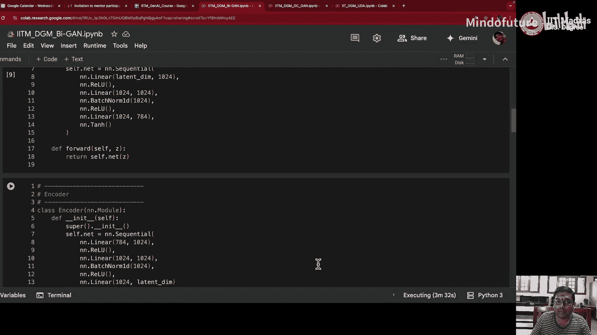

