# 生成式Ai的数学基础 ｜ Mathematical Foundations Of Generative Ai p23 P23_W4T8-教程-UDA的实现 -BV1fperz7EjK_p23-

。

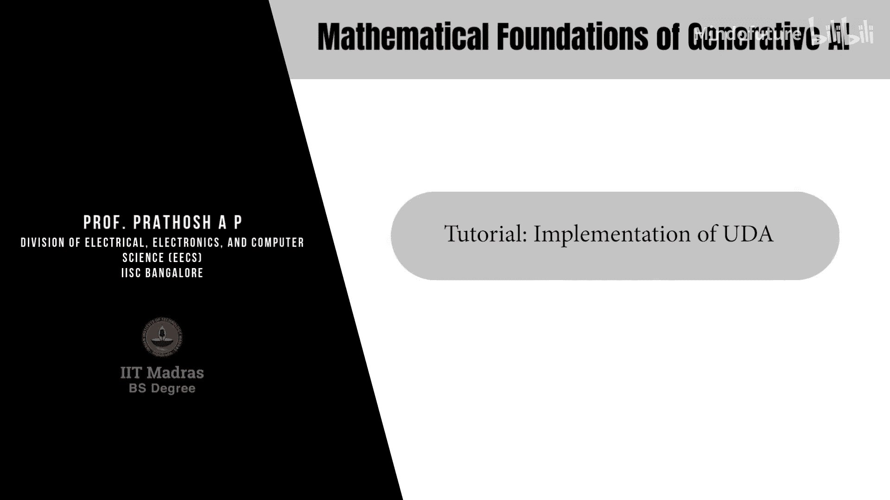

hello好。Welcome to this tutorialtorium。In which we shall discuss on the idea of unsupervised domain adaptation。

Okay。So， let's plunge in。No off。I'm surprised。Cons domain an adaptation。Using advers around。

我就 famous个有。Yeah， so what is a problem statement here？So you have your source。Doomain。

You have your source to mys。Now we are dealing with a classification task here。

Now very in which you have X。As well as Y Ie。Photo。😊。

Given set of examples and these are sampled IadD from the distribution pe source。

And then you have data distribution data t that is your target distribution， which only has the。

Images which has doesn't have the label and this is from a distribution P。Okay。

So now what do I want and then and then okay in addition to that， we know that this P is。

And PD are not same now they are different distributions。So now what is that we want？😊，Now。Now。

 we have been given。Ds and D。Learn features。Learn features such that。It performs。

 we can perform the classification task。It performs。Well。Bt on。B。嗯。😮，Pity distribution。

 that is the idea。Now for this， now we take a simple data set now we take。Emist。好。

And then we take one more dataset set， which is。MN m now this mN M is a three channel database or a three channel data set okay so 3 d means something else so it is a。

😊，To the channel。EminIS is one channel。Okay， what happens in Mist Ms now you have a number in the foreground and then there is a colored thing in the background。

Okay， so now。In MN you just have the black and white images so now what do we do to work with this now this also we convert into three channels。

Okay， this anyhow has three channels。Okay， and then you try to extract the features。😊。

Using a featured extractor。And then by looking at those features。

 then we will to decide which class it belongs to。😊，Okay。

 and the features that we get now should be invariant okay now it should be able to recognize mn also now it should be able to recognize the mist m also。

😊，This is the idea and let's try to formulate it。No。I have a。Feature extractor。

Have we would expect it。To which you give x and。Exact okay from the source domain and the target domain you get。

Fs and FT features pertaining to source domain and pertaining to the target domain。Okay， so and then。

Now， and then using the Cri network。Using the Criitique network。

 now you should be able to differentiate。between know whether it is from the source domain or it is from the target domain。

 okay， now we should be able to differentiate whether it is from the source domain or target domain。

Now this is similar to the idea of adversarial training that we have been doing now comes an interesting part。

 an additional part。😊，Which is the label classifier。We will use this label classifier。Which takes。

The input。Of F S only， okay。What is your label transfer for to be。It will save y。Okay。

 it will give you y now which is P， now which is y given Fs。

We will be able to predict to which class does it does the input belongs to now given the features。

Now we train this only using the features of source。😊，那。😊，So and then during the inference。

 he'll be giving the features of the。F T， okay， so so that it should be able to tell the tell the。

Class of it now if my training has been if my adversary training has been done proper my Fs and Ft now will be similar now because of which I will be able to。

Recognize the class of。The target domain examples， now this is the idea。

So now how will my loss functions will look like？Now let's try to look at that now。You happy。

We have P star and then the W star R。Amen。With respect to fee。N max W。嗯。Your expectation of。From the。

Source space。Logo。The W of。Eice。ok。This is the first time。Plus。Expectation。

With respect to the target space。老公。1 minus。DW of F。Okay。

 now this is how you get your feature extractor and then the。Criique networks。Great operation。 Now。

 how do you actually get here。Label classifier thing okay， now this label classifier。Now for that。

 now we know that now we should be using。Now C， of。The actual la。And then what Ill be getting。

From my。Feter extractor。 now that means that not this。Vhan。Okay。A we enough。Seeee。And was a bullet。

Now， why now how do you get this Fs now to get this Efs you have to go through this。

Fe network the feature extract network right so what the parameters are there。ボタ damage。ok。😊，Now。

 these are the。Two losses now that I will be looking into so now it is evident from these equations that。

My featured extractor， the parameters that my featured extractor has。Actually have two objectives。😊。

It actually has two objectives。 now， what are those objectives， the first one is the。

Adversarial objective。The first one is the aversarial objective。好的。😊，The second one。Is your。

Classification object。Okay。So what do you mean by your adversarial objective see the idea of your adversarial objective is。

😊，So now you should the domain classification now that is your crique network the loss which it is having now the aim is to confuse it the confuser the critic network so you have to maximize that loss okay you have to confuse it so you have to maximize the classification objective you you have to minimize the source label loss okay these are the two objectives that yeah。

😊，啊对。So now let's try to understand here。No。Now we want our featured extractor。是。

We want our feature extractor。To make hard。For the Roman classifier。是是。What the domain classifier。

To tell whether it's a。Sours are is it from？タルベト。O。So no。Now the gradient now that comes。Okay。

The gradient that come from the domain classifier。Now will be used to update the feature extractor。

This is known to us。Okay， the gradient that comes here is used to update feature extractor。So now。

 now what is that now we want to do now， okay， now let's try to understand the flow of this。No。

What we do is。No， we flipped。What do you mean by we take the reverse of it。

 we take the negative of we flip the。This is the gradient。From the domain classifier。She。When。

When updating。The feature extractor， now why do we do it？This is called as gradient reversal。啊，干。No。

Now， if we don't actually do it。What happens is if we don't do the gradient reversal now then。

The domain classifier gets really good at detecting them。😊，The source。Okay。

 and the feature extractor learns not just。😊，To get specific for the source。

 it will not be able to generalize well。So now what we do。

 we actually flip it up so that it doesnt do the job okay now。She。IfWe do not do。Graaddient reversal。

Yeah。The domain classifier。个起。Good。哎的。Detecting source。啊可。😊，And the feature extractor。L者。

Doomain specific features。It learns。你都明啊。😔，It lands domain for specific features。

Which will not be able to generalize。She。Which won't generalize。O。😊，this will be the problem okay。

 so now let's try to put all of these things up into the code and see how this actually happens。😊。

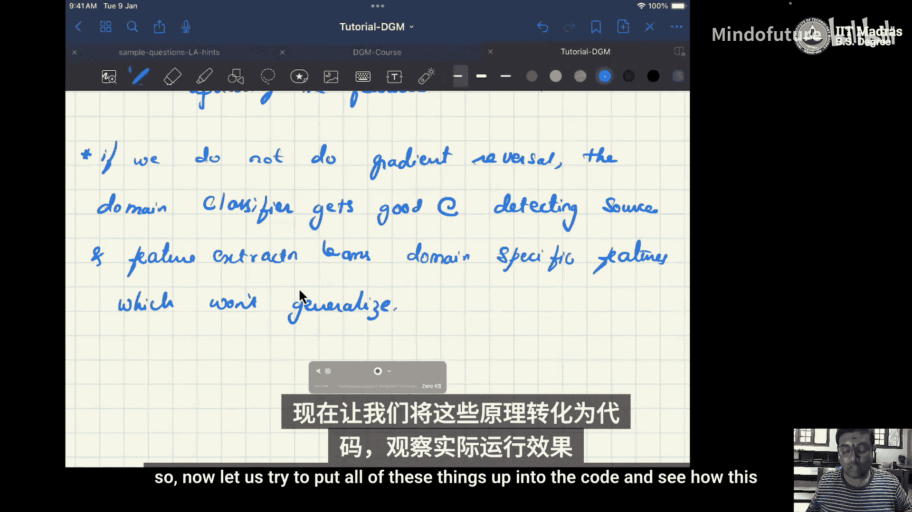

Yeah， I have used all the3 packages。Now， this is interesting this transformation is what is interesting for us now why now because I am repeating。

This thrives the same data， the one channel data which is there I am repeating it thrice now why because my target data is actually a three channel data now if I convert it into one channel that will also work but this is one more way okay I am converting 12828 32828 by repeating it ths okay。

😊，So， and then I have the。M ST data and then I am creating loaders for both of them okay and this how be normalizedize it yeah you should be we should be knowing it by now and then I just printed some examples for you to just look at okay this is the difference。

😊。

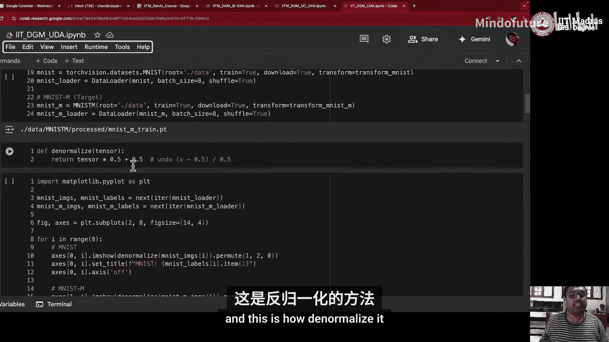

Okay， this is MN M1。Yeah， it has to be much more properly printed but anyhow。

 so Mist will be able to see that now now I should be able to learn representations now that are actually。

Invariant for the domain， I should be able to。Learn it using MN and then we should be able to work using the。

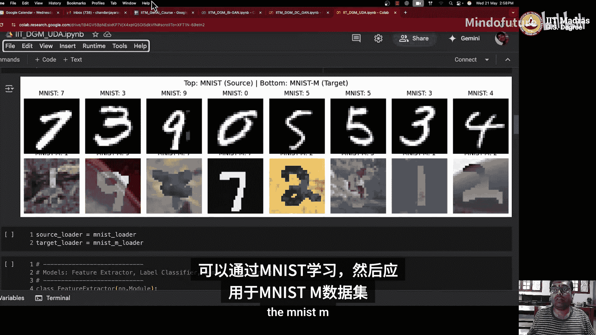

Mist time okay and then I have created the loaders for both Mni and Fmist I' am calling it a source loader on the target loader This is my feature extractor now my feature extractor will be a。

😊，Convolutional network okay you can increase the depth of the convol network the results of fine or if you want to use just the MLP a results of fine no problem now you are given an input now your image is the input now lets go back and try to understand the featured extractor now here the input for the featured extractors are images now from the images you get the features。

😊。

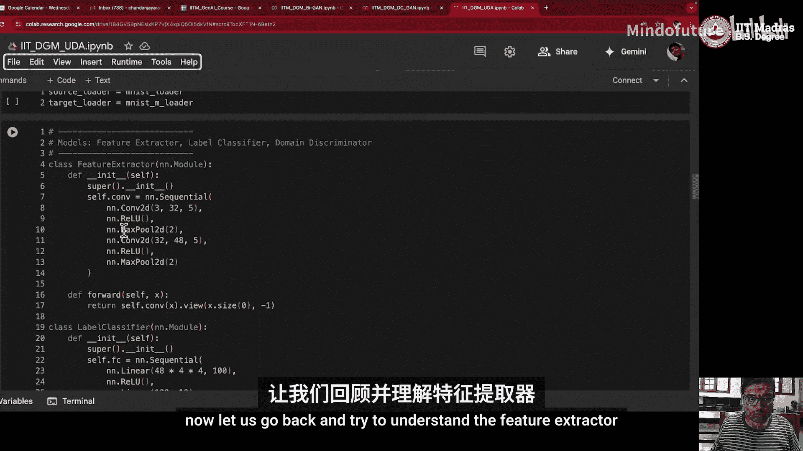

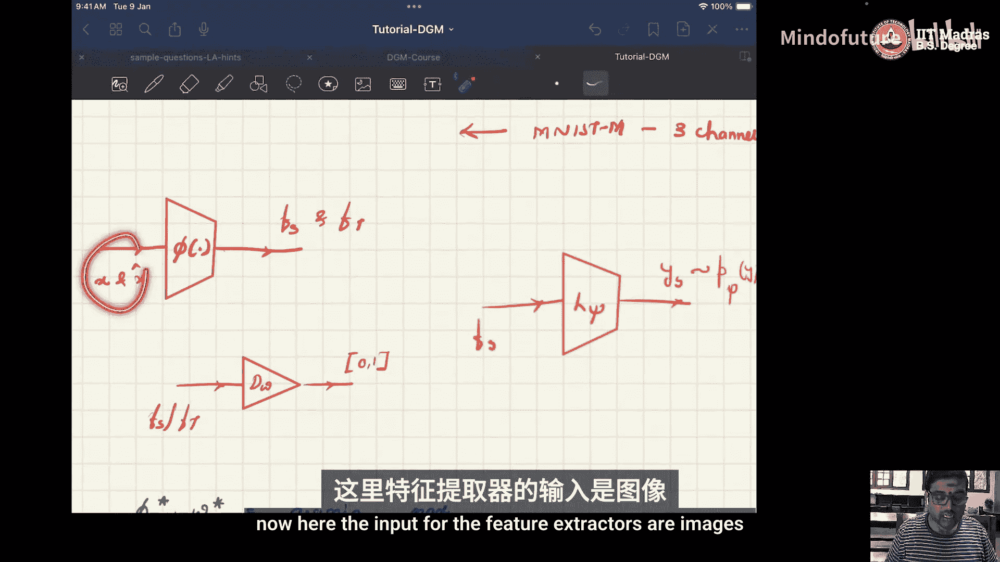

系嘅。😊，So you have got the featured extractor。And then the label classifier now label classifier will get the features okay now both the source features and the target features will be of the same size。

 but it only take the source features and then it will be able to say that to which class it belongs so now this is the label classifier and then you have a linear layer finally which is mapping to 10 now y 10 or because MN is a case in which you have 10 classes。

😊。

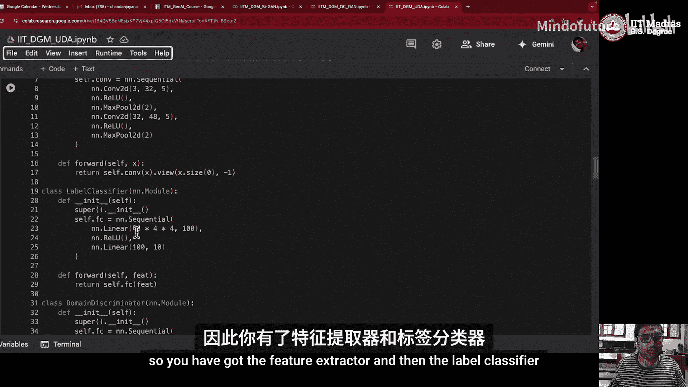

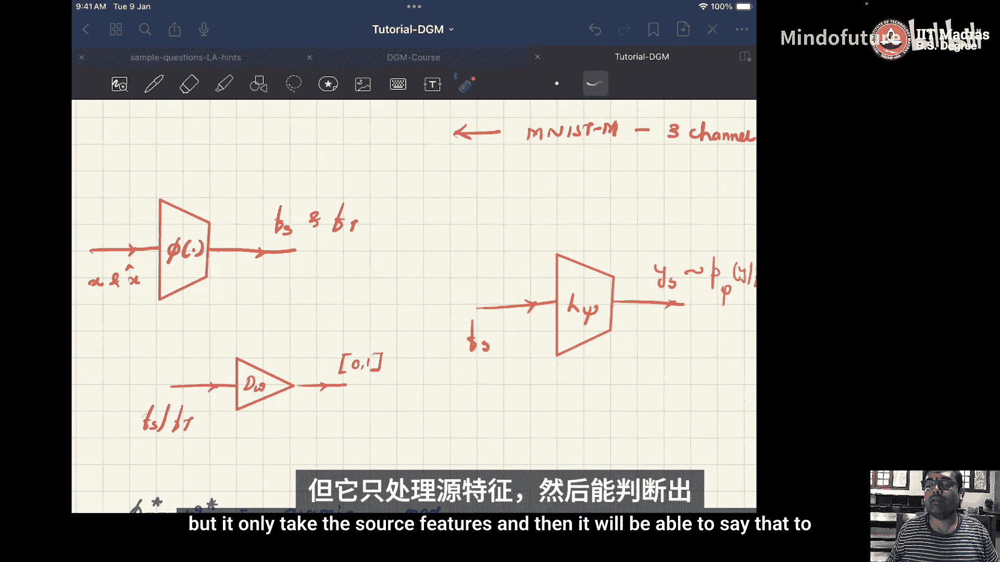

And then you have your domain discriminator， which is your critic network which will take features from the source domain or from the service target domain。

 and then it will be mapping to01。😊。

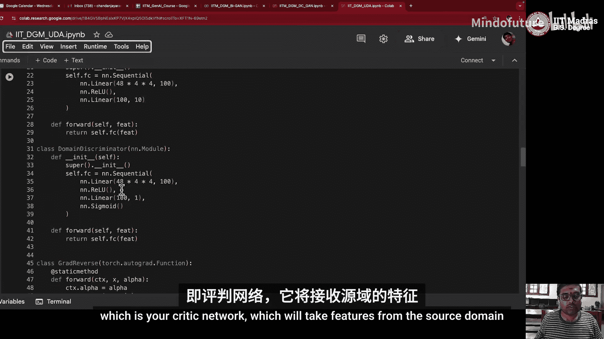

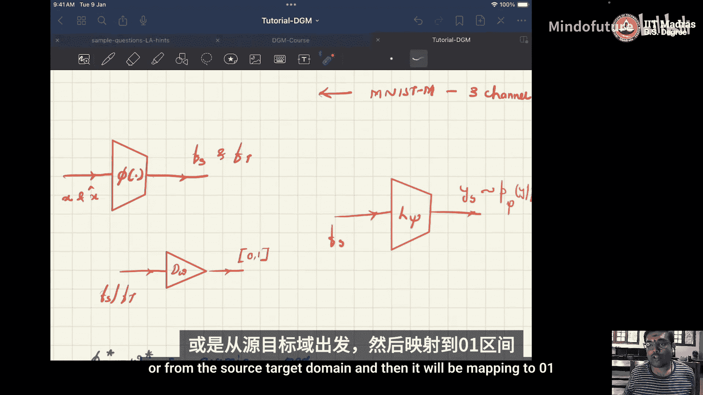

Okay， so final linear will have1 and then help us and this is my gradient reval method Okay now you can see it here now。

😊，It has。Two functions， two methods， now one is the forward and in the backward。C。

 okay now lets try to understand it from the backward so whatever is the gradient output that you are getting you are taking the negative of it Okay you are basically reversing it。

And whenever you are in the forward propagation， now it will work as an identity。😊。

Okay it will work as an identity function now that means that whether it is there or not there the forward propagation will be unharmed in the backward propagation now whatever the gradient you get that will be reversed okay。

😊，What do I mean by that， let me diagrammatically explain it。

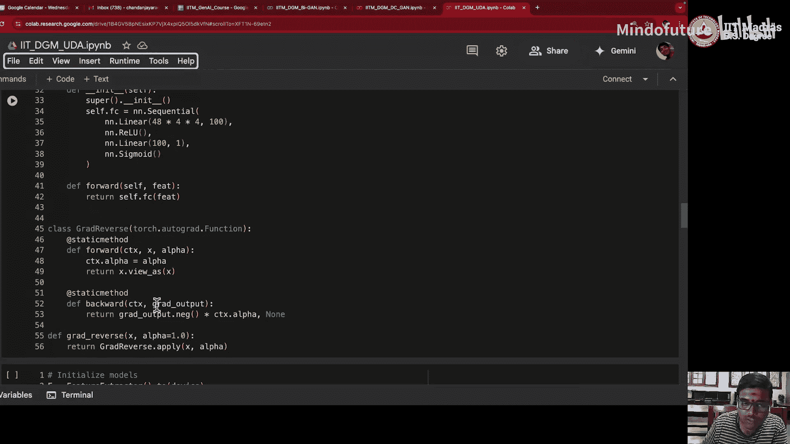

No。You have a block， okay。You pass x to this you got x out okay now this is your forward pass in the backward pass now if you pass y okay if you pass y the output will be minus y。

Okay。😊，So now in your forward pass， the values are unaltled in your backward pass the gradient reversal actually happens okay this is the gradient reversal block now that we have written there。

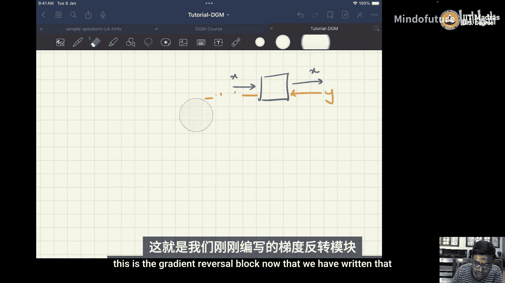

Okay。Now， going back， let's see how all of them。Bring together so now you have all your instances of all your models。

And then you have your criteria for the class discriminator has to be a CC because it the 10 class problem so you cannot use B B is preferably used for a two class problem and then in your feature extractor and then the class classifier class classifier problem so you have your parameters of F there is a feature extractor and then the classifier the label classifier C all those parameters are put together and then your discriminator it standalone now here it is interesting。

😊，Now how the training loop actually happens。Okay， now you put all of them in training， okay？😊，反。

Now here you are getting your target iterator， okay， your target loader is there fine， okay。

 you are creating a load you are creating an iterator out of it， Okay， fine good。So now。

You get things from your source Okay and then you put it on the device and then the next batch now this is why I have put it in try and expect block Now you try so the number of examples in the。

Target thing now maybe less than or more than what is there in the source now that means that you cannot directly take it like the way in which you take the source Okay。

 so now you just need the same bad size okay now if it is there you just get it。Now。

 if the loader the number of examples has been exhausted then you reinitize it and then you get it now for example what do I mean by that now lets say that in your target you have only 100 examples。

😊，Okay， and then。You have to take so 30 examples in each batch okay for one batch you will take 30 in the another batch you will take 30 in another batch you will take 30 now for the fourth batch you only have。

和电。Okay， so now if you just take it now what happens is only 10 will come now that may not match with the size of the source now then you reinitize it and then take 30 from that。

😊，Okay， now that is the idea now then you put the put it onto the device and then you concateate both of them okay now you pass both of them through the feature extractor。

😊，And then to the label classifier you only pass the source now that is the reason why you are taking only from0 till now what is the size of it okay now first okay now to understand this。

😊。

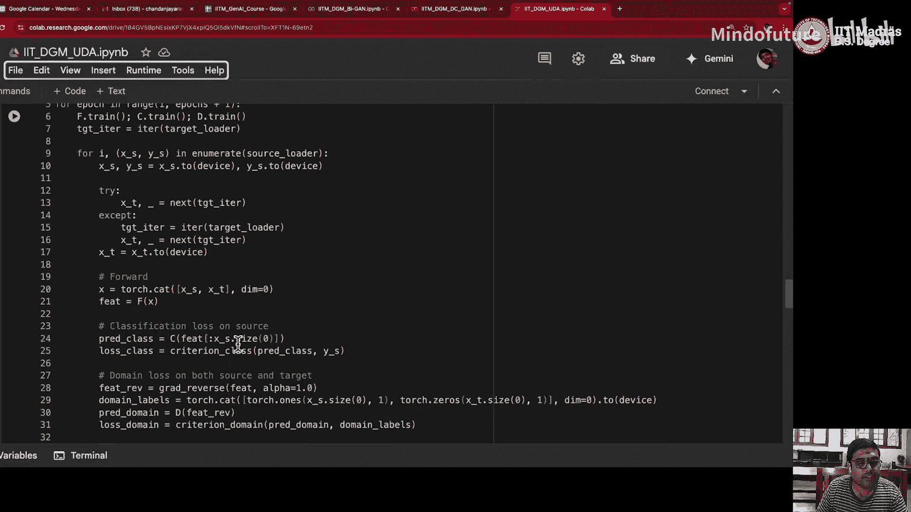

Let's go back here。You pass both of them put together okay you put together you pass both of them okay so now you will have your FS and then Ft now you only want to extract till Fs now from0 till Fs I will extract and then pass it to the label classifier is what I am saying okay。

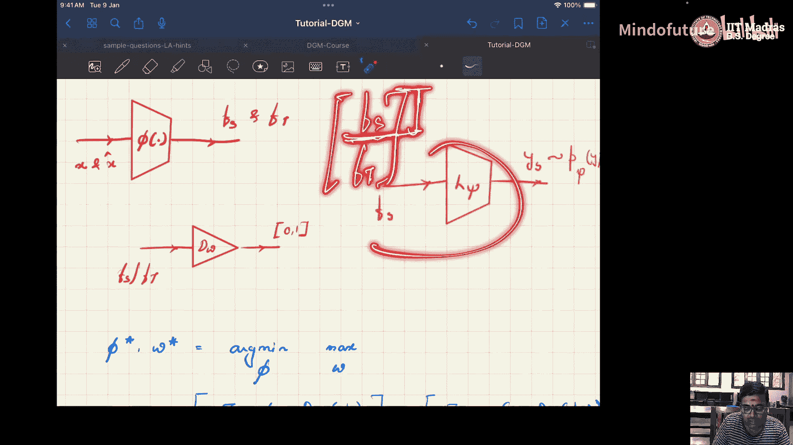

Now you'll pass it through that and then you get your loss further the。

A classifier that is your label classifier。Okay， now then now then what you will do。Now。

 whatever features that you have got？😊，You pass it through the grade In， okay。

 so now now now let's try to understand this。No。那 you have越热。Feature extractor。I got this。

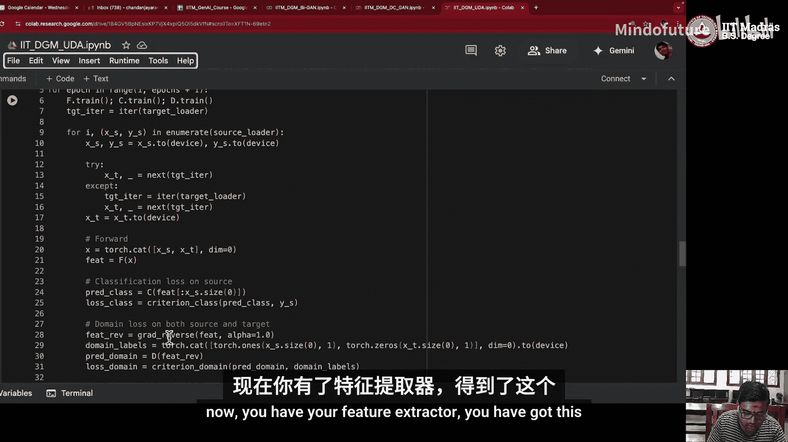

Okay。You have your feature extractor。And then whatever source features that you have got。

You pass it through the gradient reval。Now， you pass it through the gradient reversal now since it is the forward pass now what will happen is the output of this。

Now， it will be seen as that of what has been given the input we have seen this a gradient reversal now in the forward class will just work as an a function you just send it out。

😊。

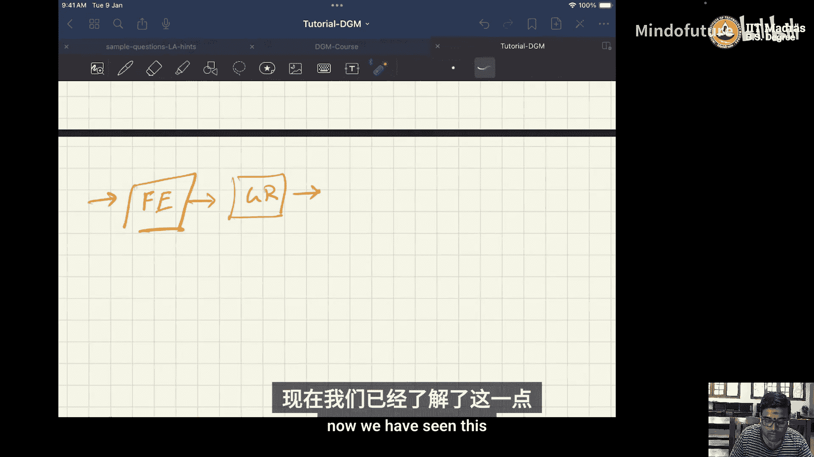

Okay fine and then you get the domain labels now if you want to get the domain labels so what you will do you just take the size of x s that is a source and then you put all ones x you put sorry x you put all ones and sorry x s you put all ones and x t you put all zeros and then that will be a domain labels okay and then whatever is the output of this。

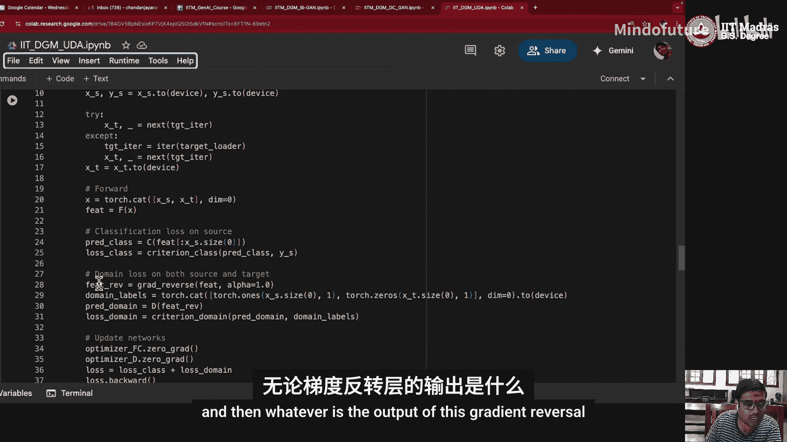

Craadient reversal of this thing， whatever is the output of this。

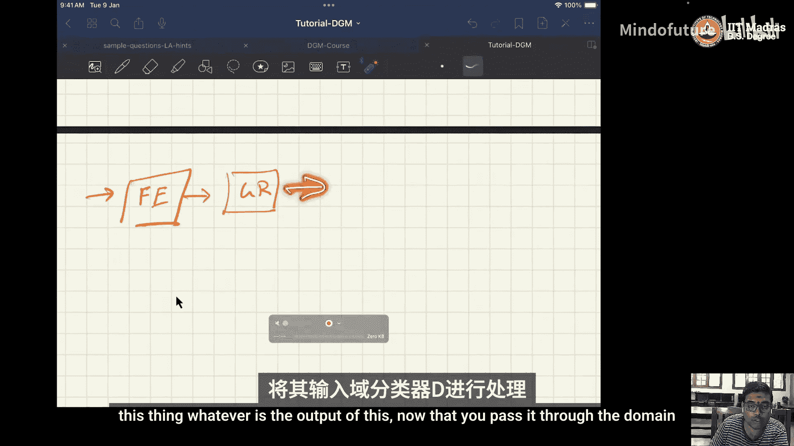

Now that you pass it through them。😮，Bmain classifier， okay that is your D。

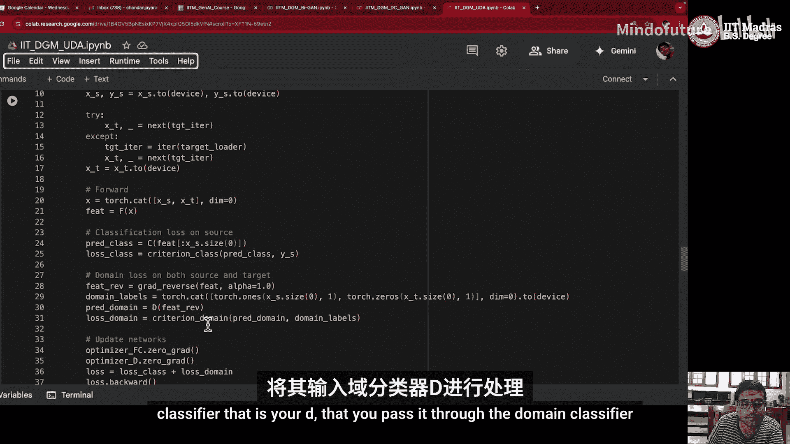

Okay。😊，That you pass it through the domain classified。

So now while it is passing okay now you have got it now the gradient universal work an identity and then you get your outcomes now then when back propagating now you get it here and then here what will happen now here。

😊，You will be reversing the gradients and then you will be passing up。Okay。

 the gradient will be reversed and then it will be passing through the feature extract。😊。

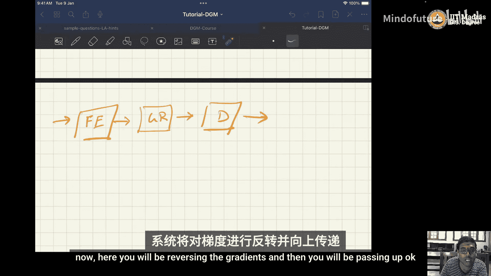

Okay。😊，So then you pass it through the。D okay， and then you calculate now that is your bc loss and then you update those the similar things okay。

😊，So。And then yeah I have done it for you， so I have done all of this。

And then how do you evaluate your target now now finally post training now how do you evaluate now you get your features okay。

😊，You get your mN you get the test data of mist m this is you are getting a test data and then you put your feature extractor and your class classifier both of them in the evaluation mode and then youject take the test loader you get the features and then pass those features through the。

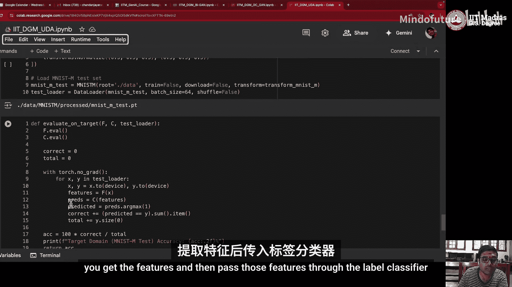

Clas class label classifier。 Okay， now what do I mean by that during inference now what you will do。

You take the S loader， you pass it here。You get the test and then you pass it through the label classifier。

 you get it。

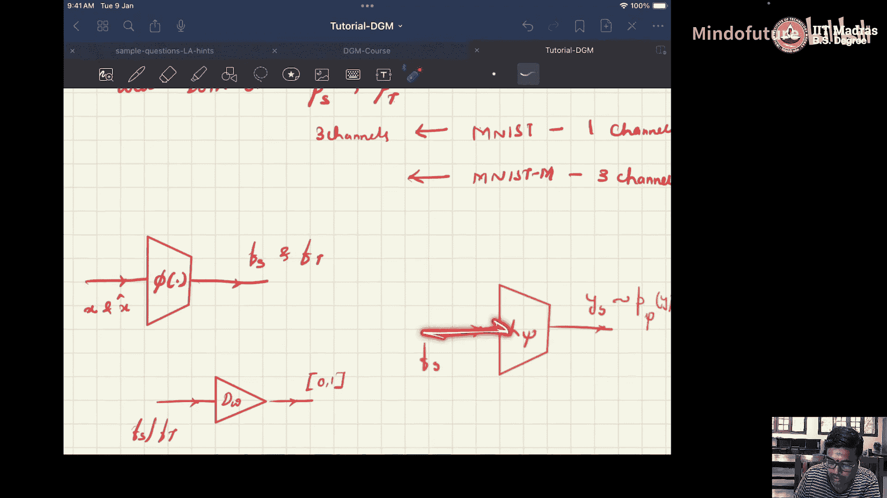

你边 o。And so we have evaluated now we have got an accuracy of 75。8 okay。This is hope。We work with the。

UD unsupervised domain adaptation by using the idea of。The。Adversarial training， okay？

So now in addition to that we also looked into the FD score so I just want you to give a rough idea of it I just generated some from using DC again I just generated some 1024 samples okay and then what I am doing is have written the code。

😊，放啊。The。Computation of FD scores now how do you compute the FD scores now let's just go through this once and then you can use this code as a standalone thing for calibing in the FD scores in your coming things also okay so now。

Yeah。做。And the first thing is。😊，You take the pretrained inception net。

All those necessary libraries and this is the pre trained inception net。On I at 1 k。

 I have just taken， and then I have chosen the。Some layer okay after 7 c。

 if you look at the inception net thing will be clear now I have taken that as the that is。

2048 okay that as the representation okay now there is no need to take it 20 for it you can take it at anything in between now it will be a block now you have to flatten it up that all。

😊，And I have taken it till the feature extractor， any CN the network will have feature extractor and the classification head。

 I have taken it till the feature extractor okay the outcome is 2048。😊，So now I have taken this。

 this is my feature extractor and then I have loaded the images and then I have extracted the features。

From both of them。

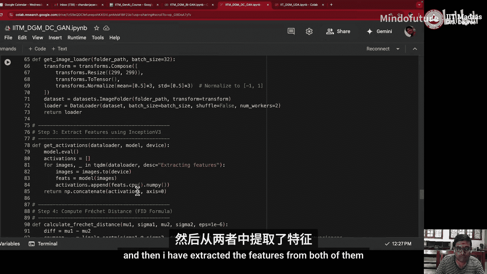

That's what we do， right？Take the imagenet In network which is pre traineded on imagenet 1k and then you pass D2 as well as degenerated from this you get some features。

我周事啊。For that true。And thegen okay and then what do you do you take the mean and the variance。

 the standard deviation of it， you take calculate mu and sigma for both of them。啊对。Similarly。

 you ca it for gen also。And then you calib the FD score how do you calib the FD score you subtract the mean and then take the。

Second norm of it， and then you get the trace of it。 Now both of them are scalrs。

 Now you can add them Now this will give you the。F ID score okay now the same thing has been done okay you can look at the calculations。

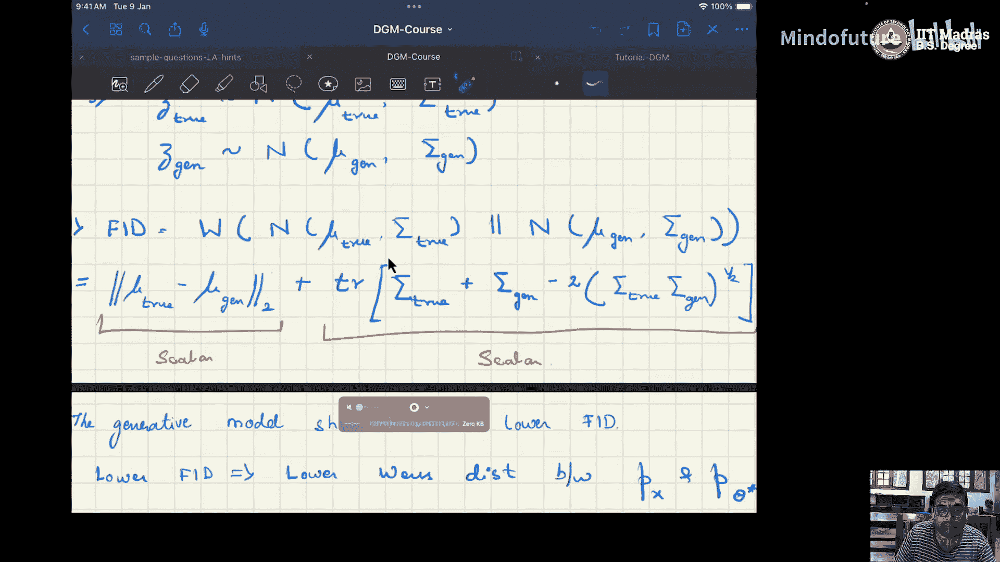

And finally， we have got an5D score of 39。23。Okay， now lower the F score， no better is the image。😊。

you take real image as well as the generated image part is given as input to this and then the output is FD score okay you can use this as a standalone thing in the。

😊，Any generative model which takes the images。As input and then you can use it this is that your Dc can coab notebook all the notebook links has been shared with you this you can take it as a standalone piece and then you can work。

😊，Now with this we conclude today's tutorial in which we discussed on unsupervised domain adaptation as well as the FD scores let's meet in the next tutorials thank you。

😊。

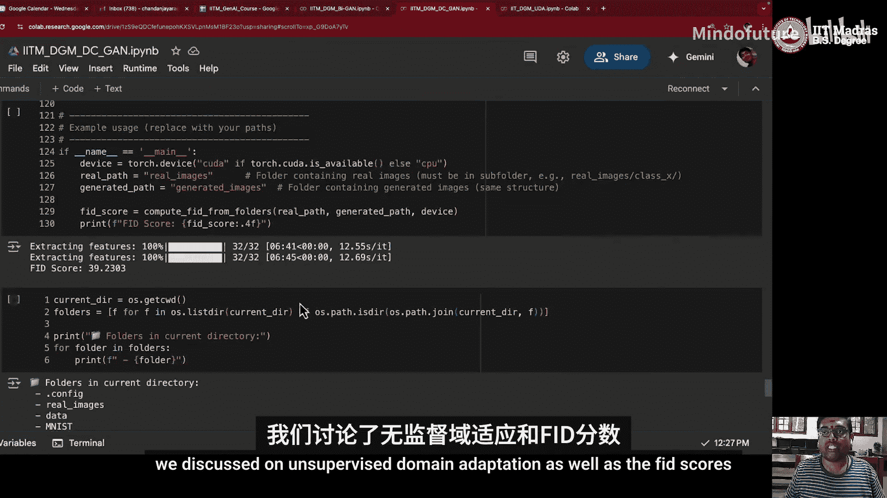

