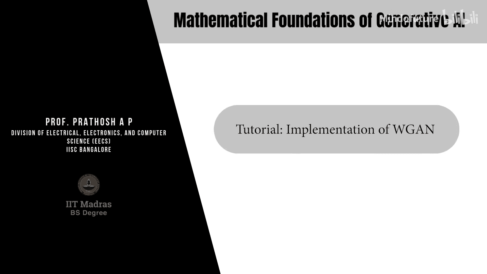
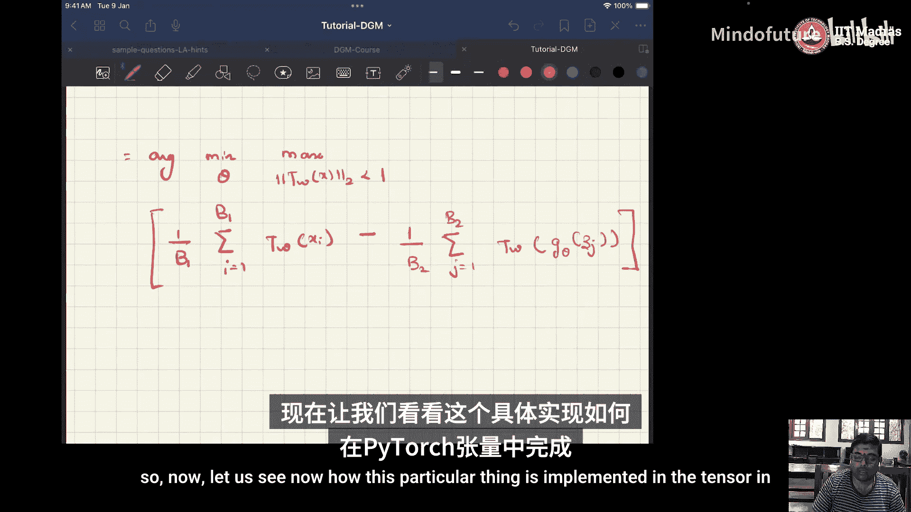
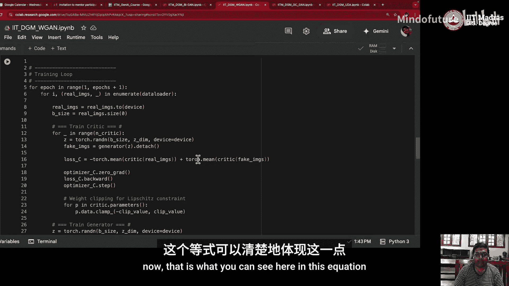
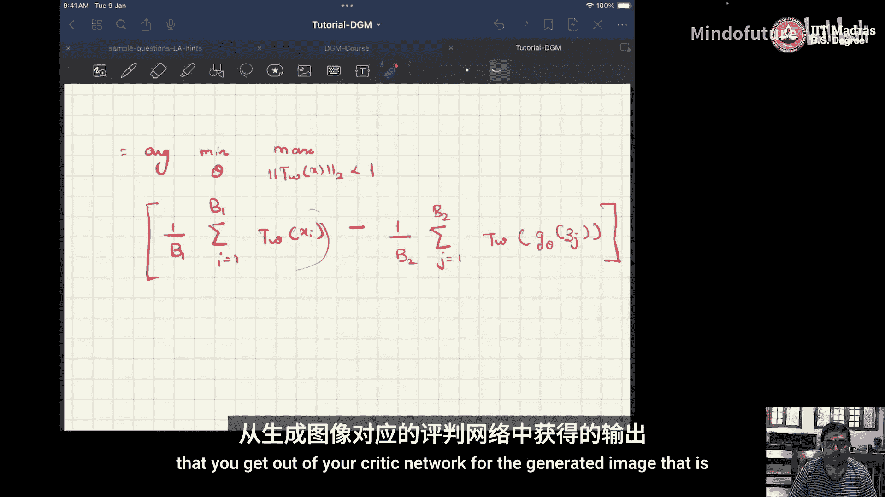
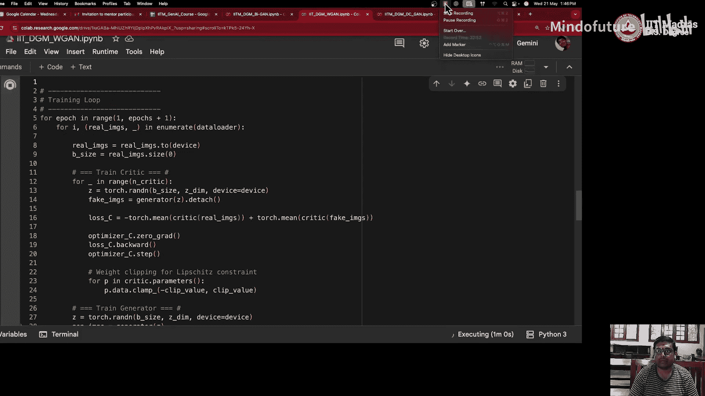

# 生成式Ai的数学基础 ｜ Mathematical Foundations Of Generative Ai p24 P24_W4T9-教程-WGAN的实现 -BV1fperz7EjK_p24-

。

Welcome you all for this tutorialluorial in which now we shall be learning。The intricacies of coding。

Of for sustained game。So now in the ti sessions。You want to have learned。

The problems that are involved in training a knifegan or any versions of those knifegan in which a saddle。

Point problem is involved。to avoid that， what happens with the saddle point problem is you know the idea of saturation that happens。

 to avoid that， know we came up with the idea of verine can that means you train it now using the verstein metric。

😊，So no。Let's try to understand what is that。Vers sustain distance。

Or it is also famously called as the Earth Mor distance。Yes。What sustain distance？

So now let's consider two distributions。P X and。Px bar these are distributions the verse and I'm assuming that these are continuous distributions for which I have well defined densities those the same assumptions that we make in the theory sessions the verse sign distance now between。

These two。Distributions。Is given by。You choose such a travel plan。

From the set of all the travel plans。Between these two。We find them minimal。啊。

Tt plan now what do which which with respect to what now which has the minimum expectation of。

The deviations。Now， you come up with。Such a travel plan。No， which has。The minimum。El2 distance。

This is what is。Equation for the versus time distance and then。

It has all the travel plan that you consider has to satisfy certain property now very important property。

 which is。Now， we have this。P of this x and x cap。 or these are， these are set of。

All transport plants。Sot of all transport plans。And then all these transport plants should satisfy your proper property。

 you know， this is the idea of marginalization。😊，Now you take any transport plan。

And you marginalize now with respect to x。Now， you should get。Except。On the other hand。

 now if you take the same transport plan and then you marginalize it with transport to x gap。Now。

 you should get x。Well， this is。For all。Transport plans that are in the set now all of them should。

Satisfing this。Now， this is for continuous distributions now let us take a simple example to try to understand what does it mean actually now let take lets try to discretize this。

😊，Good。Now when we discretize it。😊，When we discretize this。And what do we get？

The versus time distance between two distributions px and px cap。This is the same at the minimum。

For all travel plans。From the set of narrow plants。Okay。Smation over ING。

Now you take now you will have a matrix， you will have a travel plan matrix now which has to be marginalized now we will take an example and then see now what do you mean by this idea of marginalization in this discrete space？

You click Ij for that specific instance and then multily with the。The distance between them the。

Second non distance or the Euclidean distance that is considered as now this。Lambda Ij that we have。

this is。This is them。Amount。Amount of mass。Move from。X I。Belongs to Px。读。

X gap J belongs to the X gap。O。So now let take let's take an example of two discrete distributions and then try to understand it numerically。

 what does this mean？Now， let's consider the points of support。

For both of these district distributions。啊。For the point。1，2， three， and4。

 these are the points for which now you have valid the。

Probability in mass or the probability mass is non0， you can consider that。Now。

 what are the probability masses here？It is 0。4 0。3 0。20。

1 this is a very probability distribution or I can say that you just add it up now you get one。

NowSimilarly， I have probability distribution for。Xcap also， 0。1， 0。2， 0。3。90，1，4。Okay。

So now what will be the objective that we have to do now the main aim， the goal。The goal is to find。

The minimum cost， the minimum cost needed。To redistribute。To redistribute。B X。Inindu。E X。Okay。

 this is the major idea that is key world。So now since I have supported over four points。

 what will happen is my transport plan or a transport matrix now will be a four cross 4 matrix okay。

So now I'll have a。系 love啊。Full cross4。Transport matrix。Now， let's try to。

Understand that no what is in the rows， what is in the columns those things has to be。So， P X is。

In the rows。 And then。The x hat now will be in the columns， now what are the values that it has。

 it has 0。4 0。3。0。2。And 0。1， and similarly， these also will have。0。1，0。2。0。3。And 0。4。No。

Let's index them， this is one，2。3，4， or you're comfortable with the。0，1，2，3。

 now whichever are indexing the。You want to take up 1，2。be food。Now。

 what does this mean I have a mass of 0。4 how I want to redistribute。So that it looks like。Exha。

It's a question。Okay对。So now I want to redistribute the 0。4 mass like this。Ill give 0。12。

 change the color， the color looks similar。0。1 to this。And 0。2 to this， 0。1 to this。And then 9 to 4。

Now， if you add it， you get 0。4。Now you are redistributing this mass over these points okay。

 similarly the 0。3 mass that I have in the next， I want to read it distribute。😊。

Among these supports like I not give anything to hear， I not give anything to here。L give 0。

2 here and then L give 0。1 here。Okay， and similarly， now I know what does this mean the 0。

3 that I have， I have redistributed among these two supports。😊，So now 0。2 that is there。

 I want to redistribute it like this。Now this is one support plan。

 I can have multiple support plans now its a set of support plans。

 now this is one of the support plans。😊，Now， if you add it， if you add this。We got 0。4 here。

You add this， you get 0。3， add this， you get 0。2， add this you get 0。1 and then。

You take the sum of this， you get one。Similarly。You add this。You got 0。1。You add this， you go 0。2。

You add this， you get 0。3， you add this， you get 0。4 and then。You add them， and you get to one。

Now this is the idea of marginalization。Not at any given point， now let's take this。

Let's take this point。You fix this。And then you sum over。Varying the other variable。

You fix one variable and some over the other variable。Okay， now you get the probability mass here。那看。

😊，Similarly， you can check it for all the given things Now from here。

 I presume that you will be able to get the。Quantification of versusine distance now this is Ij you can think of it now how much X how much X X Xj what is a distance you can calculate it and then you will be able to obtain the。

Versus many distance， this is what do I mean by a travel plan in terms of for a discrete distribution？

Now， I presume that it is pretty much clear what do we mean by a travel plan now？Okay。

 so now coming back， now this was just an example for you to feel that okay， know。

 this is a very interesting metric that you can have now coming back to the problem。😊。

That we were looking into。The versus strain distance。So let's look at that。Now our loss function。

 now finally now will be something like this。You happy啊。

Your discriminator and then the critique now will be similar， Ill write it down。Do you have your。

Have we are channel。Your generator will get samples from Z。Which is normal0 I。Okay， now。

 which will be。你T打。This is your generator network。And then you will have your Citique network。😊。

You get a critique network。Which either takes。The generated image or the real image。And then now。

 it should be able to tell。That item。Real or a generated image which is nothing but it is giving us the probability that it belongs to the first class okay now how does the loss function look like I will not be going into the derivation but just giving you the loss function the eta theta star and w star is。

Million of theta。Maxof。W of x。The second norm of a。

It is always less than one this is one additional thing now which will be achieving by what is called as clipping okay the weight clipping we will look at the code。

So， and then you have the。The expectation。Pix。That you are getting from the real data。TW of x。Minus。

Expectation of。Z， normal0， I。PW of。G T off。Okay。this is how your loss function will look like now when we take the samples。

 that is what we evaluate the expectations with respect to the samples， right？就。嗯。

Men with respect theta。And Max with respect to。The tip version。O看。So now I have1 over B1。

Smation I is equal to 1，2， B 1。Now， what will be the discriminator？That we be telling。

For a real image。人。Minus of。1 over B2。Summation J is equal to 12 B2。TheW of。GT do。Zg。好的。

This is what loss。When look。Okay， so now let's see now how this particular thing is implemented。

In the。

In the Pytch。Let's go there。

Let's stop again。Now these are the necessary libraries you should be very much accustomed these packages and libraries by now toch as your Pytch neural network optimizer data sets and transforms so that you can fetch a particular data set and then you can transform it into whichever normalization that you want or whichever you want to resize and so on and so forth you have to save the image and then the data loader so that you can get your data loaders and the batch says is fixed properly and then you have your OS so that when you save the image it goes in de present in your runtime and then you are using a device okay a codea device if it is present you're using the Qa device。

And then the batch size that you are taking is 64 if you are not comfortable with 64 yeah for sure you can take 1 to 28 the number of epochs that you are attain is 20 okay lets take it 1 to 28 and let let us run this at least。

😊，1 epo 128 now learning rate you can take 1 of minus4。 I'm just showing you that these are。

ThePoible values that you take。So the number of times you train the critique。

The critic network is trained once the tip value。We will see what is the tip value that is you want to have your weight to be。

The less than one right for that we need the clip value the image is a 28。

 the number of channels you take is 1。Yeah， we will be using a DC can version of it now that means that you will not be using an MLP now we will be using a transposed convolution blocks。

To perform the operation of generator and the。Critic network and these are the transforms now you are putting into the 0。

50。5 now if it is not there you are downloading it。And then the generator network。

 you can look at it。O。No。对。Now by now you should be able to read through these kinds of network and see what is it being done。

Okay。Now you are getting a fine one channel image。So from 128。

 first you pass it through a fully controlled layer now yeah it is up to you again now you can。

Remove this， no problem。You can just have the convolution blocks。

And then you first your batch normalize。And then you have a transpose convolution from 128 channel to 64 channel。

When in which your size of image will increase now but the number of dimension now you had 128 channel now that you have been 64 from 64 to 1。

Initially after this transse convol you have used Raylu and then here you are using tanh now because you have to have your values of the image between minus1 and 1 because of which here are using tanh and then you have the forward method。

And similarly you have a crique method now critic method finally it should tell you whether it is the real image or the generated image that means that the output should be one value。

😊，Now， the input is an image which is one channel。With that you are converting it a 64 channel。

With tried to adding one all those things and then I' am using a leaky delu with 0。2。

Ass the leak value。And then from 64 to 128， the kernel size that I am using is for stride is2 and padding is one so on and so forth。

 okay and finally you flatten it up。😊，And then you pass through this。Now you initialize。

The generator and the crit network and then you port it onto the device I am using one more optimizer called as RMSMS Pro now there are multiple kinds of solvers now one is a ZD Adamom RMS Pro now these are no different solvers that we have and the important thing is the training loop。

Okay。So now here you have your。Data loader and you re it you get your real image and even the batch ID and then you port these into the。

Devicice that is your quoa device， okay？So and then now what are the things that we want？Now。

 we want。Two losses now one loss to update the values of the discriminator a discretic network。

 the other laws to update the values of the generator。Now， for the discriminator。

Now we know that it is a combination like earlier in Niveggan case also it is a combination of the critic network of real images as well as the fake images now that is what you can see here in this equation now why is this mean coming for that so you should be able to get it here。

Now， this is an average value that you get out of your crique network。With respect to the real image。

 the average value that you get out of your critic network or a generated image。

Okay， that is why To dot mean is a。好。😊，So， and then。要。Actually zero gra the parameters。

 then you perform the。Backward pass then you update the values and then you clip your values now all the parameters now all the critique parameters that are there you clip your value between minus clip value and the plus clip value we have taken the clip value is 0。

1 yeah。That is a。Keeping of the weights of the C network or the discriminator network so that it holds the the lips sheet constraint that is how we are doing it here。

😊，And then you have your generator。No。To update your。

Gerator okay now first you need to generate get this z now first you randomly choice that then you pass it through the generator and then you pass it through the critic network。

And you get the gradient and then you back it and then you pass it through the the generator network okay first you pass it through the。

啊。Critique network and then you pass it through the generate network the similar it is the same way in which you will be evaluating the。

In the9 man case okay， and then you finally obtain the。Images that are generated。

This is how you train the。W 嘅。I hope this was helpful in the next tutorials。

 now we will look at the training of by again thank you。😊。

