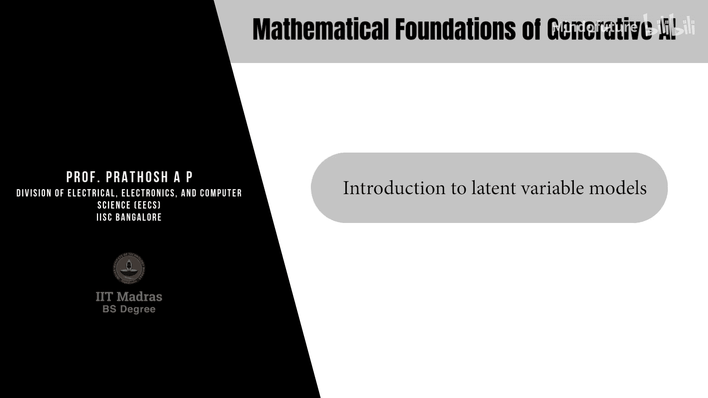
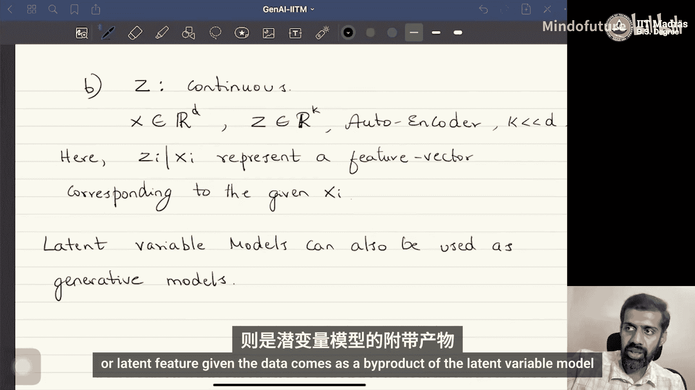

# 生成式Ai的数学基础 ｜ Mathematical Foundations Of Generative Ai p25 P25_W5L17-潜在变量模型介绍 -BV1fperz7EjK_p25-

。

Hello，The next。Family of generative models that we will be considering in this course。

Are known as the latent variable models。The famous members of this family of Genative models。

Include the variational auto encoders and the diffusion models。So。

We will define what a late variable model is， and we will look at the general principle of how to learn a late variable model。

Then we will go to variational auto encoders in and we will look at Vs in detail。

 and then we will eventually move on to diffusion models。 So that is the plan for the。Coming next us。

Okay， so what is a latent variable model， Let us say that we have data as usual and the data is a set of。

Vectctorors。That are drawn I。According to an unknown underlying distribution， which is called P。Okay。

 now I've been saying that。Whenever I say that there is a model。

 so I talk of a distribution which is parameterized based some parameter theta。

 suppose P theta denote。P theatre denotes a parametric model。Now。

 so far in generative adversarial network the speed heatta was implicitly modeled as the distribution of output of the generator network。

 correct， but in a latent variable model the definition is the following。Definition。O。

A latent variable model。In a late variable model， p theta of x。

So remember that the model is always a distribution on data is given by。

The marginal of a joint distribution between x and z。And the marginalization over。Is over z。All。

 we have。P theta of x。Is integral。Or the joint distribution of x and Z and the integral is over z。

 Okay， So this is when。你。Lnt variable is discrete。And this is when the latent variable continuous。

Cius continues。But the question is， what do we mean by。What is this Z。

 which is a new random variable that we have introduced？Signify， okay， so Z is。

Is what is called as the latent。Are hidden。Our unobserved random variable。

Now the salient feature of a latent variable model is P theta of x， which is the model distribution。

 is given as the marginal of the joint distribution of x which is the data variable and z which is another random variable that is introduced into the system。

 so this random variable Z is called as the hidden or unobserved or latent random variable now by definition this random variable is not observed because the data that we are given。

Are sampled only from the the random variable that we have denoted as x。Z is not observed at all。

so therefore it is called an unobserved random variable or latent random variable now。

From an intuitive standpoint， what does this latent random variable signify think of it as an additional information that that is there along with each of the data point。

So an example can be suppose are x， we are dealing with the images as data。

Then the Z can signify multiple features of each of the image so these features can be the orientation of the image。

 the angle of orientation of the object in the image or it can be the size of the object in the image or it can be number of objects in the image and so on。

 so what does z signify it depends upon a particular problem but from a mathematical construct。

This random this hidden random variable is another random variable that is synthetically introduced into the modeling framework。

 which would signify some feature or some information about the data that is not observed when we are collecting the data。

And the model is defined as the marginal or the joint distribution of the data variable and the hidden or the latent variable。

 if the late latent variable can be both discrete and continuous whenever the latent variable is discrete then marginalization is a sum and whenever the latent variable the hidden latent variable is continuous。

 then the marginalization happens to be an integral So this operation is called marginalization in probability theory where if you have a joint distribution between two random variables suming or integrating over one of the random variables will give you the distribution over the other random variable。

Okay， so typically what happens is。So， typically。The latent variable z is jointly estimated。

Is jointly estimated。Along with the model parameters theta。

So far we have been estimating the model parameters theta given data by minimizing data divergences right in a latent variable model not only the model parameters are estimated but the latent variable or rather a distribution of the latent variable。

Is also estimated along with the model parameter theta so now one might ask this question what is the need of introducing this another extra random variable which is going to be estimated along with the data well it turns out that it will not only make learning feasible or easy mathematically but also gives a lot of information about the data okay we will we will see that later。

Now， yeah， so now the idea is that。The random variable or a distribution on the latent variable is also jointly estimated along with the model parameters。

Now。For the。Each。X I that is in the dataset。So， we assume that。Assume that there exists。

There exists Z。Corresponding to thex。Okay， so I mean every latent variable model given a data point Xi。

We are implicitly assuming that there is a。An instantation of the latent variable denoted by Z that corresponds to each of the exc。

Okay， so now let us look at a couple of examples on what these legendnt variable models is。

 the the first example is when z is discrete。D latent variable is discrete。

 which means that delete latent variable can take one out of imp possible values。Okay。Then。

For and we will say that x is always in some RD， so x is a continuous random variable only z is discrete random variable。

 Now what happens is here。For each exile。That is in。The data set。So now Z given this particular X。

Represents。The latent variable able for each exc。We variable corresponding to X。Now。

 since Z I is discrete， the latent variable is discrete。 now every Z far an exile。Since。Zア。

This is is discreteet。For each or rather， each X。Each X。Is clustered。印度。1 off。You categories。

So this is obvious right because now since Z can take one out of M values so for each Xi。

 lets say that Z can take one of m values， then every Xi is put into a bucket of one out of M categories if you can think of the discrete values that deletent variable can take as m buckets。

 then for each Xi the corresponding legendnt variable Z can take one out of M values that means that all the data is cluster are put into one of these m buckets。

Okay， so what does this mean， I mean， this， you might I already know this。 This is called the。

The clustering algorithm or clustering。Unsupervised clustering and examples for this are the Gaussian mixture models。

Also known as GMMs。And they came in clustering。Both of these are latent variable models with discrete random variable discrete latent variables so the idea here is to learn a latent variable。

 or rather learn the data model， the data using a latent variable model where the latent variable latent variable are discrete。

 So now once it is learned what happens is that every X will correspond to a particular Z and since the latent variable is discrete when we are effectively grouping the data into one out of M categories。

 So now here is an example of why a latent variable model might be useful。

 So in this particular example， the latent variable model is。

Useful to categories data into1 out of M categories and that is what is known as the clustering Gasian mixture model and the clustering。

Both are examples of a latent variable model with discrete latent space。Now。

 we will take another example of a latent variable model where z， the latent space is continuous。

Okay， example for this is so now let we have x in Rd as usual and now z is also in some clear dimensional real space which is continuous。

Now， an example for this can be an auto encoder。For those of you who do not know what an auto encoder is don' not worry we will cover that in this course in a while here。

Every Z corresponding to a particular X。So， represent。A feature vector。

Feature vector corresponding to。You give an exc。So unlike the previous example where Z given XI will tell you what bucket or what discrete category X belongs to。

In the case where the latent variable is continuous。

 Z I given1 Xi is a vector because the latent variable is also a K dimensional vector Z I given1 X represent。

A feature vector corresponding to the given X now typically what happens is here typically the dimensionality of the latent variable is much less compared to that of the data variable。

 therefore these features given by the latent variable model can be taken as a lower dimensional representation of the higher dimensional data so this is one another use case of y latent variable models are useful。

Now， the other observation about latent variable models is。All latent variable models。Or rather。

 most of the latent variable models， latent variable models。Can also be used。As generating models。

Okay so there are two major use cases of latent variable models， one is of course。

 finding out a feature or a cluster given the data。

The other use case is sampling or generative modeling since our primary goal in this course is generative modeling。

 we will be looking at latent variable models also as generative models and mostly as generative models and the use case that I just said which is finding out the latent variable or latent feature given the data comes as a byproduct of the latent variable model。

