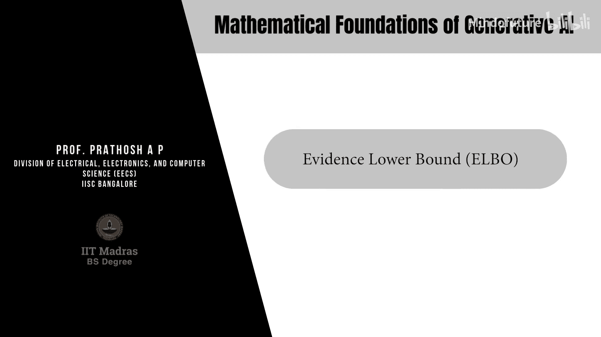
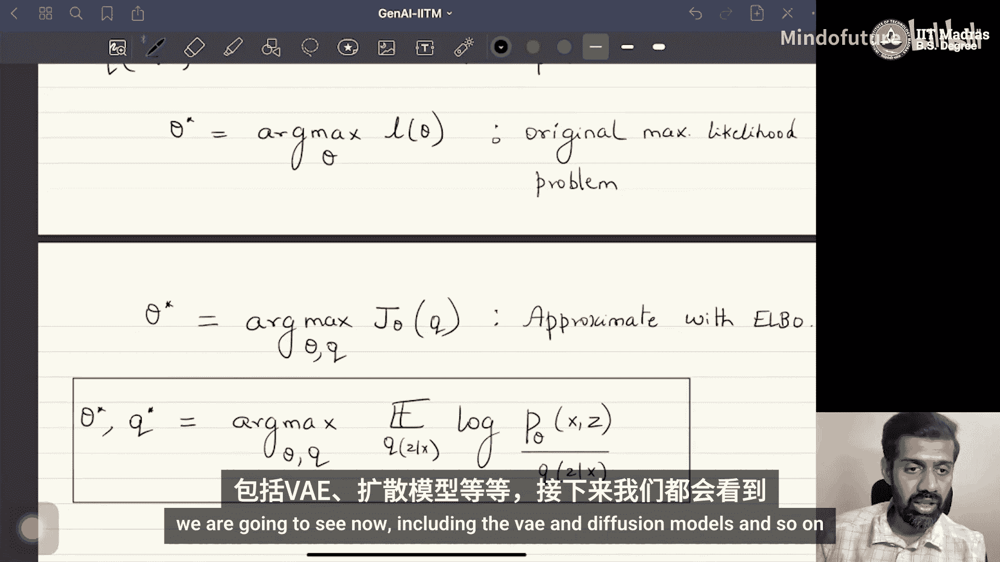

# 生成式Ai的数学基础 ｜ Mathematical Foundations Of Generative Ai p26 P26_W5L18-证据下界（ELBO） -BV1fperz7EjK_p26-

🎼。

Sure， so with this introduction， let us look at how to build what is the general principle of building a latent variable model So now。

견허를 번을。For learning a latent variable model。Learning。Lant variable models。

So the principle that we will see now is a general principle that can be applied to all classes of legend variable models starting from GM MM to diffusion model。

 So we have to look at this one general principle， which will be applying to multiple。

Latnt variable models， suppose。So what we have is we are given data。We are given data。D。W is。

 as usual， samples。Drawn from an unknown distribution。ID Px， this is what we have。对。

And we have P eta E a latent variable model。 Let let us assume that the latent variable Z is a continuous latent variable for ease of math。

 So all the equations on the maths that we do。Is directly extendable to the case where the latent variables are discrete。

 But now I will assume that the latent variables are continuous and write down the definitions。

 So now by definition the latent variable model is a joint distribution between x which is the absorbed random variable and z。

 which is an unabsored random variable So I guess。That that be。The latent variable model。Okay。

 now what is the goal， the goal is as usual to find out the model parameters。Estimate。

Estimateity model parameters， theta。Given B。 So this is what our。

Objective is always with any latent variable model。 Now， how do we estimate theta， So we have。

The usual framework of finding out theta by minimizing a distributional divergence metric。

 so minimize。The K divergence between Px and P theta。With respect to theta。

Okay so this is what our objective is we need to find out the model parameters theta that would minimize the k divergence between px and p theta what is this equal to this is equal to let us write the definition of the K divergence。

SeeThe definition of K divergence is integral。Px。Log。Di of Px and P Theta。Dx the is over x。

this is equal to。You want to minimize。I will open up the integral。 So theres Px。Log。

PX this the first term is also called the entropy of data minus integral。Bx。logg。P theta X， D x。Now。

 I can。Remo the first term from the optimization because the first term is independent of theta。

If first term is independent of theta， therefore I can write this as。I want to minimize。

Negative of integral。Bx。Log。Pre Theta X D X。Okay， now this is equal to。

If I take out the negative sign outside， then the minimization will turn out to be a maximization problem。

 the integral that we have is an expectation of log of。P the topicsphs， this is with respect to P。

Right，Therefore， the theta star， the model parameter that we need is the one that would。

Minimize decay divergence between px and P theta， it turns out that minimizing decay divergence between px and P theta is equivalent to maximizing the expected value of log of P theta topics with respect to Px。

Now， log of。P T topics is also known as the likelihood function。

The likelihood function of P heat effects or rather。You can also call it the log likelihood。

Log likelihood and therefore this procedure is known as finding out the model parameters by maximizing the likelihood function and therefore this is called the maximum likelihood estimation。

Note that。Estimating a model parameter by minimizing the care divergence between the true distribution or the data distribution and the model distribution。

Boil down to estimating the model parameters by。Maximizing the expected log likelihood where the expectation is with respect to the true data distribution please remember that this expectation we can compute because we have access to samples from px and we will use the statistical methods like law of large numbers to estimate this expectation now yeah so this is what is called as the maximum likelihood estimation our minimum k divergence estimation so now we want to estimate the model parameters theta by maximizing the likelihood。

Okay， so now P theta in our case。In a latent variable model。

Lant variable model is given by the following so P theta of x is the integral of。P theta x and Z， Dz。

 right， and we we write the marginal on the data variable as a。

As the Ma as the marginalized version of the joint distribution between the data and the latent variable。

 Okay， now let us write this thing as。So we want Theta star。To be the。6。That theta。

 which would maximize the expected value of log of。P Theta fixeds with respect to P Theta。Okay。

 so let us call this as。Let。Let us den not。The log likelihood function， B the topics。But。I of theta。

Okay， now what we will do is。We will derive a method to maximize the log likelihood and and then write down the expectation after we devise a method to maximize the log log likelihood since expectation is a linear operator one can write down the maxima for one of the data points here and then write down the expectation outside so what we will do is we just consider that we have one data point right now and omit the expectation for our calculation let is just make it a little more less cumbersome and then once we complete。

Driving the the procedure for maximizing the log likelihood L theta。

 then we would write down the expectation with respect to px separately outside because expectation is a linear operatoror and please note that the expectation is with respect to px that has nothing to do with the parameters theta so we can take down this expectation outside of the。

The optimization， we optimize the log likelihood for like one data point and then write down the expectation outside of the the the maximization operator。

 So that is what we will do so consider。Eth theta， which is the likelihood of data log likelihood of。

The data under the model distribution。 So now， this is equal to log of。Inteegral。P Theta， Xcom Z。

Easy， because this is the definition of the。La in variable model。Now， what we will do is。Suppose。

Q of Z given x。Deote。A distribution。Or the latent variable。Latnt variable Z。

 So please note that in the latent variable model， the latent variable Z is not given to us。

 but we will estimate that along with the。The model parameter theta， Okay。

 now let's say that there exists。 So which means that we can take any distribution over the latent variable and。

We can find we can come up with some optimal optimality criteria to estimate a distribution over the latent variable Now let's say that Q of z given x denote some distribution over the latent variable z it can be any distribution as I said。

 we will very soon see that our estimation procedure we also involve estimating this particular distribution over the latent variable because in a latent variable latent variable model。

 we will not only estimate the model parameters， but also a distribution over the latent variable as I said。

 we will come to that So for the mathematical purposes。

 let's say that Q of z given x denote a particular distribution any distribution on the latent variable z。

Okay， so if  Q denotes that distributions， you know we have L theta。

 which is the log likelihood given by log of integral。P Theta X and Z。

We are marginalizing that with respect to disease so what we will do now is that we will multiply and divide this integral。

With Q of z1 x。Now Q because  Q of the z given x is。Prob density function， Okay， so。对。Precise。

 doote a density function。A density function over。The latent variable Z。Okay。

 lets say that Q of z given x is a density function over the z over z。

 so now since q of z given x is a probability density function it is always non negative by definition。

 therefore we can multiply and divide this integral width that non negative quantity and the integral does not change。

Okay， so now what happens is that this is equal to log of。인터 그램。Q Z given x。Thankss。This quantity。

 which is P theta of x and Z。Divverted by Q of J given x。利是。My fun cook carefully looks at this。

What is this， This is a particular distribution over z and this is a function of Z Okay product of a distribution and a function and if you are integrating it over the random variable of that particular particular distribution。

 then this is by definition the expectation。 So this is log of。Expectation of。Santity， P theta。

X and z dividederted by。QZー givenワ x。We are taking the expectation of this with respect to the distribution Q of z given x。

 So why is this because。Because integral of Q of zp1x。Times sum function， let's say， G of Z Dz。

Is the expectation of。G of Z with respect to Q of Z units， this is the definition of expectation。

Okay， so now we wrote down the likelihood function that we would want to maximize。As an expectation。

Now observe that we have the log of an expectation。

We know how to compute expectations using the statistical estimates okay by taking sample means。

 but here。There is a log outside of the expectation， therefore。

 no we cannot estimate the log of an expectation using statistical estimate。

 so now we want some way in which we write down this entire thing not as a log of an expectation but expectation of something okay expectation of log perhaps。

Now the question is how does one bring out the expectation from the log so now we have to pull the expectation outside the logarithmic operatorer here。

 how do we do that so it turns out that there is an inequality called the instance inequality。

It says that for a convex function。Or rather， let let me be specific for this。

 So it Jenen's inequality says that a log of。The expectation of a particular function is greater than equal to the expected value of log of that particular function。

So， this is ginsense's inequality for concave functions so log of expectation is always greater than not equal to the expectation of the log So now what do we have here。

The likelihood log likelihood function that we would want to maximize。Is not given by。

A log of an expectation。 If we apply the ten inequality to this， we， we have that this is。

Greatter than or equal to the expected value of log of。This particular quantity。Okay。

 now what happened is that。We wanted to maximize this with respect to theta。

 Our goal is to maximize the likelihood function with respect to theta log likelihood function with respect to theta and we had we ended up having a log of an expectation under a late variable model。

 but log of expectation cannot be approximated using statistical estimate。

 So therefore we wanted to write it as an expectation of the log and we use sentence inequality。

 once we invokeked instance inequality。 the objective function that we would want to optimize we will not be exact。

 well get a bound on the objective function。 So if one can recognize this is very similar to。

What we did in the variational di miniization on adversarial learning where we constructed a lower bound on the function that we would want to optimize okay now we have L theta。

This。Bounded by we have。The expectation of。This particular thing let us write this down as some J theta。

Of Q。Deote this thing by。Tote with J theta of。九？Please note that the bound that we have constructed on the likelihood function that we would want to maximize。

Depends not only on the model parameters theta， but also on the choice that we have made on the。

Distribution over the legendnt variable。OkayBecause you know。

 if you take if you choose a different Q， this entire expectation will take a different value okay so now the the objective function that we would wanted to maximize ideas to a bound。

Which would。Be a function of the model parameters and a distribution over the latent variable now the likelihood function is also called as the evidence。

放平。Okay， and this happens to be a lower bound on the evidence， and therefore this is known as。

Called the evidence lower bound。Evidence。老本。People abbreviate that as。E L， B O or elbow， So E， L B O。

 evidence lower bound or elbow。Now， what did we do。

 we wanted to maximize the or find out the model parameters that would maximize the likelihood function。

That could not be done because we have a log of an expectation， therefore。

Instead of maximizing the function， we are maximizing the lower bond on the objective function and that lower bond is called the evidence lower bound or elbow and this distribution elbow。

9。Is a function of。Both。The model parameters。铁达。And。The density on the latent variable。Q of Z unix。

 this Q of z given1 x is often termed as。The variational latent posterior。

Variational less latent posterior。So it is a distribution。

 it is a density function which is the posterior of delete latent variable given data。

 it is called a variational distribution because the optimization that we are solving here is not only with respect to some parameters theta but with respect to a class of functions cube or rather a class of density functions。

Now the branch of calculus。That would the。Describe how to optimize over functions。

 It's called variational calculus。 and the functions that would get optimized are called the variational functions or variational distributions and hence the name variational latent posterior。

 But the point that is to be taken here is that the。

The lower bound that we constructed on the likelihood happens to be a function of both the model parameters theta and the density and the density that we have imposed on the latent variable called the variational latent posterior。

Okay now so far the what is the the story so far that we wanted to get theta star？

That would maximize the。Log likelihood with respect to theta。

 remember that this is the the minimum scale divergence estimate。

And this under a latent variable model。We said that instead of maximizing this。

 we are maximizing a lower bound on this。Were maximizing the elbow。Which recall us G theta of Q。

So this was the original maximum likelihood problem。Original maximum likelihood problem。

And this is the。Apprxiimate it。Wet elbow。We constructed a lower bond on the log likelihood。

 and we simply approximated the or rather， we will solve the。

Approximate version of the maximum likelihood problem by approximate by creating a lower bound on the log likelihood function。

那么。This optimization of the elbow involves two things it involves optimization over the model parameters theta and it also involves an optimization over。

The cube the distribution that we choose or Q okay therefore the problem that we will be solving is that we need the model parameter the star and we need an optimal distribution over the latent variables。

That would maximize。The expectation of。Log of。This is the evidence lower bound or elbow that we just created right so I am just expanding it out。

And this is with respect to Q of z given1 x。Now， this is the。

Foundational problem that is solved in all of the latent variable models that we are going to see now。

 including the BE and diffusion models and so on。

