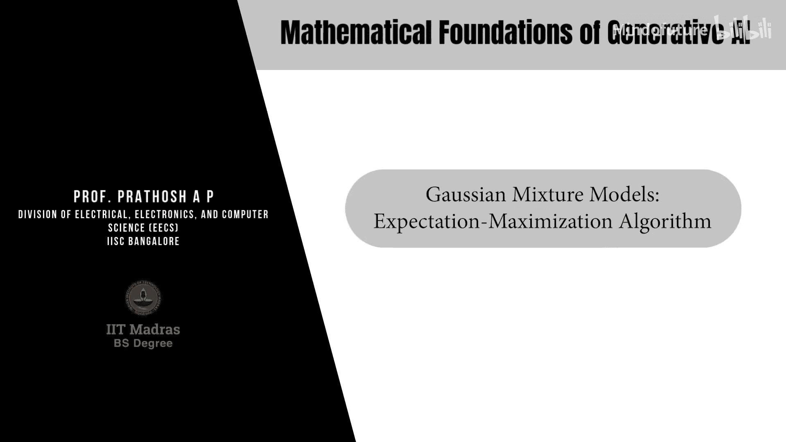
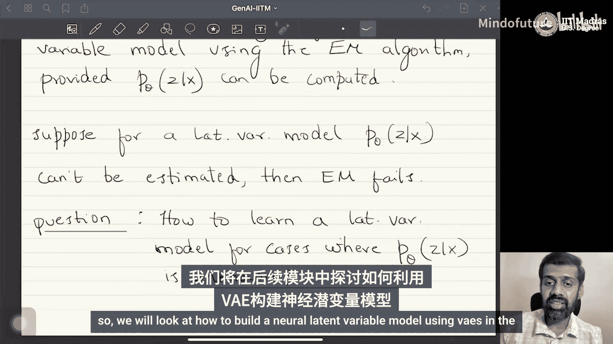

# 生成式Ai的数学基础 ｜ Mathematical Foundations Of Generative Ai p27 P27_W5L19-高斯混合模型-期望最大化算法 -BV1fperz7EjK_p27-

🎼。

So let me quickly recap before we move on so what is the idea the idea is that we started with the latent variable model which is defined as the marginal or the jo distribution between the observed data variable and some unabsorbed late variable we wanted to find the parameters theta that would mini the K divergence between px and P theta and we saw that this is equivalent maximizing B expected log likelihood。

Okay。No。Because we do not know what the latent variable is， as I said。

 the goal here is to learn the learn a distribution over the latent variable as well while we are learning the model parameters。

 so we called the Q of z given1 x as a density function over the latent variable z to be precise late variable z given1 x。

So， as we saw in the introduction for the latent variable model。

 the latent variable exists for each of the x so given a particular x we have some value for the latent variable。

We started with the log likelihood function that we would want to optimize。

And we could not optimize this because we have we landed up having the log of an expectation that cannot be compute in practice we use a ginens inequality to create a lower bond on the log likelihood that we would want to optimize instead of maximizing the log likelihood we are maximizing a lower bond on the log likelihood also called as elbow or evidence lower bone。

Okay， now this evidence load bo。Is a function of。Two things。

 one it is a function of the model parameters theta。

 it is also a function of the distribution or the density function that we have imposed on the legend variable。

 so we simultaneously have to find out the model parameters theta and also the the density function over the。

Lent variable。 So in every in any latent variable model， we have to do two things。

 which is that we find out the model parameters data and we find out a distribution on the latent variable as well。

 So this is the problem that we are going to solve。

 So one question that one might have is that why is。

Maximizing the lower bound on a function that you would want to maximize optimum。Now。

 it is not optimal， okay， they are different， but what can be shown as。

That optimizing this particular lower bond with a particular algorithm called the expectation maximization algorithm。

 which you will see now， will guarantee that the likelihood function that we would want to optimize will never decrease by solving this particular problem。

 However， it cannot be guarantee that optimizing the lower bond will。

Will ensure that we will reach the global optima for the likelihood function that we would want to optimize。

 However， under a latent variable model， we cannot optimize the log likelihood directly So there is no other we have to resort to optimizing a lower bound on it but anyway so the idea is that in every latent variable model we would solve this optimizationim problem。

 which is maximizing the evidence lower bound or a lower bound on the log likelihood function and where did this come from。

 this came from minimizing the K divergence between px and p theta and while we are optimizing the evidence lower bound。

 the optim is over two set of parameters rather not parameters1 I mean two set of variables one is the model parameter theta。

 the other is。The distribution over the latent variable that。We are trying to learn our impulse。

this is the idea now let us look at an example from the classical machine learning community for this particular algorithm and then we will extend this to degenerative models。

Which is VAs and diffusion models。Again， I am rerating B2AE R education model。

All the latent variable models are based on this principle of elbow optimization， so this is called。

Let me write the down the。Fundamental problem。Soword。In any latent variable generatedr model。

Any latent variable generated a model。Is given。Below。Okay， this is called elbow。Maximization。Okay。

 which is。Find theta and Q。That would maximize the elbow。That maximizes。

The lower bone on the likelihood， which is also called the elbow。Maximizes D。Evidence lower bound。

Whi is J Theta of Q。Okay， so this is the problem that we will be solving consistently。

In any latent variable model that we will be looking at in this course further。Right。

 so the way we do it is very different。In each of the models that we will see， so for instance。

 we solve it in a different way for in a VAE， we solve it in a slightly different way for a diffusion model。

 we solve it differently for a Gaussian mixtureer model and so on。

 but the problem that is going to be solved is the following。Okay。

 now let us look at an example for the the latent variable。Modern， which is。

From classical machine learning theory， let's look at an example。From classical Ml。

So this is just to drive home the point of how elbow optimization is used。

 So an example is a Gaussian mixture model or a GMmM a GMmM is also a latent variable model。

Gausian mixture model。So as I said earlier， a GMmM is a latent variable model with discrete latent space。

 so z is discrete。It means that z can take one of M values。Of P theta of x。

Which is the model in a GMM as given by。The marginal of the joint distribution。Between x and z。

 so this is the definition of any latent variable model with discrete latent space for the GMM。

 we have the P of x to be equal to。We have j equal to 1 through M。Be theater of。Z equal to J times。

P theta of x given z equal to J。So now we can write the join distribution between two random variables in terms of the marginal times the conditional distribution this is。

The definition， so I've just use this definition of writing the joint distribution in terms of。

The marginal and the conditional here。 Okay， and return。I we model this way here。

In a Gaussian mixture model。Now， P theta of z equal to J。

 which is a distribution on the latent variable is taken to be some alpha J and the conditional distribution of the data given the。

Lant variable taking the value J is。Made to be a Gaussian distribution with a particular mean mu J and a variance sigma J。

Okay this is the definition of a Gausian mixture model， so what happens is P theta of x。

 which is the latent variable model in the case of a GMmM as given by J equal to 1 through y。

Alpha J times。A normal distribution over x given by a mean mu J。And variance sigma J。So。

 this is this is why this model is called a Gaussian mixture model that is the likelihood of every point X is given by a linear combination of multiple Gaussian distributions。

Okay， now every for every。Lant variable Z taking a value J。

 So we have a particular Gaussian distribution。 So now what are the parameters of this model。

 So this is。A Gaussian mixture model or a GM。Prameter。Of a Germanman。

What is that we need to estimate in a GMM， so we have a theta， which is a set of parameters。

To be alpha 1， Al 2。Through alphaium， so we need to estimate all of these alphas。

 we need to also estimate mu1 mu to up to muium。And we need to estimate sigma 1 sigma2 up to sigma E。

These are the set of parameters that one needs to estimate now since。

X is in some d dimensional real space we have every mu J is also in d dimensional real space because we are talking about vectorvalued Gaussian distributions and we have every covariance matrix is in the d cross d space because it is a D by D matrix。

Alpha Js are。Bounded between 0 and 1 because they represent the probability of a discrete random variable which is deletelunt variable and we also have that if you sum them all for m this would sum to1 because again its a。

The， this is denoting the。The probability mass function of a discrete random variable therefore they should the sum to1 so this is the definition of Gaussian random variable and we need to find out all these parameters by the elbow optimization so that is the goal。

Okay， now how do we do that， So goal。To estimate。Estimate theta。我呀。EB optimization。

 this is a latent variable models。 we want estimate theta via elbow optimization。

So how do we do that， we want to get our theta star and Q star that would maximize。

J theta of Q which is the elbow， and this optimization is over theta and Q。

Now how do we do that is the question？One of the ways to achieve this is via。

The abovebo optimization problem。The abovebo optimization problem can be solved。So， iteratively。喂。

Optimizing。For theta and the Q iteratively。One after the other。

so what has done is that while we need to optimize this objective function with to theta and Q simultaneously that cannot be done。

 one of the ways to do it is to come up with an iterative algorithm where we first optimize this with to theta by keeping  Q as fixed and we optimize with to Q by keeping theta as fixed So we do it iteratively okay so here is the iterative algorithm to do that So algorithm。

What we do is that， for。Sa is 1，2。Some capital D， which is the。Ittereration number。

 So what we do is we first find。Q T plus1， which is the estimate for the latent posterior at the。

T plus1 estimate to be。The maximum of。The elbow。Rather， let's just define the terms before we go to。

The optimization let。Let。提的笔。And Q T。Represent。The estimates。U iteration P。

we can randomly initialize that and let us denote theta T and  Q T as the estimate a iteration and T so the algorithm is the following that you just。

Start arbitrarily and for t equal to 12 capital P， which is the iteration number we first keep。

Theta a constant and find the corresponding queue。The next Q by keeping the theta a constant。Then。

Which thear T a constant。So then we find the next best theta。Theta star。 Okay， let us write this。

Theta star t plus 1。 So this optimization with is with respect to Q and well find the next best。

Tta by keeping。Q to be fixed at Q D plus 1。With the Q D plus  one。Being the constant。

so thats also we alternatively find out the optima for Q and theta by keeping the other constant so this is an algorithm that that is prescribed for optimizing elbow and this algorithm is called the expectation maximization algorithm。

Maxxiimization abbreviated as the EM algorithm。It can be shown that this particular algorithm。

 let me just read that。Can be shown that。医用。Ensures。That the likelihood function that we find out at。

呃，你。Test word first iteration is at least。eququal to the likelihood that we have found at the tier detereration right so I will not show the proof here for the want of time so what can be shown is that the likelihood function that we would want to optimize will not decrease if we find the theta and Q this in this particular manner using the em algorithm yeah so。

While this is not guarantee that our likelihood would increase when we do this。

 it can be guaranteed that the likelihood would never decrease。Now， the question is， how do we。

Solve these optimization problem， which is finding out the Q star t plus 1 and thetata star t plus 1 turns out so far just。

For GMMs aim for the Gatian mixture models。Tms out for a GMM E can be done in a deterministic manner。

 it can be done easily。 So first we find。理Qstar。So Q starity plus 1， which is the maxima。Off。

The elbow with respect to Q， this can be shown to be equal to the posterior of。The latent variable。

 given data。 Okay， so this is a。You can I mean please take this as an exercise and do that。

 one can show that if you。1ant to maximize this evidence lower bound that we constructed with respect to Q the best P theta。

 so I just write that。Can be analytically shown。雄。That。The best queue。Of z given x。

That optimizes a elbow。Is simply。P theta of z given x。So this can be shown analytically。Okay。

 so I will again， you know， please take this as a homework。 It can be nicely shown。

 So now for the GMM while。Optimizing the elbow what we need to do is that given a particular theta we need to find out  Q p plus 1 okay so that is given by we know that it is given by p theta of z given1 x so what does p theta of z  given1 x use the base law it is p theta of x given z times。

P the of z divided by。P3 of x， so this is the definition according to the base law。

 we have all of these for a GMmM right so P3 of x Q and z is a normal distribution。

U mu J and sigma J as the parameters and P of z equal to j is simply sigma alpha J divided by。

So what is P theta of x in a GMMM， it is given by J equal to1 through y， and we have。P it of。Okay。

 so this is， let me just write it。So P3 of x， which is equal to。Pity of x which is equal to sigma。

P theta x given z times P theta of z。 This is over Z。 This is the definition anywhere。

 So which is given by。X。At mu J and Sigma J times alpha J。Right，So we know at the T step。

 So this would be at。BT到D。And all of these are at the P iteration， which we know。

Because we that is how we are solving the iterative algorithm so one can easily find out what  Q star of t plus1 is right with this particular  Q star。

 the theta t plus1 can be simply solved。By differentiating。This elbow。

With Q being equal to  Q T plus 1。This is served by。The boy sold。喂。Differentiating。

Differentiating J theta of Q D plus 1。Call it Q star T plus1。With respect to。听等。So theta here is。

We know that theta here is alpha， mu and sigma。And solving for them。 that's also this simple。

Oimization using the gradientance made to be0 and solving fault theta thats all。

Okay I we skip the algebra anyone interested can simply take this right down the J theta as the definition that we have given differentiate that with respect to alpha with respect to mu with respect to sigma and then find out what the best parameters are right So now this is the expectation maximization algorithm which is an iterative algorithm to find Q and theta。

For a Gaussian mixture model so one result is that the expectation maximization algorithm will ensure that the likelihood will never decrease and expectation maximization algorithm can be used for models like GMmM because finding out a  Q star the optimal Q star which is the posterior latent posterior given a theta can be solved in a deterministical or an analytic way because we know all the constrain distributions。

Okay， yeah， so。For interested audience here， the I mean if you。

 if you recall what the K means clustering algorithm is where given some data points we。

We would first assign each of the data points， we start with an arbitrary cluster centers。

 we assign all the data points to the given cluster center and we reassign we recompute the mean and we reassign so recomputing the mean and reassigning the mean and doing the procedure iteratively is nothing but the expectation maximization algorithm and one can theoretically show that again means clustering algorithm is an asympttic case of GM where the variances of all these gaussian mixture more component gaussians that we have approaches a diagonal variance a diagonal methods with zero variances that can be shown。

Anyway， so now the matter of the fact is that。Optimizing elbow for a latent variable model is feasible。

Using the A algorithm， as long as we can find P theta of Z given1 x， let me write that down。Elbow。

Can be optimized。Optimized in a latent variable model。Or rather far a late variable model。

For the latent variable model using。The year my them？有没给得灯。Provided。Avided P theta of z given x。

Can be computed。Right whyhy is this important Because the E algorithm involves。

Optimizing for Q and theta alternatively and the optimal Q that would maximize the elbow is given by P theta of Z Q1 x。

And if the model permits that we can find out P theta of Z given1 x using the base law。

 which is possible in the case of GMMM， then E algorithm can be used to find out。

The parameters of a latent variable mode。 The thing is， suppose。For a latent variable model。

P the of X given B X Q Z cannot be computed。Cannot be estimatedd。Then， Em fails。Right。

 because there's no way to find Q stars。 Now， the question is， how do we。

Find a latent variable model。好多。Learn。A latent variable model。4。Ges。喂。P T of z given1 x。有阵乱。

with your pardon， I think I made a mistake here this should be p theta of z given x not x given z。

P theta of Z given x is unknown。 So this is the question that would be taking up in the subsequent modules where。

We will see how to learn a latent variable model for the cases where the distribution P theta of z given x。

Cannot be estimated， right， So why is this important， This is important because。

If we restrict our models。2 classes such as G Mms， Okay， which have a nice deterministic farm。

 Then it becomes restrictive in the sense that， you know， they can only model。

So many classes of data distribution， so now if we want to make our P theta of x which is the model distribution a little more generic enough in those cases there is no need theres no guarantee that the p theta of z given x can be computed Now if P theta of z given x cannot be computed then expectation maximization algorithm cannot be applied to find the parameters for a latent variable model。

Therefore， the question is， how do we。Come up with algorithms to learn latent variable models where p theta of g1 x is unknown that is the question that we are going to take up and the neural network models such as the variation auto encoder or the diffusion model precisely tackle this question by estimating by approximating these distributions using neural networks。

Okay so we will look at how to build a neural latent variable model using VAs in the upcoming modules。

 thank you。

