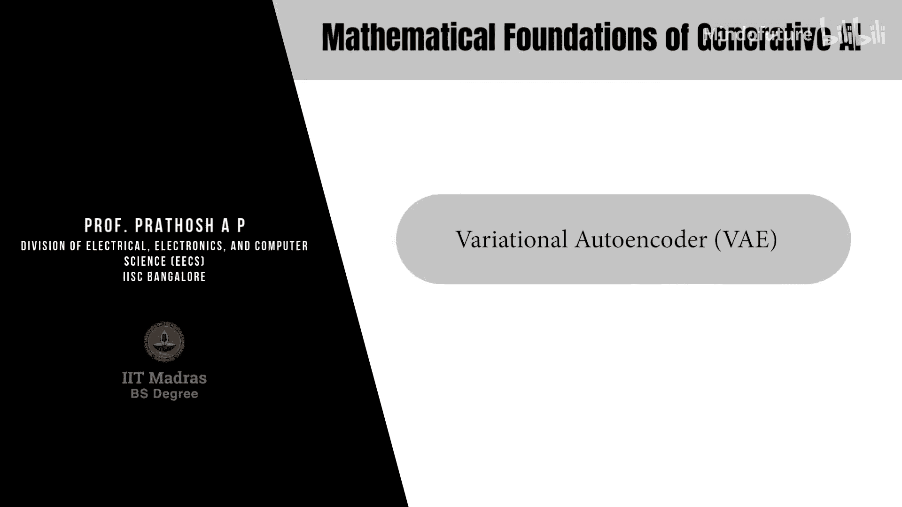
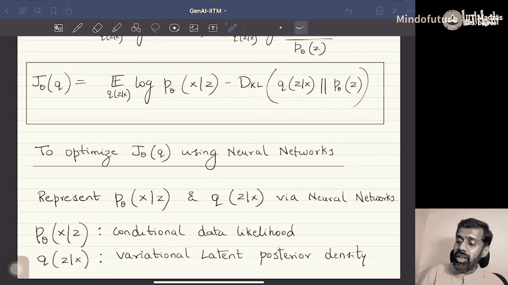
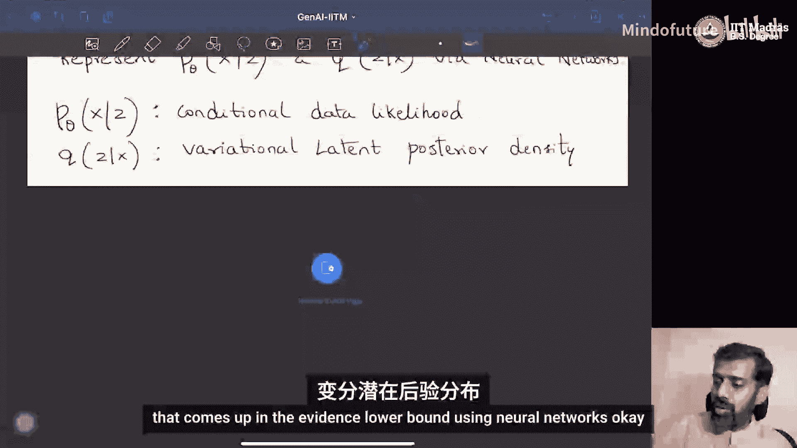
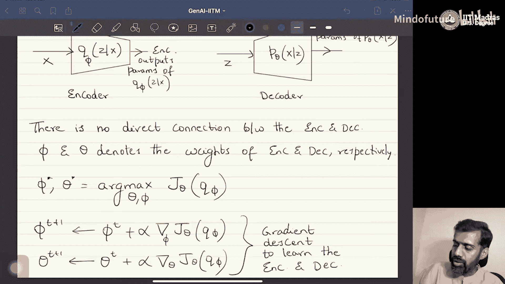

# 生成式Ai的数学基础 ｜ Mathematical Foundations Of Generative Ai p28 P28_W5L20-变分自编码器（VAE） -BV1fperz7EjK_p28-

🎼。

Hello， everyone。Welcome to this module。On variational lot encodes。

Variation auto encoders is a member of the family of latent variable models。

 specifically the neural latent variable models。So as we discussed in the previous modules。

What is a latent variable model？A legend variable model， P the topics is defined by。

This particular formulation， where。The model distribution on the data variable is given as the marginal。

Over the joint distribution of the data variable X and latent variable Z。

 where Z is another random variable that is introduced into the modeling system。

 This is a K dimensional。Random variable typically k is much less than that of the data dimension B。

 so this is the definition of the latent variable model。Now the question is。

How do we learn the parameters of a late variable model。

 We saw a procedure to do that in the last module， the idea is as usual to find the parameters theta of the model distribution such that a distributional divergence metric between the true data distribution px and the model distribution P theta is minimized。

We also saw that this minimization is。Equivalent to maximizing what is called as the expected log likelihood。

 which is also known as the maximum likelihood optimization。

We saw that for lot of cases in delete latent variable models。

Solving the maximum likelihood problem becomes intractable because of the involvement of a latent variable。

 therefore， instead of solving the problem of a maximum likelihood， we solve an alternative problem。

Using the lower bound on the log likelihood。The lower bound， which we denoted by J theta of Q。

 is given by this particular pro form。 The expected expectation of log of P Theta X and Z dividederted by Q of Z givenix。

 where Q of Z given x is a distribution on the。Letten variable。And。

While optimizing for the evidence lower bound， we not only find out the parameters of the model theta。

 but we also find an appropriate distribution Q on the latent variable。

We saw an example of how to do this in a non neuralural model formulation which is which was called the Gaussian mixture model where there is an algorithm to alternatively optimize for theta the model parameters and Q which is the posterior latent distribution。

 so that is what was called as the expectation maxization algorithm。So in this module。

 we will continue from it， and we will take up a question where。The objectives are that。

Goal of a neuralral。Lain variableable model。The goal of a neural latent variable model is of three folds first。

We need to learn。Lant variable model。Whit。Unknown。P theta of z givenix。Please， recall that。

In the expectation maximization algorithm， the optimal Q。

 the variation legendnt posterior that would optimize the evidence lower bone was given by phi of z given x right but in the previous module we saw that not all legendnt variable models will be defined in such a way that phi of z given x can be computed So we need to come up with a generalized algorithm for learning a legendnt variable model or rather optimizing the where we do not know or we cannot rather compute p of z given x so that is one of the goals。

The second object is that。Since we are talking of generative models here， we need to enable。

Sampling from Px。Ne to enable sampling our generation。From。From P the of x given z。

 So this is that we need to sample from the data distribution P heat of x given z is the conditional data distribution。

 We need to do that。 The third thing that we that we desire for this these sort of models to have is that we also need to do what is called as the posterior inference enable。

Poerior latent inference。So what is posterior inference we need to compute。

 so this actually means that we need to compute or estimate。The posterior。

Of the latent variable given data So why is this important this is important because given a data point。

 we need to know what the corresponding latent variable is because we can use that latent variable later as a feature for the data vector Now this becomes an embedding or a feature for the data vector that that is of interest So we need a latent variable model。

 a neural latent variable model that is capable of doing all these So we first need to come up with an algorithm that would enable optimizing latent variable model with P it of a z given x unknown and we need that model to be capable of both sampling from the conditional data distribution and do a posterior inference or the variational distribution Q of z given x is called the variational latent posterior we need to sample from the variational latent posterior because that would enable us feature extraction。

This as the goal， let us look at an algorithm to solve that。Okay， so algorithm。Ft。A牛odle。

Lant variable model。Okay， so let us start from the definition of the。Lant variable model。

 we have P of x to be equal to the integral of。We have x and Z， this or。Z。

 so this is the definition of the latent variable model。

 and we also know that what we need to find out is we need to find。Model parameters， theta。

 and an optimal。Poserior distribution， that would。That would maximize the evidence lower bound。Okay。

 so let us consider the evidence lower bound。Concert J Theta of Q with SD。

Which is the objective function that we are trying to maximize。 What is this given by。

 This is given by the expectation of。Log。B T do of x，9 z。Divid it by。

Q of z given x and his expectation is with respect to the variational latent posteror。Okay。

 so let us now simplify this expression a little。So this is expectation of log of。

The joint distribution between Xency can be written in terms of。

The conditional of x z and the marginal of z divided by。Q of Z given x。

 So this is with respect to Q of Z given x。Okay， now we use the law of log logarithms to break these terms up。

 So this is expectation of。老。P Theta X， given Z。And this with respect to Q of Zgononics。Minus。

Expectation of。Log of。Q of the givens。Divverted by P Theta of Z， this is with respect to Q of Z K1 x。

 just using the law of log logarithms， This is equal to the first term remains， as it is。

If you observe the second term， the second term。By definition is the k divergence。Between。

Q of Z given x。And。Beta of the。So this is the definition of care divergence。 So now， what did we do。

 The objective function that has to be optimized is now written in this particular form。

 which has two terms。 The first term is an expectation of。The conditional。

Distribution of data given the latent variable second term is a care divergence between Q of z given x and P3 top of z right so its。

It's a good idea to。remember this particular equation。

 this particular form because this keeps coming multiple times。

 So this is the socal loss function for a variation a lot of encoder or a VE。

 This is also the loss function for a diffusion model and so on。

 so it it's a nice idea to just clear your heads around this particular equation。Now。

 how did we get this is simply we started with the evidence lower bone。

 which is the lower bone that we constructed over the all likelihood function that we would want to maximize and we just use the law of logms to break it down as these two terms。

Now， the question is， how do we optimize this using neural networks？To optimize。

J the of Q using neural networks。So Ive been saying that the latent variable models that we will be looking at are neural latent variable models。

 so we need that that means that we will be using neural networks to approximate distributions here so basically the idea is to represent。

Represent。The distributions that we have P theta x given z and。Q of Z given x。

Why are neural networks？The basic idea is to please look at this equation we have two distributions here P theta of x given z and  Q of z given x。

 of course we have p theta of z here， but typically p theta of z is taken to be a constant we'll discuss that as we move on but the two key distributions that we have here are p theta of x given z which is the conditional data likelihood okay and we have Q of z given1 x which is called the variational latent posterior so maybe Ill just write the names for it So p theta of x given z is is typically called as the conditional。

Conditional data likelihood。So this is for obvious reasons， right， This is the likelihood。

 likelihood is the probability density function。 It is the likelihood of the data variable X conditioned on the latent variable。

 That's why the name the conditional data likelihood and this Q of z Q x already told us this is called the。

Variational。Lnt posterior distribution。Poserior density or distribution。

This is also obvious because what we are looking at is the posterior because it is Z given1 x。

 So this is the posterior distribution of the latent variable given the data variable。

 and it's called the variational distribution because as I said。

 this comes from the variation calculus where when you're optimizing with respect functions the branch of calculus that deals with is called the variational calculus and the solution is often referred to as the variational function variational distribution。

 and that's why the name is called the variational latent posterior。

 So yeah so the basic idea coming back to neural latent variable models。

 the idea is to represent the P theta of the given x x given z。

 which is the conditional data likelihood and Q of the given1 x。

 which is the variation latent posterior that that comes up in the evidence lower bound using neural networks the next question is。

How does one represent a probability distribution using neural networks so how to represent。

Probability distribution。Distributions are densities， okay。Where are neural networks。So。

 there are typically two ways to do it。 One is the deterministic way。

Theterministic representation where you have already seen one example for it。

 which is de generator of a again。 Okay， if you recall， the generator of a again is sampling from。

B t do of x of x。Right in this case， the neural network here is not giving you the distribution that it is modeling。

 but it is giving you the samples of the distribution that it is modeling。 correct。

 So this neural network is。Outputs。Outputs the sample of samples of the distribution that it models。

Samples from the distribution。That8 models。Correct。

 so now I call it the deterministic way because no there is nothing I mean it is not giving you the distribution itself but it is simply giving you the samples so once trying a neural network is always a deterministic function。

 the randomness is coming from the input of the neural network here which is now sampled from normal01 so it is simply a push forward function which is take will transform one random variable to the other random variable so this neural network is also modeling P the topics。

But it is modeling in such a way that it is giving samples from the distribution and the modeling P T topics in an implicit manner that means that it is not giving you the distribution itself。

 but it is giving you the samples from the distribution。And another example of this is a classifier。

 Okay， so if you look at a classifier， this is the generator of again if you。This is a gun generator。

So if you look at any classifier。W can听歌 for glassifier。As so some theres some classifier network。

A classifier network will take x as an input sample and gives you。

A sample y E given x from the distribution P of y given x。Okay。

It will give you a class label Y condition on the inputex。 So y given1 x。

 the output of this classifier can be seen as a sample from the distribution P of y given x it is supposed to model right So this is these are the ways where regular networks are used to implicitly model the probability density function。

 but not they basically give you samples from the distribution， but not the distribution itself。

 correct。그려 자 왜 또 말을。Probability density functions using neural networks。

 which is a probabilistic way。So what probabilistic neural networks。Probbilistic representation。

So maybe I will call this two deterministic representation。

In the probabilistic way of representation。 So what do we do is that suppose there is a。

Distribution function that we would like to model using the neural network。

Let's take the example of whatever we have right now。 let's say we need to model Q of Z given1 x。

 This is the density function that we would want to。Model this neural network states x as an input。

 And let's say that the parameters of this neural network are denoted by phi。

 So this neural network will output。The parameters。Off。The density function that it is modeling。Okay。

 so let's write it down。Completely yeah。So theres outputs。The parameters of the distribution。

Of the distribution。The it models。Please note the difference between these two representations。

 It is will not give us models， but。Not。The samples from the distribution are not the samples from the distribution。

Okay， unlike the previous case where the neural network。

Gives you the samples from the distribution that it is modeling in the probabilistic representation。

 the neural network will model the distribution by giving the parameters of the distribution that it is modeling not the samples from the distribution。

 So this will output the。Parameterters。Off。Q of the given x。Okay， this is the。

Probabilistic way of doing it。 An example of this is if。My Q Z Z given x。

 lets say is a Gaussian distribution， then this neural network will take an x and will output the mean and variance of this particular distribution。

Please note that in any case a neural network is a deterministic function in the sense that once you try a neural network during inference。

 the output of the neural network is not random because it is a deterministic function， however。

The way you represent a probability density function or a distribution function using a neural network differs in the deterministic representation。

 the neural network is taken to be giving samples from the distribution that it is trying to model in the and example for it is the ga generator in the probabilistic way。

Or probabilistic representation of density functions。

The idea is to get the parameters of the density function that it is modeling given a particular input。

 but not the samples from it。Okay， so this is the probabilistic way now in。

In the variation auto encoder。The distributions。Q of Z given x。

And P of x given z are represented using probabilistic neural networks。Are represented using。

Probabilistic neural networks。Okay。While optimizing for the elbow evidence lower bound。

 we use pro list neural networks to represent both the variation posterior and the conditional data likelihood in the VA。

 so let us do that。そうアビエ。Or a variational auto encoder looks like this。 So we have we are given。

Data as usual， which are。N samples drawn I from an unknown distribution of Px that is what we would like to model。

Now we have what do we need to optimize is the elbow。 So in a V E， the model is the following。

 So we have。A neural network。Let me write the elbow first。

 so what we want to optimize is the evidence lower upon。Let us take this town。

This is the objective function and the model is。We have three down。Of X is given by the。

So and distribution。Margiinnal of design distribution， this is the model。

The model that DBA is trying to learn is a leading variable model。

 the objective function is given by the elbow， so we need to optimize for the elbow。Just J it of Q。

And the way we do it in a VAE is to represent both the variational posterior and the conditional data likelihood using probabilistic neural metal。

 the following objective function is optimized。Objective is optimized。

Now P theta and Q are represented using neural networks， as I said， so Q of z given1 x。

And P theta of x given z。I。They present using neural networks。我在的。Probably stick neural networks。

How do we do this so we have one neural network。To represent。

The variation of posterior this neural network represents。Q of z given x。

So the parameters of this neural network is denoted by phi。And this neural network takes。

X has input because this is a conditional distribution。

 So what it gives out are the samples of Asari are the parameters of distribution Q Phi of z given1 x。

And there is another neural network that。Represents the conditional data likelihood。

So this will take a Z。Let's call this P theta of x given Z。

 where theta the are the parameters of this neural network。 And this will give you the parameters of。

The distribution P of xq and z。So the the diagrams are not to scale because， you know。

 the dimensions are not showing the not representatives in the size of the figure。

 they are not to scale。 Okay， so now this is the。Set up where this neural network。

 which represents latent posterior， is called the encoder network and the neural network that represents the conditional data likelihood is called the decoder network。

 I will。We will discover why these are called the encoder and decoder network in a while this is called there there are two neural networks one representing the conditional data likelihood called the decoder and there is another neural network that represents a variation posterior called the encodeder network。

O now。Please note that there is no direct connection between the encoder and decoder networks。

 right there is。There is no direct connection。Between the encoder。

And the decoder networks Okay now what do I mean by that the output of the encodeder network is not going as an input to the decoder network in a VE okay there。

They are not connected that way they are independent that way。

 but they are connected via sampling we will see that in a while but there is no direct connection between the encodeder and D decoder network。

Okay， now what is the encoder network output， encoder network outputs， as I said， the parameters。

Let us push it。A little away。 Ill give you the parameters of。Parameters of Q V。

And the decoder network will uses the parameters of。P theta x given Z。

 so please don't confuse a phi and theta for the parameters of the distribution。

 So phi and theta are the weights of these corresponding neural networks。 So let us write that。

 So phi。And theta represent or denote。The way it solves these two neural networks。offff。

The encode and decoder respectively。P P and theta represents the weight of。Encodeder and decoder。

Expectively。So they are not the parameters of the distribution that that we are modeling。

 the parameters of the distribution that we are modeling are the output of these neural networks the weights of these neural networks are denoted by phi and theta respectively both for the encoder and decoder network。

Yeah， so this gives the parameters of Q p of G given1 x and this outputs the parameters of P The of x Q164。

 maybe we will make it a little more。Explicit outputs， parameters of this and this outputs。

SoEnder outputs the parameters of this and decoder outputs the parameters of P theta of excency Okay。

 and phi and theta， as I said， are not the。Parameters of these distribution that we are talking about。

 they are simply the weights of the neural networks。

 but the output of these neural networks are the parameters of this distribution。

 So we will see how to model them anyway okay。Okay， so now with this。

 what are we interested in we are interested in finding out the parameters phi and the theta okay the optimal encodeder in decoder parameters or decoder weights such that。

L。Objective function that we have which is the elbow now elbow becomes a function of both theta and phi because you know。

 we are modeling the Q as a neural network that has parameters phi Okay elbow has another reset of parameters p。

 so we need to find the optimal encodeder parameters and the optimal decoder parameters such that the lower bound evidence lower bound is maximized Now the optimization is over theta and phi and we want to maximize this Now what is this。

We know what the elbowvo is。 Okay， now to solve this optimization problem。

 and we have neural networks here。 How do we。Solve an optimization problem using neural networks is via the gradient decent。

 which is the back propagation algorithm。 What do we need to do is we have。

3 T plus1 to be equal to3 T minus here。 we are solving a maximization problem。 So we have。Plus。

 the gradient of the elbow。Thetro p right this is how we do one gradient step on the encoder parameters and for the decoder parameters。

We do the exact same thing。So we have another learning rate， so it can be many things。

 so this is the gradient of the same elbow。With respect to theta。

 So here alpha is the gradient step size。 So what is this， this is。This is the usual gradient decent。

都能。The encoder entity Dr networks。

