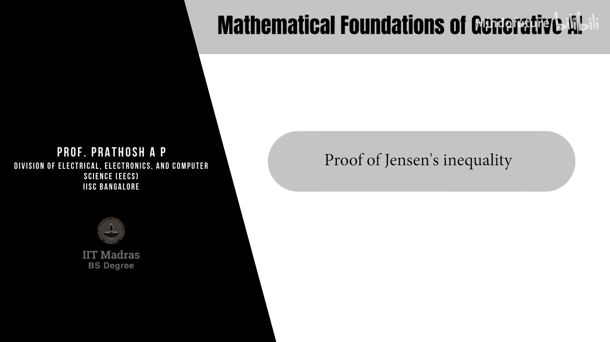
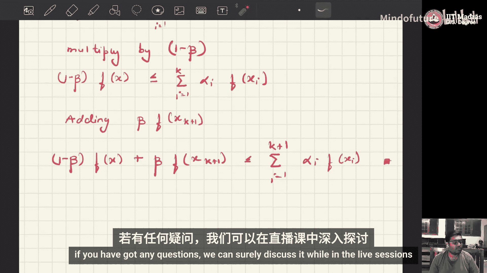

# 生成式Ai的数学基础 ｜ Mathematical Foundations Of Generative Ai p29 P29_W5T10-詹森不等式证明 -BV1fperz7EjK_p29-

🎼。

Hello all， welcome to this tutorial session。In which now we will be doing some proofs。

NowIn the theory sessions。There were some of the proofs。

Were just stated and then they were not completed。Okay， now。

 since we don't have any programming load this week。

 what we thought was we shall be looking at those proofs and then give you a taste of these derivations。

So without any further ado， let's start the first one that we shall be taking up today is。

The bedck of the latent variable model derivation， which is Jensen's inequality let's prove this jenssen's inequality and then lets proceed。

😊，Now， we shall be going ahead with the。Johnson's inequality。

Let us first state this particular inequality。你。FB， and。R to our function。Which is convicts。

It is there？Convictx function。And X。Be a。Random variable。Good。Its expectation。Defined。Now。

 if these conditions are satisfied， then。The Jensen's inequality states that。The function of。

Expectation of x is less than or equal to。Expectation of。The function of x。Good。That's。

Try to look at it before that， lets try to understand what do we mean by this idea of convexity。嗯。

The idea of convicxity。A function。F， which is from。R to R。Is convicts。If。If of。Lambda x plus。

1 minus lambda y。Is less than or equal to？Lmbda of。Eff fixs。不。1 minus。Lamed off。A free。

And this holds for all。X come away。Belongs to art。And Lambda belongs to the range。0ero co one。Okay。

 and this， what does this means， and this actually means that。The function。Lies in the。Gard。

Connecting the points under consideration。Connecting。The。2 points。Okay。は。

So this is what the definition of convexity means。😊，So now， let's go into the。

Gensen's inequality now depending on the random variable。😊。

Now there are two different proofs for discrete one。

 it is one proof and then for the continuous random of variable， we have another proof。

Now we shall be going ahead and doing in the tutorial。

The discrete case I leave the continuous case as an open thing if you have got any questions we can discuss that in the live session。

😊，So now let's try to understand the Jenensens inequality。When x is a discrete random variable。

Jensen's inequality。In this great case。Okay。Oh， what do I mean by that。Now， let's。Big。X 1， x2。

So until Xn。Belongs to art。And alpha 1， Al 2。So， until alpha n。Well， each of them is greater than 0。

And。😊，The summation of them altogether。Es one。O。😊，And then I define something。Exwhere。那我这日。😔。

It's not the mean， but just the summation of it。That's why exc。then。If F is a convicx function。O。😊。

Then。Yes。For。For a convex function， F。Now how does the ginens' inequality be there？F off。

I is equal to 1，2 n。Al Phi X。Or this is the definition of comicity study not the。Genen inequality。

This is Hol多。The definition of convexity be present。啊，对。So now let's try to。嗯。

Extrapolate this from this point。And let's proceed now the proof that we shall be doing is by induction。

Okay。The proof。Is we。Induction。对。So now。The base is。Will be n equals 2。顶。Thenba的。

By the definition of convexity。Okay，By consulting those points。A fourth alpha 1 x1。Plus， alpha 2 x2。

Is lesszard equal to？Alpha 1 f of x1。Plus alpha 2。F of x2。

This is trivially true by the definition of convexity itself。😊，Okay， so now your base case is clear。

 you are doing proof by induction， then which we need the induction hypothesis。

Im assuming that you are familiar with the idea of proof of induction， proof by induction。

Then what is the induction hypothesis？Now we assume that the inequality holds for n equals to。ok。

We assume that。对。The inequality that we have。Holds for。N equals to k listen。If off。

Smation is equal to 12 n。Alpha X。Is less than or equal to。Sation。Hfi。If off exciting。O。😊。

So now we need to take the induction step， what is the induction step？

The induction does step place n is equal to K plus one。Induction step is。And is equal2。Gless one。O。

So now in that case， what do I mean？Alpha 1 plus Al 2 plus。So until alpha K plus 1。Gods to one， okay？

Now what we shall do。Now， alpha 1 plus alpha 2 plus。T alpha n。Or alpha K。

Plus alpha k plus 1 equals to 1。Let's call this as。Buildder。And because of that。

 this will be 1 minus beta。O。So now in the sense， my1 minus beta。Is summation。I is equal to 1，2 k。

i fight。ok。😊，Now， let's define another。Scallled。Alpha a。Tilde。

 which is alpha Ie divided by 1 minus beta。Okay。Now， then it happens so that。

Summation I is equal to 12 k。A I tilda。Will be one。Okay。then if I consider。X is。

Sation is equal to 12 k。Alphahi tilde X。Okay。Now， then if I apply the convex。

 if I apply the definition of。Inequality， then what will happen。My F fix。Will be equal to。

Summation I is equal to 1，2。Key。Alpha I。D的。F of X。Okay。哦。But this is clear。Now， what do I do？

And if you remember。This1 over alpha is constant。Okay。

 now if I take this now one over one1 minus beta will be there and all the alpha I' will be inside so now。

no。Multiply by。1 minus blink。If you multiply by one minus bit of what will happen。1 minus beta。

Into F ofx。Again。Now will be less than or equal to summation I is equal to 12 k。Alpha I。F of X。对。So。

 now。Adding。Beta into F of。Ex plus one。To both the sides。What it will be。1 minus be of。If or fix。

Let's beat off。I less than or equal to。Summation is equal to 1，2 k plus1。Alpha a。If of Xxi。O。😊，And。

This computes the proof。So now。We took that。 It holds for。

We made the index hypothesis that it holds for k is in equal to k and then the index step is equal to K plus1。

Now we were able to get the result。This is the proof for Jenensen's inequality in the case of。

Discrete x is a discrete random of variable similarly you can give it a try when x is a continuous random of variable how do you go ahead with the proof if you have got any questions we can surely discuss it。

😊。

为。In their live sessions。Okay。

