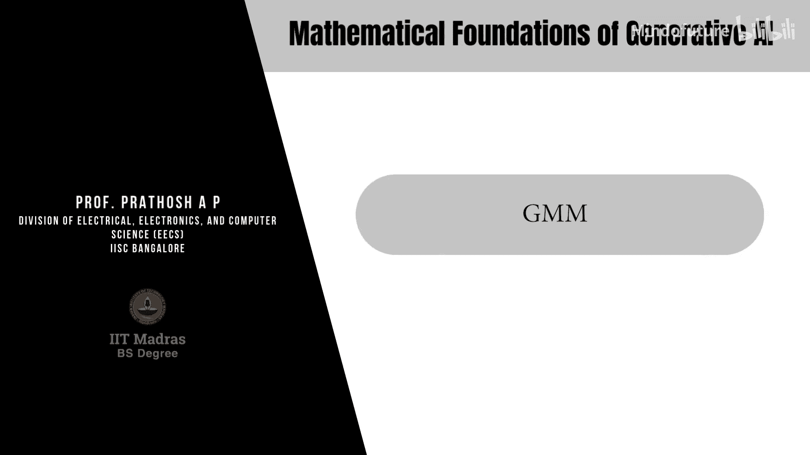
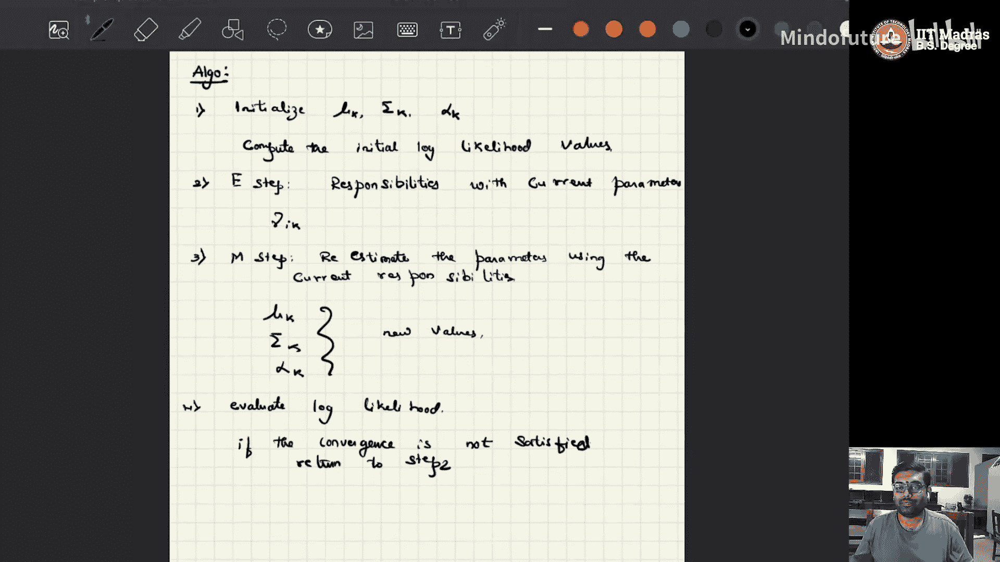

# 生成式Ai的数学基础 ｜ Mathematical Foundations Of Generative Ai p30 P30_W5T11-GMM -BV1fperz7EjK_p30-

。

Gms。Goes in mixture models。嘅。So。IAs that all of you are。Familiar with what do I mean by。

A mixture of dousions。Okay， if not， I urge you to go into the book。

 which is pattern recognition machine learning by Christopher Bishop。Especially to the chapter 9。

 where in which he deals with mixture models and EM， where in which he has explained in depth。

How the algorithm。Actually works Okay， it's a very important read。😊，Now。

 I assume that all of you please look into it。Now the derivation that we shall be doing will be from the same text and the nots that we shall be using will also be from the same text。

Okay， now。Let's define the problem first。Now we know that in this case。

Now GMmMs is a special case of latent variable models in which your latent variable is discrete that is a assumption that we are making which Z your latent will be a discrete distribution。

😊，So now let's take my X。Is。X1。L X M。那回去是啊。Sampled IidD。From the data distribution， Bx。

And I'm assuming that。I'll take any X。That is in the dimension。RD。Okay。

 and the latent that we are considering z is。Disre random variable。W take z。

Belongs to it we take values from。That one， till。直结。O。😊，this is what is our assumption。就安对你了。

For any given。Xi， any point， X， now it is combination of。Some goesussian or how do you get it？嗯's。

Summing up over。Z。Be the of。Xa。And。😊，Z。Which is nothing but。The The of Z。The theater of。Xci。Given z。

If you consider that。There are k of these。Z equals。1 to께。Now， the theta of。Z equals2。

Like it should have given。Yeah。This is。K equals 1 to capital k。OkayZ is equal to k。Mo be theater off。

Xサ。Given。Z equals to K。And this will be。Any thing but。Some mixing factor， which。甚微信。😔。

K equals one to capital K。And if I get。你么。Ex say， that I'm interested by。有见。Zig market， Okay。

 this is for one specific data point。 Now， how do you compute the。

The conditional one that is z given x， Okay， so now let's take that now。A probability of。

Z belongs to a group K。Given X I， if that is the case， we can write it as。Xa comma。They gay。

Dived by probability of Xe。this by using the base rule， I can write it as probability of。Zge。

And probability of。Ex say given。Z kid。Dverd by probability of Excel。 Now， I know these substitutions。

 Now， this is。Andfor gay。This is Nau。X I， which is parameters by mu and。The co sigma k。

Dverd by summation。J equals 1 to capital K。Alpha J。Enough。Ex same muji。Zig magic， okay。

 so now we call it as。For the I eat the point。Now， what is the responsibility that？

Kith the Gaussian will take。 Okay， this is one important value that no we should be computing。 Okay。

 so now let's proceed similarly。Okay， so now what， what is the final aim， The final aim is to。

Maxim is the log likelihood right， what is log likelihood？😊，Let's consider that。嗯。Log likelihood。

Now first， that is p of x。It was。Product of I is equal to1 to n probability of individual X。

 So then if I take in the log scale， this is log of。The effects is。Log of the product is equal to 1。

2 n。We have X I， now we order。Loarithmic rules， this will be I is equal to 12 n。老个。V of X。

 now we know this value already。Needed for this。Okay。You know， this values lose。

Now this will be summation I is equal to 1 to n。嗯那得啥事啊。😔，Lolog of。Smation。J equals12 capital K。阿发剑。

En off。X I， now which is parameter by muji。And sigology。Okay， now this will be your log likelihood。

 Now what is。The EM algorithm say now the finally let's recap the statements of EM algorithm now。

The EM algorithm。Has two steps， now one is the east step， the expectation step。No。Now。

 it's an iterative algorithm with。Theta at the stamp T。 Now， I keep it as a constant。 Okay。

 what I'll do， I'll get。The deep plus one， which is。A mags of。Q， this is my E step。Now， what is this。

 Well， this is nothing but P of。Z givenix。That means that in E step you will be finding this value by keeping this mixing coefficient mu k and sigma K as constant for all the case。

Okay， for all the mixtures， you will be finding it by keeping the mixing coefficients and the parameters as constant okay。

 so now then in M step。And step what you will do。 Now， you will， you will take that width。

The obtained the。T plus one as constant。Now what you will do， you will get。Theater start。

In that specific case， we get the star of。A Maxof。Ted off。press one。 Now。

 that means that what do you do by keeping these。Responsibility coefficients is constant now you will find this alpha k U and sig market this what you will be doing in the。

呃。M step okay now E step is pretty much clear Okay， now you will be computing these okay。

 so now let's go to the M step now which is important to us。Okay now in the M step。

 now you have three unit to your theta。Your theta is a sett， which is having a。Your alpha。

J equals 1 to k and your muse J equals 1 to k and your sigma is also J equals 12 k。Now。

 you need to compute these parameters Okay， so now on Als now there is a con。

 but there is a constraint。 which says that if you take。the summation of。

All these alpha js now you have to get one okay， but there is no such constraint on these parameters okay so now whenever we are trying to optimize now we need to do a constraint optimization okay now in this case now。

We need to do。You cannot get any values of alpha there is certain constraint that needs to be taken care we need to。

Do啊。Constrained optimization， okay。W is then we will look into it now to do so now we need something from the optimization theory。

 which is we need something called as a lagrangee multiplier okay。We need。

We need a lagrangee multiplier。Now when you add this lagre multiplier。😊，Now， your overall。

Optimizing function now where you like。There's alpha of this。Thisすね。J equals 1，2 k。Alpha J minus1。

 now this will be a new optimization function。 Now let's call this as L okay。

 this will be a new optimization function。 Now how does this optimization function look like。Now。

 this will be。Sumation I equals to 1 to n。Log off。Smation J is equal to 1，2 k。Alpha J。Exile。

Parameterized by。Muji and。Sigma J。This is your regular log likelihood。In addition to that， you need。

Like个都没。Okay。So now this is a function， this is the optimization function that we want to do it。

 we want to maximize this particular。😊，Constraint how do we do it now the idea is straightforward。

 you take the derivative and thenequ it to 0。Okay， now we need to do it for three set of parameters。

 now one for mu one for sigma and therefore for alpha， well let's start from a simple one alpha。Okay。

Now， no。Ands let's give this equation some name， let's call it as E。Okay， so now。Or differentiate。

Differentiate E。Withtrospect to。Alpha지。Okay， and equal to0。And equal to 0。 Okay， so that is。걸都 싫어。

So now you want to take the derivative of this， there is a summation you get inside。

Divivity of log of something that is one over that specific quantity。

And then the derivative of that quantity now you have a summation you get an alpha j into this Okay。

 now I am assuming that you guys are comfortable with the rules of differentiation now this will be。

Summation I equals1 to n。1 in 2。엑サイ？M j sigma j。Divided by。Sumation。J equals 1，2， k。Alpha G。Enough X。

You did。S my姐。Plus， lambda。Equal to 0。Okay。This only one term will be having alpha J。

 the remaining times will be0， wherever is alpha j you will get this。Lambda。And then this is a。

Chain rule， which you can apply now what I'll do now。Now the problem is multiply。Bite alpha J。ok。

Then both sides。Equals 1 to n。Alpha제。Enough。X we just parameter parameters y we join sigma J。

Divided by the summation。Z equals 1，2 k。Exe music。Sigma do。Plus。Equals to0。

Does this term look okay not this term， does this term look familiar？

Have we looked at this term anytime earlier？If you go back。This is the responsibility okay。

 normally this is called as responsibility。Now， this will be。Subation。Equal0 to n。Hey J， plus。

Equals to zero。So then alpha J， if you rearrange the terms。Is equal to。1， to， n。my was died。Okay。

 now this is realwritten us。N K divided by n。Okay， now this is substituted by Nk。In the Slamda。

Is given as and。Now， this is how you get the first。😊，Tumbs in the case， okay。

Now you got the mixing coefficients now， now the remaining things needs to be looked into now you need to get muK and Sigma。

嗯。So now let's do that one part is done。Now， not to get muK， we should follow the similar thing now。

Differentiate with respect to。Muji。And。Equate to 0， what？Equation a。Let's go back to equation a。

 this term is independent of muj， so no problem。Again， now this will be like。

Log of this Now this is one over this term will Now you want to differentiate this。Now you get。Okay。

 this term。Into the derivative of this。O。I will be doing one after another。

And then the normal distribution， you know， the equation。

 no one over 2 pi to the per of half one over sigmas， all those things， you know the equation right。

 okay， and then even for the multivariate case now you know how to do it okay， I will just be。

Going ahead and writing the equations。哦。Mhich of L。Equal to 0。Then I get。Mine is of。

I is equal to 1 to n。Alpha J。Enough。Exite。Muji。Sigmaジ。Divided by。Summation。J is equal to 1。

2 capital k。Alpha J。Into N of。Exci。M有 just醒 my姐。In two。

 now if you differentiate the exponential terms。你个。Zigma K。Xサマイナスみ 向け。Equal to  zero。

We know this term already。And this will be。I is equal to 12 n。A he j？Sigma系。

X s minus muu k equal to 0。So now now you should remember that this is a matrix。O。我哇。

This is a square matrix。ok。Preferably， it will be a diagonally dominant matrix。Therefore。

 we can assume that the universeverse exists。And then we can multiply by the inverse of this matrix。

Okay。This is a scalar anyhow so now you can multiply by the inverse of this。Multiply the。

Would the sides by？So it has to be a。It has to be J， okay。There is an indexing mistake。

That to be muji。Ex say。So this has to be sigma J。😔，你是什么啊。multiiply by。Inverse。Now， you get。

Smation y is equal to 1 to n。Then you multiply this。M it exc。Minus。Smation is equal to1 to n。一五秒钟。ok。

Well， this is。Equaled0。Okay。NowThis is independent of I。e。Now， you can take it as。N。

 but this is not independent of Ie is there here so now。This will be。Muge equals 1 over。AndG。Okay。

Smation I is equal to 12 n。系姐。Exite。Okay， now this will be the value of。Ie。Okay。So now similarly。

 now。On a similar steps， I will not be going ahead with。How do you calculate。The values of。Zigma J。

 but you have to follow the similar steps now。😊，You differentiate。Withtrospect to。Zigma J。And。

And follow the similar steps。You get。Zigma系。まジ。Equals one over。And姐。Smation I is equal to 12 n。

X minusみジ。Nto X minus mu J。Transpose， okay， but this will be the value that you can this completes our。

Divvation， now， how will your。The steps looks like okay， how does your EM steps look like？

I'm directly quoting this from。Page 439 of Bishop。Now how do you do this， How do you code this， Okay。

 and give the steps Now let's see。啊。So now given the Gausian mixtures。

 the goal is to maximize the likelihood function with respect to the parameter okay to get mean covariances and the mixing coefficients now first know we lets look at the algorithm。

Step1。Okay， initialize。咁有게。Is it marketけ？And alpha K。ok。😊，嗯的。Computer。Initial。哪个。

Lg likelihood values。好嘅。😊，The second step is the。Ea it。那我这日。Evaluating the responsibilities。Re。

With current parameters。疲からた。Paraitus。No， you get。系嘅。Now the third step is。M step。冇。This is。

Reestimate。The parameters。Using。The current responsibilities。Okay。With that。

 you calculate new values of muK。Sigma K and alphapha K。😊，应该得。New values。Okay。

 now then the fourth step is。Evaluiate。Log likelihood。O。No。If not convergent， okay。

 if you are not satisfied with the convergence。If。个。If the convergence is。Not satisfied。Satisfiyed。

Return to。Step 2。Okay。This is your。Overall， iterative algorithm for EM。For Gaussian mixtures。

 I hope this derivation gave you a very nice mathematical foundations on how to handle the EM。

So we will stop at this point。And then we will meet in the next tutorials with implementations of。

Variation auto encoders。Thank you。

