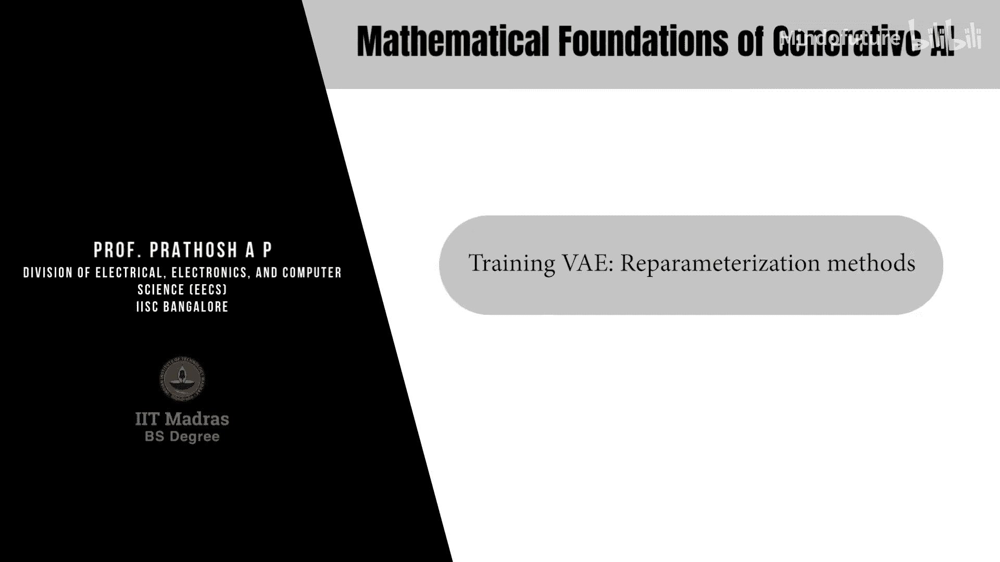
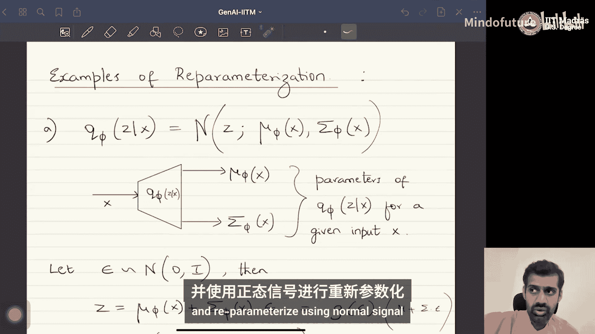

# 生成式Ai的数学基础 ｜ Mathematical Foundations Of Generative Ai p31 P31_W6L21-训练VAE-重参数化方法 -BV1fperz7EjK_p31-

🎼。

Before moving to the gradient computation。Let me just reiterate the data flow within a VAE so that the discussion on gradient and computation is well appreciated。

So in the VAE， we have two neural networks encode and decoder。Data sample x goes as an input to the。

Encodeder network and encoder network outputs the parameters of delete latent distribution Q phi z given x。

That being a probabilistic neural network， then a sample of Z is obtained by sampling through the distribution whose parameters that the encoder network has predicted。

 taking the parameters of the distribution that the encoder network has predicted， we will sample。

One or many points of z which is the actual latent vector and that latent vector that has been sampled outside of the encoder decoder will go as an input to the decoder network which would output the parameters of the conditional data distribution p theta of xq and z so three things are happening one data goes as an input to the encoder which will give you parameters ofq p of z given x and having the parameters of q phi of z given x。

There is a sampling that is happening outside of the neural network and once we have the sample from the latent distribution and that sample is taken as an input and given to the that sample is taken and given as an input to the decoder network and decoder network outputs the parameters of p3ta x given and z。

 this is the procedure of how the data flows into a VA please note that there is a sampling procedure that happens that that is there in the pipeline that is outside the neural network so this is a critical point to be noted because you know this comes up in the gradient computation so there is a sampling network the sampling procedure with your par it' is not a network it's a sampling operation that happens outside of the encodeder and decoder neural networks now let us proceed with the gradient computation now what we should do。

Is that we should look at B。The last function which is the elbow and we need to compute the gradient of the loss function with respect to the encoder and decoder parameters。

let us look at our loss function。So the last function that we have。Contains two terms。

 the first is the conditional expected data likelihood and the second term will decay divergence so just for a reference let us have a s function here now what we need to do is that we need to compute the gradient of this particular term with respect to the encoder parameters phi and the decoder parameters theta so now since we have represented the encoder function using the neural network all of these will be parameterized by phi all the Q will be parameterized by phi now let us compute the gradient of each of these terms with respect to both the encodeder and decoder parameters so now there are four gradients that we need to compute the gradient of the first term in elbow with respect to phi the gradient of the second term in the elbow with respect to phi and similarly with respect to the。

So there are four gradient terms that we need to compute so let us start with computing to compute。对。

To compute the gradient。off。你lo。We， with respect to。

The encoder parameters phi okay let us first consider the encoder parameters phi。Now。

 which means that we need to compute the gradient of。

The first term which is the expectation of so let us go term by term this is the log of p sheetta x given z。

 the expectation is with respect toq phi of z given x and also note that the z that we are conditioning it is also coming from Q phi of z given x。

This is what we have we need to compute the gradient of this particular term with respect to phi and we have this term depends on two counts。

 one the expectation is with respect to Q phi and the conditioning variable here from which we are sample which we are having in the loss。

The conditioning variable is also sampled from Q phi of z given1 x and there is different enzyme c there as well okay we need to compute the gradient now。

The abovebo term looks like the following。A vote term is similar to。

Just to avoid writing the log P theta x Eency every time I can write this as you know。

 we need to find the gradient of expectation。With respect to a distribution， let's call that sum P。

Psi of v， and we have a function， F psi of v。And the gradient is with respect to site。

 Okay So now here's the distribution。Be say that we are talking about。Yes。Q p of zgononics。

And the function with respect to which we need the gradient is。

Log of p theta of x given z so please note that this function also has been shown to be having dependency on side because the Z the conditioning variable is sampled from Q phi of z given x and therefore that also depends on the parameter with respect to which we need take gradient。

And we have replaced the random variable B with。The random variable z here because whatever we had as z is is been written as we know and the parameterssi that we have here are。

The percentage us。The parameter p that we have in our original problem right is represented using another set of Greek letters ci now why did I do this this is because you know I just wanted to avoid writing log of pt topics even every time okay so this is what this is the form of the gradient that we need okay now how does that look like let us write that down so this is equal to so gradient of。

Expectation of some function。With respect to a distribution。real to let's write that dumb。

 So this is the gradient of the expectation。 The expectation by definition is the integral。

 assuming that all of them are continuous random variables， which is the case in our。

Current scenario， F psi of V。B we。So we know that the gradient is a linear operator so we can push the gradient inside the integral。

 so this is。B are your for we。So will be we okay just push the integral inside then once we have I mean the gradient of product of two functions if you want to find that out we need to put the product rule so product rule tells us that this is the gradient of。

嗯嗯。D function。Times the second function， which is P I of V just applying the product rule of gradient or differentiation here。

 Dv plus the second term is。I can split the internal because again， in is。In here。

 so we have the gradient of the second function， which is this。Times。Upside of free B， right。

Just applying the product rule of differentiation now what is this function if you carefully look at this particular function here。

 this can be written as another expectation。Off。The gradients。

Of F of V withtrospect to the distribution and p I here right because this。This is some function。

 the gradient of fi is a function and we have the density function here an integral of the density function with respect to some function is expectation by definition。

 but second term here right is not an expectation so this term。Is not。An expectation。

 not an expectation and therefore it cannot be empirically computed。Okay。

RightSo we know how to compute expectations by taking sample averages so this can be evaluated because you know this is the if you look at the current scenario here our f function is locked p theta of x d1 z and we can compute the gradient with respect to that okay and because we can obtain samples from this distribution Q p of z given1 x okay so this expectation can be computed using sample averages however the second term here that comes up cannot be computed because it is not an expectation why is it not an expectation because f psi of e is not a probability function here。

Had it been a probability density function we can write this integral as an expectation but because it is not a probability density function this integral is not an expectation and because it is not an expectation we cannot compute that using sample averages so we have the gradient of the density which has which has no interpretability and therefore you cannot write the product of the gradient of intensity function times some other function as an expectation therefore。

😊，This gradient， which is what we need cannot be computed， so this implies。So。

This implies that the gradient。Of。The expectation of log of。

P theta x given1 z respect to Q phi of the。Thank you you next？Cannot be computed。

So here by definition， the z here is coming from Q P of z1 x right。This is the bottom line。

 so to train the neural networks which are the encode encoder network here。

 we need to find the gradient of the first term in the elbow with a spec p okay that cannot be computed because the the product rule of differentiation when applied to this particular gradient that we need to compute we will end up having a term that cannot be computed in terms of expectations are samples sample averages this term cannot be computed and therefore the gradient that we need to try the。

Enco neural network in a VE can be computed so。Another way to say this。

 look at this if you look at the data flow diagram here what we are actually saying is that there is a sampling step that exists here right so what happens is x goes through the encoder so you get some parameters and there is a sampling so if you look at this entire thing as one pipe plane what's happening is there is a neural network there is a sampler and there is another neural network and we have p theta of x given x x given z so if we need to backproagate our gradients all the way from the output of this decoder network we can do that we need to then backproagate our gradients which through this sampling network or other sampling procedure right and then we have to go propagate those gradients all the way to the input of the encodeder network if we want to train the encodeder network that cannot be done because the sampling procedure that is there is a nondiiable operation。

Okay so there are lots of functions that are non differentiable right sampling is one such function that cannot be differentiated okay so because since the sampling here cannot be differentiated you cannot propagate the gradients from the output of the decoder all the way through the input of the input of network。

As there is a sampling procedure that is in between the encode and deco network okay so now how does that translate to math is that when you try to compute the gradient and look at this if you look at this carefully what is happening is that you need to compute the gradient of an expectation of log of some function and this function is dependent on a random variable Z okay and this random variable is obtained through a sampling procedure and that sampling also is dependent on the parameter p with respect to which you are taking the gradient。

Okay， so now because the Z depends on Q p and you are seeking gradients with the spectral p。

It turns out that when you do the match the gradient of this particular expression with z coming from Q v of z given x cannot be computed with respect to p because of the existence of a sampling operation which is non differentiateable okay So now how do we solve this problem so if you do not solve this problem there is no way that we are。

We are finding out the gradients of the encoder parameters with respect to elbow so to solve this the authors in the original VA paper proposes this solution called solution。

For this problem。Is what is called as the re parameterization trick。Yeah。Okay。

 so authors uses a trick called re parameterameterization to make the gradient computation feasible okay now how do we do that as the question so re parameteraization is a well known technique in classical statistics where。

One can represent a random variable in terms of another random variable using a deterministic function。

 So let us see how that is done。 So let's recall that。The gradient of。The expectation of。

This particular function。嗯。Cannot be computed。 This is the problem that we are dealing with。Yeah。

Now how do we solve this problem？Now， the idea is express。

Express the distribution or the density function。It's plus the distribution， P I of V。In terms of。

Another distribution。Okay。Another distribution involving another。Random variable。

 auxiliary random variable。Okay。嗯。Ouxiliar random variable， which is independent of。Okay。Okay。

Independent of。第第一个。The parameter side。Yes。The idea is to represent the distribution which we are sampling with a specto okay so here too let me just complete this this v is coming from p I of V right is coming from the same distribution as we are compute the expectation with the specto so what we need to do the idea and v parameterization is to represent this density function using another o very random variable that is independent of the parameter C now how do we do that。

Let's say that。We have， suppose。So concretely， mathematically， this is how we do this。

 suppose there exists。In English， suppose there exist。An auxiliary random variable。Okay。

 let us call it epsilon so that is sampled from some distribution P epsilon。

Now this Pf salon is independent of site right， so P salon。Is not。Depenent on site。Okay。And。

We can write v， which is the random variable of interest in terms of some function G okay。Of epsilon。

So then what happens is the following， so what we need is the expectation of。

This function upside of V。Withrespect to。No。毕业狼。V epsilon of V right。

 So this can be shown to be equal to the expectation of。Eps of， so what is V here。

 V is G of epsilon So this G function depends on the parameter psi here。Okay。

 so this is F of F of G of Epsilons。So other I mean I will omit it because f already has the dependence okay so now v is given by f of v is given by g of epsilon。

 but now this expectation now is with respect to p epsilon not with respect to ps so please note the difference here the expectation which was with respect to psi now became an expectation with respect to p epsilon so this。

Result is a known result in statistics result called the law of。没。

Law of unconscious statistician or abbreviated as lotus， okay？对。

So this will tell you that an expectation with respect to one random variable can be written in terms of expectation of some other random variables so let me just。

Ex this is the law of。Yeah。Yeah。It has a peculiar name。 so idea is that the expectation。

 if that exists。A function that transforms one random variable to the other so here epsilon is getting transformed into the random variable B then expectation of a function with respect to one random variable can be written in terms of the expectation of expectation of this the function with respect to another random variable just that the arguments here for this function has to be changed by G of epsilon so this is what the idea is okay now。

Of what use this is for us is the following that now we need to we we are seeking the gradient of the expectation。

Of this fs of v with respect to p psi of v right now this this gradient is with respect tos。

 this is equal to the gradient of the expectation of。F say of Don。

With respect to Pon now so note what what did we do we removed the dependence of a sampling step or rather we shifted the sampling step okay out of the expectation So now with this what happens is。

While the gradients are with respect to Psi here， the expectation is not with respect to a distribution that depends on psi。

 correct now this。Here psi is being sampled from the epsilon is sampled from P epsilon which has no dependence on the parameters with respect to which we are looking taking the gradients this can be approximated in terms of sample average so what we can do is that we just take the usual la large numbers and this can be written as j equal to 1 through m。

The episode of。G of epsilon J。You。Where the epsilon I epsilon Js are sampled from P epsilon so now this gradient that could not be computed now can be computed。

Just recall what we did this gradient could not be computed because the gradient was with respect to an expectation。

And that expectation was being computed using a density function which had dependence on the same set of parameters with respect to which we are the gradient right so that is what created this particular problem right it just we ended up having an integral that cannot be computed now what should be done is that if we can somehow write this expectation with respect to another density function that is not dependent on the parameter with respect to which we are taking the gradient then we are done okay how do we do that the way to do it is that the express the random variable upon which this density function is defined in terms of another random variable another random variable so another random variable whose density function does not depend on。

The parameters with respect to which is taking the gradients。

 then the law of the unconscious statistication will tell you that this expectation can be written in terms of the expectation with respect to this another density function that is not dependent p side。

 So this the passing the gradient with respect to the sampling step。

 So look at it right So we have the gradient here。 we need to take the gradient with respect to s and this gradient has to pass through this。

Quote unquote， pass through this sampling step here because this is the sampling that we are doing when you are taking expectations。

What did we do is that when we write this expectation with respect to another random variable or another density function that does not depend on the parameter with respect to which we are seeking the gradient。

 then the gradient need not pass through the something step So that is the idea Okay so then we can use our usual La large numbers to compute the gradient that we are seeking your par that should be a。

Gradient parameter here。J is1 through M and we have the gradient of this particular function with respect speci which can be computed now。

Okay， so that is the idea So this entire process is what is called as the re parameterization trick where。

One random variable is being represented in terms of another random variable using a deterministic function G which would enable gradient computation easily so that is the idea of re parameteraization so let us look at the examples of re parameteraization to let us understand this point examples of re parameteraization。

OkaySo let us look at the first example that is commonly cited in the VA literature。

 lets say that the latent posterior that we have okay we assume that this is a Gaussian distribution and this Gaussian distribution is on the latent variable of course lets say that the parameters of this Gaussian distribution are mu phi of x comma sigma phi of x。

Okay， so why did I write the mu phi of x and sigma P of x because of the following so recall that in a VAE you have the encoder network。

The encoder network is giving you the parameters of the distribution  Q p so what happens is the encoder takes as input the input sample x okay and this is the Q p network and now you are getting the parameters of this distribution so we have assumed that this Q P distribution is a gaussian distribution which means that this will give you a mu and a sigma okay and this mu and sigma。

A parameter is by phi right because it depends on the parameters of this neural network and this is also dependent on x because for every given x right so for a given x。

This distribution is different。Okay， so you have a different latent distribution for every given sample of x and therefore you have the dependence on x or the parameters of this distribution  Q p right so now。

I also note that we are only assuming that this distribution Q P of z given x is Gaussian。

 which means that we are not saying that this is a particular Gaussian。

 we are simply saying that it is a Gaussian distribution whose mean and variances are being obtained from the output of the encode network。

Okay， so what are these immune sigma these are。The parameters。Parameterters of Q phi of z given x。4。

啊， given。Inputex， right？Okay， so this is under the assumption that my  Q p of z given x is a gaustian distribution with a certain mean variance。

 this neural network is going to give me the encode neural network is going to give me a particular mean and the variance of the distribution that。

Okay。I have assumed on the late posteriors。 Okay， now how do we re parameteraitize this is the question。

 So now let's let。That epsilon， which is the ailder random variable B a Gaussian okay with0 mean and identity or unit as variance unitity as variance。

 then it is a well known result in statistics that。

Any random variable a Gaussian random variable can be re parameteraized in terms of a normal distribution right so this is。

Mutheopics。Plus。Sigma p of x times epsilon。 So depending upon what the dimensions of this thing is right。

 I mean， this will become a h mark product， which is an element twice multiplication。

 but if you take a。Normal distribution with or gauss distribution with0 mean unit variance。

 you just add a particular constant mean and multiply the sample from a normal01 then you know that z。

Will be know sample from？normalmal distribution is mean equal to mu phi of x plus。Sorry。

 mu fewex and the variance。Will be equal to sigma3 of x。

 So this is a known result that any Gaussian distribution with me a certain mean invari can be re parametermetized in terms of。

A normal distribution which is a constantsian distribution with0 minute urine variance okay now what is the G function this is the G function。

 so this is。你有发吃了。So G of epsilon is this particular operation that given a particular sample from normal 01。

 you take the output of the neural network which corresponds to the mu and sigma。

 multiply that epsilon with the sigma and add。That with the mu okay so now as I said if we are working with the vectors so then this happens to be the guard products or Hadmer products all right rather we can write this is this is this will be a matrix and this will be a vector of appropriate dimension so this will be a matrix and vector product So depending upon what the dimensions of over z these are all vector operations。

 However， if you re parameteraitize a normal a sample from the normal distribution using this particular function then your z comes from。

A Gausian distribution with thatt z and given sigma。Okay， so now what is this function。

 This function G is actually。Its a mu plus sigma times sron。

 So this is that function that we are talking about which。

We showed here right so the z or the random variable of interest was now represented with us using another aary random variable and the G function in this case the G function happens to be an a transformation this is called an a transformation which is taking a mu and sigma and。

Scaling your epsilon with that particular sigmma and adding that particular mu so that is the idea this is one of the ways of re parameteraitizing there is another way of re parameteraitization which is called the inverse C of method。

Where， suppose。Yeah。SoZ is a random variable。And the variable， and。F z of Z。Deote its C。

Cumulative distribution function， okay。Then。2。Dine the cap。As。The inverse。O。This C of where， okay。

 let's call this epsilon where。The Epsilon is sampled from a uniform distribution。Oh。Yeah。

Between 0 and 1。sent C。Okay。Okay， so now this is another re parameterameterization。

 the idea is that one can write express any random variable in terms of a uniform random variable between 0 and 1 okay。

So now。The G function here is。Simply the inverse of this area。Okay。

Inverse of the CdF and the epsilon is from uniform 01。

uniform distribution between0 and1 I'm saying so one can re parameteraize。

Any continuous random variable using the inverse of the Cdf of that particular random variable。

And you operate the inverse of this C on a uniform random variable。

 which means that you take a sample from a uniform random variable between 0 and 1。

 you pass it through a function which is the inverse of this C of a particular random variable then the corresponding output that we get will have the same distribution as。

That of the random variable whose cd of inverse we are looking at this is called the inverse cdf method So this is also a re parameterization reparameterization method because what we have done is we have represented one random variable z using another random variable epsilon using some function which happens to be the inverse c these are two examples of how one can use reparameterization in in the Va setting but typically in an implementation from an implementation perspective people assume Q p of z given x to be a Gaussian random variable with a certain mean variance and the a transformation is what is used as the re parameteraization so please note that the first example that I give which is this particular form of the G function is specific only to。

Q p of z given1 x being a Gaussian distribution and the aator random variable being normal0 I here in the second example that I cited this sort of re parameteraization is common for any continuous random variable whose CD find inverse exists。

Okay， but as I said， the usual practice is to assume that  Q p of z given1 x is a normal distribution and use this kind of re parameteraization in a VA setting Okay so note that this choice that we are making on  Q p of z given1 x that it is a。

Gaussian random variable is a design choice one can make any other choice on Q P of cQ1 x and parameter is that using the encoder network the only thing is that one needs to find a G function and an also the random variable。

Using which we can re parameteraitize that， okay。Yeah that is the only condition， however。

 it is the usual practice is to assume that is aus it is a Gausian random variable with this particular mean and a variance and re parameterametric is using normal0 okay。

😊。

