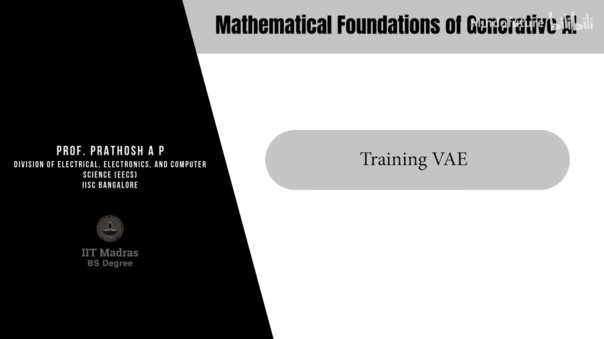
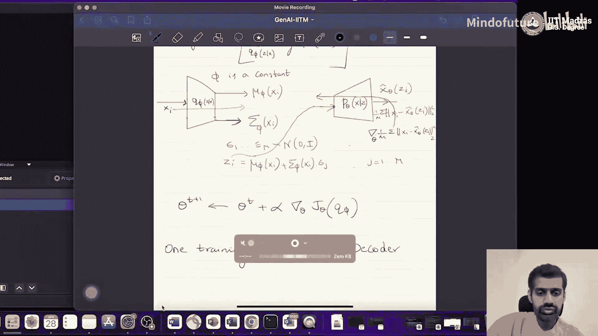

# 生成式Ai的数学基础 ｜ Mathematical Foundations Of Generative Ai p32 P32_W6L22-训练VAE -BV1fperz7EjK_p32-

。

So， this is about re parameterization， so it solve the problem of the gradient so let us get back to our gradient computation so let us definitely us copy this diagram。

Yes。Let me call it X Ie because we are lets say that we are looking at one particular sample of input data and we also need the decoder here。

Okay， so what is the data flow as I said now given an Xi it passes through the encoder network and gives you a mu of Xi and a sigma of Xi then what do we do that we sample an epsilon。

J from normal 01， this all this happens outside the neural network， okay， and then we find a Z J。

Sure。Let me call it the epsilon I here， I don't want to confuse you with multiple indices。

 the Ze so Z is given by。Repar just do re parameteritization muu phi of X I plus。

Sigma phi of X times epsilon I this is the re parameterization。

 now we will take this Z and pass it through the decoder。Oh。佢做请鸡唔系都识嗰啲。

The lengthth of this diagram see typically what happens is the dimensionality of x is much higher compared to that of the dimensionality of z。

 so we will have to represent the encoder this way。唔该。So let me try change this here as well。

I hope that you are following what's happening。 So here， the dimensionality of。

The input input data x is in Rd right and the latent variable is in dimensions RK and the way of I mean in a typical setting。

 the dimensionality of the latent space is much lesser compared to the top data space。So this is。

M free of exc。This for the sake of completeness。It's obvious。

 but let me say so this is some X I it is in RD， it is three dimensional space。 my Z I is in R K。

 which means that the mean that I have。Will will also be R and the。

Vance covariance matrix will be in a K cross K dimensional space right so that is what the idea is。

Now in in a usual implementation， what is assumed is that this sigma matrix。

 which is the covariance matrix is assumed to be a diagonal matrix， which puts it to R because。

A diagonal matrix will only have k elements right you can take the rest of them to be0 okay so then we have the decoder network here。

Decoder network takes。This ZIe that we have gotten from the sampling as an input。嗯。嗯。Okay。

 and this is P the of x given Z and we will get back。The parameters of。

P the of x Q and Z Okay still not told you how to get the parameters of P theta of x Q and Z just bear with me for a while now。

 So this is how the gradients， I mean， see the forward flow is happening。 The data flow is happening。

 What we should do is we are interested in computing the gradient of。The expectation of log。

P theta x given z with respect to Q phi of z given1 x。

 so this is the gradient that we wanted okay now with reparameterization what we have done is that we have written this gradient。

Okay。With respect to the expectation of。Log of。P theta x given。 So now what is Z here。

 Z is G times epsilon。This is the reparameterization that we have done and this expectation is now with respect to Pfon。

So this is now equal to。The gradient of now this expectation now will be written in terms of sample averages。

Okay， so this is log of。P theta X given G， this G will be of okay， G of。收啦你。读三节。

Which can be computed now。Okay， so now with re parameterization what we did was whatever this expectation with a spec toq fee which was not compute which was hard to compute was represented using an expectation with a spec2 P epsilon so which can be compute right now。

Okay， so now where is this M coming from， see what's happening is for a given mu and sigma for a given input sample X。

One can obtain multiple samples of xence there is no need that a given sample of Xi here in the input corresponds to only one sample or one latent sample。

 okay latent vector。Now for a given for this for the same given Xi there can be multiple latent vectors z Js okay that are passed as input to the decoder now that is what is represented as J here now suppose you have okay let me write that so we here epsilon one epsilon2 up to epsilon。

M， they are all being sampled from P。 So what we are saying is for a given data sample X Ie。

 we can sample。Multiple latent vectors using the parameterization trick also we should try to just to be sure so we have the Z is now actually being sampled fromq phi of z given1 x which is equal to a normal distribution with mean equal to mu phi of Xi and sigma p of variance equal to sigma p ofxixi。

Now， why is this important with this？Pull it a little down， so that。嗯。Yeah。This is Vicca。そ。

whyhy is this important see we actually wanted samples from Q p of zgon x right that is what we wanted samples from which was an normal distribution with the mean mu and sigma sorry variance epsilon sorry variance sigma but we could not I mean we could not get that or rather if we get the samples from that distribution we cannot compute the gradient so what did we do was simply designated the sampling okay in terms of a sampling over epsilon thats all that is the reparameterization trick so we can。

Put this in bracket， So we have technically we have not changed anything in terms of the gradient computation。

 but we have just made it look look a little I mean easily computable Okay so this I put it inside the bracket inside some box。

This is what we wanted， but we did it。Using the re parameterameterization。Oh。Let me write it。

 so this was。可以。This was wanted， right， and this is。A complex in。

Reparameterization that's all okay the entire process of reparameterization is to accomplish this particular sampling that we wanted by using another auxiliary random variable which is independent of the network parameters okay that is the idea here okay so now this gradient can be computed and we can as usual back properlypo。

Now one missing piece of the puzzle here is that how do we compute this log p theta x given g of Xl andj right so let us do that now to compute。

Okay。Okay。I will write that as P3 to x Q and z。maybe think of completeness let us do it this way。

Okay so how do we compute this see all this might look complicated。

 but mean if you go through it carefully they are all simple matchs and a little bit of algebra to ensure that the the computation that we are doing becomes feasible okay it is not at all complicated so how do we compute this。

Now， in practice， one can actually we can put a log here as well。No。Yeah。Do compute。嗯。

Lo of this is the term that we need to compute so we will see how to compute this okay now there are multiple ways to do it I will give you one example of how to do it the basic idea the following parameterized。

Okay。P theta of x Q and Z。喂啊。Some distribution， some loan distribution。这个这这个。え。谢谢谢。

And use the decoder。Use the decoder 2。Output parameters。

That is what we have been saying that the decoder and encodeder networks in a V are probabilistic in the sense that they give you the parameters of the distribution that they are modeling right so how do we do so an example to do this is let's say that we have assume that p theta of x Q and z this is one example of how this can be done but there are multiple ways to do it assume that this is a cotian distribution this is on x and let's say that the mean of this distribution let's call that some xcap xcap up z becausecap of z xcap theta z okay and let's say that the variance of this particular distribution is identity now what does that mean that means that the decoder here the parameters of p theta of x given and z are actually some mean which have called as xcap。

Of theta and it is taking a Z as an input right， this is what I'm saying。Okay。

 so this decoder network now is giving you the mean of this distribution Pte of x given V x given z。

 which is assumed to have。A Gaussian form and the output of this decodder neural network is giving you the mean of that casian distribution。

so that is what we are assuming。 So now under this assumption。

 lets see what happens to with the above。With the now log of。Looff。B Tta of x given Z I Z。Yeah。

What does this equal to this has a nice form now， this is equal to log of。

What is P the of x given z that is a gasian distribution which is in higher dimensions we have like one by2 pi。

TheD dimensionality is d by 2 e power。Minus。嗯。X， because it's a distribution on x x minus the mean mean is x cap theta of z。

There's a norm here。😔，And since the variance is identity。

 this is all it is that this is this is how the Gaussian distribution looks like。Okay。

 so now I can take the log， the constant out okay can see that this is proportional to simply the negative of the exponential here and the log gets cancel。

 so we have x。Minus x Theta of Z， that's it。Okay， I can use this as the last function。

 So now what happened is this implies that what we wanted， we wanted the gradient of。嗯。

Expectation of log。P the of x given z and this was with respect to  Q phi of z given x and this is what we wanted this is equal to the gradient of。

First， we saw that this was equal to the expectation of。Log。

P theta of x given g of epsilon because z was re parameterameterized in terms of the epsilon right and this expectation was with respect to P epsilon and this is equal to。

This expectation was approximated using the sample averages， which is1 by m。

And this log was now given by。J is1 through M and we have a minus here。This is X I minus。Xcap Theta。

 which is the output of the decoder Z J。嗯。That's it right So this is the last that is to be computed where。

Zj happens to be so I mean one might look at this right I mean this we are seeking the gradient with respect to phi but this entire thing does not seem to have dependence on phi at all that phi at all。

 but it does have dependence on phi through the re parameterization because the Zj or Zj term that we have here is mu of mu phi of X mu phi of X times。

Epsilon， J times。Sigma phi of X， where。Epsilon 1 through Epsilon J are all samples。

That are coming from normal 01 this is the E parameterization flag so。

The last function here that we have does depend on phi through Z。

A through a xcap theta where xcap theta depends on Z J and z or z depends on the encoder parameters phi。

 so that is how the depend is。Okay， so let us look at how the gradients for this particular term。

Opererate， so let me just copy this diagram because I need this now。Yeah。Yeah。Yes。嗯。嗯。

In writing this as sigma times epsilon。Yeah。Let us see how the gradient computation happen here。

Maybe I need a new page， let us do it here。Yeah。Yes。Okay， now it is no longer parameters of theta。

 We know that this is。到。We have here x。Cap。Ter of the。J， right， So this is。Zj goes as an input。

 which is equal to。Mu phi of X。Plus， sigma Phi X。Times epsilon J where epsilon J are being sampled from normal 01。

Al so now how does the gradient computation happen。

 let's look at this So let me I denote the forward pass in green color。 This is the forward pass。

Yeah。佢啊。Yeah。Yeah。Yeah。How does the forward pass happen， The first thing is。

So muchuch for copying it。 So forward pass。Yeah。So， first。Given。An Xi。

 which is a data point coming from data set B okay。80。It through the encoder。Yes。

Pass it through the encoder okay， the first thing that happens is Xci passes through the encoder here。

It's like this。Yeah。Okay， X is passed through the encoder， so the second thing that we should do is。

Compute。It。Compute。그来做 one亚走。It's not computation。 So once you pass it through the encoder。

 I complete encoder to obtain。Okay。To obtain new p of X and。

sigma phi ofxii so muu phi of Xi and sigma phi of X are the outputs of the encoder pass a particularxii through the encoder to get mu phi and the sigma phi right so once you get this sample needs to sample epsilon 1。

Epsilon 1 through epsilon m from normal 01， this is the auxiliary random variable okay。

 but this is outside in neural network， right outside。

The neural networks so the sampling happens outside neural networks and then once you do this。

Compute。Compute Z1 through Z J via3 parameterization。He。Yeah。Okay。Okay。

 z1 through Zj are computed by a re parameterization， which is this particular equation。

 this particular equation， and then what we do is。Bus。All of。Z1 through Z J。Through the decoder。Yeah。

To compute。Okay。Excap theta， Z J。We get M number of okay。

 so this is even through Z M right we get M number of decoder outputs and then what we need to do is just compute。

This particular term 1 by negative 1 by m。J is 1 through M。X， I。e minus。Sture Zj。Okay。

That's it right you compute this。 So now this computation happens at the output of the decoder。

 So what happens is that X I comes here and we compute CJ I will have to write it in。Green。

 because we are fighting forward path in green。So。Once we get。All of these are forward pass。

 so we get new phi of Xi and we need we get a sigma p of Xi okay once we get this sample epsilon 1 through epsilon m from normal 01。

And then what happens is we get a Zj to be equal to mu phi of Xi plus。

Sigma phi of Xi times epsilon J for J is1 through M and all these Zjs goes as an input to the decoder and what we compute here are。

Oh。Yes。We compute X。Cap theta Zj， that's the output of the decoder。

 you take the output of the decoder and compute this particular term， which is。x ie minus。

X theta of ZJ。And you sum over all。Tms this is this is one this is how we do the forward pass Okay now we are interested in computing the gradients right we need to do the backward pass I will write the backward pass in the red So this is the backward pass。

So to compute the backward pass， what we should do is that we simply have to compute。

Compute the gradient。对。Of this particular term with respect to phi。 So this is1 minus M。Yeah。Yeah。

We need to compute the gradient of this entire thing with respect to phi and then back propaggate。对。

In backlog， through。The following， see first one one needs to back back through the decoder。

Right and then the reparameterization step。And then through the encoder。

So when we are backmating through the decoder， it is this is。With fixed the。

Fixed parameters data so because we are only looking at the gradient with encodeta parameters Okay。

 this is independent anywhere， this is independent of phi and here。

The gradient is computed with spectral fee。 Okay， so let me not write that because that is what we are computing。

 So what I am saying here is that once we compute the gradient here， So we compute the gradient of。

This particular term。对。Okay， this is with respect to sorry， this is with respect to phi。

 and then we pass these gradients。First through the decoder okay with having Ps constant by having the decoder parameters theta constant。

 so here theta is constant。Because we this is with respect to phi right and then we pass the gradient so we get de here。

 we take the gradients and pass it through this particular operation。

Okay and we can compute de gradients with respect to the right I mean that is see that is the idea of reparameterization that once we have reparaitized the reparameterized we can compute the gradients with respect to the reparaized reparameterization operation with the G function。

Okay， so gradient is passing with respect to Phi here and this will pass all the way through the。

Input of the encoder here we get the gradient with respect to the encoder parameters。Okay。

 so thats that's our one backward pass。Of the encoder parameters happen with respect to the first term。

 we still have to look at the second term。Okay， this is one backwardboard pass。For the custom。

 So now this completes， you can look at it。 So we got， we obtain。 Does we obtain。Okay。The gradients。

Of the first term in the elbow。With respect to the encoder parameters and this is the Qp of z given1 x right to do I mean the entire discussion so far is to obtain the gradient of this and all the re parameterization etc ce that we did was to obtain the gradient of the first term in the elbow with respect to the encoder parameters now we could get that okay now what is how do we get the gradient with respect to the second term let us look at the second term now。

Nown now to compute。Yeah。What we need to compute is the gradient of the encode parameters with respect to the second term in the elbow so what is the second term in the elbow it is a K dirgence between Q phi of z given1 x。

And P theta of Z。Where P T of Z， Okay， let me let that down。A P the of z。

 its called the latent prior。Okay。Yeah。So this is the distribution of the prior that is assumed。

On the latent variable z， so note that this is independent of z。

 so this is not a conditional or rather post latent posterior。

 this is the prior on the latent variable that we are assuming so typically this is assumed to be。

Okay。So typically， assume to be。Typically， assume to be a。

isotopic Gaian distribution or a normal distribution where the dependence on theta is taken also well we are not saying that it depends on theta anymore。

 this is assumed to be normal 01 okay now remember that。

In the instance that we are looking at Q phi of z given x is assumed to be a Gaussian distribution with mean equal to mu phi of x X i。

Or x in general and variance equal to sigma phi of x， now this is what we assume therefore。

Kll divergence term between。Q phi of z given1 x and。P the of Z。

 the latent posterior and the latent prior can be now written as the care divergence between two gaian distributions。

One with mean mu theics。vari sigma v of x and another Gaussian distribution which means 0 and variance identity this is with the model assumptions that we have made okay now this can be shown to be equal to please take this as a short exerciser and do this the K divergence between two Gaussian distributions can be deterministically found out and that can be shown to be equal to minus half log。

Determinant of sigma V of effects。Yeah。Minus。The data demands the the。K。

 which is the dimensionality of the latent space plus trays of。Yeah。Sigma， P of x。Please。

The norm of mu p of x squared okay so please note that all of these are scals just like we saw with fid right this were sustained distance all of these are scs because it is determined is a scalar the trace of emit matrix is a scalar and this norm is a scalar therefore the entire thing will be them a scalar which can be computed so this can be estimated right this can be estimated。

Estimated， and therefore。Therefore， the gradient of the sacred term。

Which is the second term in the elbow。Is now equal to the gradient of。This entire thing。对。Yeah。

So this can be computed analytically and just simply compute this analytically you know what happens is how does this get into in the training of our encoder deco this。

Nothing changes in the forward past but。I will copy this in the reverse path， what happens this？Oh。

So during the reverse parts the gradient with respect to the scale term will simply get added up right so let me call this as。

Let me call this term as a de gra of。K， okay， just so I mean， I just need some symbol to use that。

 So what happens is this thing it while it is after you pass it through the encoder。

 this thing will simply get added with the gra of。Okay that's all So you add because the gradients are linear right you have two terms with respect to which you need to take the gradient the gradient of the first term and the gradient of the k deta will just get added So please note that the the gradient of the kl with independent of the decoder parameters theta and therefore if you when you can add it here as well。

 but when you take the gradient with respect to theta this will be0 you can simply add those gradients。

Here it is when the gradients are propagating backwards through the encoder network。

So that's also this complete so what happens is forward pass take an X get over a mu fi and sigma P and get epsilons reparas pass all those Z Js through the decoder compute the log likelihood data log likelihood compute the gradient with respect to the encoder parameters back propagated through all the way through the decoder and now we can add the kale gradients here the gradient with respect to the curta and those gradients are back propagated all the way through the input of the encoder network okay so once we do this what we can do is we can update the encoder of parameters。

Just by using one gradient step and we are simply solving the maximization problem here。

 therefore this is all part times。The gradient of Jta P。不直。But this is。Like one training。

One training step。For the encoder。No。Yeah。Okay as I said this seems a little involved but you know please go through the let again it's pretty simple see all we had to do was get the gradients of the elbow which is our loss function with respect to the encoder parameters and the loss function involved two terms the first is the log likelihood term the second is the term the log likelihood term in an expectation with respect to the distribution that the encoder is given as an output and therefore we could not compute the gradients we resort to the re parameteraization to get the gradients at soft right so once you get the gradients you can simply use the standard gradient decent to upgrade the parameters so now what we need to do is once we take one training step through the encoder we need to try the decoder as well。

How do we train the decoder lets see how to train the decoder Fortunately it is not as complicated as the encoder。

 so let us write it here to。Train the decoder。I will say training the。Training the recorder。

How do we try the decoder， we simply need the gradients of the elbow term with respect to the decoder parameters。

 okay， which is equal to the gradient of。The first term。

With respect to theta So we the second term can be ignored， right because the gradient。

Or I can just write this because the second term right， which is the divergence。

Decaal between Q phi of Z Q1 x。And P， please note that we made our p independent of theta by making it a constant。

 Okay， is equal to 0 because this this entire term is independent of theta， I can just ignore that。

 So all I need to do is find the。The gradient of this particular。

Expression which is the first term in the elbow with respect to the decoder parameters theta。

 so how do I do that is the question。But it's very similar to what we do in the encoder stage。

So let me just write the down。Very similar to the encoder computation。

 the encode gradient computation。Oh。It's the same thing。

 But what happens is that you don't have to pass the。Credients through the encoder network。

 the forward pass remains exactly the same。Or the reverse part。Yeah。Only stops here。佢你哋到。So。

 here they。The forward path does not change， it's the same as that of encoder okay so we get these and we re parameterize get these as the re parameterized version。

Xi plus sigma Phi X times。Epsilon J J equal to 12 m we compute this and now we don't hold theta as a constant right Theta is now variable because theta is the decoder parameters with respect to which we are computing gradient that also in all this we hold phi as a constant。

Of course， now we don't even pass the gradient through fee because we don't need that。

 you only need the encoder network for the forward pass by keeping P as a constant to when we are doing the backward pass。

That's it， so this is not the respect2 t to no， this is the respect 2。Sorry。

 this is not with respect to P。 This is with respect to theta。 And once we get this。

 we get our theta T plus1 as。T3 B plus something constant times。That's it。

 so this completes one step of gradient gradient descent on decoder network。Okay。

Yeah so this is how you train in a VAE let me reiterate how to train a VAE so we start with one data sample X okay we pass it through the encodes for the encoder training pass it through the encoder。

 get the outputs of the encoder， sample epsilons from normal distribution outside in your network。

 reparaitize them， and then pass all those z through the decoder， take the decoder output。

 compute the the log likelihoods is the first term of the loss。

Compute the gradients with respect to P back propagated through the decoder by keeping the decoder parameter constant。

 back propagated through the reparaitization step and add the k gradient。

 which is a second term gradient which is a deterministic gradient。

Add that I mean then take back propagate both of these terms through the encoder network and then update the encoder network parameters to gradient descent that is one training step through the encodeder well the decoder training you do the same thing during the forward pass once you get compute the output compute the gradient with respect to the first term because second term the loss the of the decoder network with respect to the second term is a constant and then back back propagate it through the the decoder network and use gradient descent to update the parameters decoder parameters so that will be one step of gradient through the decoder okay this is one training step through the decoder。

Okay。One training step。For the recorder。No。So this training has to be done for all the input samples data samples etc I just showed it for one data sample you need to do it for all the data samples that completes one epoch of training of encode and decoder and one can have multiple epochs of training encodeder and decoder so this completes the training procedure for a variation auto encodeder。

So in the next module， we will see how to use a trained VAE for doing sampling or other data generation。

 use this as generative model and also use it for。Poseror inference or getting the embedding are features that are extracted from data that will be extracted from data。

 we will see that in the next module， Thank you。Oh。

