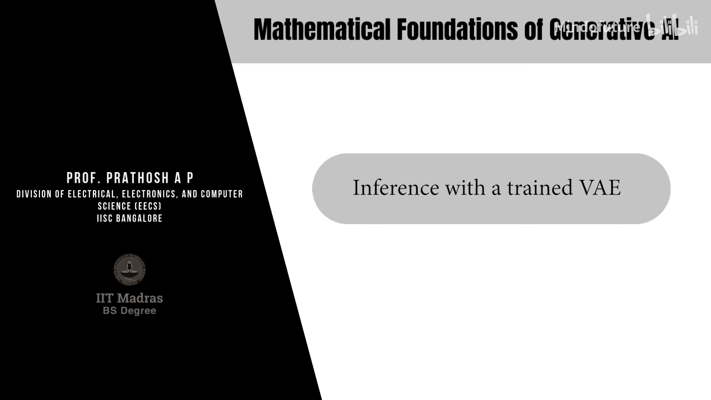
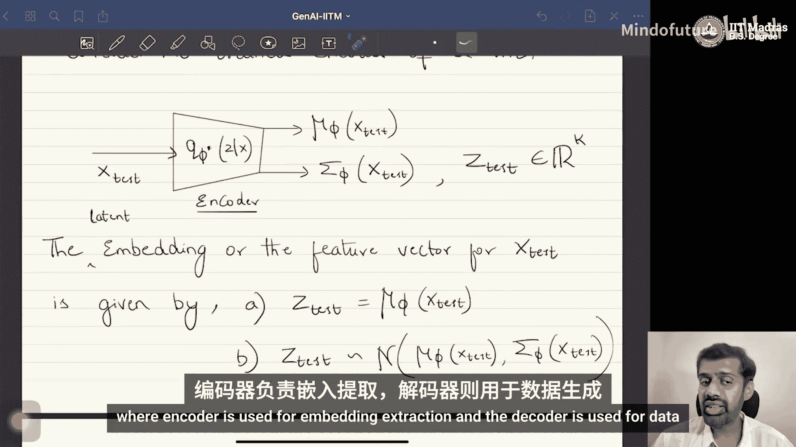

# 生成式Ai的数学基础 ｜ Mathematical Foundations Of Generative Ai p33 P33_W6L23-使用训练好的VAE进行推理 -BV1fperz7EjK_p33-

🎼。

Hello， everyone。In this module， we will continue our discussions on variation auto encodes RVAs。

In the last module we were looking at how to train a variation auto encoder so I'll just quickly recap the th procedure of variation auto encodeder and then we will look at how to use a trained variation auto encoder for different kinds of inference tasks including data generation and posterior latent inference we will also look at a couple of ways of improvisations on VAs to solve different shortcomings that may appear with an NV so that is the agenda for today's discussion so let us start looking at recap on trying a variation auto encoder。

So， a VAE architecturally。Ha do。Neural networks that approximates two distributions。

 so we have an encoder neural network。We have an encoder neural network that would output the parameters of the distribution。

 the posterior distribution。Laten posterior， so this is。Q phi of Z given x。

Now this takes an input sample x as an input， takes a data sample x as an input。

And gives the parameters of the posterior latent posterior distribution Q p of z given x。

And we have another neural network called the decoder neural network。The decota neural network。

We take the samples of the latent posterior as an input。

So the samples of thent posterior z goes as an input to the decoder。

 and that would output the parameters of the distribution P theta of x given z， which is the data。

Conditional data likelihood so this will give the parameters of this distribution and we designated that as x capta of z this is the design and what we are given as usual are n data points。

We are given a set of n data points which we call as the input data so i is 1 through yen and these are sampled IadD from an unknown distribution px so given that we have n data points sampled from an unknown distribution px this is a VAE has the encoder and the decoder and encoder that takes up one of the data points as input and gives you the parameters of the legendnt posterior  Q f for z given1 x so in the typical setting this is how the。

Implementation looker， implementation。Look， so typically， so Q phi of zk1 x。

Is assumed to be a Gaussian distribution on z with mean given by mu phi of x and variance denotted by sigma phi of x。

Here， sigma sigma phi of x is typically assumed to be a diagonal matrix， so it is a diagonal matrix。

Of sigma 1 sigma2 up to sigma k right so we have data as usual stays in a d dimensional real space and the latent space is a k dimensional real space and we have k to be much less than that of d this is the typical setting right so the variance of the posterior distribution latent posterior distribution is assumed to be a diagonal matrix so which means that here the encoder predicts mu phi of x which is of k dimensions it also predicts the diagonal of。

it outputs the diagonal elements of the variance matrix so this is sigma 1 sigma2 up to sigma k because the variance matrix covariance matrix is diagonal in typical implementations all you need to do is simply predict the diagonal elements K dimensional diagonal elements which means that the input dimension for the encoder is d so input is in d dimensions the output is in k plus k so which is 2 k dimensional output the input for the decoder network is in k dimensions right because these in k dimensions。

 the output will be in d dimensions because we are getting the sample from P the of x even then let me just move this down。

Once we get samples of mu and sigma， what do we do， we simply sample an epsilon。

 So epsilon 1 to epsilon M from an oxcillate distribution that happens to be Gaussian distribution and then we do reparameterization so we get Zj to be equal to mu phi of x。

Plus。Sigma 1 through sigma。几。So just multiply this with an identity matrix times d epsilon。

 So epsilon is again in K dimensional space。 All you need to do is take this and。

Multiply this width an element is multiplication with epsilon J。

 So this is the re parameterameterization。P parameterization once you get the Z J just give that particular Zj as an input to the decoder and decoder produces samples of x state of samples from P state of x given z and we also have that the loss function that we would optimize。

放。V Ae is the。Evidence lower bone or elbow， which is given by this particular expression。

Q phi of Z given1 x。Minus the Kl divergence dkl between Q phi of zq1 x。Q p of z given1 x and P of z。

This is the loss function that we had and we saw that this was equivalent to。As sumation over X。

 Ie minus。那。Excap theta of Z。Let me call it as。X for a single data point。

 it's easy to comprehend that way。 So this is the first term。

 The second term was deterministically given by this particular expression， which is。minus half log。

Sigma phi of x。The determinant of log of sigma P effects。

Which is simply the sum of all the small sigmas minus minus k plus。The trays of。

Tras of de matrix sigma Phi of。X。Plus， the norm of。The mean that the neural network is predicting。

 So this was the loss function。 And we saw how to differentiate this with respect to the。

Encoder parameters and decoder parameters and note that here。

The Z that goes as an input to the decoder is actually a sample。From the re parameterameterization。

 So this is。Okay， so Z。Fu squared so this is a sample from the reparameterization。

 So this was the last function that has to be optimized and we saw how to optimize this using gradient descent to find the parameters of the encoders and the decoder parameters right so I will say so theta and phi。

Pas updated。Alternatively。喂呀。Graadian de。Yeah， so this is what we saw that there's an encoder and a decoder network and we have。

The data that we have been given， so an encoder takes a data sample as an input and gives you the parameters of the latent posterior Okay this is the sigma matrix。

 so this is。This is the sigma phi of x is simply diagonal。

It's a diagonal matrix that contains this particular element sigma 1 through sigma k。

 that is what the encoder would produce and decoder will take a sample of。Z。

 okay sampled from the latent posterior。我不知贴。Decoder will take a sample from the latent posterior。알든。

Produces a sample from the distribution P theta of xq so that is the procedure and we update the parameters of the encoderant decoder alternatively using gradient decent so now suppose that the V is now trying so what we have to do is how do we use a VE for different kinds of inference tasks So we will see inference。

Inference width。A trained V， so now that we have trained VaE。

Well have to see how to do the inference。By the way， one other point before we move on。

 I have never talked about the architecture of the encoder and decoder networks so that is a design choice one can choose any kind of architectures for the encoder and decoder networks suppose your X happens to be from image domain then typically the encoder and decoder networks will have convolutional neural networks so encodeder will have convolutions followed by fully connected layers and the decoder will start with fully connected layers because Zj is a vector of K dimensions and it will have what are known as transpose convolutions or up samplingling layers and it will give back an image and the output so it depends upon what kind of data topology you have you choose the architecture that way but all the discussions that we did so far is agnostic to whatever the data topology and the architecture which means that any architecture can be used as far as it is compatible with the data that is being used。

So more of this will be discussed when the VAAs will be implemented in tutorials。Okay。

 now once we have V is trained， we will have to。See how to use these Vs in in inference setting。

 So the there are。Because V is a latent variable models you can use it for two major tasks。

 so one is a data generation， which is sampling because Va can also be used VE is basically a latent variable generative model。

 the first task is data generation。Data generation。Or sampling。

 so this is also called the sampling task。How do we use VAE for sampling task it is as follows。

 so we only take the decoder。So， consider。The following sampling procedure。

The following sampling procedure。So this is common to any of the latent variable model how do you sample in a latent variable model recall that a latent variable model P the of x is given by。

你。Margiinnal over the joint distribution of。The data and the latent variable。

 which means that the sampling can be accomplished using following。 so first step is to sample。

Sample is Z new from。P of z， So you get a sample z new from p of z。

 which is the prior on the latent variable。 So typically this is。A normalormal 01。

 because this is the prior that we have imposed on P theta P P of Z right we have taken P of Z to be independent of theta。

 and we have kept it fixed at normal 01。 So you get one new sample from。B O Z， and then。

Sample a data point x new。フ람。Beat it off。X given z。

itionallyconditionally sample a new data point x nu from P3 of x given z and how do we sample from p3 of x given z so this is done using the decoder network because we are getting the samples of P3 the parameters of P3 of x given z via our decoder so this can be sampled using the decoder network。

The code of the V A。Okay， so why should this work， Let us look at the construction of the decoder。

 so we have the trial the decoder network。So this is the decoder network。

 so this decoder network has been trying to take samples z from Q phi of z  given1 x。

I what we did in re parameterameterization case so P theta star x given z star indicating that it is trying and this will give you the samples or rather the parameters of so we called it as x cap theta of z which are it what was this in one of the implementations。

 so this was actually the mean。offff。P theta of x given z。

 So this is the mean of P theta of x given z right that is how we constructed the decoder in one of the sensations。

 Now， we don't know what Q phi of z given x， however。你。K열 term elbow。Will ensure。Will ensure。

And ensure that。Q phi of z given x will be equal to p of z。 so that is what the K term is doing。

 This will be equal to normal 01。For all x， right note that。

Q phi of z given x is a distribution for a given x， correct？

Because it is a conditional distribution Now if you look at the loss function here。

 the second term in the elbow or the loss function that we are optimizing will ensure that Q phi of z Q x will approach p because we need to minimize this right if you minimize this remember that our objective is to maximize the elbow if you are maximizing the elbow there is a negative sign here which means that we are minimizing the K divergence So if you minimize the K divergence between these two distributions for all x。

Q p of z given x has been pushed close to P of z right and what is P of Z P of z is normal 01 by construction we have taken P of z to be a normal01 distribution by construction。

 which means that。If the VA is trained properly。The V is well trained。Well train。Q phi of z given x。

Will be equal to the normal distribution for allx right this is what the idea is Now if that is the case then decoder the way the decoder was trained was to take a sample from Q phi of z given x and give you the sample of p of x given z Now if  Qp of  Q phi of z given x is an normal distribution for allx。

We can replace this simply with a z nu。 Okay， that is sampled from normal01。

 So sampling from normal 01， this implies that。Sampling from。

From normal01 is equivalent to sampling from。Sampling from。Q phi of g given1 x for all x。

 so all we need to do is sample a point from normal 0 and give it as an input to the decoder and decoder now will produce a sample from p theta x given1 z because that is the way it has been trained。

 correct？Okay， so now once we get the output of the decoder。So X。Let's say x gap T da， or rather。

What was the symbol x。Gaped of the new。Is the output of the decoder。Output of decoder。f。

As z knew that is sampled from normal 01。RightSo now how do we get a novel sample from the data distribution as the question。

 Okay， now there are two options here either。Use。Ext gap。Z knew as the as the novel data point。

As the novel generated。Now well generate data point。Or sample。Why is this a possibility。

 This is a possibility because x theta exccap theta z nu right sits in R D in the de dimensional space and it is the mean of the distribution p theta of xq and z。

 which means that you can use the mean of the distribution itself as the novel generated data point or this is one possibility the other possibility is to get the x nu which is the sample data point as a sample from the Gaussian distribution that has a mean equal to xcap theta z nu。

And variances。Is identity。 So why is this the case if you recall， So this is because this is because。

We modeled P theta of x given z as an normal distribution with mean equal to x theta of z and variance equal to identity。

 this is how we had modeled it。 So now the output of the decoder is giving you the mean of this particular distribution P theta of x given z。

 So using that mean we have the variance to be identity we can sample a point from an normal distribution if we sample a point from the。

Normal distribution， which is speed heat of x given Z。 Then we have the new point。

 So x new is the generated data point。 So this will be the。Marvel generated data point。Here。

 this is the novel generated data point。So this is how you use a variation auto encodeder for for data generation so let me repeat so what do we do is that we for sampling or data generation we do not need the encoder at all。

 all we need is the decoder what do we do we take the train decoder we will sample a point from normal 01 which is the point from the latent space。

And give it as an input to the decoder while the decoder has learned to construct the data point from Q phi of z given1 x。

It is during inference we take a data sample from normal 01 and give it as an input because sampling from a normal 01 distribution is equivalent into sampling from Q p of z givenex for all x。

Because。In the L optimization the second K term will ensure that for all xq p of z given x is normal01 irrespective of x so if you want to sample a new data point what do we do is that we take a sample from normal01 and pass it through the decoder network and get x theta cap of z which is the mean of the distribution p theta of x given z because the neural network decoder is a probabilistic neural network now either we can use the output of the decoder itself as the normal generated data point or we can take that as the mean of the Gaussian distribution and sample another xnu the generated data point using simple sampling from the sampling procedure from a normal distribution which the output of the decoder being considered as the mean that is how a VAe is used for data generation so this is the decoder of the V。

we。So encoder is not used while using VAE for data generation。So now the next， as I said。

 any latent variable model can be used。4。Ebedding extraction。

 Okay are also known as the feature extraction。 Let's see， because Ve is also a late variable model。

 Ve can also be used for。Feature extraction or embedding extraction。 Let us see how to do that。

 The second application of Ve is in what is called as V is for。Lant posterior inference。

Lant posterior inference。Also known as the embedding of Vi extraction。Ebeing God feature extraction。

OkayNow how do we use a VAE for feature extraction is as follows so we take trained VE and we only use the encodes here decoders are not used so consider the encoder of a trained VE。

So in any encoder decoder model right the embedding extraction is mostly done via the encoding network and the data generation is done via the decoding network。

 this is true for even the language models or the aggressive language models that we will be discussing later if we have an encoder decoder model feature extraction is done or embedding extraction is done using the encodeder models and the data generation is done using the decoder models Okay so consider the。

Ted encoder of a Ve。Tryed encoder of a V A。Okay， so let's。Take a trained encoder。So。

 this is Qfi star。Of thelin。This will take an input data point。So let's call this x test。

 so we want D。Ebeing corresponding to this data point called X test。Stress as an input。

 and what we get here are usually， as usual， the mean of。The distribution under direct。

 and we get the variance of the distribution。Ext and this is the diagonal。

Covariance metals we are using。 Okay， this is what we get。 Okay， so now the embedding。Or the feature。

放。also have to call the latent eming。Because it's the posterior latent posterior extraction。

 right inference。 So latent eming are the feature for feature vector for。Feure vector for。Ext。

Is given by。So we one can use multiple choices again okay the first thing is can simply take the embedding corresponding into excess as the mean vector itself。

 this is one choice。Or I can take this Z test to B。

A sample that is drawn from an normal distribution， with mean。

Equal to mu and variance equal to the prediction sigma。But we get from the VA。Okay。

So with this note that there is not only one encoding or embedding that you can get for a given X test。

 one can sample any number of encodings right for a given input data point and you can even take an average of all of them and take that as the embedding for the given data point or you can take the mean itself that the neural network encoder network predicts as the encode embedding of the given data point text so this is these are the ways in which。

A V E can be used the encode of a V can be used for a feature or embedding extraction。

 Now what do we do with these Z test this can be used in multiple ways so one can use the Z for as as features while building a classifier on data or later as we see these will be used to build generative models。

Another class of generative models on Z test so what do I mean by that so well while the data data is given in some data dimensional real space imagine that you access an image so first you train and encode or decoder or VAE on the raw data and you embed all the data in the latent space of the VaE and take all the embeddings and you can build another generative model on top of the embeddings of the VAE so that is another way how embeddings are used we will we will see that in a while so once the features are extracted they can be used in any so manner so just for the sake of completeness will say that the feature C test。

Will be in a K dimensional space， which means that your data is now being compressed right so we started with a D dimensional space and the data always compressed to a lower K dimensional latent space so that is why one would seek。

An embeing extraction because it is a compact representation of data。

Okay so this is how the VA is used so in summary the decoder of the VAE is used as a generator for the novel data points。

 the encoder of the VAE post training is used for posteror inference or feature extraction this is as I said this is common across all encoding decoding models encoder decoder models where encodeder is used for emboing extraction and the decoder is used for data generation。

Okay。

