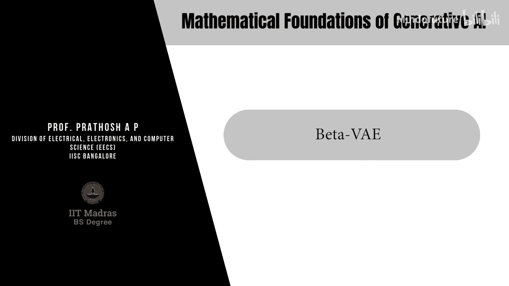
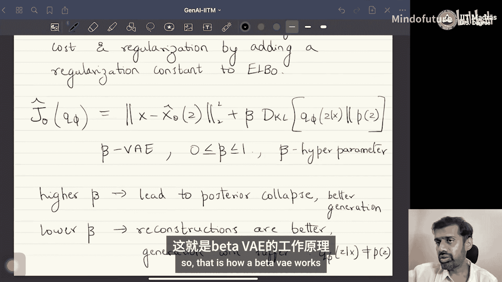

# 生成式Ai的数学基础 ｜ Mathematical Foundations Of Generative Ai p34 P34_W6L24-Beta-VAE -BV1fperz7EjK_p34-

🎼。

Okay， so let us now move to a couple of improvisations over VE。 We'll just see。The first way。

So posterior collapse in an IV。Okay。Consider what is happening in a VAE。

 so there is an encoder network。And there is the decoder network。Given x。

 this would give you Q phi of z given x， the parameters of Q phi of z given x。

And the decoder will take a z， which is a sample from that Q phi of z given x and。Produce us。

The parameters of P the of x givenancy。Sorry， it is。Takeake a sample of z as an input。 Yeah。

 this is what B is doing， now。In a 위에。Second term in elbow， which is the care term。It is the k。

Between Q phi of z given x。And P theta of Z， So we。Remoote the dependency on P theta so this is Pz。

 so this is minimized right？In a VAE， the second term in elbow is minimized Now， if we do that。

 what is going to happen for all x。Q phi of Z given x。Is。佛fully。Made to be equal to。

Made to be the same。As PC， whatever they。Distribution on the late priorities okay this can be let's say for instance normal 01 for all x we are asking the encoder to be trained in such a way that no matter what x that it sees as an input Q phi of z given1 x should be a normal distribution with0 minus unit variance right okay fine so what is the issue with this So if this happens so this is called the collapse of posterior because。

This is the latent posterior， and this latent posterior is collapsing into one particular distribution for allx。

Okay， now if this happens， think about it。 What will happen in the situation is the decoal。明。

See difficult。都。Differentiate between。🎼Differentiate between the。

Differentiate between two input samples。Say X and xj， so suppose I have two input samples X and xj。

 the decoder will have it very difficult to be separating between X and Xj because both for X I and xj。

 this is because this is because。Q phi of Z。Z given X I will be same as the that of cube phi of z given xj for both of these samples。

 the encoder。Will output the same distribution， which is normal 01 because the elbow。

 the second term in the elbow is forcing  Q phi of z given1 x to be equal to normal distribution。

 no matter what the input X is。 So which means that if you sample a point。

 So let's say that I sample a point， you know Z1 or Z I from。Q v of40 given1 X。

And I have ZJ being sampled from Q P of。Z given x J。

 So both of these samples are coming from the exact same distribution normal 01。

 so which means that the decoder。The decoder will have difficult difficulty in separating out X and Xj since both both the posteriors are same for X and Xj so this phenomenon is called the posterior collapse now which means that the reconstruction or the first term which is the reconstruction term in the VAE will suffer because of this particular formulation so what do we do is the question okay。

Now， one way to reduce this is。To。Solution for this problem is as follows solution。

F posteror collapse。Collaps in Vs。So recall that the last function J theta of Q p in the BA can be written as one you have the reconstruction term。

Which is the first term， and we have the second term， which is。The equal divergence between。

Q phi of z given x。Im busy。just this is the elbow in it with the assumptions that we have made。

 So if you think about it， this can be looked into as。The reconstruction term。

So this is the reconstruction term。So why is this a reconstruction term What is it doing X is being taken as the input to the encoder and you are given you are getting an getting the Z of course after the re parameterization and z is going as an input to the decoder and decoder is trying to reconstruct or get the data back from DC that has been given so that is why the name auto encodeder So what is an auto encodeder。

It is encoding the input data point right so input data point is being encoded or embedded onto a late space and that is getting reconstructed in the decoder so that is why the name variational auto encodeder So this is auto encoding auto is self encoding right it is encoding the cells which is x at the output of the decoder so that is the reconstruction term。

There is a second term right which is the KL term， which can be viewed as a regularization term。On Z。

 so this is。Reconstruction term on the edge space so there is regularization on Z so what do you mean by regularization in machine learning regularization is a concept where we restrict the distribution of either the parameter or the or the activations of neural networks such that the certain behavior is imposed on it a certain prior behavior is imposed on either the activation distribution or the parameter distribution Now what are we doing here is this is a knife autoender where we are simply asking the the architecture or the system to reconstruct the data。

But here we are saying you not only the task is not only to reconstruct the data back。

 but also to ensure that the distribution of the latent space has to follow a particular prior distribution that we are imposing so VE can be looked into as an auto encodeder with the regularization so that is why sometimes people refer to these VA kind of models as regularized auto encoders because this is auto encodeder plus regularization on the latent space so this term can be looked into as regularization So whenever so let me write that down so VE。

Can we。Vied。As。An auto encoder。But。A regularized latent space。

So that therefore it is also called a regularized。Auto encoder。

It is called the regularized auto encoder So of whenever we talk of regularization in machine learning we also talk of what is called as a regularization contrain okay which will control the amount of regularization that will happen so。

A typical。Regularized cost。In machine learning looks like the following right。Looks like。

So we have some cost， which we'll call us some L theta。

This will be some cost plus some time some lambda times some term on the parameter space theta right。

 this is how a regularized cost will look like where this is the。The regularization function。

This is the cost function。And this is typically what is called as the regularization constant that will govern how much regularization is happening。

 so if you impose if you make lambda to be very high， then the model will get overregularized okay。

If you make lambda to be very very small then the model will simply overfi so this is the classic bias and variance trade off problems so you have you have a trade off the lambda will trade off between the overfitting and underfitting regimes which are the high bias low variances and low bias high variance regions so I am assuming that the。

Audience here are aware of what regularized machine learning is and what is the bias variance rate of so if you look at the cost function of VAE in terms of a regularized auto encoding cost function then it is obvious that the regularization constant here is missing right so。

What can we done this， We'll write that down。 So in a。In a B E。Vied as。

Viewed as a regularized autoender。The regularization constant。Is aent。

Okay so what does that mean that means that there is no way that one can control between the overfitting and underfitting regimes in other words the posterior collapse that we just talked of which is that all of the latent poster areas getting close to one particular distribution there is no way that we can control that。

A simple tweak that can be done to avoid this is by adding the regularization constant。To the cause。

 so。Can be made。To trade off between。Cost and regularization。By adding a。

Adding a regularization constant to the。Cos cost。regulargization constant to the regularization function。

 right constant。또엘。This was a simple tweak that was done。

 so which means that you have J theta of Q p of let's call this as。JCab。

 the new cost is simply equal to now the we have the reconstruction cost as it is。

But to the kale cost， some constant beta is added。Beta times。Decal between Q phi of G Q1 x。I'm busy。

So this particular formulation is what is called as a beta Be。Where beta is a number between 0 and 1。

So， with beta equal to 1 we will get to the9 VE regime so now what happens is one can control beta so beta is made to be a hyperparameter a design choice。

I have a parameter Now what happens is higher the beta。So this implies， you know。

 you have more weight to the kale， which means this may lead to。Le lead to posteror collapse。Okay。

 so lower beta。This will lead to this the reconstructions are better。

Because the confusion between the。Poerors of different input x are lesser here So what happens if I mean higher beta will lead to posterior collapse which is fine know but what is the advantage of the posterior collapses at recall during generation the decoder has seen samples from Q p of z given x and and construct the x back now we don't know  Q p of z given x for any given x right so what do we do is we will assume that  Q p of z given x is equal to p of z for all x only then the generation works because we are sampling from pz finally during generation and giving a to decoder So now even though it might lead to posterior collapse this will lead to better generation。

And lower beta， but reconstructions would be bad in this case。In the lower bit。

 the reconstructions are better。But the generations are， generations will suffer because。

Geration will suffer， because。Q phi of z given x is not made equal to p by lowering the beta。

 So that is the trade off that one we deal with with the different values of beta。

 So depending upon what is important for the given application。

 is it is it the embedding extraction or reconstruction or generation。

 depending upon that one would choose or tweak beta to suit the particular need So this is about beta Ve。

 So typically in in in practice when V is has to be implemented。

 one would always implement a beta Ve with a beta term and tweak beta on a validation data to suit whatever the given application。

 the needs of the given application R So that is how a beta Ve works。

