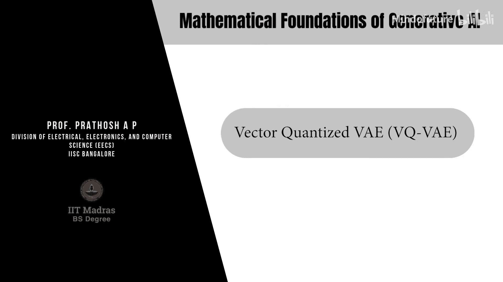
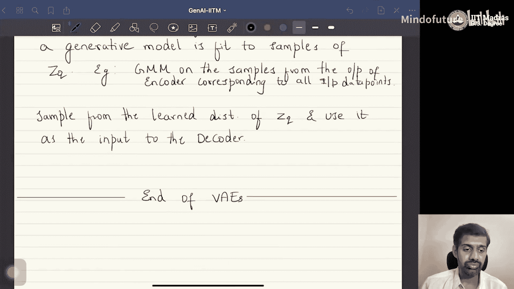
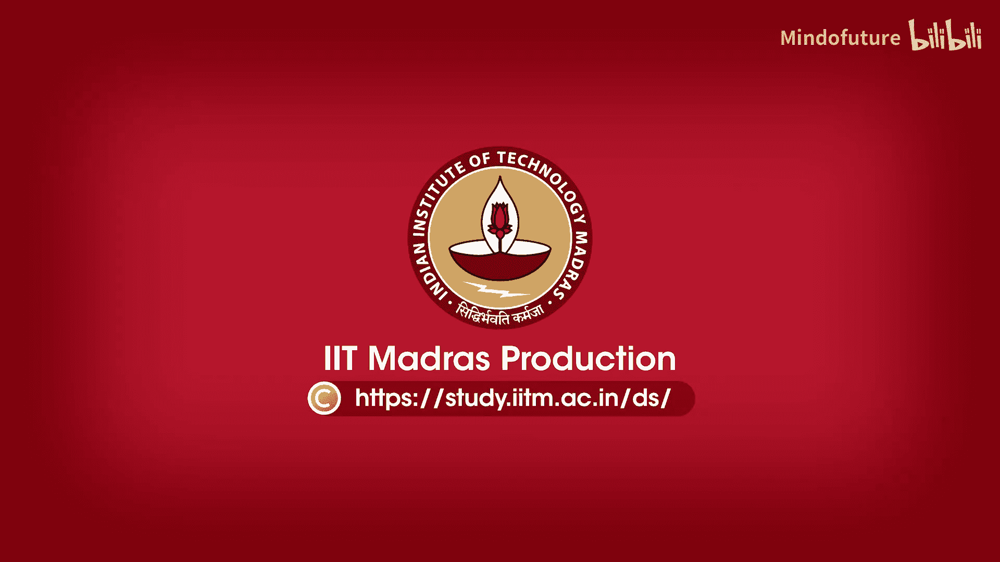

# 生成式Ai的数学基础 ｜ Mathematical Foundations Of Generative Ai p35 P35_W6L25-矢量量化VAE（VQ-VAE） -BV1fperz7EjK_p35-

🎼。

Okay， so next we will move to one of the improved improvisations on VAE。

 which is called vector quantized VAE or VQVE。With the contest V E or。Vq V。

So as far as the families of VAE are concerned， the BQ VAAE is the current state of the art。

That is used offering practice Okay so what is a vector quantas Ve so in a vector quantas Ve。

In BQ B A。The first thing that is done is the latent space is made discrete。

Laightnt space is discrete。And。Be the quantized。Wetro quantized using the learnable dictionary。

I will explain all this。You en dictionary。The idea is the following right in the VA that we saw so far the latent space was continuous because it was coming from a normal01 normal distribution with 0 minute unit variance and on。

 but in practice if you look at the practical data for instance images of speech or text etc。

 it is intuitive to think of the latent space be having discrete。

Representation because if you think of speech okay a speech signal can be represented using a finite set of phonemes。

 So phonemes are these abstract linguistic units corresponding to the sounds in for instance a is a phoneme E is a phoneme O is a phoneme and so on。

 So every speech utters or speech signal that you see can be thought of as a combination of different phonemes。

 So which means that speech signal can be any given speech signal can be represented using finite set of phonemes So similarly one can think of the fundamental units for an image as well。

 So every image can be represented in terms of let's say primitive structures such as lines and and circles and different kinds of primary shapes and colors and so on。

 Of course， in the case of images， the number of discrete such latent primitives may be large。

 which is okay But the idea is that。the intuitive idea is that the the practically occurring data such as images。

 speech and text etc text is very obvious to see text as a a set of combination of set of discrete tokens tokens can be alphabets or they can be combination of alphabets and so on。

 so every data can be represented the better using a discrete set of latent space as symbols and that is the reason why。

A Vq Ve operates the latent space in a discrete sense。 Okay。

 now how is this done So the latent Ve is also VE therefore it contains an encoder and a decoder structure here in a Vq Ve。

 the encodeder and decoder are deterministic in the sense that unlike in a Ve。

 which gives you the samples of Q P of Z the parameters of Q P of Z1 x the in the Vq Ve， we get the。

Samples of Q itself， not the parameters，Now， this will take。Xi as an input。

 the input data point and the output of the encoder， this is the encoder。

 which is the deterministic encoder， which means that it will give a vector， let's say Z of X。

Gives a vector C of X， and now we have the decoder。That is the decoder network。And decoder network。

Takes the vector quantized version of Z。 I will tell you what that means。

So let's call this P thes P theta and gives back x cap of。はい。this is a reconstructed data point。

 this is the decoder。Now we have what is called as a latent dictionary， let us call that as Z1 z2。

Up to Z M。So this is the latent dictionary。Okay， this is a latent dictionary。 Now。

 let's say that every。The I in the dictionary is。In some key dimensional space，Now， suppose。

There are。M latent。Victorors。Off。K dimensions， each。Okay， in the dictionary。So。

 there is a latent dictionary let us call that some L， so L is a set of vectors z1 z2 up to zm。

 so there are M such vectors all of these vectors Z they are in some K dimensional space。

 so we have an m cross K matrix which forms the latent dictionary okay。Now what happens is。Z Q I。

 which is the quantized version of the latent space， is simply Z J star where。J star is that index。

J equal to1 through m that index， which would minimize a distance between the output of the encoder and an element of the latent space so this process is what is called as vector quantization。

Now， what' is happening here， you have an input data point and the encoder gives some output Z which is some vector what we do is we take that vector。

 take that vector Z， which is the output of the encoder corresponding to a given data mind and we search in the dictionary latent dictionary for that vector which is closest to the output of the encoder so that would give us the that would actually give us one of the elements from the latent dictionary。

Wwhichhi we call a zq， which is the quantized version of Xi。

 So now that quantized version of Z E X is the one that goes as。The input to the decoder。Okay。

 so now I hope that this is I mean the vector， the idea of vector quantization is is。

Explain properly。 So now in practice what happens is。The latent space。The latent space。I。

Designed to be。Attener。Of latent dictionary vectors。So what do I mean by that。

 so let's say that my latent space is latent vector。Is taken to be a matrix。Of。Each of this has。

Say each will take it as column wise。 So each of these columns are one of these vectors。 So we have。

Dimality of this is k， so we have ks and the P number of columns so where。이 추로。Hes a vector。

From the dictionary。From the dictionary L okay so each row will happen to be a vector from that particular dictionary。

 So your latent vector is made a matrix of P such vectors So what is done as each。

Rs rather each column。off。So let me call this as Z。Gap。Xile。그래？Which is the latent vector。

 So Z cap X is the output of the encoder。 this is given by this particular each column of z cap of X。

So E of X is。At the context， that's all。What do I mean by that here， So the Z E。

 okay let me call this a z cap of E， so this is zq。So of Zcap of。

Z cap of E X I is a matrix that that has k P number of vectors from the la space。 So of this is Z E。

Of X a。in。K across speed dimension。 So this is nothing but。P vectors。그럼。The late dictionary。Okay。

 so now P here is a hyperparmeter， depending upon what the。Application is。Okay。

 then what we do is every each column of the this Z E。Z E cap X is quantized。

 so that is what is done。Here， so Z E of X。Is a column of。Coollumn off。The matrix， the。Cap u of x。

 so every column is contest。That is always done practice so why should this be done is because you know if you take only single vector as the output of the encoder that may not be representative enough for data sets like images and so on。

 therefore the in practice this is made to be of a dimension。

K cross p where each of the columns of this particular matrix is one vector from the latent dictionary which is vector quantized so that is the idea Now this is the design of a VQva how do we train a VQva It is trained very similar to that of a VE with the elbow cast so lets look at training a VQva。

How to try a VQVA let us write down the objective。The objective is。Say J theta of Q for the BQV A is。

 of course， we have the reconstruction and task， which is x minus。Output of the decoder。And this。

 of course， takes。ZQ has the input， ZQ cap as the input。Plus。

We simply have the regularization cost where we need。The output of the encoder。To much。

Quantized version。For each of the dimensions， this is the cost that up。Now， unlike in a VE。

 this is the usual VE task， right， VE objective， unlike the VE here， we also learn。

In addition to the encoder decoder parameters。The encoder and decoder parameters。

The latent dictionaries also learned。What do you mean by that？

So we do a gradient decent on each of the elements of the latent dictionary via this。

 so we will take this。And simply find the minimum the gradients with respect to Zj of this particular cost which is。

J3 of9 correct。So please note that here the gradients are with respect to the elements of the latent dictionary itself so we are learning the latent dictionary as well so we are not only learning the parameters of the encoder and the decoder but we are also learning the latent dictionary itself by taking the gradients of。

The elements of the latent dictionary with respect to elbow right so this is how AQVA is traineded。

Okay， so now once it is trained， how do we do inference in a VQBE？Inference。Inference in a Vee。

Is done as follows。 So let us first look at the posteror inference or embedding extraction。

 I think that is easier。 Well go to generation N。 So the first thing is the embedding extraction。

Ebudding extraction。Or will what is called as the posterior inference。Poserior inference。So。

 as usual， the posterior inference or emdding extraction as done via the encoding network。

 we take the trained encoding network。내비き。So take a tri encoder in the VQVE。

 take X test which is for which we need the encoding。

 so this is a QP star and what we get here is the output of the encoder which we call xz test。

Or rather X cube Z Zters。 Then what we do is the embedding Z。Ccist。

Which is the embedding is simply taken as。The vector quant version of which is so Ar。

J equal to1 through m to solve this optimization problem， which is Z E cap its test。minus。

The1 in the dictionaries right so just take the vector quantized version of the output of the encoders from the dictionary do it for each of the columns so as we said now this is in some R K cross p right so this is this will also be in our K cross p but we extra quantize each of the columns of this particular matrix and that would be our embedding for given x test okay。

Now， this is easy。 How do we do generation or sampling。In VQVA， that's an non thing sampling in VQVA。

The problem with the sampling in the Vq VE is that unlike in a VE where we know what the distribution of Q phi of z given1 x is here we are not imposing any particular distribution on Q p of z given1 x。

 which means that the sampling from the that distribution is not trivial so here what are we getting we are getting the decoder is taking Q zq of x。

Okay， and this is giving you the samplecap。 Okay， so now to be able to。Genrate a data point。

 Let me write that down。To be able to。Sample from the decoder。Sample from the decoder of VQVE。

We need to first sample。Sample from the distribution of。Q。Zq。

Right so because only if we know how to sample from the distribution of Zq that we can take that as an input and give it to the decoder of the Vq A and generate。

 but now we don't know what the distribution of Zq is unlike in the case of a Vq V sorry a B and IV where the distribution of so。

Distribution of the latent space was known and it was made to be equal to normal 01 by dl term here we don't know that right so now how do we solve this problem is typically what is done is the following so。

I do。First， learn to sample from。Samples from the distribution of。Of the two。그래。

AGerrative model is learned。Model S fit to。Samples of。CQ。

 so what does this mean This means that you take all the input data points。

 pass it through the encoder of the trained VE trained Vq VE collect all Zqs。

 So on the collection of all those Zqs treat it as a dataec and learn another generative model on top of it so this can be。

This can be a GM。安。The samples。From the output of the encoder。Output of encoder。

Corresponding to all input data points。All input data points。

RightSo given given a set of data data set that we have right a lot of input data points pass that pass all of them through the encoder。

 so you will get the corresponding latent representations you fit a GMm on top of it between that you learn another generatedr model on top of it So once you do this this will this will enable us to sample from the distribution of Zq right so then。

上本。From the learned distribution。Learn distribution of ZQ。And use it as the input。Do they deder。

 that's。So this is a little convolulative and cumbersome to sample from a BQBA so what did we do Ill just repeat。

Now to sample from the deco of the VQA， we need to load the distribution of the output of the encoder that gives that goes as an input to the decoder unlike in a VE。

 we don't know what the distribution is， So what is done just learn another generative model metagenrative model on top of the output of the encoder that would tell us how that will give us a method to sample from the distribution of the latent space of the VQV using then using that generative model。

 get a new point， get new points from the distribution of the late space and give that as an input to the decoder of the VQA to sample。

Because of the cumbersome nature of this VQVAE is not typically used as a generative model。

 it is generally used as a feature extractor， in fact in lot of state of the art models for image generation the latent space of VQVAE is used as a starting point in fact a model called stable diffusion which is state of the art for diffusion models for image generation uses the latent space of a learned VQVAE as the starting point so which is the posterior inference so basically given a data point data set of images。

 take a VQVAE take the encode of the VQVAE pass all the input data points。

 image data points and represent them with the latent spaces of the VQA latent vector of the VQVE and that is used for further cross to build a diffusion model as we will see later。

Okay， so this takes us to the end of discussions on variation naal encoders。

Wwhich is the first of the family of first of the models from the family of latent variable models that we will be seeing in this course Now next we will be looking at another state of the art models generative models called the denoing diffusion probabilistic models or diffusion models in chart we will be looking at diffusion models which happens to be a special case of family of VAs called hierarchical VAs so we will connect that to the hierarchical VAs so diffusion models forms the basis for most of the generative models on image space that are present in the market currently state of the art models we will be looking at diffusion models as the next family of models Thank you。

