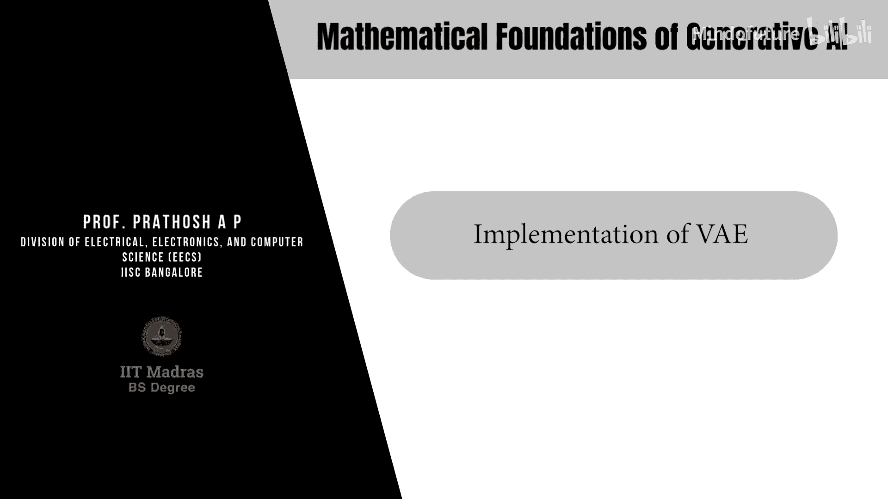
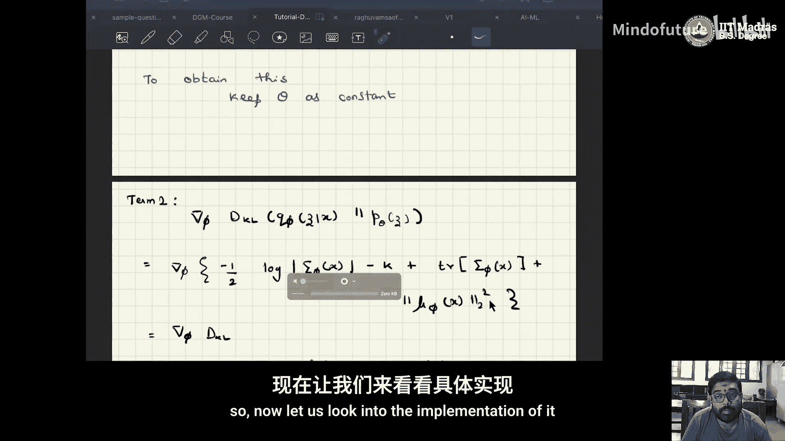
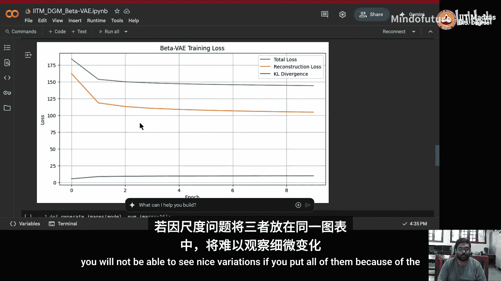
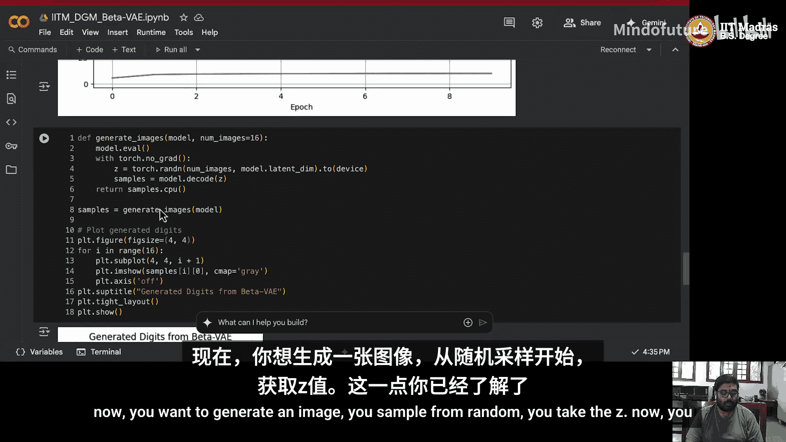
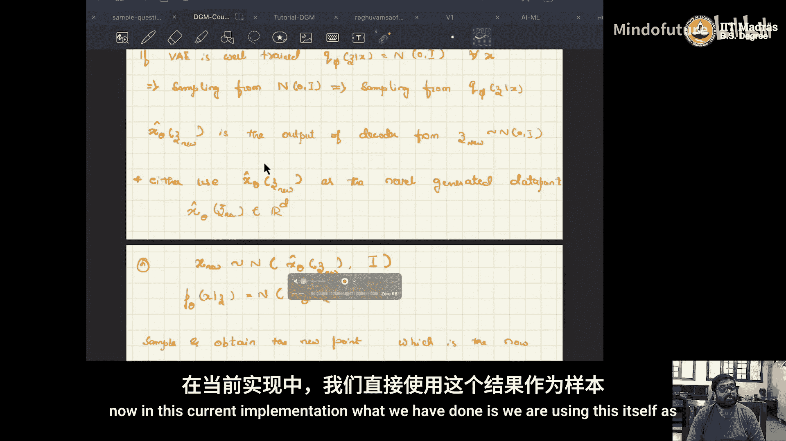
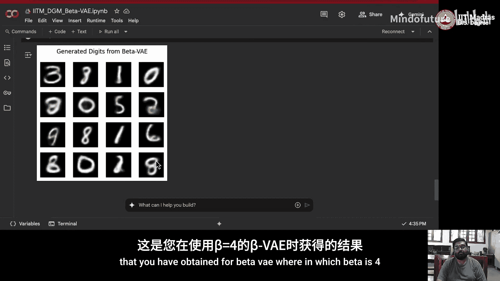
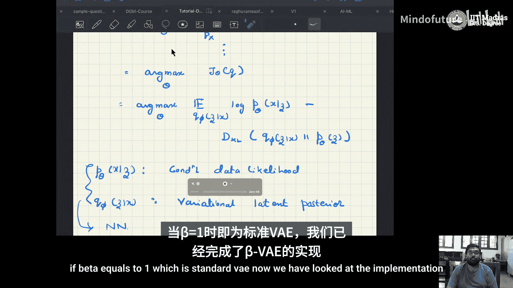
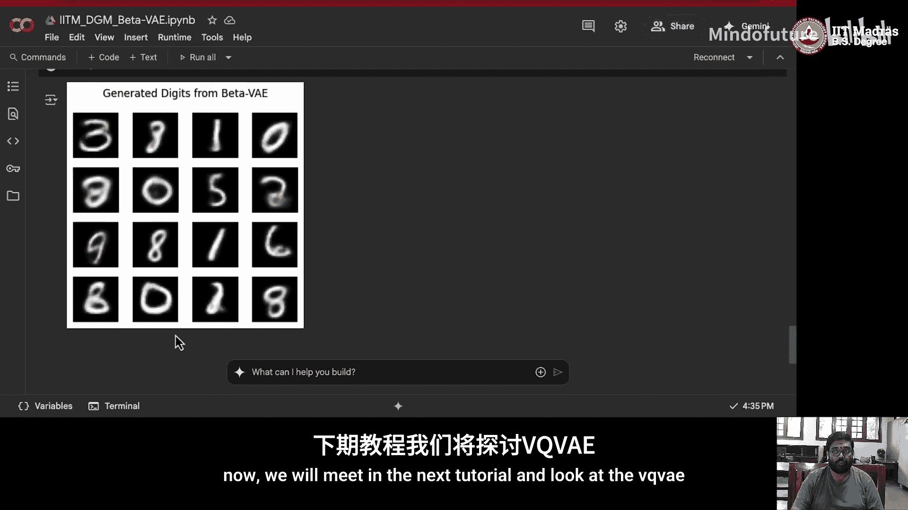

# 生成式Ai的数学基础 ｜ Mathematical Foundations Of Generative Ai p36 P36_W6T12-VAE的实现 -BV1fperz7EjK_p36-

🎼。

hello好。Welcome to this tutorial。Where in which we will be learning about。

The implementation of variational auto encoders Vs。Let's do a very small recap on the aspects of V。

走边是吧。Looking at variation auto encoders， VAs。Now，W which is a latent model。

So we we want a latent variable model， so you have been given data D。No which is。

Xxi I is equal to 1 to n， now which is sampled IadD from distribution Px。And Xa belongs to。快力。

So now what is the latent variable model condition that has to be satisfied？No， it is。P theta of X。

Is equal to if you integrate over the latent。Space。What are the joint stuff。

OkayNow you should be getting be3 off。X。And with the Z。

Is from RK and typically during implementation we see through， the k is quite less than d。So， then。

 we want。So it's a theta star。That's there。We have。Arment of。😮。

The Kl divergence between the data distribution， px and。Then the distribution P heta。

 and we know that this can be。Re as Im just skipping algebra here。

 I assume that these steps are pretty much known to you， this is expectation。

With respect to the data distribution Px。我会。Log off。B the到 of x。And then from here。

 I assume that you know how to derive。The elbow， I'm just keeping it as dots。This is nothing but。

R max of theta。We call it as J3ta Q。Now， just for remembrance， now this is。A Maxof。Peter。No。

 you have。Expectation over the variational latent posterior now that is。Q free of。Z given x。Log off。

Be tee of。X given Z。Minus。The K divergence now between。The latent posterior that is。Give feel of。

Z givens。And then the。Prior and written prior， Ill just beat3 of z。Okay， this is your。Function。

 which we need to optimize now here。Now， if you recall。T theta of x given z。Is what is called as the？

Conditional data likelihood。As called as conditional data likelihood。And then， you have。Q fee of。

Z given x。No it is。Which is variational。Lant posterior。Okay。A little posterior。And both of these。

Distributions which are there。 Now we want to represent them using a。

Neural network okay now this is what we want to proceed now here your encoder model will give you the parameters of the distribution。

So we know that procedure why we chose that there were two things when which we chose one。

 when which it will give you the parameters okay， so now coming to the structure。Of how do we do it？

Now you have an encoder model。Which will take x then。It will give you the parameters。

And then you have a。Decoder model。Business。That will take z and then gida。

Parameterters of the data generations。So now you take x here。あ。6。And then呢。You will get。

The parameters。Q。The mean of it。Okay， and then。You build them。

The variance now this we are assuming a diagonal variance， so therefore。

 what will happen is now you get you want to。嘅。😊，O。

Since we are assumingsum the diagonal now we will be only getting the diagonal element。

 not the whole matrix okay， so now this is。Q free of。Z given x kind of x is the input。

You get these things now， once you have obtained that we this is encoder this is the。

This is the encoder model， Now then we perform the。

Repar because of re parameterization So we know that Z I that we want to do what we want is Q phi of。

Xile。Haammer product with。A sample from standard distribution。然后。Here， your X。Is in。AB。You。Z。

And then呢。The mean。Both of them are in。Okay。我等你会子啊。X I now this is an Rk cross k。

 but you are only getting the diagonal elements as an output from the encoder Okay so now to the decoder which is represented by another。

Neural network， which is P theta of。X given z。Now this will take this。

ZIe has an input and then it will give。X kapphite。Okay， but this is the overall structure。😊。

So now how we how do we perform a theta of this is how we can represent it so that we know that it is generated。

Now this is the overall structure。😊，So， now， let's。Remember。

 now how does it performs the forward pass？Let's recall the forward pass。The forward word pass。Yeah。

Step one that we do yes。Now given Xi from D， we pass it through the encoder and then we obtain。

The mean and sigma mu and sigma， okay now we have X belongs to D。那要。Pass it through。

Encoder now this is post this is the forward pass。Encoder， and then you get mufihi of。X一。And do。Okay。

 so you obtain this and then the second step is。Now， you。三本。Epsilon 1 to Epsilon M。

From normal distribution。0ロア。Now this is outside of。You network。O。

This is outside of neural network now， which should be evident from here。You obtain these， Okay。

 and then。有三本。Epsilence， and then you finally obtain time。Z系。Okay。

 this is outside of the neural network， so then what you will do in step 3。So， you compute。Z1。30。Zm。

This is done via a re parameteritization。This is done via a re parameterraization。

Then the fourth step。You bus。These。Z1 till。Zm via decoder。And then。And compute。Scapap theta of。自解。

This is what you do， this is your forward pass。😊，Now， the question is， how do you perform the？

Backward propagation is the question， so now to perform backward propagation。See。

 you have two sets of parameters， now you have theta and as well as phi。And you have。Two terms here。

Now for the first， also， you should find gradient with respect to theta and gradient with respect to phi。

And even for the second term， we should find gradient with respect to theta and gradient with respect to phi。

Now because of it， now you need to compute four terms。😊，Okay。

 so now let us try to do what now first let us look into how do you train the encoder？

Now to train the encoder， okay， now to encoder， if you look at the encoder。

 encoder is parameters by phi。So now you need to take the gradient of this term with respect to phi and then the gradient of this term with respect to phi。

Okay， that is what you should be doing to train the encoder and then to train the decoder。

So which is represented by parameters theta now you should be obtaining the gradients of this first term with respect to theta and then the gradient of the second term with respect to theta so now let's try to do that。

So no。Okay， any。Otaining ingredients。Vian with respect to。Phi and theta。Okay， let's do that。

 now let's take training the encoder， let's take the part of。Draining的。The encode required。

Now in training the encoder， now let's take the first term。So。Term one。

 not training the encoder that is with respect so we want the gradient with respect to phi。Okay。

The term1， what do we want？The term one that we want us。You want the gradient with respect to fee。

Expectation of fur。Variational latent posterior Q Phi of。Does he give an X？To log off。Be tired of。

X given z。And then we know that via reparaitization， now it will become。So the expectation。

With respectpect to。P up Salem。Log off。P theta of x given g of Epsilon。O， now。This can be。

Looked into expectations。 You can write it as。Some more samples， So J equals。When to M。Looff。

P Theta of x given G of。一四轮接。O。So now。Now， we know that。P theta of we change the color。

 That a similar。所一万的。😔，So now we know that P theta of。X given Z that we have。

Is from the distribution normal。Exscap The of。こアい。Now we are fixing this distribution because of which what will happen。

A log of P The of。X given z。Equals log of。Gn over to Pai to the port of。D by 2。EXP of。X minus。

Eta of Z。The second name of it。NowIf you take the log inside， this will be proportional okay。

 this is not alpha， this is proportional to。X minus。OfZ。The second one。Okay。

So now if you substitute this。In the equation that is here， if you substitute。

 you take this and then。substituteubd here。 Now then you。

The gradient term that you have will be proportional to again。

 I'm just taking it so now this will be。Mus1 over m。Sumation。J equals。温度。And。😊，Xci minusrs。就是哎。

我 it second。Okay， now this is the term this is nothing but the reconstruction this is the MSc。😊。

Between two matrices， so now there is a very nice neck here。I leave it as a small teaser。No。

 if your image。Is having values between now。0 and one。Now， then this can be looked as the BC。

Bary cross entropy。听 of it好。Okay， so now。Now with this。

 now to obtain this what we will do now to obtain this。To obtain this。

We keep the parameters of the decoder， which is theta。Thats constant。嘅。Now。

 what did we do just now we just obtained how to look at the gradient of the first which is in our。

Function， objective function。 we just。This term， and then we took the gradient with respect to P。

 That's all we have done till now。 So now let's take the。The second term。嗯。So let's take go。怎 do。

Which is。Dal of。Q free off。C given x。Andpe it of the。The turn2 that we have。嗯。

Is the care divergence between two distributions So now if you。Remember， not this。

 we are restricting to be a Gaussian。Okay， and then。There is a standard derivation for this。

I look at you to。I urge you to look at that specific derivation because of which what will happen is this whole kale divergence。

Now， if you have this as a fixed distribution， now what will happen is it will turn out to be a straightforward equation。

 I just write that equation down that is minus half。老搞诉呢。X that is there。嗯。Minus k。

 which is the dimension of。嗯。The latent space and the trays of。The matrix。Gless。The norm。Of the。

Me this is the value Okay， now this is and as you can see here now。This doesnt have theta at all。

 this term2， which is there。 Okay， now irrespective of the gradient with the respective fee that you are taking now this term two that is there is independent of theta now。

 now because of which the term4 that we want to find the gradient of。

The gradient to this term with respect to theta， you don't need to look at it at all now because it is independent。

Okay， now only this is needed for a calculation of the gradient of the encoder okay。

 so now this we represent as。Again。Okay， now this term。

 what we will do is now typically we will add this term while updating the parameters of the encoder okay so now this term。

This stone。Will be added。When。Then updating the parameters of the encoder。Ping the parameters off。

Encoder。Therefore， your gradient update will be like。Phi of t plus  one what you will do will do。

Fhi of t plus。Some learning great alpha。And the gradient with respect to the。The end部。Okay。

 now how do you get that？No。You calculate this term。You calculate this term， you add them。

That will be gradient。Okay。And this is the standard update， this is how you train your encoder now。

Pri your decoder。就不追牛儿。Decoder。我在这子思。You want to take the gradient。specト t다。是吗。The theater of。Phi。

 and this will be the。Graient with respect to expectation of。The variation of latent posterior。

Blog of。Be tee of。X given z。Blessss。The theta with respect is detailed term as it turns out。

 as I told you， this is independent of theta。Independent of the so you don't need to worry about it。

 So now you need to calculate。This specific term， and we know how to do it。 Okay。

 as it turns out that now it is。The same term now you have to take the gradient with respect to the theta here okay and then you just stop at the decoder now you really will not take the reverse path even the encoder you will stop at the decoder this is how you just do what okay。

So now the idea is the reverse part that is the backward path。The backward part。Stops。Post decoder。

You not go to it and go know how do you have it and how youre。Tta t plus 1。提点D。Plus， at four times。

Dve， j3 do you see。Now this is your gradient update。Okay。😊。

So now I urge you to look at the posterior collapse。Now， since you are forcing in your detailed term。

This is your detailed term， you are forcing your variational latent posterior。

To one distribution okay for all x you are forcing it now because of which if you have two samples now there will be not much difference between them。

 you cannot differentiate between the samples now because of which there is the problem of posterior collapse now if you。

Sample enough examples from the distribution， you will be able to see it。Okay。

 so this is the idea of。How do you work with？This is a theoretical idea。

 so now now let's look into the implementation of it。

Implementation is a pretty straightforward one。These are the necessary libraries now Ill not be explaining about the necessary libraries that are there。

Okay， and then this is。You are transforming your data I'm doing a very minimal transformation I'm just transforming it into the。

Tenser， I am not going further than that。Okay， so now。

Then you have your beta B see okay whether Va and beta Va know always we implement betava now if you put the beta value to be1 which is same as the。

😊，Very lovely， okay， so now。That should be clear。No， I'm using。A convolutional network in this case。

😊，Now， whatever is the latent dimension， there is a dimension of z。

Is given I am putting it as default as 20 yeah you can enhance more depending on the data so if your data is Ms now this is enough if you are looking into much more difficult data that time you should have latent dimension to be even more okay so and then you have your。

Encoder。Now I presume that by now you should be comfortable with looking at the structure of CNNs。

And then you flatten it up。啊，对。Now then you have a linear layer to get the mu under the。Zigma。Okay。

 now you have the。From this， so this is 1284 crossword you are flattened it up to the late dimension 20 and even your sigma is 20 and then you know that why we are putting even sigma to be 22 because we are only getting the diagonal elements okay so now that is what you are doing。

And then this is your decoder it will take latent dimension to 1284 to 4 4 plus 4 and 4 and then from there now then what do you do you obtain it into the size of the image。

So you get it 130 to 32 okay and what do you do 130 to 32 you have you finally get only 28 28 okay because that is the standard size of the m right now post this decoder which is the transposed convolution that we have。

😊，Okay， now then what will happen is now you get it to1， 32， 32 and then from there you only take 28。

 28， you only take 28 columns okay。Now， this is the。Encoder。Okay。

 now encoder will give you the parameters mu and sigma。

 now you will pass an example through the encoder you will get this block。

 this is the encoder n n or sequential encoder block。And then you flatten it up， okay？

Then you obtain mu sigma， and then you。Now sendend it out and this is the re parameterameterization that happens now mue plus sigma into mu plus Eps now this is yourpsilon okay。

into the standard deviation this is what you do okay and then you decode it now you get this set which is obtained from3 parameterization and then you convert it into 12844 and then you pass it through the decoder。

And then you obtain only you you get only the 28 now because as I told you the output will be 32 cross 32 now you only get 28 across 28 now this is the encode process re parameteraitization and then the decode you combine all of them in the forward method now you。

Give the x， you pass it self dot encode， you call this encoder method which will give you mu and sigma。

 and then you pass that mun sigma into the reparameterization， so you obtain z。

 you pass that z into the decoder you get your。Xat okay and then you pass your exactat mu and sigma all of them out now why are you passing all of them out because you want to calculate the loss okay now if you remember to calculate the second term of the encoder you need mu and sigma now because of which you are sending it out even with the reconstruction。

😊，Now， this is your calculation of your betava loss as I told you。

 the reconstruction loss now when you are having a sigmoid。At the end， okay？

Now your MSc loss now will be same as the BC loss in that case okay this is your reconstruction loss which is there now that is that second norm of x and the generated x hat and this is your kL。

Okay， now this you'll be able to look at。So no。Now then what is your overall loss the reconstruction loss with beta times kl this is that beta value you are putting in there and then you are sending reconstruction loss and kl so that you can put it in the list right then finally see how they are。

Are reducing。那看。Yeah， and this is you are using the device。And then you' are creating a model。

And you're obtaining the parameters of it。So you are training it for 10 epos and then you are keeping beta as 4。

Now， I urge you to enhance the beta。Now from now take different betas from 1225。

 take it at two two steps and then even less than one。

From 0 to 1 also you take it and then see how FD score changes you have access to the FD scores as well yeah。

So now now let's look at the training procedure。Now for number of epochs。

 you just want to reiterateerate， you take a batch， you take x and then pour it onto the device。

You send through the model now model is nothing but having all the three blocks that is your encoder reparameterization and then decoder now you pass it through you get your x hat as well as mu and sigma you pass them and then because of which you get the loss the reconstruction loss and ks from this specific function this will give you all of them and then you obtain you you zero gra all of them then you obtain the gradient then you go ahead and perform the optimize that step。

Wwhich will update the weights and then you are just bookkeeping off all those things I have run this code already and then I am just showing you the outcome of this okay otherwise the time it will take much time into running。

😊，And this is the last plot that I have shown here the K。

So now one thing I urges that since you have enough list to plot all of all three of them separate。

 you will not be able to see nice。Variations if you put all of them because of the scale。

 if you put all of them into one graph it will not be good now how do you generate an image now now you want to generate an image you sample from randoman okay you take the z。

O。No， you know that。 Okay， no。

Now how do you perform the sampling now， I will just reiterate over the sampling。

So now if your training has happened properly， now your KL term will ensure that。有的。

Q phi of that is your latent posterior has been similar to standard01 for all x。

So now what does this mean now if you are sampling from 01。

 it is same as sampling from your late posterior。O。😊，So now what do you do？Now。

 the output of the decoder。Is this specific。Vue， okay。

Now you pass this znu which is there through the decoder and obtain this either you use this this itself this itself as the newly generated example or what do you do you sample from the distribution。

And obtain more points Okay now in this current implementation。

 what we have done is we are using this itself as the。😊。

Example， and then we will be doing it。So now you sample from 01 now how many images you want and what is the latent dimension？

Now this is your back size and this is your latent dimension which we have fixed as 20 and then you will pass it through the decoder and then whatever comes you are porting on to the CPU。

😊，These are the generated images that you have obtained for betava where which beta is for。

So no。If you see here， now we have just discussed。This whole theory。

 I just want to bring it your notice。That。If you put beta here。

this become beta VE if beta equals to 1 this is standard Vae now we have looked at the implementation of betava now you can put one then you can go ahead and then you can see that now these reconstructions are not so great now because I have trained it for very small number of epochs we can try it out for more number of epochs and then see how your reconstructions actually are better so you can try it over different values of beta and then see how you get better reconstructions。

With this we will conclude the tutorials on beta Vs we will meet in the next tutorial and look at the VQ V thank you。

😊。

