# 生成式Ai的数学基础 ｜ Mathematical Foundations Of Generative Ai p37 P37_W6T13-VQ-VAE的实现 -BV1fperz7EjK_p37-

🎼。

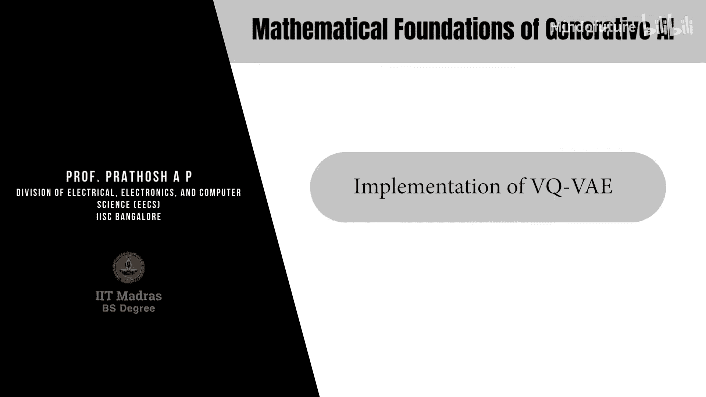

Hello all， welcome to the tutorial in which we shall be discussing about。A variant of VAs。

 variation auto encoders， which is called as VQva vector contest V。

The main difference between the betavaE and the VE that we have seen and the VQ VE is that now here the latent space that you have is discrete。

😊，Okay，That is the first fundamental difference。😊，Now。

 what do you do with this is now we have all these。Late into vectors that are there。

Now using which now we come up with something called as a learnable dictionary。

 also famously known as the codebook。And then let's see how it works。Now。

The optimizationian function that is there。Yes this is the standard reconstruction loss。

That we have now in addition to that now you have this MSc loss now between the latent and the net quantized。

哦感。Okay， so now let's。See how this is being implemented in the code。

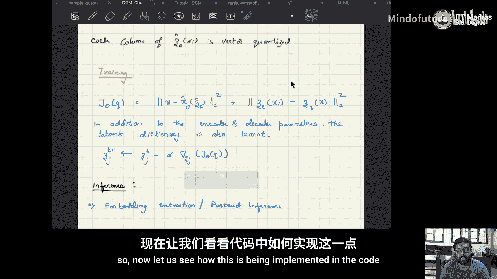

these are the necessary libraries that we need。We should be very much aware of it by now。

Now I am using a vector quantsizer now this vector quantsizer is part of the VQva network now lets look at this network and then hop on to vector quantsizer now in this VQV network you have the encoder part now in the encoder part I have convolution layers and then in the decor part I have the transpo convolution layer so yeah and then in the forward method now encoder now we pass the input and then you get z and then you pass this z。

Through the quantizer and then you obtain the quantized outcome and then the quantized outcome that is there the quantized vectors that are there you pass it on through the decoder to get the reconstruction now you pass the。

Reconstruction and then the loss so that using the loss you can update the weight of the network Okay now this is you can use Vq Be now either for。

Ebedding extraction okay or embedding extraction or it is called as posterior inference or we can use it for sample generation okay so now lets look look at this vector quantizer。

😊，Now， where in which now you can see that it has a number of embeddings Okay。

 and what is the dimension of。Each embedding okay so and then so there is a last term which is involved which is called as a commitment loss lets look at it when we go back to the vector quantas okay so now lets look at it here。

No。You have the first thing now which is the number of embeddings that is there now this is the size of your codebook or the dictionary that you have now how many discrete vectors you need it is what saying about number of embeddings and then the embedding dimension now that is there is that each vector in the codebook now whats a about dimension of that specific vector now you are saying that and then this。

The idea of this commitment loss is it is a scalar it will it it is a scalar it will weigh between two specific losses which we will see some time now and then you are creating an embedding。

😊，O。Now you are creating an embedding now that is of it is a matrix of size number of embeddings into the embedding dimension so。

Now that means that it will if you keep it as k the number of embeddings as k and the dimension of each as d so now you are coming up with a k across d dictionary okay so and then you are what you are doing is you are initializing all the weights from minus1 by number of embeddings to plus one by number of embeddings in uniform fashion you are initializing the weights now this step is not needed yeah you can go ahead with that okay so now the first step that happens is now you get z okay now how did you get this z lets go back to。

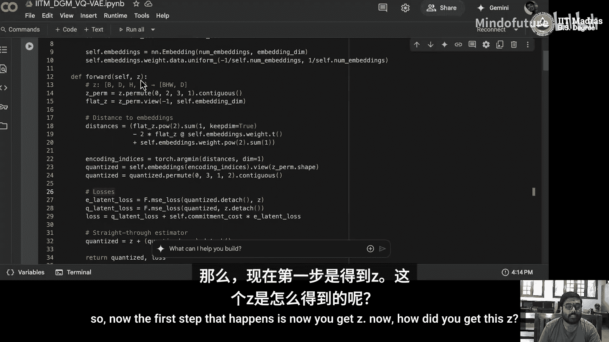

You have your X here。This is your encoder， you pass it through your encoder。

And then you get this encoded z for that specific X， know that you pass it through there。

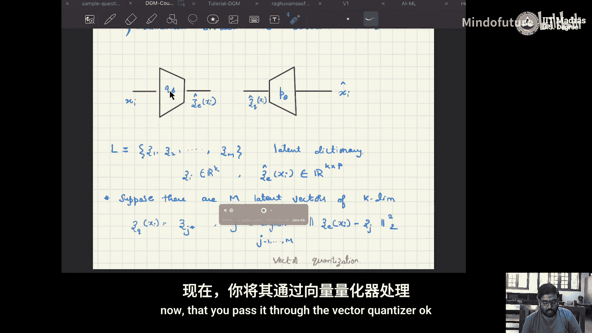

vectorctor quantism。 Okay of that you have。Got it through z。

 Now let's look at what is the dimension of this z now to understand that let's go it here now this is。

32 cross 7 cross 7。 Okay， you have 32。那。sorry this is the embedding dimension so embedding dimension whatever it is into7 cross 7 okay now that is one block and then you have batch of it okay now that is always it is in the format of B D H W okay now that is the input dimension you have B d H W。

😊，Okay， and then that you permute it okay you have B dhw now then you convert it into B hwd so the dimension now that is there you put it at the last and then。

You convert it into a matrix now which is of size being here I have mentioned it BHW comedy now that is what is being done in these two steps okay。

So no。Then what do you do then you find the distance you have to find the nearest embedding right now for that reason now you have to find the distance for each input vector what do you do you find the nearest em now from the codebook that you have and nearest embeing how do you look at it now that is the distances that are there the distances that you have calculated now what is the minimum of it now you take this now this is representing。

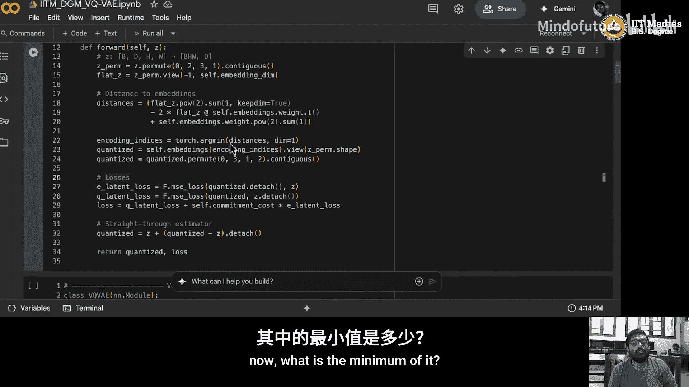

This specific situation， you get the nearest embeddings， now which is here。

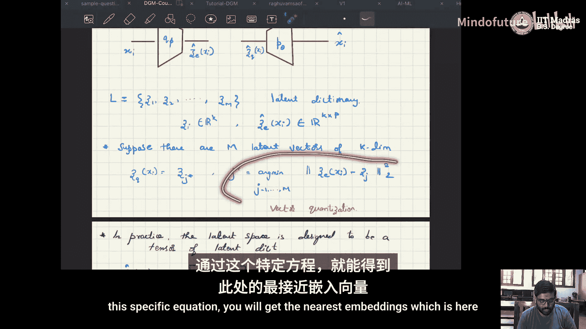

Okay， so now once you have got the nearest embedding。

 okay now then you have to reshape it right and then you have to reshape it and pass it through the decoder now for that specific reason you reshape it into。

😊，This particular B HwD okay to that specific BHwd。

First you view it now that means that you change it。

 it will be a vector and you change it into the parameters of that you have the parameter of this shape。

です。Z para shape， okay， and then。You permute it into 0，3，1，2， that is B H wt okay fine。

 so this is what you get the。Vectctorors， okay， now vectors is done now comes the important。😊，Now。

 where in which you have to obtain the。Losses， okay， now this is。Interesting。

 now we came across something called as a commitment。

Cost okay now what is this commitment cost now this commitment cost encourages the encoder output z now that is there to stay close to the embeddings that is zq okay it it want it to be staying close to the embeddings okay and then what do you do then you perform a detaach right now why do you perform the detach now so that the gradient flow does not happen through the codebook now you do it okay now and then again on the other hand。

That is in this line line number 28。Now you have the codebook loss now you want to even update the weight you want those are lanable parameters right the codebook loss it is now you want to pull the embeddings now towards the encoder output okay now here we stop the gradient from encoder to prevent encoder training on this part。

Okay， and then you combine them using this commitment loss。

 how much emphasis you want to give it to this specific class。😊。

Now you can vary using the commitment loss。Okay， so， and then what do you do？😊。

You send this quantized outcome and then the loss okay now you have got the loss。

This is regarding the network structure。So。Now these are you are putting your quota and all those things。

 you are creating a instance of the VQ， all those things， the standard stuff。

So now comes the interesting task here now don't worry this is not an error this is a keyboard interrupt I have roed it myself。

So you put it in your training mode， you get the x okay。

 and then you put it onto the device and you send it through the model you get X hat now which is your reconstructions and then the VQ laws。

So no。Again， you want to obtain the reconstruction laws why you want to obtain the reconstruction laws now if you remember how does the objective function look like this is your reconstruction loss and this is your VQ loss。

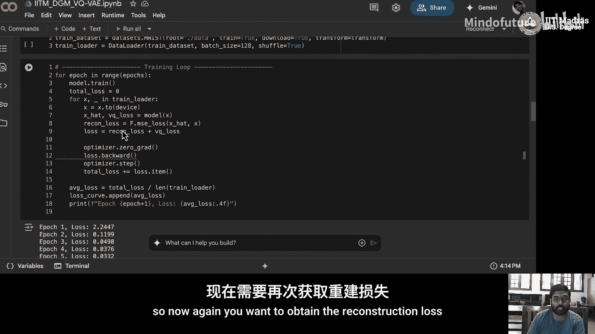

You have obtained this VQ loss from the vector quantizer okay now this is your reconstruction loss。

 you add both of them and then you proceed with the a。😊。

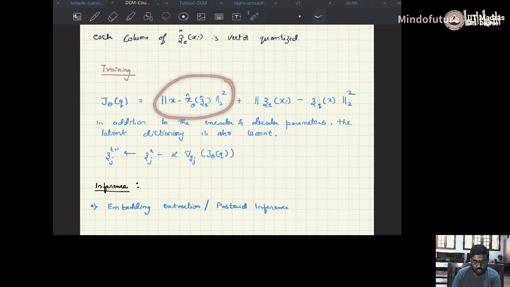

Okay， you have added both of them and then you get the overall loss。And then you obtain the。

The gradient in the loss dot backward and then you update the steps okay then you do certain lock keeping and then you take care of the loss transition。

😊，I have put the last transition。So now comes the reconstruction see now here now I have shown two variation now one is I I pass the x get z okay and the z that I have got。

😊，Now that I'll pass through and get there。A reconstructionconstruct， okay。Andll pass this。Ex。😊，Okay。

 now that will have the full flat structure， you have the encoder， you get the vector quantization。

 you pass it through the decoder and obtain the reconstruction this is the first thing。

This is the standard。 Okay， now， this is your。The top one is the original and the bottom one is the reconstructed of values but now this is for the input you can reconstruct now the question that arises is how can you sample now okay now this was one important question that was arranged even during the sessions one is okay now the inference you can obtain the embedding extraction which is straightforward thing okay you just stop at the encoding you you train it and then stop at the encoding process okay now you have got the embedding now that is simple so now if you want to implement it for sampling okay now you have to sample from this distribution。

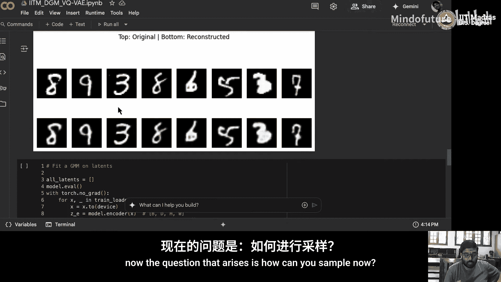

So now how do you sample from this distribution okay so now if you want to sample from this distribution you should know this distribution now to do so now what we will do is we will turn a GMm。

😊，Okay， we will train the GMm and then what we will do we will sample from this distribution and pass it on and obtain the。

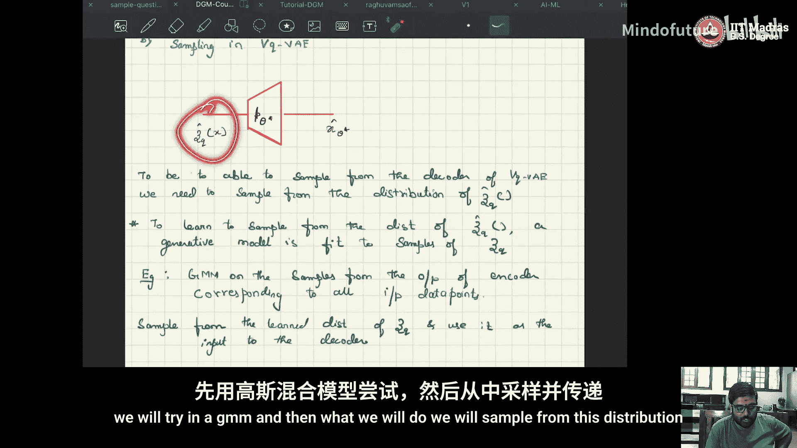

New samples that is what I have tried to do it for all the latent what I have done is I have obtained all the latent first。

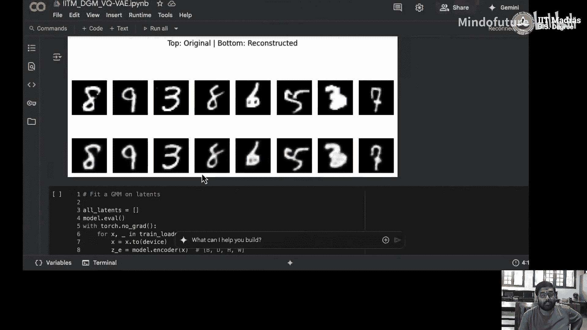

And then I have put it into one specific list Okay put it in the evaluation mode and then I obtained all the late okay so as you can see here I am only。

Passing it through the encoder。And then I permute it。

And then I convert it into the dimension which is needed and then I put it onto the all lates so so now now I have all the lates put together now I have to train in a Gaussian mixture model so from a scale and or mixture I create a Gaussian mixture I have taken 100 components now because of which。

It took too much of time so I stopped it in between so you can take any smaller number of components some 2030 components so and then you fit that specific。

All the latents that are there。Using GMm and then you sample from this now you sample from this particular GMm。

And then once you have sampled it。Now， then what do you do， you find the。

From this whatever samples that you have got you find the distance between the sampled latent and then the latent dictionary that is there now you find the minimum ones okay now why you have to do it now again this is。

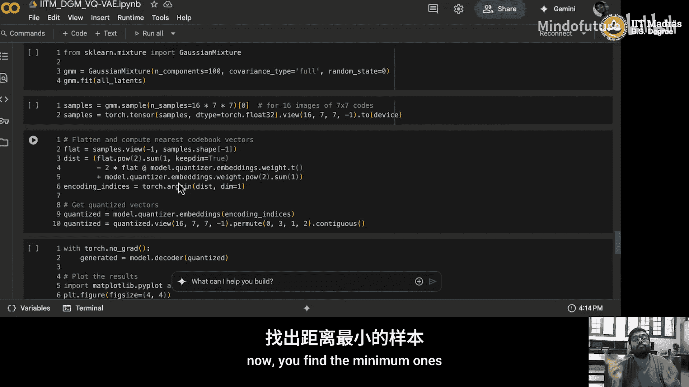

Im saying about this you sample it and then again find the embedding which is having the least distance。

 okay you have this least distance and then you pass it through the decoder。😊。

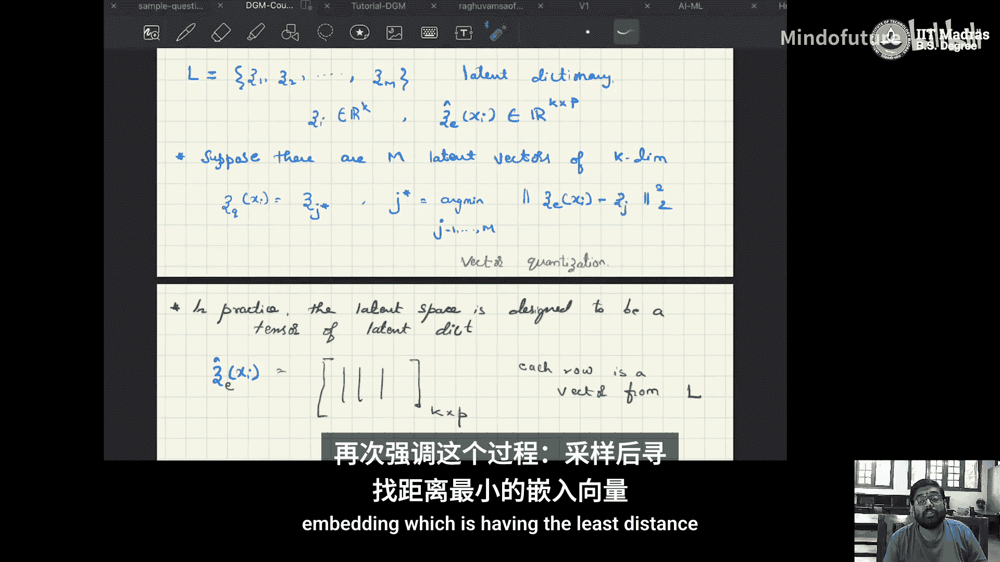

Okay， this is the standard procedure that we there but the reconstructions are quite bad here。

 the reason is I did not try enough now because of。😊，The GMM we we so it took a lot of time。

 now we stopped intermediately and then we ran this。

So the reconstructions are really bad now because the GMM is not trained now this is not because that VQA structure is not trained no notice it is because the GMM is not trained now you are not able to sample things from GMM properly now if you train the GMM and leave it as an exercise you take smaller components now you will be able to do it now this is the idea of VQA now in which you have the latent space which is discrete and then you can use for either getting the embeddings or you can use for new sample generation。

Now with this， we will conclude our discussion on vector quantized variation auto encoders we will meet in the next tutorials。

 thank you。😊。

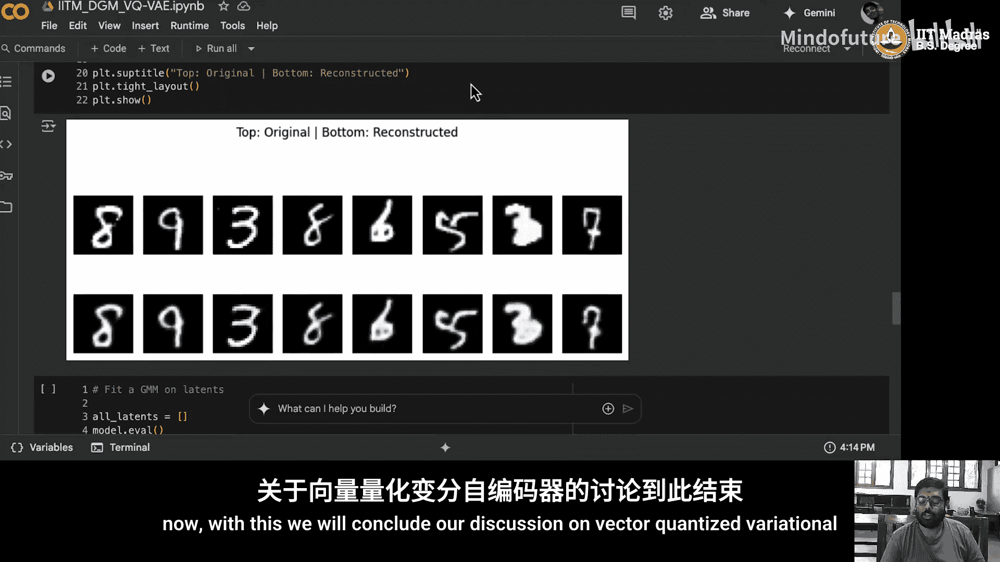

