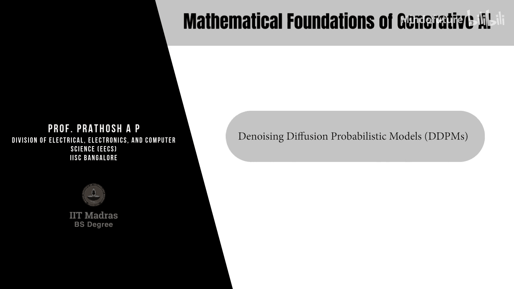
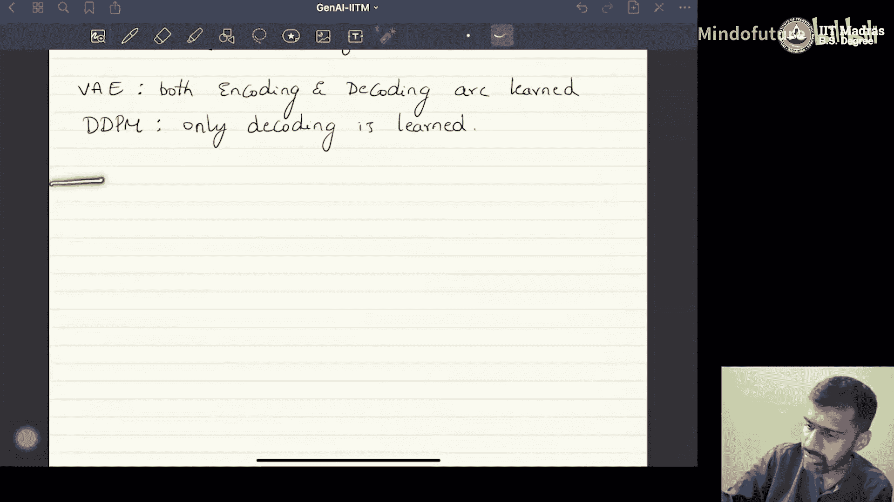

# 生成式Ai的数学基础 ｜ Mathematical Foundations Of Generative Ai p38 P38_W7L26-去噪扩散概率模型（DDPMs） -BV1fperz7EjK_p38-

🎼。

Welcome everyone to this new module in the Geneative model course。In this module。

 we are going to study denoing diffusion probabilistic models。

Abbreviated as DDPms are in short called as diffusion models。Now， these diffusion models。

Form the state of the art models for tasks like conditional image generation。In the current scenario。

Now， you might have seen a lot of examples where commercial。Language models。

 such as G now can generate。Images conditioned on a particular text。

So these conditional image generation models are mostly based on the principles of diffusion models。

So， while we studied two families of diffusion models before which are the adversarial networks and variation auto encoders。

 the current state of the art is using diffusion models。

 so we will study DDPMs or diffusion models in the coming module。のでラ。

Multiple possible interpretations of how one can look at diffusion models one can look into that from stochastic calculus seeing that as dissolution for a stochastic differential equation or one can see that from an energy based model modeling framework the other way to look at it is as a special case of variation autoencoder or as a latent variable model so that is why we studied the VAs or variation autoenderrs before jumping on this particular topic now the approach that I would take in this course majorly will be to show diffusion models as continuation or rather a special case of VAE or latent variable models。

Okay， so now let us start， as usual， the problem is that we are given。They are given data。

So let's call it B equal to。It's not。The X 1， x 2。U to 액。

This is sampled ID from an unknown distribution px。

 so this is the usual problem setting that we have。Now the goal。Its as usual to learn。都三不。

We need to know how to sample from the unknown distribution px this is the generative modeling problem right this is the generative。

AI， as they call it， this is the generative model modeling problem。Now。

 the GDPDPM tackles this problem from a。Lant variable model perspective。

 the usual latent variable models that we saw。So if you recall in a BAE。So I would like to see DDPMs。

 DDPMs。Od。Our latent variable。Lant variable generated models。Ready models。That can be seen as。

Special cases of。These family of models called hierarchical VAs。Herarchical Vs。

So now what are these hierarchical VAs， so recall that in a VAe。And a V。

So broadly what is the idea the idea is that we start from the data space x right and project the data onto a late space that we denoted by the variable z and then you get back to the data space So this was the encoding process where there was a projection from the。

Data space to late space and we had a decoder or the decoding phase where the data was project from the late space back to the data space。

 So this was broadly what。Is done in a Ve by minimizing the evidence lower born I mean hierarchical B what happens is so here fingers。

There is only one latent space。 So this is the。This will call the data space。

This is the latent space or the latent variable， and this again。

 is the data space Okay So now the encoding。Takes the data and protect it onto the latent space and decoding takes the latent space and protect it back to the data space that is what the idea is right but here there is only one latent space in in a hierarchical VAE。

네， hierarchical 위에。There are multiple latent spaces。

Unlike in a VAE where there is only one latent space in a hierarchical VAE there are multiple latent spaces in a hierarchical manner which means that data is first projected onto the first latent space and from there data moves to the second latent space and then to the third latent space and so on and we have up to capital t number of latent spaces so this is the。

The encoding procedure。And decoding just reverses what it is。

 so starting from the tith latent space it takes。Theth latent space to t minus first latent space and from there t minus second latent space and so on up to。

The data space。 Okay， so。This is the decoding process。Now， what is the intuition here is that。

Instead of。Designating all the job to one encoder right I mean what is what is that we are doing in in an encoder of a Ve or any late variable model for that matter is to take data and forcing the encoder or the encoding distribution so if you recall what is the encoding distribution it is the latent posterior which you have been denoting by Q of。

Z1 next。And this is p of x given z the decoding distribution。

 so now we are forcing one single distribution with one single late space to encode or embed all the information about the data distribution and compress it okay one step。

Now， this may not be a great idea because。There is so much information with data and compressing all that information into a lower dimensional subspace using one step transition may be difficult。

 So now intuitively it makes better sense to。Instead have multiple projections onto multiple latent spaces where the transition from the data space to the late space and vice versa happens in a hierarchical manner quote unqu slowly so this is I mean the idea is that if you do this then encoding and reconstructing or rather decoding the data is much simpler if one does it in a hierarchical manner that is the intuition。

Now， a diffusion model takes it one step forward where they say that。A diffusion model or a DDpM。

Ease。A hierarchical VAE with the following properties。Suppose we impose。

These properties in a hierarchical V this is how we are going to get。

 so we have the first property is that。Of course， there are multiple。La in spaces。

We have multiple latent spaces。The second property is that typically in a VAe。

The dimensionality of the latent space is much compare much less compared to the dimensionality of the data space。

 but in a DDPM or a diffusion model， the dimensionality of the latent space。Of all latent spaces。

I same as that of the data space。佢。This is another special property of a DDpM。

 which means that Im saying the dimensionality of the latent space is equal to rather。

That read the other wayon the dimensionality of the latent space。

 all latent spaces are equal to the dimensionality of the data space。Okay， ferrality。

First there are multiple latent spaces， let's call them z1 z2 up to we have zt right and the dimensionality of the latent space is equal to that of the data space and now why that is that is a good thing to do it is because。

Again in a VE when we are compressing when youre projecting data onto a lower dimensional space there may be lots of information and we rather don't want to do it so we match the dimensionality of the late spaces to the data space and that is that can be a vague rough intuition so as to why this may be important the third thing that is done here is the encoding process。

The encoding procedure， let me call it for now。Andcor procedure is fixed。Or like non learnable。

Unlike in a VA or a hierarchical V where the encodes are learned， so unlike。A VE or a hierarchical V。

No。If you recall in a VE， the encoding was。Represented using a probabilistic neural network， right。

 so this is。So Phi is a neural network。That is learn， right， that is。W elbow optimization。

 this is what we do in a VA in a DDPM。Though the encoding distribution Q of z given x okay for all z is。

Is fixed。Im not loable。See note that I am not saying that the encoding distribution or encoding procedure is deterministic okay it is still a probabilistic process。

 it is a probabilistic process but not notable so this it is a fixed probabilistic process and that is why you see that when you represent the forward the encoding process of a GDPM the distributions do not have any dependence on parameters because there is nothing to learn here okay。

Now in a DM， what is learned is only the decoding process is learned right encoding process is not learnable but the。

So here I'll write it separately So in a VE。Both encoding and decoding procedures are learned both。

In quoing。I'm begoing， I learned。So in a DDPM。Only decoding is learned。Only decoding this learn。

 the encoding procedure is not learned， but only。Made a。Fix， fixed。

Probabilistic process as we will see now So now again what is the intuition here。

 the lot of the background comes from the stochastic differential equation theory Okay where the idea is。

 you know imagine that。What are we what what are we trying to build here。

 We are trying to build a generative model a generative model is。

One that would take an arbitrary distribution which is the latent space and projects it back onto the data space okay which means that no matter what sort of encoding process is there。

 if we can somehow reverse that encoding process then we are then we already have a generative model with it so we don't have to。

Necessarily learn the encoding process because all we need is I mean in a generative modeling setup all we need is to start from the latent space and get to the data space now then while do we need a latent variable model a latent variable model is needed because if we know how to start from the data space and get to the late space perhaps we can learn how to start from the latent space and go back to the data space and that is precisely what we do in a latent variable model by marginalizing we have seen that so far。

Now。While encoding is necessary， there's no。There is no intuitive there is no strict necessity that the encoding process has to be learnable okay so that is why and also partially it comes from the stochastic differential equation community that。

You have suppose you have one encoding process that is that is fixed and not learnable。

 You can always come up with a。The decoding process which can be agree and it matches the the encoding process and we will see all at so that is the insition Now these are the three properties that we have to now impose on a VE to get to a diffusion model now think of a diffusion model as a Ve with these three properties what are the three properties one。

It has multiple latent spaces， unlike in a。In our VAE， DDPM has multiple latent spaces。That。

He is made hierarchical， which means that starting from the data space。

 you go to the first latent space and from firstlant space。

 you go to the second latent space and so on， and you have capital of them。读。

The dimensionality of the latent spaces all of them is the same as that as that of the data space that is the second property。

 the third property is that the encoding procedure is fixed or it is not allable unlike in a VAE only the decoding process is learned okay。

Now with with all this， so let us get into the details of how how to build a diffusion model and how to learn it。

Let's write down DDPms。

