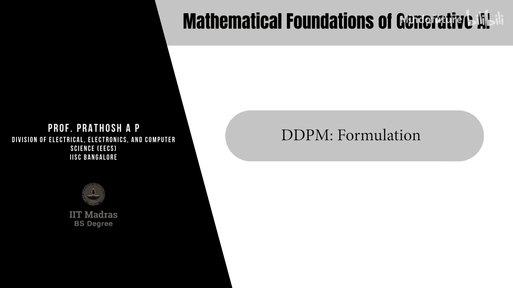
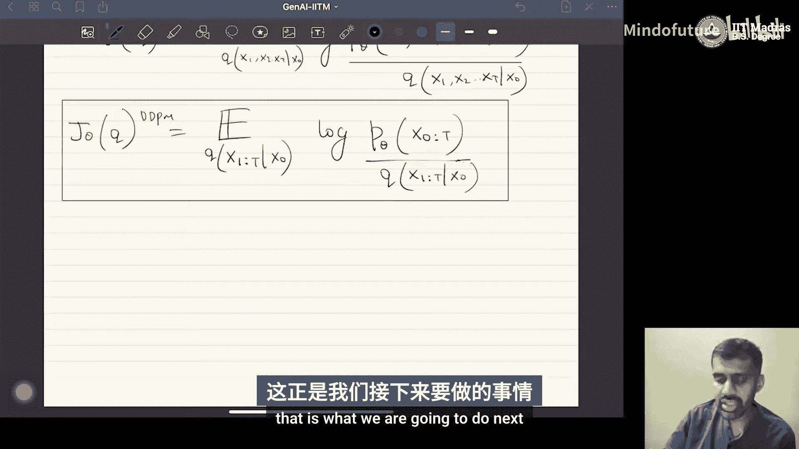
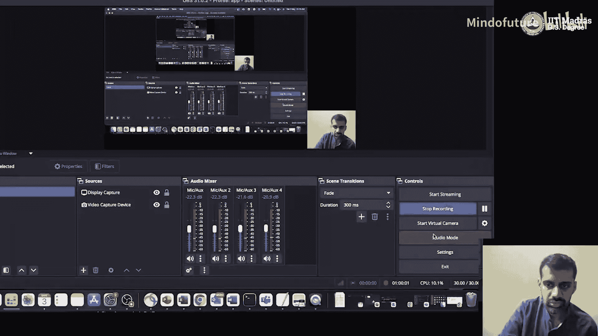

# 生成式Ai的数学基础 ｜ Mathematical Foundations Of Generative Ai p39 P39_W7L27-DDPM-公式 -BV1fperz7EjK_p39-

🎼。

TDPM's formulation。So， even the name if you see they are called denoizing diffusion probabilistic models。

 the process I mean the word denoing here actually stands for decoding okay so we will see the encoding process is also referred to as the forward process or the the encoding process the decoding is also called the denoicing process or the。

Backward process or reverse process we will will get to that So the point that I wanted to make here is there is no encoding here we only have the denoing part or the decoding point okay now。

Just to be consistent with the notations that are there in the literature in all the existing literature I will make a switch in the notation so we have been using x to denote the data variable so far and we have been using the the alphabet z or Z to denote the la spaces now I will slightly change the notation here in all DDPM literature the data。

Variable。Data variable is denoted by。Denoted by x not。Now。

 this is what we have been denoting by x with with x so far so now the latent。Space。

Let me write only the notations。So latent space is typically denoted。Y x1。ex two。

Up to x capital t okay please note that we have been using z so far so we were using z1 z up to zt to denote the la spaces but now the literature everywhere right I mean if you look at all the papers and others descriptions of tutorials of DDPM you see this particular notation so therefore I will resort to this notation so that I just want to be consistent with the existing literature。

Now， please note that this x12 xp is not the same as the data samples that we have。

 so I will just erase this okay。Just two。Disambiate the notation so given data D is equal to。

Well so let's say that there is only a single data point xn okay now this is now being sampled from P of xn because xn is the underlying data distribution okay x n is the data distribution so right this is the。

Data distribution。Okay， so please note the change in the notations。嗯。Yeah。

So now whenever I use now x1 x to xp so these are latent variables and in all our treatment just like with the case of VAs Ill assume that there is only a single data point x not and this can be trivially extended to the case where there are multiple data points just by putting a summation or an expectation with respect to all data points at the outside okay so this is the idea so we are assuming that there is only a single data point that we are given x not and this comes from the distribution p of x not the latent spaces denoted by x1 capital x1 x2 up to x3 these are not the samples of the data distribution but rather。

Lnt variables， Okay， so please note this。Important notational change in this course and this I will do this only for the DDpM discussions because as I said。

This is consistent with everything that has published there so Ill maybe write that。

Not to be confused。Connstrued with previous notations。We of notations where。Next one， next to up to。

😔，not these four。Or data points， okay？Now， in a DDpM， these are the latent。Victors corresponding to。

I given data point x not， okay， so in a。InThe DDPM literature。D DD PM literature treasure。

X not denotes the。Data point。And x 1， x2。Up to Xp den。The latent space or latent vectors， okay。

 so this is the change in the notation， okay。Now lets write down the encoding procedure in a VAE sorry in a DDPM。

Ecoding and it's also called the forward process。So it is called the forward process because we are starting from the data space and graduallying projecting return to several latent spaces so the notation is we start from x not okay then we will go to x1 then we will go to x2 and so on and。

We have x capital t Okay， so this is the encoding process。 Now this is the data point。 This is the。

So is the data point and all of these are。All of these are latent vectors。

It in vectors corresponding to this data point okay。Lant vectors corresponding to。Its not okay。

 this will be our。Rotation， please note that as we said。

 the dimensionality of every xt is equal to the dimensionality of。X not O for all T。

And capital T typically is which is how many number of latent spaces that one needs to consider is a hyperparmeter。

It is chosen experimentally， so we will。It's because about the hyperparmeter later。No。

I said that this is a latent variable model， the DDPM is a latent variable model。

 which means that let us know denoteote or define the model。

So maybe before I define the model let us complete the encoding process and then we will go to the definition of the process so I told you that the encoding process which is now also called the forward process I be using these terms encoding process and forward process interchangeably。

Now the forward process or the encode encoding process I told is fixed non learnarnable。

 right it's a fixed non nonlineararable。Proc， let us define。The encoding process。

Let's define the encoding or the forward process。And I did EPO。

Let us define the forward process in a DDPM okay now what does the forward process do it starts from the data space and then projects the data space onto the late space okay now what is done in a DDPM is that the forward process defined as follows using these equations so lets say that we have xnt right xnt is the。

Input data point。Okay， now this input data point is。Scaled with a scalar， which is root of alpha 1。

And it is shifted。By a skilled。Listen off。I a sample drawn from isotopic acid distribution。

Please recall that I told you that。The forward process in a DDPM。Is fixed， but it is。

Not deterministic， right it is still a random process。Okay。

 so this is taken to be the first latent space。Okay， so now what is this。

 the first latent space is taken to be。呃。The scaled and shifted version of xn okay。

 which is the data variable now the scale is defined by a constant alpha 1 and the shift is defined by this the is some scaled version of。

A random sample that is drawn from a normal distribution。Okay。

 so this we will do iteratively so now x2 will be root of alpha 2 times x1。Plus。

root of 1 minus alpha 2 times some epsilon 2 where epsilon 2 is now drawn from again normal01 and so on。

 so this is how we define it and for a given x t which is the Teth latent space let is define it as alpha t times x t minus 1。

Plus。Root of1 minus alpha T。Times epsilon， P。Where epsilon T is again a sample from normal01。Now。

 what are the。Announs here were epsilon 12， epsilon T。

Or lets call it as enal capital T because we need capital t of them okay our fixed scals。

Are fixed scals between0 and 1 okay？Now， this is called the variant schedule and this is fixed to be a constant。

 this is again another hyperparameter。Okay， alpha1 and all for they are fixed。Now。

Diaagonmatically what does is what does this signify lets say that we have xn which is an image okay that we start with which ce there is some house image that we have okay and this is my xn。

What is happening is the projection onto the next latent space can be looked into as I just sample。

IGo your noise。This is my epsilon knot， this is root of I scale it with the alpha1 minus alpha mini range。

This adding with the noise will simply give me。你。The first latent space and this will be the data point with some noise。

Add it to it Okay， so of course we have the Excelel on you sorry you multiply this with alpha So you multiply the data with the root of alpha and then。

Take a noise which is scaled Gaussian noise and just add it to get x1 so this is the first latent space okay now to get the second latent space you take the image or the the latent variable that you have note that all the latent variables are of the same dimension of that of the image that' is why you can interpret all of these as adding noise so this will be root of alpha 2 times x21 minus root of1 minus alpha2 times epsilon 2 where epsilon 2 is another sample and you get。

X3。Which is the image with。Some more now is added。So we have some more noise added and you know。

 we keep going like this。T a point where we reach x capitalita p。And you know。

 it' is not difficult to see that x capital t， hopefully with a large value on t will be completely noise。

you the image or the semantic content of the input data completely vanishes okay so this is this is how one can visualize what is happening so now what is this that people who are already aware one can see that this procedure which is defining the forward process or the encoding process please note that there is nothing to be learned here there is no parameter that we are learning this is a fixed process okay fixed encoding process but here it is not deterministic it is still probabilistic okay it's a random process because the we are sampling from a Gaussian distribution at every time but this is fixed okay so if one can see this or this Xp this forward process that we have just defined the entire thing now。

The forward process。不。So， this is the。The ball。Definines。你恩果零。Or the forward process。Offer DDpm。Okay。

 it is very easy to see that let us call this sum equation 1， so equation 1。Representence。

Represents a first order or Marco chain。It represents a first star marco chain with Gaussian transitions right what is a Marco chain。

 a Marco chain is a。ranandom process which is a sequence of random variables where when you sample the sequence at every time what you get is a random variable with an associated distribution okay so a marco chain or a marco process is a special form of random process where。

Given that we have observed the t minus first random variable。

 the T earth random variable is independent of everything else before that。

 so the first code chain let us define so。A first order markco chain。It defineines。

Series of random variables。Hereer of random variables。

 let's call them x not x1 up to x capital D okay， such that。What's that。X T is independent of。

Everything， you know， x t minus2 up to x not given1。X D minus1。

Okay so if I know what my xt minus 1 is， then my Xt is independent of everything。

 the entire past given that I know the immediate previous random variables so this is the definition of a false coaching and it is very easy to see or show that this expression which is the encoding process or the forward process ofing DDPM represents a false start coaching。

Okay， so this implies， what does this imply， this imply that one can define a series of。

Conditional distributions。Get right there down。One can define。

Define a series of conditional distributions。On thee。On the latent spaces， latent variables。

As follows。So of Q， let us define that as Q because it is the encoding process and we have been using the notation Q for the encoding process or Q of xt given xt minus1。

So please note that Q of xp， the random variable at time p only depends on t minus1 okay the dependence is only on t minus1 the random variable at t minus1 is independent of everything else how do we define this？

So， we will define that by the definition here， so lets this if you look at this definition。

Then we have studied the reparameterization right I mean a Gaussian variable can be reparameterized。

Using any mean any Gaussian distribution can be re parameterized using a Gaussian distribution with zero main unit variance so it's very easy to see that because is a Gausian this is a normal random variable distribution as zero main unit variance if you scale it and shift it with something xt will still have a Gaussian distribution with the mean random variance defined by these two variables so that we know now therefore this conditional distribution which defines the forward process can be defined as a Gaussian distribution on xt because we are the xt is the random variable please note that we are talking about the forward process now in DDPm is a first start or Marco chain and at every point t we get a random variable because when you sample a marco chain or a random process you get a random variable at every time t so the other way to look at it is that we are。

Building hierarchical legend spaces at every time t what we have is the tith legend representation of the given data point x not and from from a diagrammatic point of view。

 so xt is。The the image or the data point that you get by adding the socal noise for t number of steps okay so this entire process can be looked into as this is like。

So you take data plus add noise。Let me rate it us。唔知道。SoId noise。And then， we have。

The first gradientnt space， right， which is。Noisy data， data plus noise。No isy data。Then again。

 you add noise。Okay， and then we get。We will say noisy。

 noisy data I mean just just making this up so and you keep doing this so now this is the first the data variable you have the first late space have the second late space and so on and finally you only get noise only okay this is the idea。

This is x capital okay now these distributions are Gaussian distributions at the T' random variable I was just saying that xt dens the Tth random variable in the marco chain or the T at latent space or the data variable lit after adding noise for t number of steps okay this is at xt and what is the mean of this the mean of this is given by root of alpha t。

Times x minus1。Please note that when you condition a distribution the condition random variable is always fixed at given value that is a definition of a conditional distribution where the condition random variable is actually fixed to a particular value；

 therefore this is a contrain when we are defining this so this is the mean of this particular distribution and the variance is given by 1 minus alpha t times the identity matrix so why is this。

This is because。What we are actually doing here while defining X D is to take。

A random variable a sample from a sample from the normal distribution with zero million units and then we are scaling it by some constant and shifting it with some constant and if you take a random variable that has that is Gaussian with zero million unit variances you scale it with scale it with some constant and shift it with some constant we still get a Gaussian distribution or random variable we mean the variance defined by the scale and the shift that is exactly what it is this is the reparameterization that we saw in the context of Ve as well right okay so this is the definition now so this is the。

Ming。And this is theviience。Now， please note that yeah so I've already said that right the dimensionality of all this these are all vector valued random variables。

 so therefore this is。This is equal to we are saying that this is all RD， right。

 this is all RD for Rt。So， we are talking about them and if we are talking about images。

 all of the Xs have the exact same dimension as the initial data space and the epsil answer the socal noise that we sample also should have the same dimensionality as the data of course it otherwise you cant add two vectors。

😊，Okay， so this is the definition of the forward process in a。DDPm， so this is。It is because。

Let think I queue？Of X T given X T minus1。Is is called D。Conditional forward process。

Conditional forward are the encoding distributions。Okay。

 and there are t of them because at every T you can define a distribution this way。

Then what do we need we have the fixed encoding distribution now which is fully defined now we also need a decoding distribution right so lets lets define。

Define the model。嗯。喂啊。A decoding distribution。Okay， so we all know what a model is right。

 I mean a model is a distribution over data P theta right which has a particular。Farm defined by the。

Defined by the。Lent variable， a distribution P theta。

 so let us define what the model distribution is in the case of a GDPpM。嗯。So in a DPM setup。

 so as we said we have multiple hierarchical late spaces。

 we will have to define a model that will define that as。B t of。It's not。It's one。

X2 up to x capital P。This is equal to。B。Theta of x capital D。Times the product of。T equal to 1。

2 capital T。B2 do off。X t minus1， given Xt。Well。Be you off。Xt minus1， given Xt。Is defined。

To be a Gaussian distribution。On the T minus first random variable。

 and the mean is given us mu theta， the variance is taken to be some sigma theta。그。Okay。

 so this is the definition of the model this is the definition of a model。

In a DDPM now here please note that this is actually nothing but the join distribution between the data and latent variables because why is this this is very similar to P theta of x comma z right which is the in any latent variable model let me write that down。

P theta defines a legend variable model over the joint distribution， so p throughta。Definines。

ALant variable model。It variable model。Wt。Multiple latent spaces。

Multiple la variables Why is this so it is very simple to see because， you know， this is similar to。

Similar to a VA where what we define is that we define where we define。

We define p the of x comma z right so what is this this is nothing but P the of x comma z because x x is the data variable and x1 through x t is the。

The entire latent variable， so this is the data variable and this entire thing is the multiple latent variables right so this is nothing but the joint distribution between。

啊，你。Data variable and the latent variable。 So this is the。Joint distribution。

Jo and distribution between data and delete in variables。

Thats all okay now unlike a VAe this has a particular form here okay which comes from the fact that the the decoding distribution or the so called model distribution is also assumed to be。

Adding a marco chain。Okay in the reverse direction so you have you know here what we have done this because we have represented time from you know left to right from x n to x capital t in the decoding direction or the dennoizing direction or the reverse direction what we need to do is start from x capital t and go all the way up to x n but because there is there are series of random variables again so one can define that as a random process and that random process is also assumed to be a Marco process。

it is also assumed to be a marco process with Gaussian transitions just like the forward process。

 but the catch here is that the mean and variances of the conditional distribution at every transitions is learnable。

Okay， so this definition of the joint distribution of the data and deletent variable。

Aris is because we are assuming that the river reverse process is Gasian。

 let me write that sorry reverse process is Markovian。😊，The definition of P theta。

Definition of the model distribution。P theta arises。Definition of the model distribution。

Oral distribution B theta。In a8 PM。A raises。Because of。TheMarovan assumption。

Specifically for starter Markovan assumption。In the reverse direction。Okay。

 so this particular definition that we gave here right I mean this is pretty simple and if you take a marco chain okay。

😊，And want to write down the joint distribution of all the random variables involved in a markco chain a for start markco chain this is how it looks like thats by definition weve also made the assumption that the transition probabilities are also gaussian with a mean mu theta and variance sigma theta that are learnable so now give us direction width。

With Gaussian transitions with learnable parameters。Cautionion transitions。

With caution transitions containing learnable parameters。Okay，So now these distributions， okay， P of。

X T -1 given X T， they are called the。Conditional。Rverse processes。

 I mean distributions that are there in the conditional reverse processes right we want we want to know these distributions。

Mu theta and actually we have to make this a function of Xp as well because。

Mu theta changes at every xt， mu theta of xt and。Sigma it of xt R。Learn。

yeah elbow optimization thats it So now in a in in a VU what did we do we learned the encoding and the parameters of the encoding and the decoding distribution both。

But here we only learn the parameters of the decoding distribution because our encoding distribution is fixed。

Okay， so。That is the idea so now here the this is the definition of the model for a DPM dennoian diffusion probabiling model and we have made an assumption that the reverse distribution reverse process or the backward process or the decoding process is also a marco chain with。

Gauussian transitions where the parameters are learned about so I will actually make this a function of Xt。

Easier to comprehend it so this is a function of xt and sigma theta is also a function of X Xt。

There is also a function of Xt。Fine， so now we have all the model distributions or model definitions。

 there is one other thing that was covered here is one can show that if one defines a marco chain in this way。

啊。As in the definition of the forward distribution， one can show that xt。

 the distribution of xt right， which is Q。Of fix D。

The distribution of the final random variable can be shown to be。Equal to normal 01。

 so this is called the stationaryist of the Marco chain。今日嗰前。

So now if you have a first start co chain with this particular definition。

 one can show that the stationary distribution of that particular remote co chain happens to be a Gausian distribution so this is another known property that we will be using as we move on。

Okay， so now the next thing that is to be done is that now we have to use all these definitions and use the standard elbow optimization to find these parameters mu theta xt and sigma theta xt4 the reverse distribution or the decoding distribution so let us。

Look at that now， so what we need to do is。Elbow optimization。Do learn。The decoding parameters。

Inna Dpm。So please be a little patient with me because this might all seem a little abstract but as we move a lot of clarity would emerge so Ill also tell you how to just like we discussed the implementation aspects of VAAE and again well also discuss the implementation aspects of DDPM but so far what we have seen is that the DDPM is a hierarchical VAE with fixed encoding or the forward process where the decoding process is learned so we assume that both the the encoding and the decoding policies are defined by macro chains with the Gaussian transitions while the encoding transitions or the encoding ening macro chain that defines the encoding process of the forward process is completely defined the。

Decoding process is only defined up to the distributional level so we know that they are all gaussian transitions but we don't know what their parameters are so now what should we do is that given that we have data with us we have to use these definitions the model definitions and the usual elbow optimization that we have seen so far to obtain the decoding parameters so that is the。

Story so far。 Okay， so what is elbow optimization， So will please recall that。

Then elbow optimization， we start with the。哪个会。The likelihood Im just going back to the previous notation here and which was given by the。

Margiinnal of this is this you know is easy This is the definition of a latent variable model right what we did was we constructed a lower bound on this。

 which we call as the evidence lower bound J theta of  Q。Q P in the case of a V。

 which was given by the expectation of。Log of。P theta of X I Z。Dived by Q of z given1 x。

And this was with respect to Q of z given1 x Okay So in a VE。

 we made this Q also a learnable distribution。 Okay， this is what we have， but in a。So in a DDPM。

We have the exact same procedure just that we have the elbow for DDPM。

Has no dependence on the encoding parameters because it is fixed right this is elbow for DDPM this is equal to。

This is equal to we write the same thing the expectation of。Log of。P uta。

 what does this x and z here in our notations is it x0 x1 x2 up to x capital t this is because we have p number of lant variables divided by。

Q of again we have x1 x to up to x capital D given x not because we have this is z given x right and the expectation is with respect to。

The same thing that we have Q of。It's 1， x2。Up to x capital t given x n because x n is the data variable here。

 okay， Ill just write it in shorthand so that I can save some space Ill write it asq of x。1。

2 t give an x0 okay？And this as log of expectation of P theta have x not to capital t。Divided by。

Please note that while the model has a dependence on parameters theta。

The encoding process here does not have any dependence is  one2 capital t given x node。This is it。

 so this is the key equation that that we are going to work with， so this is the elbow for DDPM。

Is defined by this situation。Good。😊，Now what should we do is that well have to use this definition of this evidence lower born for GDPDPM and find a way to get these parameters theta of the model the way we have defined the model that is what we are going to do next with a bit of algebra Ill run through all this algebra quickly so that you know you appreciate what is happening and finally we end up having a nice looking very。

Elegant equation to solve this GDPpM and I will talk about how to implement that once we go through the algebras so now the next goal is to。

Use this evidence lower bone and the definitions of the models that we have seen so far and find the parameters of the model theta that is what we are going to do next。

