# 生成式Ai的数学基础 ｜ Mathematical Foundations Of Generative Ai p40 P40_W7T14-U-Net -BV1fperz7EjK_p40-

。

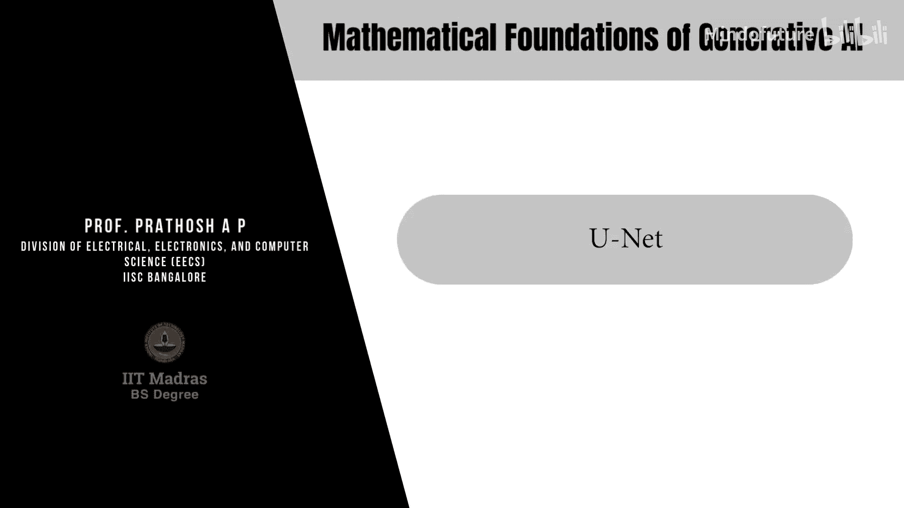

Hello， on。Welcome to this tutorial。😊，In which now we will be learning。

An interesting new architecture。😊，Which is called as the unit。

Now this unit architecture is preferably used for the idea of segmentation。😊，Now。

 what is this segmentation actually it means that let's see the output and proceed。😊。

You have an image。😡，And then you want to know where is the region of interest？😊，Now， for example。

 in the image that we have considered now as you can see here this animal now is the region of interest。

 so I should be able to differentiate between the animal and then the foreground and then the background。

😊，So now yeah this is the actual mass and this is the prediction that we will be getting okay so now how many such kind of objects can you can have any number of objects so now that means that each pixel。

😊，That you have。You are predicting to which element it belongs to。Okay， now for example。

 if you have three kinds of object。Lets say that now then each pixel can belong to one of these three。

So your output now will be nothing but。A block where in which for each pixel you will have three values okay that is how you should run and you will be using since it is kind of a classification problem now you will be using a CC loss。

😊，Pixel voice， that is what is the overall idea。😊，That is that is regarding the idea of segmentation in a very brief way。

😊，So now， how do we achieve this specific task in terms of unit is a question。Okay， so now。

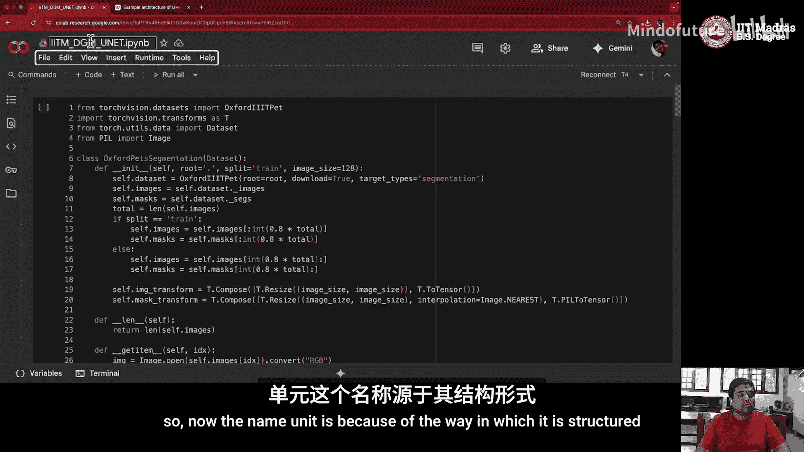

The name unit is because of the way in which it is structured。As you can see the structure here。

 this is the kind of it represents a kind of you， so this is called as a unit。

this bottommost thing that is there it is actually called as a bottleneck。As it he says。So now。

 and then you have connections。From this end to this end， now this is called as lateral connections。

😊，And this is called as the encoder and this is called as the decoder so in the encoding process now what are we trying to do now we are trying to reduce the feature size okay now preferably we use convolutions。

Okay and then we get the inter presentation and then from that inter presentation you have to go up now that means that you have to increase the size from there your output should be the same size of the image as I told you that you have to create this mask which is same size of the image now that means that you have to increase your size now which is done by transposed convolution which we have seen now。

😊。

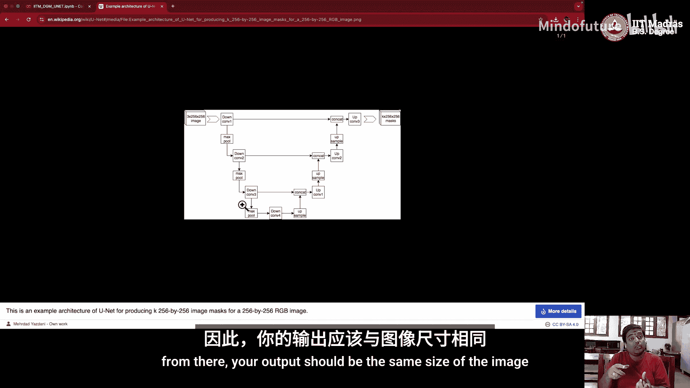

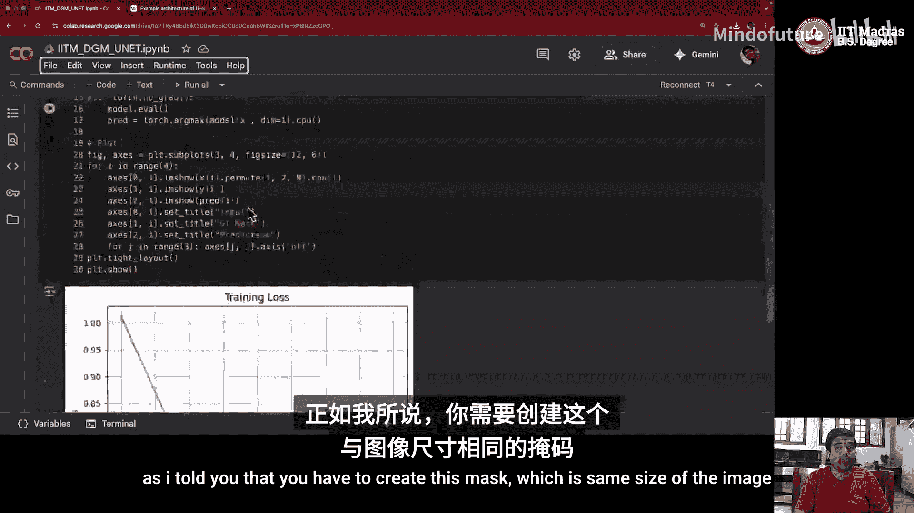

呃，没有。Okay， so now and then at each level， this is one level。

 this is one level what happens is now you combine the outcome of the encoder with the decoder with the decoder part now you cancatenate okay now this is the structure and the final output will be a。

😊，A mask on which you generate。

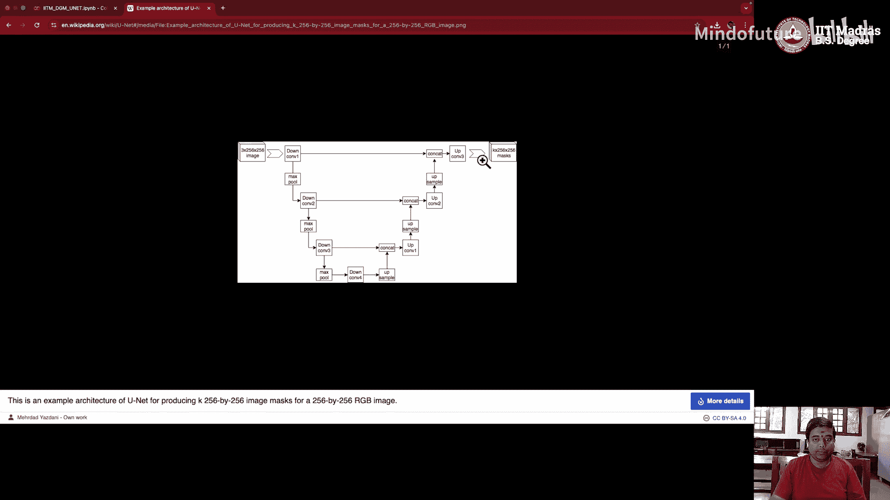

Okay， so now let's see how do we work with this architecture？Now， for that。

 we are using a data set called as Oxford PE dataset。哦。

Now you get this data set now this is the in method。

 I presume that all of you are quite comfortable with the ideas of optical or entered programming。

 you get the data set。😊，And then you initialize the images and masks and then you get the total length。

 80% you are trying to take it as3 and the remaining 20% you are fixing it as test this 80% is not anything wholly and you can keep anything any any specific 70% to 65% depending on your need you can do it and then you are getting the transforms out of it。

This is the in method and then the get item youll be getting。

The specific examples okay now this we have seen in our Pyto tutorial now when we were looking into custom data search okay so now lets look into the unit architecture。

 this is a simple unit architecture that we have come up with。😊，Now for the init method。

 now in channels and out channels are three， which makes sense。Okay。So both of them input。

 so you are having a three channel input。And the output should be a one channel so the output would be a three channel output。

So now you are having a con block okay so now here I am combining two convolution blocks into one con block now it is up to you now you can have one con block straightforward I have just chosen this specific architecture。

啊， so。So if the in channel is。3 and our channel is 64， so it is 364 and then raillu。

The kernel size is 3 and padding is 1 and strideide is1 since you haven't mentioned it。

So here out trans 64，64， that will be the block。So then what I have done is。So， I have my。

Encoder now ENC represents the encoder now first I will have a con block in channel which is 3 to 64。

64 and I have a max pooling of two， right。So， 64 to 128， 1228256， 256 to 5 well。

 and then the bottleneck is 522，10，24。😊，Okay， now this is my encoder part and then after each encoding I am having max full of two so that the feature size reduces by half。

😊，Then I have the up sampling or。Then which I'm using a transpo convolution。

So now I have first I am using a transpo convolution for 10，2，42，512。Okay， now then1，0，2，42，5，1。

 why is this？Now， after this。You have converted into F well now you get fightwell from the encoder now you should remember that there is a lateral connection at each layer。

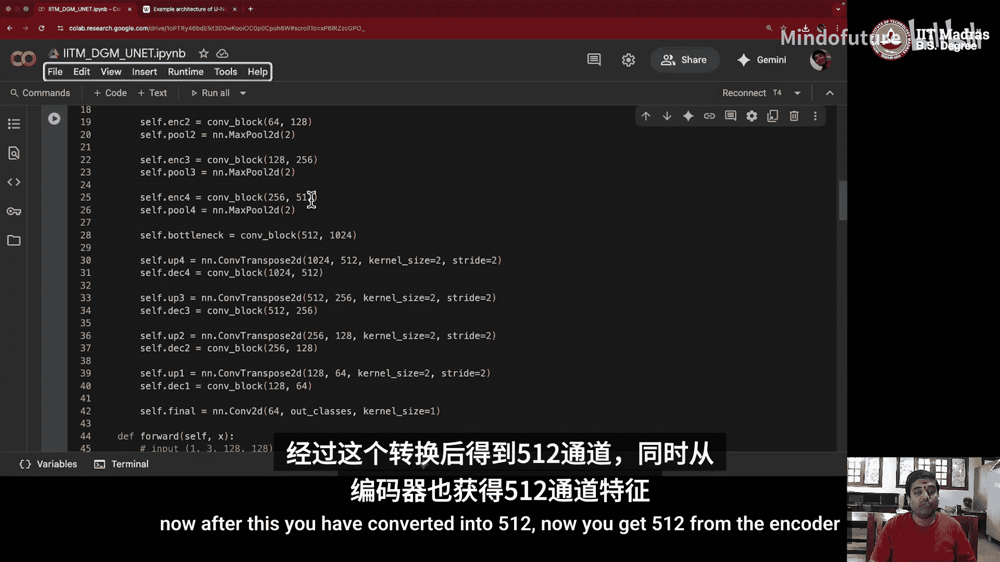

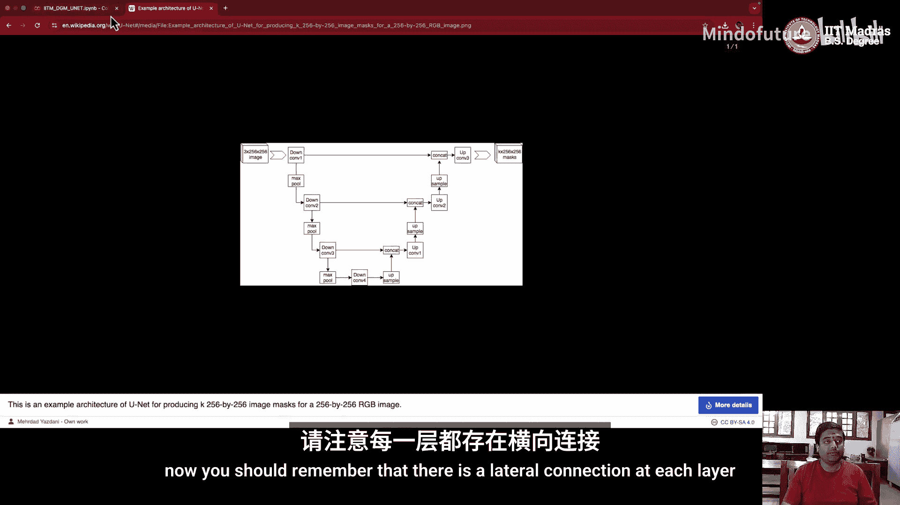

Okay， now because of which when you have this F channel block and you add the output of fourth encoder here。

 which is also F channel block。😊，So now your overall thinking will be 1024 channel。Okay。

 and then you convert it again to5 world。 Now， then you again。Upample it。

Fight well to 256 and then5 2 to 256 y again to the decoder 3 the encodeder 3 which is 256 will come so 256 of this up transpo transpose convolution and 256 from the encoder will come in again it will become fight will that fight while you are converting to 56。

😊，The same thing here，256 you are converting it to 128。😊，Now， as you can see here。

 now your number of channels are increasing， but because of the。

For the way in which the transverse convolution is there。

 your feature size will be increasing I' will show it in the forward method。😊，Okay。So， again。

 you add for this decoder， the encoder 2， which is 128 and this 128， which is 26 to 128。

And finally you have 64 to 3 now which is what we will what we want Okay so now this is the forward method now when we look at it it will be pretty much clear for us。

😊，TheForward method you have x which is the input now have taken one example now always whenever you take a input it will be in batches so this one I' am assuming that there is only one example okay。

😊，Not typically which is not true now you have multiple examples in the batch just for illustration's sake。

 I have taken it as one。😊，And then you have three channels。

 and this is the size your 1228 cross 12 28。😊，Okay， so now often even。You have 64 channel。

And 128 128 and then you apply the pooling layer now because of which this 128 will become 64 and then you pass it through the encoder2 now because of which 64 to 128 now you can see you can go back and see here。

😊，It is 64 to 1，28。And then here now so on and so forth。

 you apply again a pooling it will become 32 and then you apply encode 3 now which is 1282556 like that the final outcome now will be 1024。

😊，8，8，1，1，0，24，88 now this is your encoding for process is run。No view user。

Transposed convolution in which 1024 will be converted to52 channel and as you can see here the feature size which is 8 cross 8 has been increased to 16 cross 16。

😊，Now there is this， yeah， this is here。This is the one。

This is up samplingling and then what did you do you add a D4 and E4 now what is E4 now it is5 2 1616 now d4 is5hi 2 1616 now if you add now you have a5 11616 block and fight 1 1616 block you add them so number of channels that you have is 1024 and then 1616 the feature size will 1616 that is this concatenation now this is what is called as lateral connection okay which we discuss this is called as lateral connection and then you pass it through this decoder which is a convolution layer now which this 102 equal to5 2。

😊。

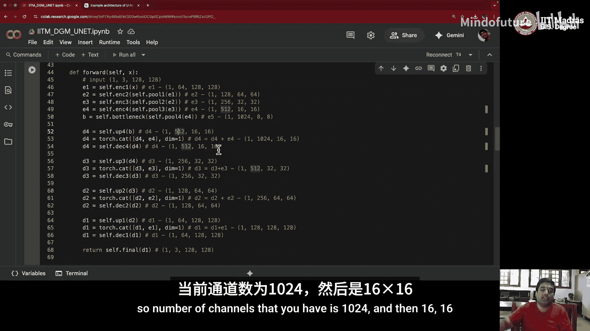

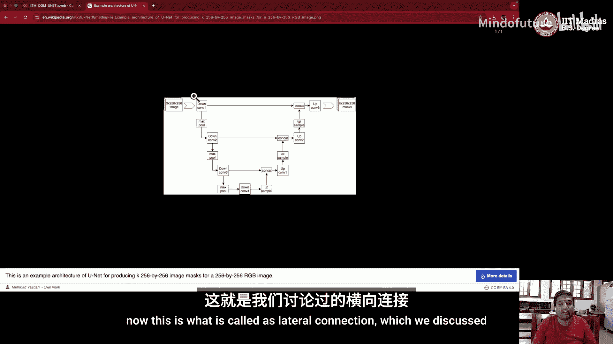

Start yes， node equal to 4，1，0，2，4 to 5。Okay， so now you have5 well 16， 16。😊。

That you ups sampleample and then get 256 3 to 32 to this 256 32 32 which is d3 you concate it with e3 now what is e3256 3232 now again it will become5 32 32。

😊，That you pass it through the convolution， you get 2 56。😊，Now。

 then this256 is passed through a transse convolution， you convert it into 128。😊。

And you increase the size， which is 64， 64。😊，Okay， and then you add e2 what is e2 e2 is again。

 128 64，64。😊，Now you add it so that you get two foot。 Now like that。

 you go on performing the operation。 Now finally， you get 1，3，1，28，1，28。

 which is the same size of the input。 Now the input is the。😊，Image。

 but output is not the image output is mask。ok。😊，Now this is the overall unit architecture now why do we need this so we haven't said it segmentation why do we need this unit architecture that we will come to know when we start implementing GDPPM now we need to add something called positional embedding okay。

😊，To add this positional embedding， now we will be needing this unit architecture。😊，Okay。

 because of that reason。InIn this tutorial。Of week  seven。

 we will be looking into the unit architecture。And the remaining things is straightforward I presume that we don't need to go through the training procedure again the standard training procedure you have taken the training data now your training data has a batch 8 okay then you have created an instance of the model and then ported it on the device。

You use crossenttropy as， yes， in the initial thing itself。

 I told you why you should use crossenttropy， which is a pixel wise decision。And then the optimizer。

 and then you are training it for 5 vpos。对。So you get x and y， put it onto the device。

 optimize at0 gra zero all the gradients， get the predictions， get the loss。Okay。

 get the gradients and update the weights。And then you keep track of the loss so that you can know the loss trend I have done it for a very small number of epochs。

 which is5。And then I have plotted the loss， and then I have taken the test。어种。

And then I have obtained the masks now this is your last curve and this is your input this is the actual mask。

😊，And this is your prediction， yes your prediction is bad。

 makes sense now because you have only trained for5 epos。😊，Okay， you trying it for more reportspo。

 youll get better results。Okay， now this is a simple discussion on unit。😊。

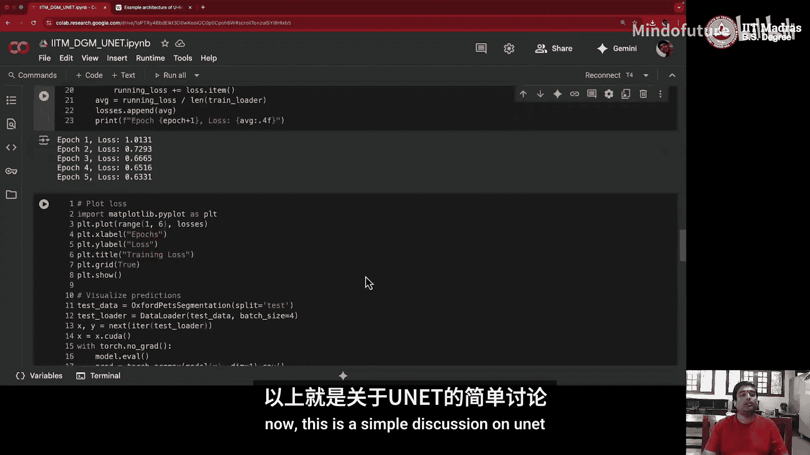

Now， where in which， now you have a combination of。

Convolution and up convolution or transpo convolution and there is an idea of bottleneck and the lateral connections are that。

These are the important components of unit， and we will see in the next tutorial when we implement DDPM。

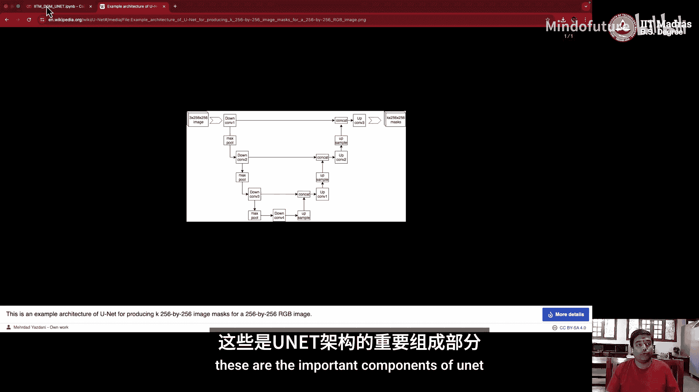

How now we can use this unit architecture and obtain。Or generate new images。That's for the next week。

 and we'll stop today's tutorial， thank you all。😊。

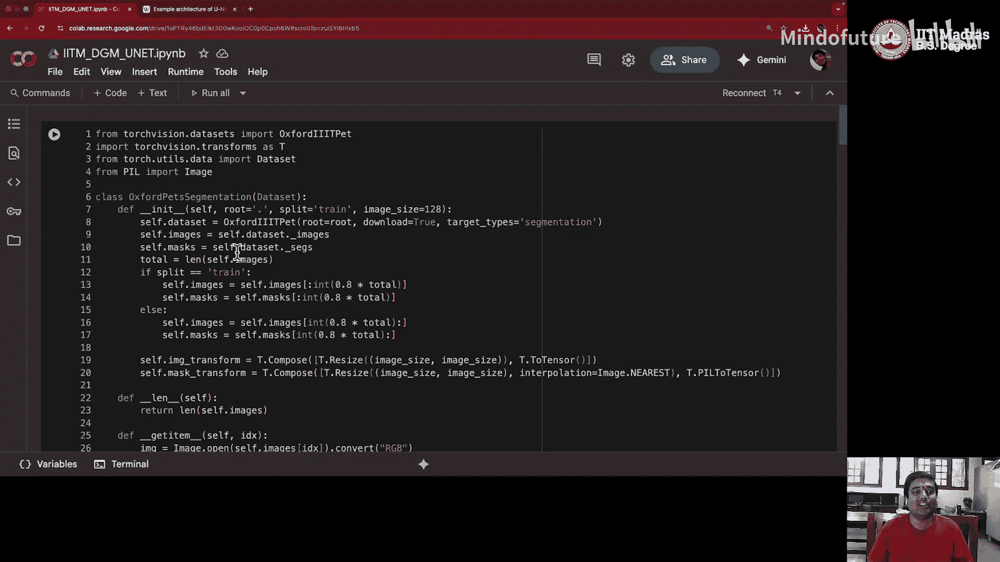

