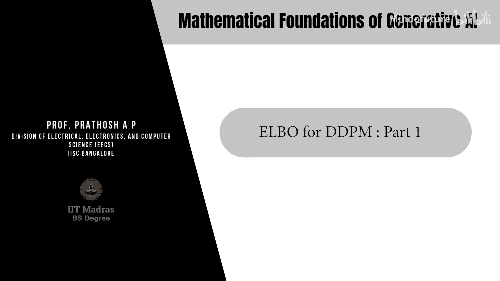
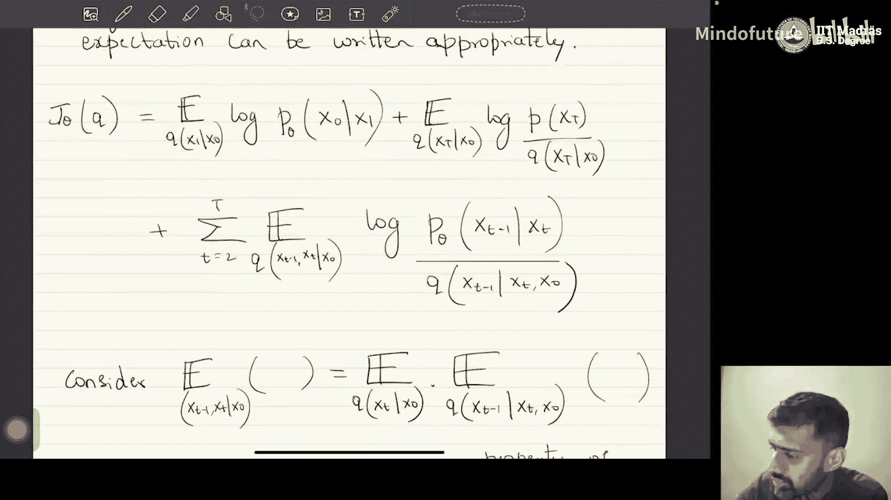

# 生成式Ai的数学基础 ｜ Mathematical Foundations Of Generative Ai p41 P41_W8L28-DDPM的ELBO-第一部分 -BV1fperz7EjK_p41-

🎼。

hello， everybody。In this module， we will continue our discussions with DDPM。Specifically。

 we will be looking at。Driving the objective function。

 which is the evidence lower bone corresponding to TDDPM so that is the objective of this particular module。

So let's quickly recap what we were doing。We created the model for DDPM using the hierarchical VAE formulation。

So in a latent variable， we also saw that a DDPM is a latent variable model。

That has multiple latent spaces as。A marco chain and all of these latent variables have the exact same dimension as that of the data space we wrote down the joint distribution between the late between the data and the latent variable which is similar to。

P rate of x comma Z that we were denoting within in the VA in the VE context。So。

 the joint distribution between the data and the latent variable is given by this particular formula。

This comes out from the fact that we have assumed that in the backward are the decoding direction。

The mark， I mean， the latent variables adhere to a first start markco chain。

And we have also made this assumption that the conditional distribution are the Markov and transition distributions in the reverse direction。

Is a Gaussian distribution with a mean denoted by mu theta of xt and the variance denoted by sigma theta of xt Both of these are learnable。

Variables is what we saw， so we are we learn these parameters mu and sigma via the standard elbow optimization。

Okay， with that as the introduction we wrote down。The standard equation for the evidence lower bound that we have that we had derived for any latent variable model which look like this。

 this is the evidence lower bound。The lower bound on the log likelihood。

 which we have been calling as evidence lower bound or elbow。this is our objective function。

That we would optimize in any ent variable generated model so for a DDpm this particular equation takes this form。

Where log of the joint distribution between the data and the latent variable is represented using these notations。

 So just to remind notations， x not is the data variable and x1 to x t denotes the latent variable cap t number of latent variables and Q represents the forward。

Process are the encoding process which is fixed and not non learnnable in a in the context of a GDPPM that is given byq of x1 x to up to xt which are t number of latent variables conditioned on the data variable which is very similar to Q of for Zio 1x which is the latent posterior that appears in elbow。

Now with this， the objective function I also used a shorthand to denote Turkey of x1，2 T。

 So this actually means that。Let here， x。1，2， T is actually a set of。Variables。

And similarlyq of sorry x of0 to t represents x0 x1 up to x capital t this is the shorthand so now with this as the evidence lower bound that we would want to optimize the next goal is to write down the definitions of the encoding distribution and the decoding distribution or the model distribution that we have come up with for DDpM plug them into these equations and find an expression that can be optimized in the context of a DDpm so that is the next goal so let us write that downs the goal is to。

Optimizing elbow。Optimizing the evidence lower bone for a Dium。

For DDPm so this is what we are going to do in this particular module so this is going to be algebraically a little involving but yeah so we have to go through that so please bear with me。

Let me just copy the expression for。Dブ。So this is what we would want to optimize okay so let us start expanding it because we know what the definitions are。

 so we have。We have。P theta of。X，0 to T。We have defined as to be。A Marco chain remember。

 so p of x capital t times the product of all the conditionals So t equal to 1，2 T P theta of。X t -1。

Given xt so this is the definition of p theta of x 0 to t， this is how we defined it。

 so note that the dependence on theta here is taken off because we know that we have constructed the marco chain in such a way that the stationary distribution of this marco chain at xt is equal to an isotopic Gaussian distribution right this is the way we have constructed the forward distribution therefore when we start in the reverse distribution we start with a Gaussian random variable with zero mean unit variance because that is the stationary distribution of the marco chain that we have constructed the forward direction。

So， similarly。So we want Q of。See in the denominator， we have Q of x 1 through T given x0。

What is this given by this is also given by the product of。We have t equal to 1，2 capital t。

 This is Q of。X。P given X T -1。Why is this， this is also because the forward process。

Is a starttle macro process。 This is because。The farm process。Forward are the encoding process。Is。

F starter Markovvin。Okay because the forward process is a start markco process we can write the the posterior distribution of all the latent condition on data as the product of all the marginals Okay so now we have everything that we want we have。

The numerator here in the elbow and also the denominator that has been defined so let us just plug that in in the definition of elbow so maybe we can just expand this to make sure that this is easier so why is this this is because it is for start of Marovian。

So well write that so Q of。X 12 t conditioned on x nt。

 What is this equal to by the chain rule of probability This is equal to  Q of x1 given x n。

And Q of x1。X 2， given。嗯。X1， sorry， x2 given x1 and x not。And。

The third term is q of x 3 given x2 x 1 and x n and so on。 Okay， this is the。

The usual chain rule of probability， right This is Q of X p given all the past p minus1。T minus2。

 and we have this up to its not。 So this is the usual definition of the general rule of probability using the general of probability。

 This is equal to simply the product of t equal to 1，2 capital T， all the。Conditionals。

A all t conditioned only on the previous one this is because for start from markov in right because the second term if you look at it Q of x2 given x1 and x n so given x1 x2 is independent of x n and given x2 x3 is independent of x1 and x n and so on。

 therefore you can write it this way this is the。The first start or Markov in property。

 I can read it here。So we have the starter Markov in property and this this is why this happens Okay so now we have everything that we need to define our elbow。

 so let us write that down， therefore。Now， the elbow。Or the objective function I write it as。

J theta of Q。Now here I can actually omit Q because Q is fixed and we don't have to learn Q here。

Is equal to the expectation of。Log of。P Theta， x 1，2， T。Rather。

 x02 T because this is the joint distribution between the the data and the latent variable right so x node is the data variable and you have all the latent variables。

Divided by the posterior of the late， which is x 12 T conditioned on the data variable。

 right this is what it is and the expectation is with respect to Q Okay using the definitions of the。

DD PMM， so we can write that as log of。So what is p theta x2 T we have just written that as p of xt times the product of t equal to 1 to capital t p theta x t minus1 given xt right this is the definition that we used and in the denominator we similarly have the product of t equal to 1 to capital t。

Q of。X P， given X T minus is。Where does this come from this simply comes from the definitions of the models that we have for the DDpM right so just see this this is P hit of x0 to t is given by this expression and Q of x t to1 given x not is given by this expression and we have the reasons for it right so now what we have to do is have to simplify this and use the definition and a bit of algebra to simplify this so let us do that step by step。

Okay， so now for the ease of。Algebra is simply omit the expectation here and write just the。

Lock term， consider。This particular term， which is log of。D thing。Consider of the stone。Okay。

 now what we will do is that we will first take out this is equal to。Log of。P， xt。From this product。

 Ill simply take out the。Firstust conditional P of x0 given x1 and write everything there So why am I doing this this is because of convenience of algebra which we will see in a while P of x t minus1 given xt so what did we do here please note that from this product which had all the marginals we just took out one of the marginals for the first and second variables I mean data variable and first random variable and kept everything aside we will do the same thing for the denominator as well so why do we do this as I said the reason will be will become clear this is simply because of algebra convenience will see that later q of x1 given x not and。

Keep everything from p to 2 to capital D。 and we have all these conditionals X T given。テマイ1。Okay。

So now we will， what we will do is that we will。We have log of products， take one of those out。

 so P of xt。Times P theta of x nor given x1。Divided by。Q of x1 given x n。 Let us take this term out。

 And what is remaining is plus。log个。Product T to。To to capital D merge both the products。

 and this will be P of x t minus1 given x T divided by。Q of X T given X T -1。

Okay so now if you look at this in the denominator of the second term what we have is here the denominator is progressing in the in one direction which is the forward direction right I mean given x t minus1 we are computing the likelihood of xt whereas the numerator is progressing in the opposite direction because of course right I mean p theta represents the decoding distribution and  Q represents the encodecoding distribution so in the numerator we are starting from xt and moving backwards in time and in the denominator we are starting from xt minus1 we are moving forward in time okay so now the question is can we somehow represent one of them either the denominator or numerator in terms of one of the directions right or either represent Q as q in terms of the reverse direction or represent p in terms of the forward direction。

So representing P theta in terms of forward direction is difficult because it is parameterized and that is what we are trying to find out but representing  Q in terms of reverse direction is possible using base root now why are we doing this so we are doing this because algebraically right it is much easier to work if we have one direction instead of working with both the directions okay so let us do that so consider。

The denominator， in the second term。Eminator in the second term。So this can be written as follows。

 So we have Q of。嗯。Xt given x t minus1。I can write this as Q of。Xt given x t minus1。X T-1。And x not。

So this is this is exactly these two distributions are exactly the same y because of the fast Marco in property so if I condition it if I condition this distribution with x not additionally the thing is going to change so this is。

First order Marco win。Okay， so nothing is going to change Now what we will do is we will simply use the basees raw on on RHs which。

We can write this as Q of x t minus1 given。Xt and xn。单英。Q of x t given x0。Divided by。QF。X T -1。

Given x n。Why is this true， this is simply the base rule for three random variables。

This is base rule。But。It is three random variables you can simply verify this now look at what happened we had the the forward distribution okay in in in one direction which is you know given x t minus1 what is xt that we have here we change this okay so what happened is using just by conditioning it using x not and using base law we got a distribution here okay which is。

Not in the follow direction， but in the reverse direction。

 So what is the saying this this particular distribution which is。Q of X， T-1。Given X T index， not。

So what is this signifying， This is signifying。 This is the。The distribution of。

The t minus first random variable， x t minus1 given1。Given that。The encoding process。

Encoding process。Has。Landed art。Land at X P。At t equal to t。At X， P at T。 Okay， l t equal to T。

Starting from X。This is what this distribution signifies it is saying now given that I start from xn which is one let us say one particular data point it can be an image given that we have started from one particular image and we have landed at xt at time t so tell me what is the likelihood of arriving at that xt。

With different x t minus1 or t minus1 okay so what is the likelihood of x t minus1 or different x t minus1。

😊，Given that I started from X smart and landed at X T。 So that is what this distribution is saying。

 So you can look into this as a sort of。The true I mean quote unqu true reverse distribution in the sense that so I know that I have started from xnt and landed at Xt now what is the likelihood that I have come from xt minus-1 so this is what it is telling me so what did this do this simply expressed the forward distribution which isq of given xt minus-1 in the opposite direction using base that's all so algebra actually nothing changes because all we have done is we have taken advantage of the fact that the forward processes for start or markov in and simply conditioned it on xnt and use the base rule to flip the direction thats all this will aid us in in algebra and also as I said right I mean this has an intuitive explanation that this is giving you what should be the sort of true see if you look at it what is happening is finally we want to learn the speed data which is the reverse distribution。

conditional reverse distribution at all times now to do that we need a sort of the the true reverse distribution which we don't have access to what we have access to is we know how to move in the forward direction now if we can if we can somehow get an idea about what is the mean quote unquote true reverse process。

😊，Then perhaps we can find the parameters of this P theta easier so as we return out that as we move with the algebra it will turn out that there will be a k divergence between these two terms which has the same interpretation as I just gave so the idea is to represent this forward distribution in terms of the corresponding true reverse direction and how do we do that I mean how do we invert the probabilities that is by using basees law now we initially conditioned it on xn so why why did we initially condition it on xn why did we just simply use basees law here because if we simply use basees law on this we will have marginals of this sort which is which we don't know to compute the other thing is condition in it on x will give you a sort of anchoring in the sense that given that have started with a particular image now tell me what is the likelihood of x t minus-1 so this is easier to compute than let's say that。

like given x t minus 1 or rather given xt tell me what xt what x t minus1 that I came from now because what happens is as you move on in the forward process。

😊，Multiple images can lead to a same same same same noisy image but if I anchor it on the particular input image then you know it will give you much more capability of computing it that is the intuitive way of saying it so therefore we conditioned it on xno which is the input image is the does not change anything algebraly because we are dealing with fast start macrocopro and then we inverted this using base law that it okay now what do we have to do is plug in this expression that we just came up with into the elbow computation that we are doing let us do that so。

Plugging the elbow。Expression。To the elbow。我斗的多。Let us plug this into the elbow computation。

 so let us take this。This is where we work。And we will have to replace the denominator of this expression。

Using whatever we got。In elbow computation。 So let me just copy the faster term as。

The first term remains， as it is。So maybe I will move it a little。To my left， Okay。

 so this is equal to log of this plus。Log of。Product from T equal to T to capital tone， by the way。

 I thought it was obvious a symbol that looks like a big pie here actually denotes product okay of whatever expression that is inside this product of。

We have a P Theta of X T-1。Given x T in the numerator。 now in the denominator。

 we have to just plug in whatever we。 So Q of x t minus1 given x t was。Given by this expression now。

Okay， so we have to just。Pluug this in in the denominator of this。No？

This is actually the most trickies part in the entire computation rest is all algebra we will get through the algebra I will。

Spy the first term as it is。 We will locate change that the second term。啊。Logopher。😔。

Product of T equal to capital D。We have the enumerator the same。B2 do for x D1。Given X T。

I move the denominator of the denominator to the numerator Q of x t minus1 given x0 to the numerator。

And in the denominator， we have Q of。X t -1， given x T and x not。Thanks。Q of X T given x n。

And by the way what do these distributionq of xt given x nor and xt minus1 given x nor signify they simply signify the what is the likelihood of the Tth latent variable or the noisy version of the input given the particular input that is what it says and the definition of the forward process gives us a way to compute to both of them which we will see later so let us get through the algebra first。

Now。What we can do is that we can just write this as the first term again is。你是。The second term。

 what we will do is that we will write this as log of。I will keep the product。

Of the numerator as will have a P of。X。X T given。sorry， X T minus-1 given X T。X T-1 given X T。

Indeeddy。Demerator and denominator。 we have Q of。Xt minus1 given xt and x0。

See also note that okay so there may be a question that may come up right Q of xt given Q of x t minus1 given xt and x n why can't I write this as x t minus1 given xt okay and just omit x I can't do that because the random variable x t minus1 is not independent of x not given x t so its the other wayon right I mean we have xt independent of x not given x t minus1 not the other veron that is why we cannot write it that way I just keep it keep this term and the remaining term that we have here which is log of the product ofq of x t minus1 given x not diverted byq of xt given x not can be now。

Unroll， and I can write that as。Lo of。Product of。Or I I'll just open that as well。 Okay。

 so maybe I'll just write it and then open it。Product of whatever is remaining risk of。

X t minus1 given x not。Divided by。Q of X T given xn。So this is the remaining term。 Now。

 please note what will happen to this particular term。 I will just group it with within a bracket。

 Okay what will happen to this term， This is log of I just open that up。 This isq of。

T equal to t to capital T right so we have Q of x1 given x0。The second term is Q of x2 given x1。

And so on， and in the denominator， it is q of x t given x from t equal to t2 capitality。

 which isq of x2 given x1。I have Q of。X。3， given x smart。

with your pardon this isq of x2 given x nor here and this isq of x2 given x and we have x3 given x nor and so on because both of them are conditioned on x n This is what we have now what will happen in this product is that these terms will get cancelled away so theyll have another term here and what will remind is the first term the term corresponding to t equal to 2 in the numerator and the term corresponding to t equal to capital in the denominator everything else will have a corresponding term in the numerator and denominator right So if I write that down now the。

Elbow will look like this。 take this。So we have these two terms， and the third term will have。Yeah。

 the third term will be log of。Q of x 1 given x nor that will survive。

And in the denominator I have Q of x capital D given x right these are the two terms that would survive。

Okay， now what we will do is we will combine， okay， actually we can。

Cancel these two terms out here and here because what we have is you know log of a plus b which is log a times log B I can combine both of them if I combine both of them then the the denominator of the first term and the en numerator of the last term would just cancel it okay so okay so combining everything that is left right now will be。

The equal do。Log of。呃，BT的。X nor given x1。This is one term。Plus， we have log of。P of X T。

 where is this coming from。 This is coming from here。 Okay， so we have log a times B。

 I I I am just taking them out。 I'm just using the log of the the log of logarithms here and this I divide by。

Divided by Q of X， P given x n。Where is this term coming from this term is coming from here。

 so there is log ofq of x t given x node Ill just state this here and whatever is remaining right this particular term。

Can get it done this way。So this is what we have right now。Okay， so now。

I can write log of products as sum of logs。 So this is equal to a log of。P Theta of xnt given x1。

And the second term is log of。P of X D。Given Q of x capital T， given x n。Plus。

The log of products is sum of logs。 So this is equal to be equal to。To the capital D。Log off。

Be it off。X t-1， given X T。And in the denominator， we have。Que of。X。T-1， given X T and X mark。

This is what determines Now the story is not complete because remember that we have an expectation in the outside。

 right I mean。Yeah， so the elbow actually had an expectation to suspect to Q。

Of an expression so we just simplified this entire expression which was inside which is inside which was which is a function with the respect to which we are computing the expectation now we have to bring in the expectation to this expression and see what happens。

Let me that down So bringing in the outer expectation。The outer expectation term。

So what will happen is so we have this entire term here。This entire term and outside of this。

Maybe I should。呃。Write it later。 So we have the expectation of。The storm， okay。Let me call this as。

Dong。This we have this term and we have the expectation of this。

 The expectation is with respect to Q of。Z given x right。

 which is the latent variables x12 t given the data variable x n this is the expectation with respect to。

Now if you look at this this term here this contains three subterms。

 the first one has only dependence on x not and x1 the second one has only dependence on x capital t and xt while the third third term has dependent dependent dependence on multiple random variables okay now when you are taking an expectation with respect to these random variables。

Since the dependence of the subts is only on a subset of these random variables I can write the expectation only with respect to those subts wherever the depend is okay so I will write that down since。

The subt in term。Depens。only on。Subject of。X。温度低。The outer expectation。The outer expectation。

Can be written appropriately， right。rite the outer expectation appropriately by taking knocking off all the terms okay all the random variables that are not that are not contributing to the inner term so let us write it down so this will become so make the elbow j theta ofq to be equal to the expectation the what is the first term the first term is log of。

B t down。We have x， not given its one。Okay， now there are only two random variables that it depends on。

 so this will be Q of x1 given x not so everything else is independent as far as the first term is concerned。

What about the second term， The second term is expectation as linear so I can push the expectation through all the terms。

 So this was log of。P X， P divided by we had。Q of x capital t given x node this was the second term。

 and here the expectation also is only dependent on so。

X T and x north all the other random variables are independent。

 so I can write the expectation this way these two terms in the third term， though， so we have。

The third term， which is the sum of p equal to 22 capital expectation of。Log of。

Using the linearity of expectations to just push the expectation through all the terms here。

 this is x t minus1。GilinixD。Divided by。哦。Que off。X t minus-1。Given X T index， not。Okay。

 this is the denominator that is that we have。 and here the dependence is onq of。

So note that this wasq of x 12 t given x not okay now we are only writing the terms that are writing the random variabless that are relevant to whatever is within the within the function here and knocking off everything because they are independent so the terms that we have here are h T。

Q of we have xxt and we have x t minus1 and x not okay let me write it that way。So， this is Q of。

X t -1。And x t so dependence is on x t minus1 and x n and of course。

 it is conditional on x t minus1 and xt and it is conditioned on xn。Okay。No。Considerer。

The expectation of。Some function with respect to Q of X P -1。And x t given x n okay。

 this is what we have Okay now this can be written in terms of product of two expectations using the law of conditional expectation this way。

 So this is equal to the expectation of。Q of。X T given x n。Bes。Expectation of Q of。X， D-1。

Give an X T， and X not。Okay， so of this particular function that we have。

 this is the probability of conditional expectation one can verify this。

St in elementary probability theory， property of the。The conditional expectation。

isThe property of financial expectation， so which means that the third term that I have here， okay。

 maybe I will just push it a little further。The third term can be written in terms of a product of two expectations。

 Why are we doing it it this way， I will will just be cleared in them。In a moment。

 so we want to write it as k divergences so if if we use the property of the conditional expectations we can easily write it write it as k divergences。

 so let us write that down。So it will take all three terms here。And rewrite them。

