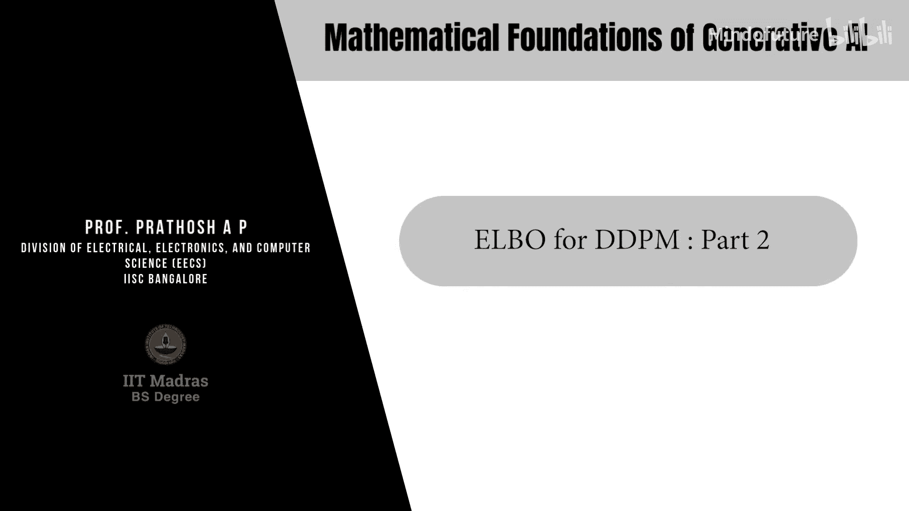
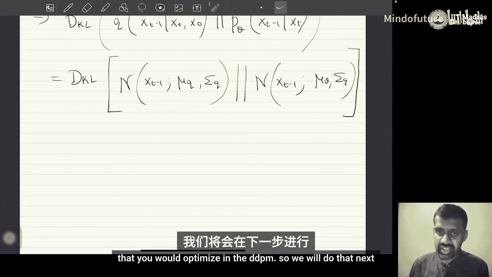

# 生成式Ai的数学基础 ｜ Mathematical Foundations Of Generative Ai p42 P42_W8L29-DDPM的ELBO-第二部分 -BV1fperz7EjK_p42-

🎼。

So rewriting elbow using the property of conditional expectation。Rewriting the elbow。Using。

Using the property of conditional expectation。So we just wrote that particular property right property of conditional expectation。

 we will have the following。So let us just copy that。Now， the third term will be a。

A product of two expectations。呃。Its plus。So we just use this property now that whatever we have this expectation。

 we will write it as product of these two expectations。And。There's also was some。We have a some here。

And this has to be some over。T equal to2 per。Okay。😊。

I is what it is So why did we write it this way the first term is okay as is you can recognize readily that the second term is scale divergence by definition so expectation of log of ratios of distributions and this expectation is with respect to one of the constanttituent distributions is the definition of scale divergence the third term this thing right。

I again kale divergence because we wanted to write that as scale divergence we wrote it as product of two expectations so now only if you have expectation with respect to one of the denominal distributions here that you can write this as a k so this this is equal to we will write the first term as is。

So this is expectation of log of。Be too down。X1 given x0。Sorry， x not given x1。Your pardon。

 So this is。X n given x1， and this expectation is with respect to Q of x1 given x n。

And the second term。can be recognized as decL divergence in negative of K divergence， this is decal。

Between。Between。Q of。X T， given x not。And P of Xt。And the third term that we have is。Minus。

We have an outer expectation with respect to Q of x T given xnt。And。

Whatever we have inside is again an expectation sorry a kale divergence this is the kale divergence dkl between。

Q off。X p-1。Given X， P and x n。An。And be theatre。Off。X T -1。Give an X D。Yeah， so that's it。

So this is the final expression for the elbow offer。DDPM so let me just。Circle it。

So this is the algebra。 So the elbow or the loss term or the。

Lower bound of the log likelihood function that would optimize for a GDPpM contains these three terms。

 Okay so let us just write write those down。 So if you recall the first two terms are very。

 very similar to what we saw in a V So this looks like the reconstruction given the first latent variable right I mean x1 So this is very similar to P of x given z and the expectation is with respect to  Q of z given1 x the only thing is we have taken the first latent variable right here we have hierarchy of latent variable We are just taking the first latent variable here The second term here is very similar to Q of dec between  Q of z given1 x and P of z that's exactly what it is X T is the T。

Lnt variable and x node is a data variable and this is also similar to the B but because of the oh I think I made a mistake here there is a sum over all t。

Because of the hierarchical nature of the BE， we will have this extra term here。

 which is actually the most important term。Okay， in the。Tining of of of a DDpm okay， the first term。

 okay， let us write all three terms one by one。 So the Ebo objective of DDPM contains three terms。그电。

Three terms。To state them all one by one。 The first one is the conditional。Data likelihood。

This is typically a reconstruction term。W， because this is trying to reconstruct the data it is not back from the first latent variable this is the usual reconstruction term that appears in the。

VAE literature， the second term that we have here which is the scale divergence between these two。

Is the prior matching term。Okay。This is called the prior matching term。

 Why is this Because it is trying to。Fre much， Tom。So。

 this why is this called prior matching term is because it is trying to match the prior of the late the ti latent variable to the conditional。

Distribution of the latent given data， Okay， which is similar to what we have in the second term of a Ve。

 So there is this third term， which is called。To this， this particular sum。

It's called the consistency term or denoizing match term。So， this term is called。The consistency。Or。

Denoizing matching。 Okay， Ill tell you why it is called denoizing matching term。

So that its called a consistency or a denoizing launchching term because。Okay。

 so I think there is one more packet that we need here。To dealing decay still divergence。

This is called the denoing matching term because this distribution as we as I have already told you while defining this can be seen as like known denoing so。

So dennoizing is the decoding process， as I said right the encoding is called the the denonoing process and this is the denoizing process。

 So this is known denoizing because given x not and x p。

 we know what the distribution of extreme -1 is。 So this is a known denoizing。Process。I mean。

 this is this corresponds to the known denoizing and this is the learnable or the model。

The learnable denoing so we want the model or the learnable denoing term to match to the known denoing which the forward process is already imposing so by minimizing the care divergence between these two terms but we are actually doing this we are trying to match the denoizing process that we obtain through the defined forward process and what the model is trying to do and that is why there is a consistency between the two denoing processes and that is why it is called denoizing matching of the consistency term that comes up extra in the DDpM formulation。

Okay， now you also notice that the okay， so what do we have to do before I come to that。

 the goal objective。Has always been。To find a theta star okay that would maximize the elbow right that is what we have been looking at so which is J theta ofq which is our elbow。

So， we need to take this expression that we have derived and try to find a theta that would maximize this now please note that the second term here which is the prior matching term can be completely ignored because it is independent of theta。

So no matter what model parameters that you take independent of theta。This is independent of theta。

 so it can be ignored。Okay， so reconstruction term depends on theta because it has P theta of x not given x1。

So， I will come to how to optimize for the reconstruction term because it is pretty easier to do it So what is interesting and requires requires a bit of more discussion is how to optimize the denoizing matching term or the consistency term with respect to theta okay so what we will do next is。

Write down the consistency term and try to find out how to compute the scale divergence between these two distributions Okay that is what we will do so let us look at。

Computing the consistency of。Rather， estimating。eststimating the k divergence in the consistency term。

So in the elbow we have the consistency term and that has a k divergence between these two distributions and that has to be estimated so let us take these k divergence and try to estimate it。

That is what we are going to do now。So you will be pleasantly surprised to know that despite all this algebra that we are doing the final expression that we obtain for the consistency term is going to turn out to be very very elegant and simple okay this comes from the definitions of the distribution that we have taken okay so we have to compute the k divergence between these two distributions now okay now first of all we have to compute。

The known denoing term， okay， to compute。To compute Q of。X T -1， given X T。And next one。

 we will have to compute this， okay。So because scale divergence involves two distributions right we have to compute both of them。

 let's take the first one and then we will go to the second one。 So what do we。

Know about this distribution Q of。X T-1。Given next T and x not。

This is equal to we will just use the base law because we know see again when we defined this socal known reverse process okay we use base law to convert the forward to reverse now all the definitions that we have are for the forward process right so therefore we again invert it back to the forward in the forward direction so can so that we can use all the definition that we know of。

To compute this。 So this is a Q of X T， given X P-1 and x not。Times。Q of X T， given x not。Divided by。

Qew off。X T given x month， so this is simply the waste law。Again， base rule。 Okay。

 now we will use the definition of the Marco n process。

 The first term here can be simply written as  Q of x T given x T minus-1 because given x t minus-1  Q of x T is independent of x not because of the first start or Marco process。

So this is Q of x t given x not。Divided by。Q off。Xter given1 x not。 Oh， what happens should be。

X T -1。 Yeah your pardon。 This is X T-1。Thisq of x t -1 given x node and thisq of x T given x n， Yes。

 okay。Okay so we need the Ls we have these three terms in the rs do we know q of xt given xt minus1 we do because that is how we have defined the the macro chain do we know the other terms in the numerator。

😊，Do we know the other term， the second term here， So q of x t minus1 given x n and  Q of x t given x n are unknown Okay y because okay let me write that down so Q of。

So， we know。李农。P off。X T given x T -1。 How， Because by definition， right。

 we have defined this to way a normal distribution。With mean being equal to。What was the definition。

 Was it root of alpha t times x T， and the variance was 1 minus。Alpha t times the identity， right。

 this we know。 Okay， but what about。Q of X T given x nor right we need to compute this to get the LSs here。

How do we get see it turns out that this can also be obtained。

 so this can be obtained using the recursion。A simple recursion will give us this particular discussion the distribution recursion。

Howway is that， let's do that。 So we have。As as as below。So， we have。We have X。X T to be equal to。

Root of Alphati times。X， T -1 plus。Root of 1 minus L 40 times。

Lets call this some epsilon t -1 where epsilon t -1 is again a dummi variable rate。

 it is simply a sample from normal01。 This is our definition of the forward processes So we have defined and we know this so let us simply recur over this So to x T you know what I can write is I can write x t -1。

In terms of its predecessors， so I will write this as a root of alpha t minus1 times x t minus2。Plus。

Root of1 minus alpha t 1。Times epsilon T -2。Plus。1 minus alpha d。Times。

Epsilon t -1 Okay now what is epsilon t 2 is again another sample from a normal 01 Okay so you can you can look into that as an independent sample from normal 01。

 which is identical to epsilon t 2 okay now I will just。Onroll this， this is a root of Alvati times。

Under the root， we have both of these。We have root of alpha T。Into alpha T -1。Times x。P -2。And， plus。

 we have。Its weird looking terms。 So this is a root of。Alpha T minus。All T times alpha T-1。

This multiplied by epsilon t minus2 plus you can verify the algebra later you take it for granted for now。

 so this is simply unrolling this off this times epsilon t 1。This is what we have。

 So now let's let's consider the second term here， okay， and we will see what this is。

Let's name this some T1 of L T 2。So consider T2。Considerate T2 that is equal to just copy this from write it again。

See， what does this look like， You can simply write this this where right this looks like some。

A times some epsilon 1 plus b times some epsilon 2 okay where epsilon 1 and epsilon 2 are drawn I from normal01。

 so what we are having is a linear combination of two gasian I mean two random variables that are drawn I from。

So Epsilon 1 and epsilon 2 are both drawn I。그럼50 오케이。So， from the property of Gaussian distributions。

 we know that if you combine two Gaussian random variables with zero means and unit variance you are going to get another random variable that is Gaussian with a particular mean and particular variance okay so what we can show is that so t2。

这个。As a linear combination of。读。Normal。Aandom variables。And， therefore。애들。Lead to another normal。

late tora。Gussian， random variable。If is following properties now please verify this what can be shown is that the T2 will simply will give another random variable。

eququal to some epsilon that is drawn by normal distribution with the zero mean。

 the mean does not change the variance would change 1 minus so because both of these have0 means right by scaling them the mean would not change this is1 minus alpha t into alpha t minus1 times I so please you can verify this it is very easy to verify that this will give us another randomtime variable that has this particular property let's call this some epsilon star okay so plugging back to the expression that we have here。

 what do we have we have xt in the rhs sorry LHs So xt is equal to a root of alpha t times alpha t minus1 into x t minus2 plus。

The second term which I can represent as another Gaussian rateta variable rate which is 1 minus alpha t times alpha t minus 1。

Times。Some other epsilon t minus2， okay， where this。

I call this epsilon star t minus2 where epsilon star t minus2 is again sampled from normal 01。

So what did I do， See， we had。Lally a combination of two isotopic Gaussians that is another Gaussian with a certain mean0 and variance something so we know that any Gaussian with0 mean and some particular variance can be written again in terms of an isotopic Gaussian so I just how do you do that you just take an isotope Gaussian and scale it with whatever variance it is because the mean is anywhere zero okay。

Now， I did it for the second term， one can break us this for。All the terms continuing the recursion。

Recursion till x n。 you just continue this recursion till x not what we get as the following。

 So we get R x T to be equal to root of。Alpha T times Al T -1。Into alpha 1。Into xn。Plus。Root of。

1 minus alpha T。 Al T -1。Up to alpha 1 times some epsilon where this epsilon is drawn again from normal 01。

Okay， so now I can write this as so X P can be it on as。Root of。Alpha T bar times， x not。Plus。

Root of 1 minus alpha T bar times in salon， where。All4 T sorry or X T。Alpha T bar is simply。

The product of。All the are， all the alphas。Till T alpha I this is the definition， of which means。

 So please look at this。Now， Epsilon， what is Epsilon Epsilon is。Coming from harm0 one。

So this entire thing looks like。Again， the parameterization of isottopic gasian which means that the distributionq of xt。

X t given x not。Is simply given by this is again a Gaussian distribution y because xt is a linear combination of R sorry it is not a linear combination it is a scaled it is a scaled and a shifted version of an isottopic Gaussian which again is a Gaussian distribution whose mean and variance are given by the scale and de this is distribution on x nor the mean is given by。

Root of。Alpha P bar times x0。And the variance is1 minus。Alpha P bar。As。对认这里。Okay。

 so this simply implies that the。The very nice and an important property of GDPpM。

 which means that the ti earth latent。Can be obtained。Directly from the data。

Directly from the data x not without having to hop these steps right data x not without。hoping。

40 steps。That's it right Why see how do we go to xt from x nott。

 we start from xnt you know add some noise and get to x1 and then add some noise go to x2 and so on right But here what we have shown through thecursion is that xt can be directly obtained from x not without having to hop for T step There is one nice probability of the forward process。

No后啊。Where what did we， where did we come from。Recall that we wanted to compute the consistency term okay and we want to compute the first term in the consistency in that that appears in the k within the consistency term and that can be written using this within the base law and there we got three terms q of x t given x t minus1 which we knowq of xt minus1 given xn andq of x t given xn were not known we just use recur recursion to get that okay so finally we have everything that we need to compute。

Q of x T -1 given x node。 So let me let us take that and try to write it down。 So this is。So。

 getting back to。Consist system。Getting back to the consistency term。

So we simply wanted this particular term to be computed， right so。The consistency term had these。

Things， and now we know all of them。 So this is equal to So we have。Q of X T， given X T -1。

We know that This is a Gaussian。So we know that this is a Gaussian， right， This is by definition。

 We know that this is a。Gausian at X T。And the mean is。Ro of。

Alpha t times  x0 minus1 and the variance is 1 minus alpha t times I。

 so we know this distribution we just found out。Q of X T given X not as well。 What was this。

This was given by the Gaussian distribution X T。 And what was the mean。

 the mean was root of alpha T bar。Times。X n。D variance was 1 minus alpha t bar times the identity。

Right， and similarly， one can write Q of。X， do you -1 given x not。The same way。

 this is a Gaussian distribution at。X0 -1。The mean is。Root of alpha。T minus alpha bar T -1。

Time x not。D variance is 1 minus alpha。Bar t minus1 times the identity。Okay。

 so we know we have everything that we want to know to get this distribution。

 so let us write that down， so therefore， which implies。That Q of。X， P， -1。Given xt and xn。

Well take this particular form。 We have this is proportional to Ill just skip the constant this proportional to e power。

What do we have we have all of them have like identity as variances right so I can write this as。X。

P minus some constant times。Because it is a Gaussian distribution， right， So times e power。

 all of these are Gaussian distributions minus we have。X mean。Nor of x p1 minus some mean term here。

And in the denominator， we again have。E power。X。B minus-1。

minus some other mean corresponding to that quicker I mean the respective distribution right whatever distributions that are there here here right you just have to take the corresponding means here and plug that this plug it in so this is again equal to our proportional to another Gaussian distribution e power something。

All you need to do is。Complete the square。 Okay， this will be。

 So note that this is a distribution on x t 1 right。

 So this will be you can if you complete the square。In terms of x t minus1。

 so we have x t minus1 minus it will have some mean let us call that as muq okay and some variance this is obtained using completing the square。

我 are。Completion of this query。Compleation of the square method I will skip this algebra here because you know it can be found out in any standard monolo papers complete completion of the square method okay so can simply plug in all these expressions for these multivari gaussian distributions and complete square in terms of x t minus-11 would get it okay so now if we do this what can be shown as the Q of x t minus1 given xt and x node which is the distribution that we have in the consistency term can be shown to be a Gaussian distribution because it is simply a ratio of multiple gaussian distribution right。

It is defined on x t minus1 and it has a mean which is muq okay which it will be a function of X and x n obviously right because it is conditioned on x and x n and it has a variance which is it we will call as a sigma cube where。

So this is a piece of algebra that I want you to just verify okay can be easily verified mu cu the mean。

Of this particular caution distribution as given by this particular expression。

 This is equal to a root of。Alpha T times。1 minus。Alpha bar T -1。Into xt okay。

 so please note that these alphas are all scales they are just scaling a particular vector element wise x T is a vector。

Plus。Root of alpha t minus1 bar into 1 minus alpha t times its not。Allt。Divid it by。

1 minus alpha t so it it is very evident to show that this all we know all of these and everything is computable right and we have a sigmaq is given by the variance can we is given by 1 minus alpha t times。

1 minus alpha t minus1 bar。Divided by。1 minus Al T bar。

Times the identity Okay it is simply see all of these are scals I just scaling so this can actually be written as some sigma Q squared times identity okay where the sigma  Q squared is simply this entire expression it is a scalar Okay this is given by sigma  Q squared。

Sigmaq where times are identity。 Okay， So both muq and sigma Q are。Kn， right， and computer both。M Q。

 I sigma Q。And good。And， therefore。Theq of x。T minus1 given x T and x node。

 which is the first distribution that comes comes up in the consistency return。Are computable。왜。

because we know what x t is， we know what x n is and we know what the other term is that the entire thing can be computable。

Okay， so with that， what we should do now is that we should write down this definition of kale。😊。

In the consistency term now we know the first term here， the second term is the model distribution。

 so let us write that term know decal the consistency term is simply decal divergence betweenq of x t minus1 given x t and x0。

And P theta of x t -1。Give an X D。Okay。We also know that P theta of xt minus1 given xt we have modeled this as a Gaussian distribution rate because we assume that this is also a a a。

A marco chain with the Gaussian transitions with。The mean and the variance。

Compututerable that is recall as mu theta and the variance in fact in practice what is done is only the mean is computed the variance is kept the constant it is kept the same as that of for Q so that only the mean is computable this is our design choice that is an in practice which implies that the consistency term now。

Will be。Between the queue and。Let me just write that down。 So this。Term， no will be。

Of this particular term。Is equal to， so we know that we know both the distribution right now this is equal to the k divergence。

Between two Gaussian distributions on the same random variable so x p minus1 and we know that the mean mu q and the variance is sigma  Q right and the second distribution which is the decoding distribution also we know is a Gaustian distribution。

With the mean mu theta and the variance sigma Q see know that the only thing that is to be computed here is mu theta Okay so we need to the next step is that we we compute this particular k dirgence and we know that gaussian the k dirgence between two gaussian distributions is。

I tractable and that can be computed will compute what detailed divergencies and will will finally get the loss function that you would optimize in the DDPm。

So we will do that next。

