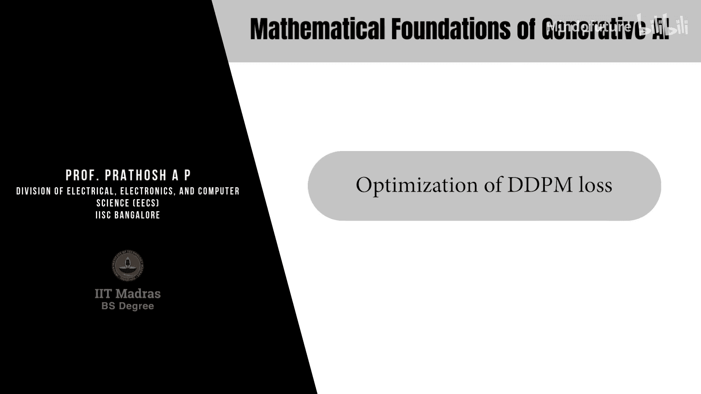

# 生成式Ai的数学基础 ｜ Mathematical Foundations Of Generative Ai p43 P43_W8L30-DDPM损失的优化 -BV1fperz7EjK_p43-

🎼。

We are looking at the。Arriving at a term for。The optimization of evidence lower bound for GDPPms。

We saw that the final objective。For DDPM had three terms。One was the reconstruction term。

 the other was the k term， the prior matching term and the third term which we called as the consistency term。

So， we saw that the prior match in term is independent of the model parameter theta。

 so we just ignored that。The first term is the reconstruction term， we will revisit that in a while。

We were simplifying the。Consistency term also known as the denoicing matching term。So。

 we saw that the consistency term or the nois denoising matching term consisted of a care divergence between two distributions。

Q xt minus1 conditioned on xt and xn which we called as the true reverse distribution and p heat of x t minus1 given xt which is the model reverse distribution we wanted to minimize or rather we wanted to compute the care divergence between these two distributions。

No。We do not have access to Q of xt minus1 given xt and x not。Therefore。

 we used Bayes rule to find out the Q of xt minus1 given xt and x n after some algebra we showed that this particular distributionq of xt minus1 given xt and x n happens to be a Gaussian distribution with a certain mean which we called as mu q and a variance which we call as。

Sigma cube。Where muq was given by a linear combination of Xt and x。

Note that xt and x n are vectors and all these alphas here and the derivatives of it are all scaleals。

 So this is nothing but a linear combination of xt and x n And we saw that sigma Q is nothing but a diagonally scaled version of the identity matrix where the scale is given by small sigma  Q squared。

 So Q of x t minus when given xt and x n happens to be a normal distribution with certain main variance。

We also know that the model distribution or the reverses or the backward distribution for a DDpM is also assumed to be a Gaussian distribution because it is a marco chain with Gaussian transitions and we call the mean as mu theta and the variance is assumed to be the same as the toughq of x minus-1 given xt and xn now。

One can also parameterize this variance and estimate it but in practice variance is kept as a constant it has been observed that only by estimating the mean for every transition you get considerably good results and the variance can be kept as a constant so this is kept as a constant and it is taken to be the same as that of the distributionq of estimate minus has when given x x。

Then what happens is finally the consistency term happens to be re divergence between these two Gaussian distributions。

 One Gaussian distribution has mean muq and variance sigma  Q the other Gaussian distribution has mean xt minus-1 the variance sorry mean as mu theta and variance as sigma  Q now with this let us continue from here so this scale divergence K divergence between two Gaussian distributions is can be deterministically computed as we have seen multiple times and it is given by this particular expression log of sigma  Q the determinant of sigma  Q divided by。

Note， the the variance of both of these distributions are same， so this will be。

Log of determinant of。Sigma  Q by sigma  Q minus d where d is the data dimensionality and we have traces of sigma Q inverse time sigma  Q。

This would have been the trace of variance of the product matrix products of these two matrices。

 but in this case they are both the same plus。The quadratic form of the difference between the means of these two。

 which is mu Q minus mu。Mute theta minus mu Q transpose。Sigma Q inverse times。

Mq mu q minus mu theta please note that this mu q and mu theta both of them are d dimensional vectors because they are the means of a D dimensional gaussian distribution。

 so this would be the care divergence。So this would cancel out to be0 and traces of this will be identity which means that this would be d so this and these would cancel and we know that sigma Q inverse is simply this is equal to we know that this is sigma  Q squared times the identity inverse this is what we have so。

Putting all these together will have this to be equal to half。In度。Mu tida minus muu Q。

The norm of this。So for all the all those complicated looking equations， So there will be two。

Sigmaq squared here as a constant or2 sigmaq square times this for all the complicated algebra that we did the final elbow looks very very elegant。

 so it is simply a regression。This is a regression over。Or mucu， right。

So this is the mean squared error cost a squared error cost there is no mean yet here So this is the squared error cost and what we are doing is we are trying to match mu theta to muq at every time step t that is all it is right So finally the elbow turns out to be having the following form So we have to combine the first term which is。

The reconstruction term as well， so the final equation for elbowing DpM looks the following。E步。

4 GDP PMm。So we called it J theta of Q。This looks like we had an expectation of。Log of。P铁打。

X nor given x1， this was the first reconstruction term that we had and this was with to Q of x1 given x nor so we had derived this。

Plus the second K term right the prior matching term will vanish because it is independent of theta。

 so we had this to be equal to 22 capital t。Expectation of。1 by two sigma， Q square times。

Mil Tda minus Mi Q。Square， and this expectation is， again， with respect to Q of X T given x me。

If there is an expectation。With respect to Q of X T E given x n。And this here。Minus sigma。

T equal to 2 to capital D。it does itD。Final elbow that we need to optimize。 we have where。啊。X D。

Comes from normal 01。 So because the stationary distribution of the forward mark chain that we have。

 So this is the final expression for。The evidence lower bound for a DDPM。

 So this is what we are going to optimize。In all the practical implementations。

 but we will simplify this a little further to have different kinds of forms that are easy to be implemented but。

Fundamentally， this is the expression that we are going to optimize。ok。Let us try to。

Simplify this further。 There are multiple forms for this elbow。 Okay。

 so we will look at different kinds of expressions of this elbow and see how this can be estimated in practice how this can be。

Optimizing in practice。 So this is a queue of X T given x。Right，Okay， so now let us first construct。

 So to compute。The reconstruction term， let us first compute the reconstruction term。

So let us compute the reconstruction terms， what is the reconstruction terms so consider so we will look at the expectation later。

 so consider。ALo of。Log of P theta x。Not given x1。 So this is the first term that we have right So every x1 is the first latent vector that we have or the first noisy version of x n。

 So what is this equal to we know that we know。From the model the definition P theta of x t minus1 given x T。

 so this is for any8 we know that this is a Gaussian distribution right。

 this is the model assumption that we have made a de mean equal to mu theta。

And the variance is equal to a sigma Q。 right So this is the definition that we have for anything。

 which means that for。P theta of x not given x1 just have to plug in the appropriate equation so this will be equal to。

A Gaussian distribution。A text n of xn with the。Mean being equal to mu theta of。X 1， right。

This is in general， the mu theta is a function of。X T， right that is how we have constructed。

 This is a function of x T。And we have sigma  Q here， this mut of x1 here。

 and this is sigma Q squared times identity because that is what we have made our variance to be equal to right so which which implies log of。

P theta of x not given x 1， which is the term that comes up in the reconstruction term is equal to log of。

So we have one by2 by。Sigma， Q squared。To the power of B over 2。

 This is the expression for a D dimensional Gaussians。 we have E power minus。X not minus。

Mu theta of x 1。Squared。Divveridted by two sigma Q squared this is the usual definition of Gaussian distribution right a D dimension from Gaussian distribution can just take this and just simplifying take the log and the exponunation out if we do this。

 this will be simply equal to minus。X not minus mu theta。Of X1。Square。Divided by2 sigma Q squared。

Minus D O D over2 log of。2 pi sigma  Q squared。 Now this this term is independent of theta and this simply can be ignored。

 Okay， this is because this is。Dedependent of theta when we are optimizing with respect to theta。

 we can just take that out right。Okay， so now。With an expression for this， now we have to see how to。

Optimize。For the elbow that we have obtained。 So how do we do it in practice is the question Let us do that。

Okay。呃。So which means the reconstruction term， which is。Log of。P Theta of X Nor， given X1。

Simply equal to minus。Minus or I'll write it as proportional because I am right now taking of the constant term so mu theta of x1。

Divided y。2 sigma Q squared， That's it， okay。Now the final elbow， which is a J theta of Q。

Is equal to。This particular time term， let me write that down， so。

This is the second term that we have。 We' keep it that way。I have I write it down。

 So this is equal to。 we have。An expectation of。Minus。It's not minus。Mu Theta of X1。Squad。

 this is with respect to Q of x。X1 given x not。This one given x not。And this is the first term。

And we have plus。Minus。Expectation of。Some t equal to2 capital t。

mean expectation is a linear operator。 I can write it inside but anyway。 So this is minus。

Expectation is with respect to Q of X T given x not。

The term that we have here is1 by2 sigma Q squared。Times。Mu3 of X T。Minus。Mcu ho correct。 So this is。

The final term that we would want to optimize。Okay。

 this is what we need to optimize so what do we need to do we need to find a theta star。

That would maximize so remember that all we are doing is maximizing the lower bone on the evidence which is minimize indicator divergence between px and P Theta so our objective has not changed so this respect to theta we need to optimize this right。

This is what we need to do Now what are the unknown parameters here Of course we know what muq is mu theta is something that we do not know now if we have something that we do not know what do we do we simply estimate that using some function approximationxi which is the neural network okay the basic idea here so basic idea。

Is to express the unknown。Express the unknown。Which is mu theta of Xt。Using the neural network。

Using a function approximationrom， which is neural network， right using a function approximator。

Which is a neural network， okay。Now， how do we do that。

 so lets say that there exists a neural network。There exists a neural network。

 There is a particular reason why the architecture is this way。 I will I will。

Describe that as we move on。 so here is a neural network。

 So this neural network takes x t as an input。 let us call this the Theta network and what this gives at the output is。

So new the of Xt， right I mean this neural network is。ARegressor。On mucu。

It's a regressor on muq because the last function here is。Mu theta minus mu q squared。

 So that is that that's the last function that we are trying to optimize。

 So this neural network takes an Xt and predicts what mu theta is。 that's all we need。

 So if we have a neural network that does this sort of a thing， then we are done。 Okay。

 thats what we need。 However， I mean， in principle this is all that is happening in a DDpm okay or a diffusion model whilety a diffusion model。

 but。There are a few improvisation that are done on top of this， which we will see now。

 So basically the idea is to express the unknown quantity。

 which is a mu theta of xt using a neural network。 So why this particular shape of neural network that's an implementation detail See Xt and mu theta are both of same dimensionality Xt also lies in RD mu theta also lies in RD Therefore whenever you are trying to solve a regression problem the usual convention is to use a architecture this way this is also called a U net architecture where the dimensionality of the neural network keeps decreasing up to a level and there there will be a bottleneck layer and from there the dimensionality will keep increasing So basically the dimensionality here decreases up to a certain level。

So， this is。So， decrease the dimensionality and from here the dimensionality is increased。

Increed dimension so that you get back 2 d so this is the typical architecture that is used in a Dpm okay。

😊，So， because as I said， when you are regressiongressing over a variable that has the same dimension as the input。

 it has been found out empirically that these sort of architectures help well Okay as I said。

 there is no theoretical。😊，Underpinning so as to why you once should use resort to unit sort of architecture but this is the standard practice that is used but more I mean details on this will be discussed during the tutorials the implementation tutorials but what is of importance for us right now is that the elbow has something that is unknown which is new the and we approximate this using the neural network。

No， one might ask a question， right， so mut theta。Depends on xt。So every Xt has a different mu theta。

Now， why are we having one neural network to estimate all the mu data again that is a design choice。

The reason we choose one mu theta for all time test time steps T is to ensure that there are。

Sharing of parameters， parameters sharing across different neural networks that that that。

Reggresses over mu the or predicts mu theta at every xt so think of it like having different neural networks with all shared parameters so it is like having one neural network that predicts a mu theta of xt for all given xt so there is only one neural network that takes any xt and predicts a mu theta also a mu theta for that particular xt。

😊，There is another important detail that is to be。😊。

Studed here is that this neural network does not have a sense of time in the sense that this neural network has no understanding of what this particular xt correspond to in terms of time See recall that this xt is the Tth latent vector starting from xon。

 but this neural network does not have any idea about the time okay so typically what is done to counter that is T which is the。

Scalar time parameter also is given as an additional input to this neural network。

Okay now how is and t here is a scalar right because it it is from0 to capital t which is a hyperparameter so how is this t given as an input to a neural network to this particular neural network is a question。

😊，Okay， so let us write it down， so。There's one neural network。Which。Predicts are regresses。

Predicts mu theta of x T。4。Any X D， okay。The other detail is2。En sure。That。Neutural network。

Has an idea of time。呃。抖。Rather idea of time。Another variable corresponding to。

Another fixed variable corresponding to time is also given as an input。Aariable T， okay。

Corresponding to the time。Corresponding to the time of。Xピ。Is given as inputing。Okay。

Now t as I said the time variable is a scalar x t is a very high dimensional vector which is in dimensions。

 how does t are a scalar given as an input in addition to x t so typical way that is done this t is converted into。

😊，A vector。Using sinus ordereded positional embeddings。What is this idea。

 the idea is that you have you are given some time vectors and some scalers right from1 to capital p now we need to convert all of them into。

A vector。Because why is that needed that is needed because typically what happens is if you take a data vector that is in very high dimensions D and if you just concatenate a scalar into that know oftentimes that scalar gets completely ignored with neural network so a better practice is to convert the scalar into another vector typically of dimensions of this data and then concatenate or add and give it as an additional input。

Now the question is p is a fixed scalar variable and we need to convert that into a vector so hobbies that done that is done by using a function called positional embedding basically so positional embeing。

Positional embeing is simply a function。B。That takes p and produces a vector p cap now P as we know。

 is a scalar， which is a positive integer。Yeah， it is a positive in teacher。😊，Where Tcap。

Is a vector a real valued vector in a D dimension so it converts a scalar which is a positive integer into a d dimensional vector How is that done that is done using a particular I mean there are multiple ways to do this now in the particular case called sinus hurdle embedding so what is done this so we have tcap。

Evaluated at a particular T is given by。A vector。 So this vector。Is in D dimensions。

 This is a one cross D dimensional vector， because that is what we are looking for is given by。

A particular expression that is derived using the。Harmononics of for signs and cosines。 Okay。

 so that is the idea。Let just write that down。So this is also called the sinus solided positional embedding。

 In fact， this is the same positional embedding that would be used in a transformer as well So we will look at this when we look at the transformer as well。

 So it is given by sign of。Sign of W， K P。The I， okay， let me write it as the。The Iat。

R of this is given by。Saign off。W， K P， if。I is equal to 2 k its if it's even， then it is if its R。

 then is given by the cosine of。W， K T。If the position is。At okay， where W K。Yes。1 over。

What's the length it is。跟头诉人。To the power of her。都嘅为啲。Which is a constant number。

 So basically what this is doing is。It is converting so once we do this we get a vector pcap corresponding to every t that is of dimensions d。

😊，Okay， so we get a vector that is of dimensions D。

For every scalar Okay so now you take that particular So I mean。

 think of it like just representing this time scalear in terms of a vector。

 which is of dimensions D can just take that vector as an input and give it as an input to this particular network that is reing our new the。

 So that is the basic idea of using the position embeddings we will get to position embeddings again when we look at the transformers in the in the。

😊，Context of large language models。 Anyway， So let's get back。

 So what we are actually doing is representing this。Mu the of xt。

 which is unknown in terms of a neural network， which takes Xt as an input and。

Regresses over new theta。Okay。So， we also have this another term in the elbow which has xn which is regressing over mu the of x1 and xn so all we need to do is that whenever we take xn which is an input sample。

 we need to pass it through this particular network。

 whatever we get as mu the of x1 okay we need to start with x1 take x1 and pass it through this neural network get mu the of x1 and try to just regress it over xn thats all sort that is the first term the second term is that we take multiple Ts。

We sample a batch of Ts。 And for all those Ts， we compute what mu Q is。 Remember。

 mu Q is also a function of x T and x not。 So we compute muq for that corresponding。X T。

 and then we pass that X T to。Through the neural network and compute detect the output and regress it over muq so that is the broad training procedure of how it is done I I will walk through the training again。

 but that is the broad training procedure。 This should the maximize this should maximize the elbow and this is all the training procedures but there are some there are multiple equivalent interpretations of this but this will work in practice okay but there are multiple equivalent interpretations of this which we will see now。

So let us look at equivalent interpretations of the elbow。

