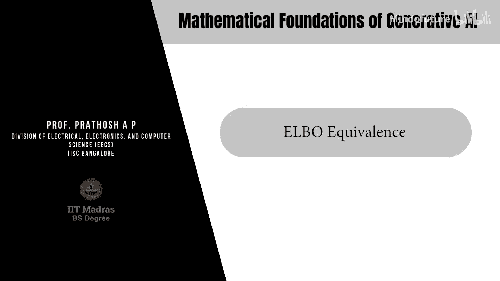
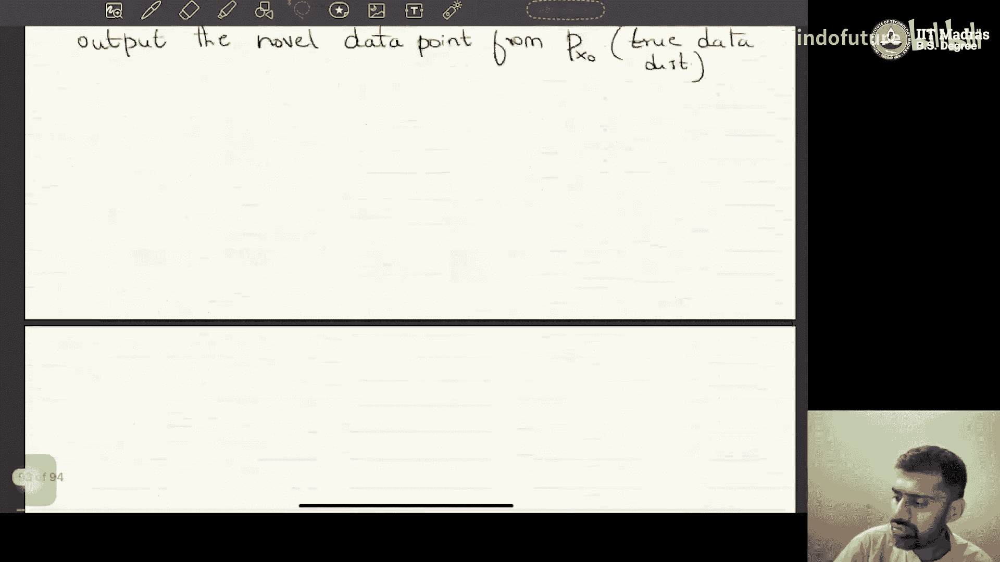

# 生成式Ai的数学基础 ｜ Mathematical Foundations Of Generative Ai p44 P44_W8L31-ELBO等价性 -BV1fperz7EjK_p44-

🎼。

So， elbow。Equivalence。So as I said。Whatever we have seen so far。

Is all that that is there to de but there are as I said multiple ways of representing the same thing equivalently so we will see how to do this okay so recall that the denoizing machine term of the consistent consistency term that we had was2 sigmaq squared。

Times。Mu theta of mu theta was a function of xt minus mu  Q。

 and this mu Q was a function of xt and x n。Have been omiing this term。To make it look simple。

 but this is what it is Now， what is muq， we know that mu q of xt commma x not。Is given by1 minus。

Alpha bar T -1。Times， root of。Alpha t divided by。1 minus alpha T bar。Times。

 so this is the constant that gets multiplied with xt。Plus。1 minus alpha T。In two root of alpha T-1。

B divided by。1 minus alpha p bar this time x0 so muq was a linear combination of X and x bar as we saw。

 right。Now， we have mu Tita because the mu Tita。Takes X T。

 So what we can do right now is that we can actually express mu the also in terms of。

X T and something that we。Estimate， so how do we do that。

 We will just copy this particular term here。And this constant， as well。

But instead of x not that comes up here， I will write that as x theta at xt。Good where。

Where x theta of xt。Is the output of the neural network。

This point this point is actually often confused Okay so how did this come from it is pretty simple。

 So what we have done here is。Remember that mu theta that we have which we which comes up in the elbow is something that we design in we can design it the way we want So what did we do here is since muq which is the okay so now the last function here right is a regression over muq so muq is fixed you can look into muq as the true value upon which we are regressing and mu theta is the output of the neural network right so if the true value that we are regressiongressing can be represented in terms of xt and x not then the output of the neural network which we are which we are using to regress can also be represented in terms of xt okay the same term that is in muq and something that we are learning so why would this work this works because。

M theta right is a vector indeed dimensions and we know that。

We can always re parameterameterize a Gaussian distribution using constant now suppose without this re parameterameterization our neural network was giving some mu theta as an output okay we can always adjust the output of this neural network with some scale and shift such that this mu theta takes the particular form that we have。

Does that make sense so I will just simply repeat what I just said because this is this is something that is often confused。

So， basically what we are saying is a mu Q。So muQ looked like some constant c1 times xt。Plus。

 C two times。X not so this is how it was looking。 So what what did we do is we wrote mu theta also as c1 times xt so note that this x t C1 times x is is a constant Okay given a particular x t given a particular time instant t C1 times x t is a constant I can write my mu theta c1 times xt plus。

C，2 times some X theter。Now I what I am saying is I can always adjust my x datata which is the output of this neural network such that my muq can be represented in terms of c1 times x0 plus c2 times whatever that x datata is because it is only a。

😊，Scaling and linear shifting。Okay， so this is nothing but the classical re parameterameterization that we are doing so since we are designing however a mu theta should look like I can write down my mu theta in terms of something that closely matches muq。

 but I still have something that that is to be optimized or rather predictive using the neural network so why did I do this this is simply done in practice to make the the。

😊，Interpretation of DDPM prediction， a little more interpretable， a little more。Tangible。

 so with this， what happens is with this。With this。Our loss function， which is one by。2 sigma。

 Q squared times。Mu theta minus mu Q squared。This will have。The following form。

 So there will be one by。2 sigma Q squared times。I will simplify all the constant and just write them。

 So mu theta is is written in terms of。Alphas and。X T and x theta。 So this is one minus alpha t bar。

C Im correct at 1 minus all four teams times root of。Alpha t -1 bar。The spindu。X theta of xt。

 which is the prediction of the neural network。Minus x not。Okay。

 so all these are I can rearrange the other terms and simply write this as  one by2 sigma Q squared。

And to。1 minus alpha T。Squared。2 alpha t minus1。B divided by。1 minus alpha。T bar square。单。Theors T。

Right。Minus。X market。그래。This is the the consistency term。

 So this has a much more interpretable form in the sense that so why is this why is this interpretable now。

 previously we were saying that this is a regression on mu theta。 So with this formulation we have a。

😊，Different interpretation， as I said， mathematically speaking they are exactly equivalent and you know nothing changes implementation wise but for what is that we are estimating okay。

 how do we want to interpret it but interpretation wise this looks much better So now this takes X T as an input Now this term。

😊，There's no X theta。Xcap theta， and this is a regressor on x not。 This is a agressor on。X， not。

Because what is the last function here， last function is simply regressing upon x nut。

A regressiongress on it's not。 Why is this important， As I said， this is this is a this is a。

Question of interpretability with this particular type of interpretation， this can be the above。

Evo network。Can be viewed。As a deannor。Dinoiser4。D datata point x n。

This is the major advantage of why one should re parameteraize mucu and mu theta in terms of XP and x this is this is because this entire network renewal neural network that is now being trained which is a regressor on xNt。

😊，Can be visualized as a denoizing network or a denoiser for the given data point X not。😊，At。All。

Noisy。Instances。X t so now what is this doing recall autism or x t or x t is the T latent space and in the particular。

😊，Construction of the forward process for the DDPM the the forward process can be looked into the process of noisy find the image So we have we take a particular data point x not or an image x not and we keep adding noise as we saw to get an X T now X t is the that version of the data which has been noise okay and what we are trying to predict from it we are trying to predict what the the input image was。

That led to this particular noise image Xt。So in that sense。

 this entire neural network that we are training can be looked into as a denoizing network on。😊。

The data distribution okay so that is one of the reasons why this thing is called you know denoizing diffusion denoizing diffusion probabilistic models So what we are actually I mean there are two reasons why we call it denoizing diffusion models one the data generation can be are the the reverse process or the backward or the decoding process can be looked into as the denoizing process The other reason is that the neural network that we are training can be interpreted in terms of。

Dnoizing a given data point at some noise scale time scale。

Okay now one other thing that is to be noted here is which is very very critical is unlike the neural networks that we unlike the generative models that we saw so far which are the generative adversarial networks and the variation auto of encoders。

😊，The neural network that we are training does not give us the samples from the distribution that we are seeking。

Okay， so this is not sampling。 So let me just write that down。 So unlike。Unliken again。Auttter B。

The neural network that gets trained in DDpM。Neural network。That gets trained。In a D PMM。In a D PMm。

Does not。Does not output。The novel data point， okay。

Right even after training so this is true even after training so the neural network is not giving you the output of the generated sample so how do we do that we will see that in a while do how do how does one do inference in a in a DDPM we will see this in a while we will see that in a while but this is something that is to be noted is that the neural network that we train in the context of DPM is not a sampler it is simply a regressor over the noisy sample it is simply a regressor over the input data point X d it is not。

Re write that down。 So this is a regressor on the input data points， or regressiongressor。

On the input data point text T。Input data point x not not x d x not so this is a rigorousgressor on the input data point x not so at again right post training all you need to do is sample a point from the normal distribution give it to the generator and gives you a point from the distribution of interest and in a V same thing happens with the decoder here the neural network that is being trained will not give us the novel data point。

From the distribution that we are only okay， now will data point。From。From P X node。

 so with the distribution that we have model Px node， which is the true data distribution。

then the question is how do we sample from a L PM we will see that in a while2 data distribution。😊。

This is one thing that is to be noted now we know everything now we have everything that we need to try in a ADPM so let us let me write the training procedure now how to train a ADPM given a particular data set。

😊。

