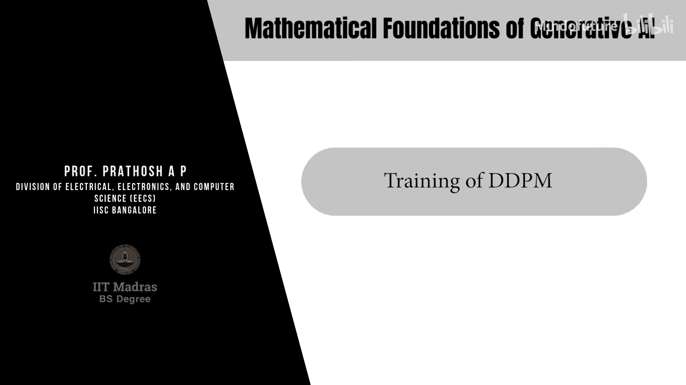

# 生成式Ai的数学基础 ｜ Mathematical Foundations Of Generative Ai p45 P45_W8L32-DDPM的训练 -BV1fperz7EjK_p45-

。

So training of a GDPPM。Okay， soま。One other thing that is to be noted is that。

All our discussions is by assuming that we have a single data point X not and whatever we do can be extend it to batch training as well just by putting an expectation outside the elbow that we are that we are optimizing Okay so what we will do is you know given。

😊，A data point takes not。Given an input data point X not， given a。Data point takes north。

From the true data distribution。So we have a data point that that is given from the true data distribution。

 So what do we do is the following， this is how we train the DPM network。

 So we have a neural network， which is。This particular network， think I have copied it。

So we have this particular neural network，So what we should do is that so that we repeat。Repeat。

 until convergence。We have to repeat this until convergence。 What do we do， we first pick。

Pick a tea by sampling uniformly。Between0 and capital t okay， so capital t is a hyperparameter。

Typically taken to be so T is typically taken to be thousand。Okay in experimentations。

 lets say that we have thousand as capital so we pick a t by uniformly sampling between 0 and capital t then what we should do is that we draw a sample x t。

From。What is the。TheDe of xt that we have this is alpha t bar times x not。

 this is the main the is1 minus alpha t times I。NowHow do we draw a sample from this particular distribution？

Simply using our usual trick of revparization。So which is x t， we make x t to be equal to。

Alpha T bar times x n。Plus。Root of 1 minus。Alpha T bar。Into some epsilon tea where。

Epsilon T is normal 01。 So this is simply the noise。The noisy sample that we have okay。

Then what do we do， We take。Graadient step， trying。O。路 tda。T plus 1。 This is okay。

 Let me not call it T。So t到 k plus。Is two dark。Minus。The gradient of。你。

Elbow that we have with respect to data。 That's also we have a。嗯。Step size this。

 So what is where J theta。We Jed of Q。Zqual to。Exscape the。Xt minus x not。

So this we do for one particular data point and if we are doing it for a batch of M data points so what we need to do is。

Just take it。 Take sum over some。Okay， so this sum has to be from， let's say。

 M equal to M to capital M and。Let me call this X， P。M。For the fact that we are sampling。

T for impossible times in one batch。 Okay， so let me repeat So what we are doing is see we have here in the loss function。

The loss function， we have a sum over t equal to2 to capital t， which means that。

We need to train it over all possibilities， but typically what is done is you sample a random tea and。

Do it for capital M number of steps。Okay， so take M number of Ps and then。

Some all this over those m number of t and then back propagate the loss also look typically not all time steps are taken。

 but a subset of capital t is taken。 So I will just write that where m。Where M。

 capital M is simply a subset of。Or rather that this belongs to。I can see it as a subset of。0。

2 capital T， which is a batch size。Can't call it the batch size because it is not exactly the batch size。

 which is the number of time steps that are used while trying the elbows we are approximating the elbow by taking every number of capital steps and we repeat this over all data points that are there so we Im assuming that we only have one single data point instead of having one single data point we take a batch of samples from the input distribution and we repeat this over that particular batch。

Okay so that is it So basically what we are doing is simply so we take x t we compute x t so I will write that down So as usual so we have a forward pass where we take x t。

And compute this。 This is one forward pass。For forwardward pass to compute。X。X bar Theta， a text T。

This is one forward pass。 Okay， and there's only one backward pass， which would。

Comput the gradients of this with to theta and we just you do this backward was。Backward bars。

4 gradient decent。Perfect the training as you see is extremely elegant in the case of DDPM so there is no wind maxax optimization problem or another serialial optimization problem that we are solving it is very elegant in the sense that all we need to do is given a data point X X node given a data point x node that is sample from the true data distribution what we do is that we just pick a random time step T and we compute the tieth sample。

A T is an noisy latent vector corresponding to that particular t by the recurive recursive expression that we just did。

 What is that it is simply sampling from So actually if you look at it。

 So this is this is sampling from Q of。X T given x n。

which is sampling from the tith conditional forward distribution and how did we do that we just derive this if you recall so this is just xt given by the recursion formula which is sample from an normal 01 and sample from and parameter as a an normally distributed random variables to get your xt okay and we pass that xt and do a gradient step using the regression task that we have。

So now， in practice what is done is one before taking one gradient step。

 so recall that the loss function had a sum over all。

T from t equal to 2 the capital t that is not what is done you pick an m capital lamb which is again a hyper parameter between 0 and capital t and then compute the get the noisy versions at all those particular Ts at all different ms and just sum all those losses。

For all the different time steps and then take one gradient step。Okay， so actually。

 let's put a sum here。So this should be X TM as we are calling it。

Because we need to do it at different time steps， this m equal to 12 capital m。And we compute the。

The gradient of this with respect to theta。 That's it。

 you will see the more details of this and implementing this while we are looking at tutorials。

 but yeah。😊，So， I hope the training regime is pretty simple it is actually very very simple in compared to in comparison with the G training and the VA training and this is one of the reasons why diffusion models are now the state of the art in image generation because this training is very very stable compared to the other models and you dont have the problem such as the saddle point optimization or even。

😊，The posterior collapse problem that we saw with the VAs， okay， the training is very elegant here。

Okay， so that it this is how you train a DDpM， so this is end up training a DDpM。So。

 please note that here while we are training we have to also encounter for the the first likelihood term that we have here。

The log likelihood term that is there here which is simply take for for for the special case where t equal to 1 we just have to take x n and add that as the loss function as we are taking that gradient with respect to different rees so that is I think that that is an understood that is a given thing。

Okay， so this takes us to the end of training for DDpM now the critical question is as we have been saying that DDpM in a DDPM the neural network that we have does not give you the samples so we will not get the samples from the distribution that we are modeling from the neural network。

