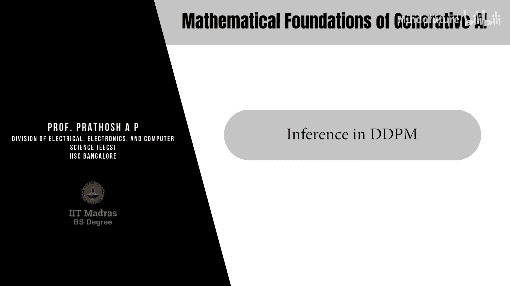
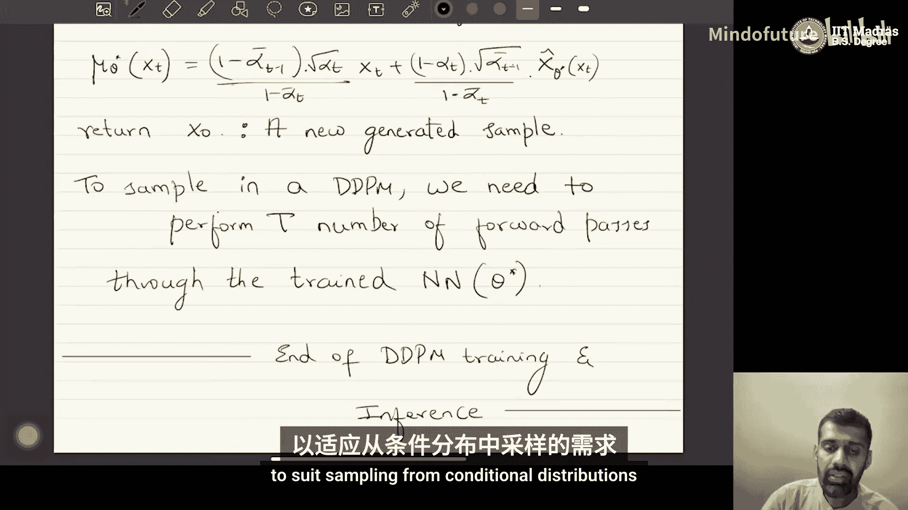

# 生成式Ai的数学基础 ｜ Mathematical Foundations Of Generative Ai p46 P46_W8L33-DDPM中的推理 -BV1fperz7EjK_p46-

🎼。

Now how do we do inference or sampling in GDPDPM， so let us look at it。

Inference or sampling with DDPms。Inference。Or sampling。From D PM。Sampling in a D PM。Okay。

 so how do we do this。Unlike in a gar or a Ve， where we simply push。

One uniform you one Gaussian random variable through a network and get the samples。

 It does not happen this way。 Okay， so now the inference has to be done the following way right so two。

Get a sample。Xn from P of xn is a true data distribution。We need to run the reverse chain。

 We need to。Proverse。We need to traverse through。😊，The backward process are the decoding process。

Wwhich is starting from x t， we need to get to x t minus1。

 then we need to get to x t minus2 and so on， and then we should get to x x0。

 So this is the backward process that we need to traverse traverse through So how do we do this We know that this is this implies that we need to sample iteratively。

To sample iteratively。프럼。The decoding distributions， which are。Recording distributions。

Which are the decoding distributions， P theta of。X t -1， given X T。

 So these are the decoding distributions。 and we need to sample X T -1 from this distribution for。

T equal to capital t to 1 So this is all we need to do right because suppose you know so what does this mean that this means that we get our x t of course x t comes from novel 01。

Because that is by definition and then we have x t minus1。Comes from P The of。Beat it off。X。T-1。

 given X T。Right， and then we get x。X p-2 is sampled from。P theatre of。X  t-2， given x。

T minus1 and so on， and we keep doing this and finally we get our xnt。

 which is a sample from P sheet of xn given x1。Okay， there is what we need to do。

 we need to iteratively sample from the decoding distributions That is all now do we know how to sample from this distribution turns out that we do because so x we know that。

We have。We have。X t minus-1。So x t minus1 are samples from P3 of。

Xt -1 given xt right this is what the decoding distributions are。

 but p theta of x t minus-1 given xt， this is the decoding or the reverse distribution that we have modeled so far。

 What is this is actually a Gaussian distribution we said because we said that the reverse or the backward process is a markco chain with a Gaussian transition X t minus-1 and what is the mean of this the mean of this is mu theta this is how we have modeled this mu theta of xt and the variances sigma  Q squared times identity。

This is what we have been modeling our distributions with okay。Okay。

 so how do we know how to sample from it again， Re parameterameterization is what we know。

 So this is x which means that x t minus1 if we take this if we take a sample epsilon from normal 01 okay。

And repairpar， so what we need is a sample from a Gaussian distribution with a particular mean mu theta and a particular variance。

😊，Now， if we know the mean and variance， we know how to get a sample from precaution distribution with that particular mean variance。

😊，Thanks to the re parameterameterization trick。 How do we do that。

 We take a sample epsilon from normal 01， we add。😊，That mean。ToThat。 and scale the。

At a variable which that particular variance。 That's it。 If we do this， then we have a sample from。

 the particular distribution。 This is the re parameterization。 Okay， now what is mu theta here。

 So mu theta here now will be mu theta star because we have already tried a neural network that would give us mu theta。

 okay， So if you want to use the formulation where the neural network is regressing over mu theta。

 then you can just take the output of this neural network itself。 That's it。

 Or if you want to take the formulation where we are we are we are we are。😊，Regressing over x。

 then new theta star of xt has to be computed this particular way。

 which is1 minus alpha t minus1 bar。Times root of alpha t divided by 1 minus alpha t bar into x T plus。

1 minus alpha T。Times root of alpha t minus1 bar divided y。1 minus alpha t bar。

Times x cap of theta star， which is the neural network， Okay， X T。Thats it okay， so do we know x t。

 we know x t because we have started from x capital D。

Okay so at every time t we know what the next time step is because that is we are going in the reverse direction so we know xt do we know x cap theta star we do because we have a trained neural network that can take that xt and give you an x x cap theta star which which means that we know mu theta star which means that we know x t minus1 thats why we do it let us write that as as an algorithm so inference。

Inferen in DPM。So what do we do start with。Start with a random point X T from normal 01。Okay。

 so while or rather far。For t equal to capital t t minus1 through  one。

 so we have we we are downgrading we have to do do。What do we need to do， we just have to get。Get。

Xti the star of X。From。The neural network。This is one forward pass so what do we have to do we take the train neural network that we have here。

So if I do I still have the same thing in my clipboard yeah。

 so we try we take the tri the neural network。This is theta star now， okay， we get this， we get x。

 so there is one only one forward pass that we do。For our pass to get。Excapita star at X T。Okay。

Once we do this， we make x T minus-1 as。Mut tiita star X T。Plus。Sigma Q squared times。The epsilon。

Where epsilon is some other sample run from normal 01。Okay， and also we have。

The muq star given by this particular expression as I said if you are looking at the neural network that is regressing over mu the star directly then you don't have to compute this you can just take the output of the neural network and add it to this particular thing that's it。

Okay， if you do this for t number of steps， okay capital t number of steps， then output。Or return。

Return x n。 Okay， so this will now be。A new sample。Or a new generated sample。

 So we call it as x stars x is Ok。 New generated sample。Okay。

 so please note that unlike a in in a VA or again。We wont get the generated sample in one step in one shot。

Rather， we will get it。😊，In capital D number of time shots， okay， which means that。读三倍。In a DDPM。

10 PM。We need to。Go through。T number of format passes。Forward passes through the。

We need to rather not go through。 We'll say， we need to perform。

To perform T number of forward passes through the train neural network。

Or regressor see that is why GDPDPM is known to be。Slower compared togans and vs in generation。

 So because you know， we need to do capital t number of forward passes。

 So why do we have to do capital t number of forward passes because all we are doing is that we are running through the decoding chain or the decoding or the reversemaco process And to do that。

 we have to every time sample from x t minus-1 given x where we start from x capital which is normal0 and and we keep repeated sampling from this distribution How do we sample from the distribution。

 we know that the distribution is macrocoian or sorry rather Gaussian we know that it is Gaussian with the mean mut tta star and the fixed variance this mean is what we are getting as an output through the neural network either we get the mean directly as the output as we saw in the the fast formulation or we get something which。

😊，Can we use to find out the mean that we need？so once we get the mean that we need because you know muq star is simply in this formulation where we are regressing over xn the mean that we need is simply xt times the output of the neural network with some appropriate scales once we get the mu the mean of that distribution sampling from it is easy because all you need to do is sample a random point from Gaussian01 and then three parameter is it to get get a sample from P theta of so this is actually what is this this is。

Sampling from。The sampling from。P heat of x t minus-1 given x T So through re parameterization we just sample from p the of x -1 given xt right that is what we do and we do it repeatedly for all Ts from t equal to capital t to1。

 So if we do that the final sample that we get is。Is the novel data point that we are seeking from that we are seeking okay now you can look at this entire process of repeatedly sampling from Phe of xt minus1 given xt as the denoizing right because if you see the input process as the process of。

Noing the forward process anoing。 the reverse process here can be seen as the process of denoing。

 Okay， so that's why the name we that's why the name that we have here。

 which is the denoing diffusion is 1 minus alpha T。

 Yeah that's why we have the name denoing diffusion probabilistic nu What what we are actually doing is simply。

Taking from the taking from noise okay what is noise here。

 noise is a sample from normal 01 and slowly one step at a time we are quote unquote dennoizing that particular noise so that we get a point that that we have sampled from。

The data distribution。Now， why should this work？Please recall that all we are doing so far is trying to find a P theta so the initial principles of gene modeling that we have right we are trying to find a P theta。

😊，Using a latent variable model such that the K divergence between Pta and Px is minimize。

 So we are trying to find a model distribution which is close to the data distribution by minimizing the K divergence。

 minimizing the K divergence is equivalent to maximizing the log likelihood and。

Log likelihood cannot be maximized in a latent variable model so we constructed the lower bone which is called the evidence lower bone and we took the hierarchicalva approach where we had multiple latent spaces multiple latent spaces and then we constructed a marco chain or the latent space and the forward distribution of the encoding distribution was fixed nothing was to be learned all that we need to learn what the decoding distribution which is also a marco chain okay with Gaussian transitions what did we do we simply learned the parameters of the Gaussian transitions of the decoding marco chain thats all and sampling in a DPM is simply running through the decoding process which is nothing but a marco process with Gaussian transitions whose mean we have learned using data。

The which is given by the neural network so again repeating the neural network that we are trying in a DPM does not give you samples from the distribution that we are trying to model it will simply give you the mean。

offff。L。Gausian transition conditional distributions。

Of the decoding are the reverse marco chain that we transition over to get the sample of interest。

Okay， so what we have to do is that we need to simply transit for capital number of capital t number of times。

To get one sample from a GDPPM， which makes it a little slower in inference correspond， I mean。

 in comparison with。Ves and GNs where the generation is a single step process。

 Now you just have to do one forward pass to get the data here you need to do capital t number of times。

 However， the training in a DDPM is extremely simple because all we are doing is solving the regression task and because there is no saddle point optimization problem or the posterior collapse problems the training is not known to be much more stable and thats why these models are the state of the art models in all the discussions so far I am not told you how to get alphas see Als are also taken to be hyperparameters which is right that down during training。

So t is fixed， and we fix alpha 1 through alpha T R。Hyperparmeters。Which are fixed between 0 and1。

0 and1。哎。Typically taken to be a reducing schedule they take take it between uniformly spread between 0。

99 to 0。9 or something。 that's a hyperparameter。 The details of it will be discussed during tutorials but yeah so the idea is that ti with the DPM is much simpler and the sampling and tiles for a process for capital T number of times and all we are doing while we are sampling while we are generating a sample is repeatedly。

Hppping through the。Rverse marco chain with Gaussian transitions whose mean is given by the output of the neural network。

Rightい。So that is how one would sample。Novel data points from a GDPPM。 so again。

 neural network is not giving the de generated sample rather it it is giving you the mean of the distribution through which we。

Hpe to get a novel data point。So this takes us to the end of training。

En of D PMM training and inference。Any info。So， the next topic that we should see is that so far the formulation that we have per DDPM only samples from unconditional distributions that means that it can generate an image or some text or some data point。

It is not equipped yet to sample from conditional distributions。

 which means that you know if you look at all these state of the art image generation models that you have you know including G Gbli etc。

 and all that what they are doing is given a particular text it will generate an image corresponding to that particular text which which is translated into sampling from the conditional distributions the next question that we will be taking is how do we modify the formulation of GDPPM so that it starts sampling from conditional distribution the typical application is text conditional generation So there are two methods to do it one is called the classifier guided diffusion and the other is called classifier free guidance So we will look at both of these methods and see how to modify this formulation of GDPPM to suit sampling from conditional distributions。

