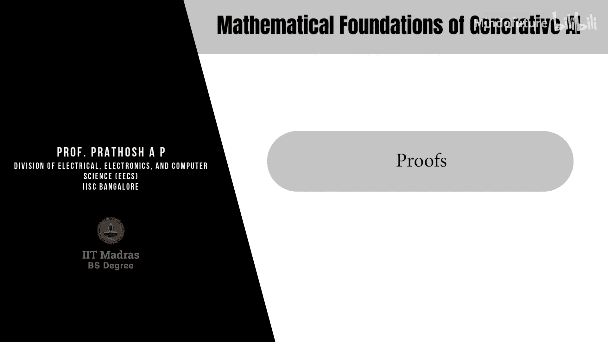
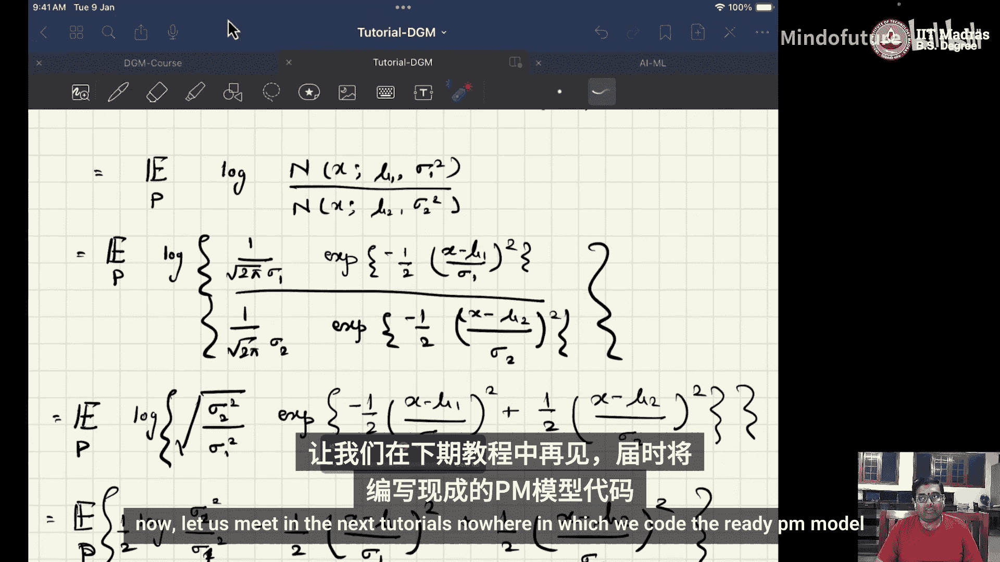

# 生成式Ai的数学基础 ｜ Mathematical Foundations Of Generative Ai p48 P48_W8T16-证明 -BV1fperz7EjK_p48-

。

Hello all， welcome to this tutorial in which now we will be looking at some of the unfinished proofs or unfinished steps that was described in week eight lectures。

😊，It will be a nice algebraic exercise， and then let's do it。😊。

there were actually three places in which a couple of things were what do you call just given as statements？

Now， one is， now what is the sum of two normally distributed random variables？

 if x is an random variable and y is an random variable and z is x plus y。😊，And what will be the mu？

And sigma of Z。What is mui and sigma Z is the question now that has to be expressed in terms of mu x mu y and sigma x sigma y。

 how do you express it that is the first point。😊，The second one was you wanted to compute in the forward process。

We wanted to compute this quantity Q of xt minus1 given xt comma x not we wanted to compute this quantity。

Now this one left as an exc。Now using the idea of completing squares。

 where I will also not be doing it。This is an algebra even this is much more algebraic exercise。

 I'll point you to the the reference from which you can go ahead with that。😊。

And the third one that we left is how do you compute？The K divergence。

Now between two normally distributed values。Now， these are the three steps that we。

Left or we directly stated the results rather than going ahead and deriving the results lets derive these results。

😊，Today's。Tuttorial， the first one that we want to look into is。Some of。D。To， not。Distributed。

A random variable。So I actually mean they are independent。Now that is without saying。

 it goes that the random variables that are under consideration are actually independent。Now。

 let's say that x is a normally distributed random of variable now with。Mex， and。Sigma y square。

Mal andvari。And then you have y， which is normally distributed。No that mu Y And sorry。

 this is sigma X。 thisigma X。This isigma y squared， now we want to know。How does Z look like z is？

Express way。And we know that intuitive it makes sense to us not to say that。Z is。

Normally distributed width。Newex。Pm white come on。Sigma x squared plus sigma v squared。

Now you can even simulate this。😊，Look at data Now， since we already know how to generate random variables now using a specific mean and then the deviation。

 you can generate with some mean okay， and some。Another mean， so for example。

 it's M mu x let's say it is 2 and mu y， let's say it is 3。And then sigma x and sigma y。

 let's keep it as 1。Okay and see brought the histogram and see how does it look like and in2D also you can understand yes this specific result makes sense okay then programmatically we can do that that is also a nice idea of doing it yeah but now we need to look into the mathematical proofs。

😊，Okay， so now what we should be doing this in this case。

 we will be using the idea of characteristic function。😊。

Now there is one more way in which we can prove this which give rise to the idea of computing square。

 which is algebraically。😊，Actually， it is intense and challenging。

Not because it involves a lot of algebra。 So it's like it has too many terms to look into and keeping track needs。

😊，much more elaborate exercise so I leave it as an exercise now you can look at it in Wikipedia if you just type some of normal distributed random variable you get a Wikipedia page now in which they have used convolutions to prove it that is also one way possible but I will be doing the proof in this session using the characteristic function。

😊，Please。Using the characteristic function。And I am assuming that you are all aware of the idea of characteristic function。

 okay so now。So now the characteristic function of Z。Now which is x y of T。Ass fee of。

Expl y and it explicitly。Is it equal do。Expectation of。E to the power of I T of。Exmiss what。O。😊。

So now。呃， the dactistic function。The characteristic function。Function for。

A normally distributed random variable。off。Normal distribution。With me as the mean。

And sigma squared has a variance。Is given by。我非要地。Equals。E XP of。IDU。Minus isigma squared。

T squared by 2。 This is what。This is a known formula。Okay， so now what is that we want now we want。

Fe0 of。B。Now， if we， if we are able to bring the phi of T into this specific thing。

 whatever is here will be the mu whatever is here will be the。Valance okay。

 that is what we want to do it actually。This is。Phi of x plus y of T now since x and y are independent。

 we can。第一印度。F very often。Now substituting。This specific equation。Now you will get。E XP of。啊啲。Mix。

Minus。Zigma squared。T square by 2。Into EXP of。系啲。M way minus。Zigma， this is sigma x squared。

 this is sigma y squared。D square by 2。This is。It the power of something into it power of something。

So now that is it the of this。Bless us。Okay。No，那 the设。EHP off。

IT is common now this is muo x plus mu by in a sense， you are adding it。Minus， now， if you。

You take minus as common here and add these two terms。Okay， now you have sigma x squared plus sigma。

W square。Into t square by 2。Okay， yes， this is what the format in which we wanted。Now。

 this means that now this is the mean and this is the variance this actually means that。

Z is normally distributed with mean mux plus。明文。And sigma x plus。

Sigma sorry sigma x squared plusingma very squared？And this isnt。放率。O。

And then use this and substitute in the error computation that we did whereas is that I can even show you the step in which we needed this。

嗯。上回来播不播。我不会不不会不。Yes。YesHere is what。해야や here。This。Is a normal distribution。

 this is a normal distribution， this is ax。Plus be one。Now I just did for。X plus y。

 and then I assume that。From this， you are capable of doing it for。A x plus B，y。So now。If x is， okay。

 let just give you the first part if x is。Normally。Mics and。Sigma x is squared。

What will be the distribution of ax？NowThis is normal distribution。AIn mus come on。

A square into as a minus squared。I think from here， you can extrapolate it。😊。

And then youll be able to。Obtain the result。Thiscus。This is X。And B by from here。Now。

 you will be able to。Extracted。Okay， so now since both of them are mean zero， you get zero。

So now your whole aim is to get the。Zigma， I leave it to you as a nice point。

This is the first task that was partially finished。😊。

Now you have pointers on which you can accent it。The second one， which was the completing square。

 you can look at the Wikipedia page that I refer to you。😊。

The third one that we wanted to look into is actually the。The scale divergence。Ked divergence。

 between。都。Normally， distributed。Random variables are two normal distributions。So now。

I'll say that I have P， which is your。Distribution， which is。Ex。this is。Normal distribution。

Mu 1 and sigma 1 squared。Now you cannot take x and y here now because whenever you are calling caating K divergence。

 the support for PNq has to be seen， so you have to refer it as x only otherwise notally it doesn't make sense。

This is also the same space， and。Ne 2 and Sigma 2 square。

Now you have to find the kl divergence between these two。 Now how do you define k？

B k between two distributions， P and Q。Is given but now P and Q is having densities P and Q， okay。

 small P and small Q。Okay， now this is given by integral over the space of x。Be a fix。Looff。

Px divided by。QX， dx， and I know this formula should be by heart to you and。

Since we are looking at the normal distribution now here we have the support from minus infinity to infinity minus infinity to infinity。

And you have but。And this is。A normal distribution。X， now with mu 1 and。Zigma went square。Log off。

Normal distribution。X， which is。Mu 1， sigma 1 squared。Divide by。X。Whi is mue 2 and sigma 2 squared。

Bx。And。Does it？Look like something we know， yes， this is nothing but expectation with respect to distribution P。

Okay， the to B。Log off yeah， whenever I we write log here， we always will L and okay。

I'm going going to log that。X。Muwen。Zigma 1 squared。Divided by。Normal x。没有 do。Zigma to squared。

 this is what？we want to allocate now，So now let's do it。Expectation with respect to P。So now。

 we know there's。Log off， you have two term。No。1 over2 pi square root of two pi。Zigma 1。EXP off。

Minus half。Into x minus mu1。P sigma 1 whole square。Now this is your en numerator divided by。

1 over square root of2 pi。Sigma 2。E XP of。Minus half。X minus mu 2。Divided by sigma 2。好奇怪。

This is full log。This whole thing。Log of this whole thing， okay numerator and denominator。So nowok。

 let's。Do this。 Now， this is。There is an expectation with respect distribution B。你等你呢。Log off。

Zigma 2 square divided by sigma 1 square。Square root of this。EXP off。

Something divided by something okay it is the part of something divide by something。

 so you know how to do it， right？You have to subtract， okay？And this。

This minus this since you already have a minus， that means that this plus this。Okay。

So now this will be EXP of。Minus half into x minus mu divided by sigma 1。Whole square。Plus。

Half into x minus mu to divided by。Sigma 2 whole square。This is EXP。And this is for the log。O。只哪。Now。

 next step is。I presume that it is pretty much clear。What to do。This is。Log off。Zigma1 squared。

Divided by sigma2 sigma2 square， divided by sigma 1 square。since there's a square root。

You write half here。Okay， and then EXP and log will get canceled this。Mus half。X minus mu1。

Divide by Sigma 1， whole square。Plus， half。X minus mu 2 divided by sigma 2 whole squared。

All of them in sorry the expectation。O。So now。要近。Immediately see that。 we should take half。As。

Common factor。This is in our notation I'm using capital P， I should keep my notation consistent。嗯嗯。😊。

E XP of half in 2。Okay， so now。What are the things that we have？This is minus is of。

X minus mu 1 divided by sigma 1。Hhole square。Plus x minus mu2。Divided by。Zigma to whole square。嗯。😊。

Deng。This is。This is minus。Log off。Zigma 1 squared divided by sigma 2 squared。Yeah。

 I think you can understand this。Log of gateway B is。Minus log of B by a right。

 that is idea that I have utilized here。Okay， so now。Now what do you do？Let's expand these time。

 we still have expectation with respect to P outside。Have half。Now， you have this。

X minus mu1 divided by。Zigma1。W squared， there's a minus for this。Plus。Xa square。Minrs。2 mu to x。

Plus， mu to square。Divide by sigma 2 square。Minus log of。Zigma 1 squared divided by sigma 2 squared。

Now I directly understand why I do this， why I not？Expand this term， and I only expanded this term。

 it will be pretty much clear in the。Next step。So now you have an expectation here。

 expectation of a plus b plus C。Is expectation of a plus expectation of B plus expectation of C now the expectation can be used as linear operator。

Okay， so now this。When I use it。So now I can directly write it as。

 but this is half Ill just keep as it is。this minus。Expectation of。X minus mu1 whole squared。

Divided by。Zigma 1 square。O。😊，NowSigma 1 squared is independent of x。

 so I don't need to worry about it。Plus。Expectation of。Now this is x is squared。Minus。Do明 do。

Into expectation of x。O。Clless。Mune to whole square。Divided by sigma 2 square。And this is a constant。

老家夫。Zigma 1 squared by Sigma 2 squared。Will be asous。

So now do we know this expectation of x minus mu1， this is expectation of x minus mu1 whole square。

 now this is nothing but the variance right。Okay， we know this actually now what are the terms that we know here。

 we know that expectation of。X minus mu and whole square。😔，ThereThere iss nothing but。Vs of x。

 actually。What is variance of fixed in this case？Zigma1 square root。Okay， this we know already。

And then。What are the next things that we know？AndThen this is Iigma 1 squared。

 this is Iigma 1 square now you will become you at minus1 out of this。

 now what is expectation of x square？Okay。So now， expectation of。X square， I urge you to do it。

This is a mu 1 square， plus。Iigma1 square of this， I can。Re substituteubute， Okay， now。

 if I substitute all these things in our current。Think this is half。

Mineus sigma 1 squared divided by sigma 1 squared。Plus。Mu one square。Plus， sigma and square。

Mus 2 mu 1 what is expectation of x now this is so this is mu 2 into mu 1。Minus mu2 squared。

Divided by sigma 2 square correct。Minus。Lago。Zigma 1 squared divided by sigma 2 squared。O。😊。

So now we have this minus1 which is there， now we can rearrange the terms now。Now what this is。Half。

Mule 1 squared。Minus。都没有玩没有读。Minus mu 2 squared。Divided by sigma2 square。Plus。

Zigma 1 square divided by sigma2 square， what did I just do？I rearranged this， this。

 and this I took it as one term。And then this and this and here。Puing it here。Miners。Log of。

Zigma 1 squared divided by sigma 2 squared。M-1。Now， what is this， This is half。This is mu1 minus。没有多。

홀 square？Divided by sigma 2 squared。不less。Zigma1 square divided by Sigma 2 squared。Minus log off。

Zigma 1 squared， sigma 2 squared minus-1。Okay。Now this is there？The English。Okay， nice algebra。

 so you just know what did you just do okay， now the algebra is you feel like two much things now you just substituted these。

😊，Rearrange their terms。Took the log inside。Took the expectation inside and substituted the values。

Okay， this is what you have done this。You can see it in yeah here。How do you actually take。

Now you can see here now you have the trace of this。Now which is same as this one。

I'll urge you to look into it later。O。D is there in this case it is1， this is one dimension。

 how does it convert？This。Would you have。Is seen as this term。And this which is it。The same as。How。

 is this， you know see you see is because a trace is coming something an universeverse is coming？

Now why is this and the idea is pretty much simple。😊。

See here youre dealing with x now which is in R actually。😊。

Your normal distribution that you are con as is a scalar Now here you are considering actually a vector valued。

Distribution， because of which you get。Zigma， which is a matrix actually。😊，Now， at that time。

 the algebra becomes even more。What do you call sophisticated okay now with this intuition that you have now I urge you to extend the same idea into the vector value random variables which will be a nice algebraic size again so now in that case now you should be at each time you should be looking at the equivalent of the。

Vecter valued substitution。For the steps that we have carried out now with this。

 we will end this tutorial。😊，I think this tutorialial was algebraically nice。

And then all the substitutions that we do have simple algebraite manipulation just by looking at the symbols now I want you not to get scared off okay with this we will conclude this tutorial now let us meet in the next tutorials in which we code the ADPM model thank you。

😊。

