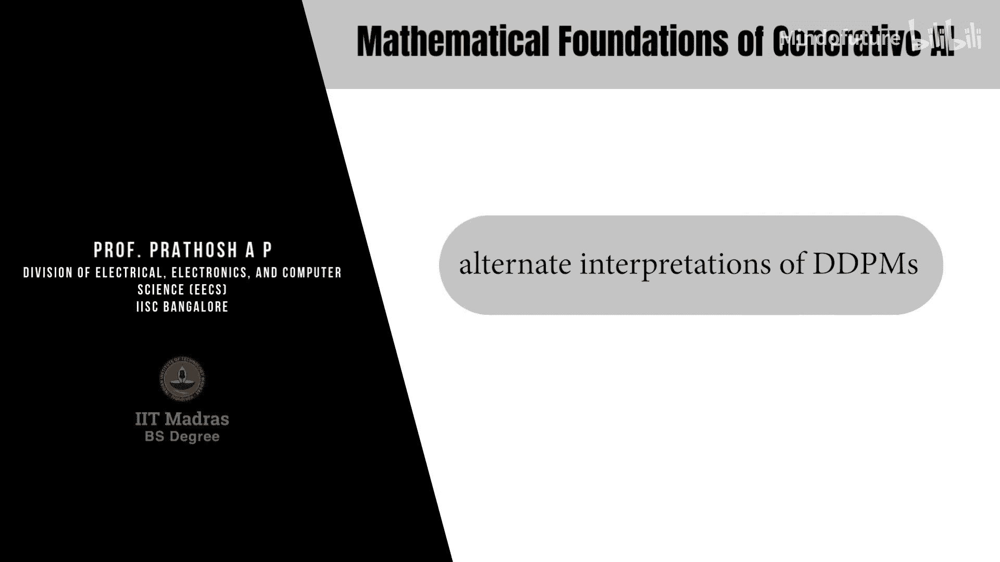
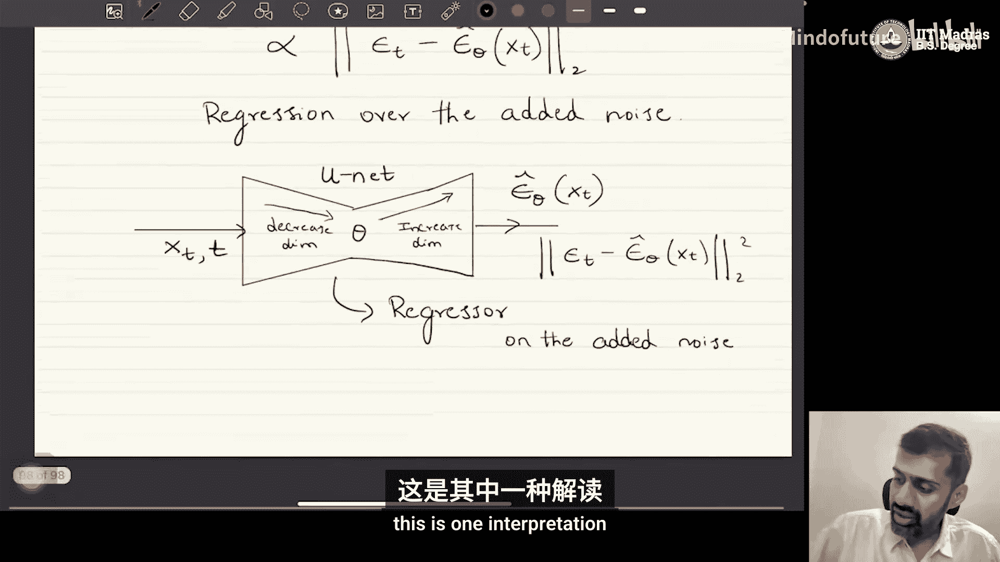

# 生成式Ai的数学基础 ｜ Mathematical Foundations Of Generative Ai p49 P49_W9L34-DDPM的替代解释 -BV1fperz7EjK_p49-

🎼。

Hello， everyone。Welcome to this new module in the course。In this module， we are going to look at。

The conditional generation capabilities of a diffusion model。As I mentioned the previous time。

 conditional generation refers to。The idea of generating a particular data sample conditioned on another type of modality。

Now， this can be text conditioned image generation or class conditioned。Image generation， and so on。

The idea is to sample from the conditional distribution rather than sampling from a marginal distribution。

So in this module， we will look at how to modify the structure of a DPM so that the one can sample from a conditional distribution。

To be able to do that， well have to look at the multiple。Paent formalisms， formulations of a DDPM。

 So far， we have understood DDPM， the timing of D DDPM as。

The binnoizing where given a particular data sample。With added noise， which is the pth。

 which can also be seen as the tith latent variable。We build a neural network， which is a reggressor。

Which would predict what was the initial data point。Upon which this noise was added。

So we also saw another formulation where。This neural network was considered as a regressor over the mean of the distribution。

 the true reverse distribution。ButNo。With the goal of modifying the diffusion model to be able to sample from the conditional distributions。

We will first look at。Altterimate formulations of it， One as the noise predictor， the other as。

The predictor of the score of the distribution and then use that formulation to modify the diffusion model to be able to sample from a conditional distribution So that is the overview of what we are going to do now。

First， let us look at。Alternate interpretations of a GDPPM。Alternate interpretations of a GDPP。

The first way that we look at this。So DDPM as a noise predictor。So， this is one of the。

Very famous interpretation that is used in the original paper of DDD PMm so DDPm as。我的歌我。

Recreation world。I read noise。So， all of these rebllulations are based on some sort of re parameterameterization of the the same equations that we saw。

 so fundamentally nothing is changing。Only we are re parameterizing or reformulating the underlying equations of the consistency term and expressing it in different ways so that we have different ways of interpreting the same result okay so let us look at it recall that。

The forward process of DDPM。Forward process of。DDPM does the following。 So what does it do。

P define X P， which is the tith。Let into variable or one can look into that as the P noisy version of the data as。

Routh of alpha t times x0。Plus。Roed of1 minus。P here because we are recursing alpha t bar times。

Epsilon， so let's call this epsilon T where epsilon T is a sample that we have drawn from normal 01 right so this is the。

ARecursive definition of the T latent variable that we derived from the previous lectures。Okay。

 so this rearranging the above terms。Rearranging the about terms。

One can express xnt the true data sample。Are the input data sample in terms of。X T。

 Dt latent variable or the noisy sample。And the。Added noise。 So what is epsilon T here。

 Epsilon T is the noise that is added。2 x t2 x not to make it X T， right so。Let me write that down。

 So Epsilon T can be interpreted as。Denoies。It is added。都。It's not。Now noise added to it not。

To convert it into X。That is what our epsilon t is and we did it using the recursory formulation。

 so now xn can be represented in terms of xt and the noise that was added to that。Okay， now recall。

 also recall that in the consistency term of the elbow that we derive for。So， consistency term。

In the elbow。At this particular form， right it was。Mu theta minus mu Q。

 So it was the difference between the norm of mu theta and mu Q where mu theta mu mu Q was the mean of。

Q of。X t minus1 given xt and x0 this was the so called true distribution。

 true reverse distribution and mu theta was the mean of。The decoding distribution at t minus1。

 this was the definition of this was how we derive this。 Now this is how we got the consistency done。

 So now the question is。Can we represent this particular consistency term in terms of the noise that is added is the question that is what we are going to do to that let us represent。

So represent new Q。In terms of。In terms of x T and epsent T。

 So now can we represent the mean of the distribution。

 the true distribution that comes up in the consistency term in terms of x t and eps t。

 So that is the question it terms out it can be done because so muq was a function of x t and x not right This is what our definition of muq was what was it It was root of alpha t times。

1 minus alpha bar t -1。This into xt， so remember that nuq was simply a linear combination of xt and x n right and the linear the coefficientient of the linear combination was given by the product of these total 1 minus L party times x0。

Dividted by。We have the entire thing scaled away。1 minus alpha t bar。

So this was the definition of the。Mucu， which is the mean of。

Which is the mean of the true reverse distribution， so that was the definition that we used。Now。

 what we should do is。We have our xn that we have expressed in terms of xt and x out lets call this equation1。

 So now replacing xn here replacing。Replacing xnt。诶冇。Using equation 1。

 So if we replace our x node using equation 1， which writes x node in terms of x and x on p， then。

Let me rewrite this。So in that case， my mu cu。Here， xn will be。particular thing。

So what are we doing here， simply representing its not in terms of。Xt and def， so that the entire。

Expression now will become。A function of extreme excency， So this。Bart。It's simply it's not okay。Now。

 while skip the algebra one can simply rearrange the terms and group them together finally I will just write the final expirs this will be 1 by root of alpha t times xt。

Minus。1 minus alpha t dividederted by。Root of 1 minus alpha T bar。

Into root of alpha t and this is multiplied by epsilon t。

 please note that the noise epsilon is also the same dimension as that of data that also is in Rd therefore muq is still in the dimension of R Rd that now it becomes a linear combination of xt and epsilon T。

 So what was a linear combination between xt and xn in the combination of xt and xn now is a linear combination of。

X T and epsilon t so now this muq which shows up in the consistency term is represented in terms of this is no longer a function of xt So now this became a function of x T and epsilon T so pattern it's no longer a function of x not it's a function of it is represented in terms of x T and epsilon T so once we do this well do the same thing for mu theta as well So mu theta as we know is a function of x t right So and using the same argument that we used before that because it's our design gel we can always re parameteraize this mu theta in terms of something that looks very similar to mu q。

And designate everything that we learn。As。One of the parameters。

 so this is alpha t times the same thing。To all per into epsilon theta epsilon theta cap。

 let's call it this is a function of Xt。So this is very similar to what we did when we re parameteraitize reparaitized muq and mu theta in terms of Xp so what was the idea。

 the idea is that if you have a Gaussian random variable then you can always scale it and shift it with whatever constant that you need and get it back to the mean that is needed so all we are saying is if we represent this epsilon cap theta using in a neural network then the neural network can always learn the scale and shift that is the idea so why do we do this we do this just to ensure that our mu theta looks similar to muQ and when we compute the consistent the constants and the shifts gets canceled away way so that the expression looks a little elegant Thats all。

Now， if we do this， now the current consistency term will be as follows。So consistency， which was。

The norm of the difference between these two vectors now will simply become。

So recall call that this was actually equal to one by。What one by two。Sigma Q squared the term。 Okay。

 so that will just retain。 So this will be now 2 Q2 sigma Q squared。

 just plugging in the definitions of mu Q and mu theta， as we have written here。

 everything all the terms will cancel away。 So what we will have is a constant here， which will be。

1 minus alpha。T squared divided by。1 minus alpha。T bar times alpha T times。

Whatever is there inside now will be epsilon。B minus。Epsilon gap Theta is a another function of Xp。

So no hope that epson。Epsilon P and epsilon theta are both again d dimensional vector Okay this is another pre parameterization。

 So what did we say is that I just remove the constant and write that the consistency term is now。

Proportal to， but for a constant difference between the noise that was added to xn to make it Xt and the output of the neural network。

Okay， so this problem can be now looked into as regression， regression。我文。The added noise。

This is another formulation where you see the timing of DPM as regression over added notion。

 let me just copy this。Network diagram so that we can express this in terms of regression over。

So we already saw two interpretations right and one interpretation was that this neural network is taking xt and predicting the mean of the distribution Q of xt minus-1 given xt and x not the other interpretation was that this neural network is taking xt and it is predicting x not regression over x not which is predicting the the which is the deizing task here is a third interpretation where you say that this neural network is taking xt and T and what it is predicting is。

The noise。That was added to xn to make it xt So regression regressiongressor。On。

The added noise to another interpretation of it this is the interpretation that you see in the original paper or the original research article that proposed EpM as a regressiongressor over minus okay so I will write that this is regressor over epsilon t minus。

So当打 gap这分 cannot fix。This neural network is now taking X T basically what is it doing given an image or a data point that has noise Okay this is predicting what is the amount of noise that was added to this neural network。

 Sorry， added to this xnt to make it X T。RightSo you can now very well see the relationship between this and previous interpretation where if you are given xt。

 if you are predicting x not which is the denocing task okay you need to implicitly understand what was the noise that was added to x n to make it Xt other without knowing what was the noise that was added to x not to make it Xt there is no way that you are predicting x not given xt right so here instead of seeing it as predicting x not here we are seeing it as predicting the noise that was added to directly predicting the noise that was added to x n to make it Xt so this is another interpretation of Ep and this interpretation as often shown in in lot of a papers and other discussions。

This is one interpretation。

