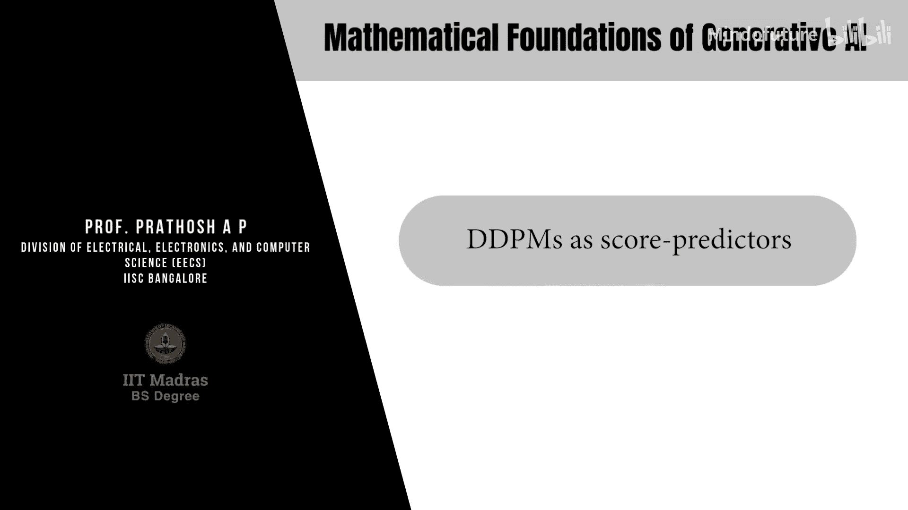
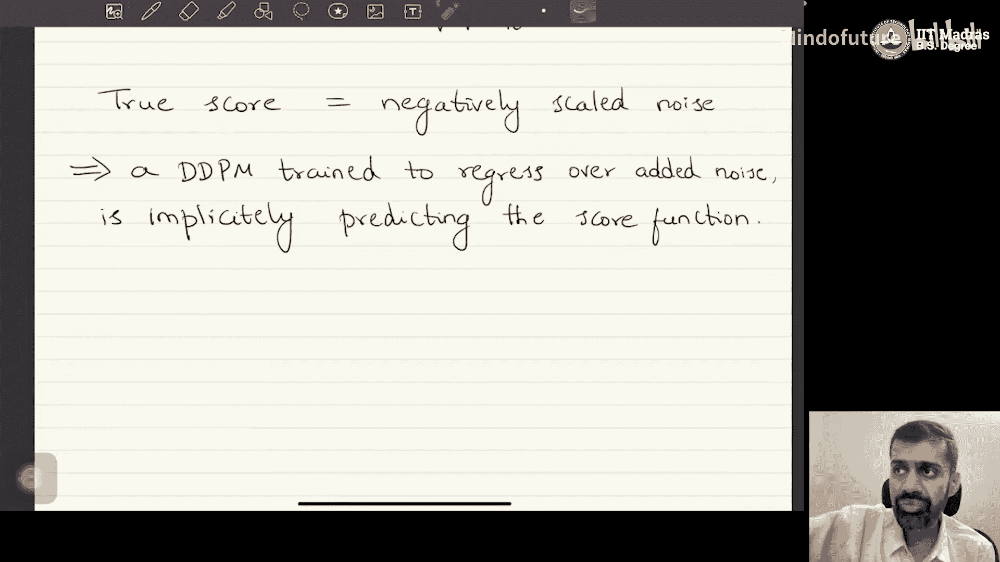

# 生成式Ai的数学基础 ｜ Mathematical Foundations Of Generative Ai p50 P50_W9L35-DDPM作为分数预测器 -BV1fperz7EjK_p50-

🎼。

The other interpretation that is that we will see now。

 which is actually very useful to useful for the the task of conditional generation is。

TDPM as score predictors。This interpretation also has。

A very strong relationship between what what are called as these core best models。

 So we will see what that is now。There is。Suppose theres a famous result in classical statistics that says the following。

 Suppose now T is a random variable that is Gaussian。And let's say the you mean of this。

Where this gausian distribution is mu t and variances sigma t。Sigma D。

 then there is something called 3D formula。不是是啊。No will result in statistics that would say that the conditional expectation of the mean given the random variable。

 given that we have observed the random variable。第。Is given by。

This is given by the observed value of the random variable plus。The variances。Tams。

This core vector P。Log。P of P。这边。PT is the distribution from which we are sampling T。

 which is the normal distribution in this case so now this is。This is what we call as。B of B。Now。

 I will not prove this result， I will take this as a fact。So what is he saying is？

Suppose there is a gaian random variable with a certain mean and variance if want to。

Compute the expected value of the mean vector， given that you have already observed a particular value of the random variable。

 then it is given by this particular formula where。The gradient of。

The log of a particular distribution with respect to the underlying random variable is defined as this core。

This core function。see now look at this， typically we take the log likelihood of a given distribution and the derivatives are computed with respect to model parameters so here the gradients are being computed with respect to the random variable upon which the distribution is supported so score of a given distribution is the gradient or the derivative of the log likelihood of the density function with respect to the random variable itself upon which the distribution is supported so that is the definition of the score function okay now why is this of importance to us。

So okay so intuitively what is the score function telling you this score function tells us what is the direction in which the log likelihood is speaking so suppose you want to find a model that would that would maximize the log likelihood So what one should do is that traverse in the direction where the score function points because score function is telling us what is the rate of the change of the log likelihood of the the density function with respect to random variable so we are saying in the in the in the space of the random variables the range of the random variables。

Wwhich is the direction along which one needs to traverse is what is pointed out and so that we match the through distribution is what is being pointed out by the score of the distribution so score of the distribution is simply the gradient of the log likelihood of the distribution with respect to the random variable itself now why is this this of importance in the current context is so now you recall in the case of a DDPm。

That in a DDpM。The distribution of。The Tth latent variable or the noise vector conditioned on the input is given by a normal distribution right this we have derived this。

Next step。And the mean is given by square root of alpha bar times x0 and the variance is 1 minus alpha t。

But。Times the identity matrix okay， so this we have derived so now if we apply the 3Ds formula to this。

For to above。We have the expectation of。The mean。Given x T。

 the random variable that we are talking about is x T now is given by。X， P plus。1 minus alpha d bar。

Baams。This score， this score is log of the distribution that we are。Talking about is is P of Xt。

And the derivative is with respect to。X。So the derivative is with respect to x now now we also know that suppose you have one particular sample。

Suppose the best estimate。The best estimate for the conditional mean。

 which is the expected value of mu given next t。Is the two mean itself。

See if we know what the exact room is， the best estimate is is the。Blooming。

The true mean itself is the best estimate， which implies。

Which implies that the expectation of mule given next to is the mean of this distribution， which is。

This one， okay， which is a rule of。Alpha T bar times， that not。Now。

 if I plug this into the 2D formula， so my root of alpha t bar times， its not。

Which is the Ls is now equal to xt plus 1 minus alpha t bar。单。The score function。

The marginal distribution of x T so P of xt we will define what log of P of xt is in a while in the context of a DDPm。

 So this is just application of the 2D formula now rearranging the terms。

If we rearrange the terms here， I can write x not。In terms of。Xt and this core function。Stams。

The derivative of。Log of p of xt， which is the square function。

Respect to X divided by this is just rearring in returns and。In the algebra。

 this will be alpha T bar So what did I do just。Using the result in statistics。

 which is the3 formula。 we just rearranged。 we just expressed the true data x not in terms of X T。

 which is the the latent T at the latent variable and what is called as this core function why is this of importance。

 as usual， we can rewrite the the consistency term in our loss function the elbow in terms of X T and this score function。

 That is the。Equal interpretation that we have。 So now expressing。Expressing the consistency term。

In terms of scores。In terms of school functions。Now， recall that our muq。

 which is a function of X index xn， which is what we had in the consistency term as given by root of Al farRT。

Maybe we can just copy it avoid writing it again。This was the definition of muq that appears in the consistency term。

Now here I just replace xnt。By this particular expression。 So xt。

 we wrote down x nott in terms of xt and。The score function， I can simply write down。 It's not。

In terms of。Xt and this core function， which we have just derived using the 2D formula。

 so this is xt x not。Okay， so this will be our x not。Using the result above so that is what we do。

 So now again I will skip the algebra if you rear the terms。

 finally this will be1 by root of alpha t times x t。

Plus 1 minus alpha t divided by root of alpha t times this core function。Log。B of x D。

Dspect to extent。 So this is my new k。so muq is represented in terms of xt and this core function now once we do that we know what the next trick is we will do write down the mu theta similarly in terms of muq so this can be as similarly in the lines of muq this is one by alphapha t times xt。

Bless。And as I keep saying the same trick will subdue all the constants and put everything in the neural network I write this as S theta is takex steep so know where。

Is the of its。Is the。Predicted。这 that's school。Using neural networks。

So this is another interpretation。 So now what happens is with this the consistency term。見ま。

Wwhich was the norm of the difference between the mu theta can be represented in terms of all the emailL just skipping all the constants。

 the difference between the true score。And predicted score。Okay， this is another interpretation now。

We will write down the exact same structure that we had。

 So now this is the third or rather fourth interpretation of。What we are doing in a DDPM。

 So the same DPM can be again looked into as。Reggression over the score of the distribution。

This is re over。Rereation already score function。So now。

 this neural network takes Xt and T as input and what does it predict， it predicts the score。Of the。

Distribution。Or agressian world。This core function， regression。So its around this core function。

This is the third interpretation。Okay， now one might ask this question。 I mean。

 in all the other interpretation， we knew what the true。

Data point was a true mean was or the true noise added noise was so that we could regress upon right So now here a stta of x t is the output of the neural network fine。

 but how do we know what the true score is so we dont know what the true score is it turns out that we know what true score is so let us write that down So to compute the true score。

To compute the root score。So we might have already seen how to compute the true score。

 so we had this definition right xn was given by xt using the formula what did we write this was epsilon n minus epsilon times the score。

Lout of X log of。Px T divided by。Ro of alpha t right This is what we saw using the 2 formula。

 but we also know that this is equal to x is also equal to。Also。

 we have x node is equal to x p minus。Ro of 1 minus alpha t bar times epsilon t divided y。ruolph。

Alpha T bar right So this is by definition， right， this is by definition。

I by definition and we have epsilon t is the noise that we added to it not to make it x t so that is by definition So equating one and 2 you simply equ this one and 2 this will call as equation 2。

そのequating1 then2。It is very easy to see that the score equal one and2 and rearranging just skip the algebra。

So Im deliberately deliberately skip skipping the algebra and leaving it as an exercise because you know it will consume a lot more time and it is pretty easy to do the algebra I leave it as an exercise to students so though now the true score。

That we seek。Is simply equal to one negative of one by root of。1 minus alpha d bar。Times， excellent。

Okay， so now this is a very elegant result， which is showing that proof score。😊。

Is simply the negatively scaled。Negingly scaled the noise， so that's it。Now what we are saying is。

Higher than noise lower the score and vice versa。 I mean， it's obvious， right。

 because suppose you take an xn and。Add some noise Now the the score function should point in the direction that is opposite to that tough noise。

 because if you if one or2 traverse from the noisy point to the point where the distribution peaks。

 which is the no noise point， you will have to traverse in the direction that is exactly opposite to that tough noise。

RightSo that's why the true score is nothing but the scaled version of the negative negatively scaled version of the noise okay now。

What does this mean， This also means this implies that。A GDPDPM。B do。So the over。Regress over noise。

그。One of the interpretations that we just saw was that it is regressing over the added noise， okay。

 we will just call it as added noise。I did noise。Is。Implicitly， predicting the score。

Implicitly predicting the score function。So this is the bottom line okay so now whenever we talk of DPM so we can talk of three4 mean in fact。

 yeah three different interpretations one that given an xt so note that in all of these interpretations right the input is always xt comm T it is taking xt and t as the input now given xt and t the neural network either can be looked into as predicting what the true data point x n is or it can be looked into as predicting what the mean mu theta is or it can be looked into as predicting epsilon T which is the added noise or it can be interpreted as predicting the score so depending upon you know what your loss function is right I mean if if you regress over the the added noise。

Your regress over the added noise， then you can interpret this neural network as regress over over noise and if your if your loss function is x t minus x node then it is regression over the true data point and if it is mu  Q minus mu theta。

 then it is regression over the mean and if its S theta minus d score。

 then it is regression over score and so on。 it doesn't matter what one is。呃。

Interpreting it as the underlying I mean and all the loss function that we talked of are simply the scale and shifteded versions of each other。

 so it does not matter the neural network is learning the exact same thing irrespective of the interpretation that one has okay。

So now the bottom bottom line is that all these neural networks are exactly equivalent and the most used interpretation of a GDPDPM is that of thegressor over noise so it takes xt and t as an input and what it predicts is the epsilon t which was the noise that was added to x not to make it xt so let us keep this interpretation。

For further discussions， but this is a very important point that the DDpM or the neural network that is designed to regress over the added noise is also regressing over the core function so now this implies that whatever analysis that we do on noise I mean using the predictor as noise can be done by taking the score functions and vice versa this is a very important point because when we have to convert our GDPDPMs for conditional sampling we will be using this result that you know we will be interpreting this DDPm or the neural network that we use for DDPM as a regressor over the score function because it is easier to do it that way so whenever I am saying that we are regressing over score function we are implicitly regressing over the added noise and vice versa。

Just have to keep that in mind。

